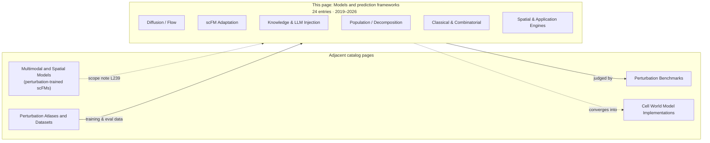
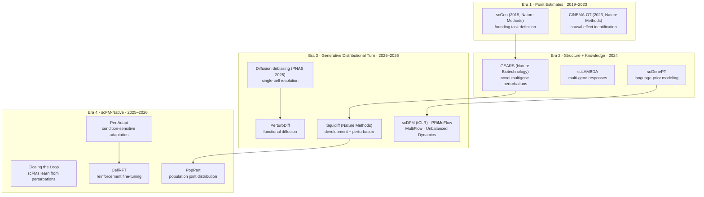

This page documents the **dedicated perturbation-prediction frameworks** curated in the repository's `Genetic Perturbation: Models, Atlases and Benchmarks` section — a collection of **24 entries spanning 2019–2026** that model how cells respond to genetic and chemical perturbations. It covers standalone prediction frameworks only: perturbation-*trained* foundation models, perturbation atlases, and perturbation benchmarks are deliberately routed to sibling pages, and this document makes those boundaries explicit so you can navigate the catalog without overlap.

Sources: [README.md](README.md#L237-L241), [README.md](README.md#L241-L265)

## Positioning Within the Catalog

The parent section splits perturbation research into three sub-collections, and this page owns the first one. The section intro states the boundary rule explicitly: perturbation-trained single-cell foundation models such as **X-Cell, SCALE, PerturbGen, STATE, GeneJepa, and Tahoe-x1** are cataloged under Multimodal scFMs, because their perturbation capability comes from pretraining rather than from a dedicated prediction framework. Everything listed under `### Models and prediction frameworks` is a framework whose primary contribution is response prediction itself.

| Collection | Content | Catalog destination |
|---|---|---|
| Models and prediction frameworks (L241–265) | 24 standalone perturbation-prediction frameworks | **This page** |
| Perturbation-trained scFMs (L151–158) | X-Cell, SCALE, PerturbGen, STATE, GeneJepa, Tahoe-x1 | [Multimodal and Spatial Models](7-multimodal-and-spatial-models) |
| Perturbation atlases and datasets (L267–273) | Tahoe-100M, X-Atlas/Orion, PerturBase, Perturb-seq | [Perturbation Atlases and Datasets](10-perturbation-atlases-and-datasets) |
| Perturbation benchmarks (L275–290) | PerturBench, PertEval-scFM, linear-baseline critiques | [Perturbation Benchmarks](11-perturbation-benchmarks) |

Two further boundary rules worth knowing as a developer: LLM-driven perturbation approaches (e.g., **LangPert** and LLM-informed gene embeddings for perturbation models) live under the LLM-based section, and perturbation-capable virtual-cell simulators (OCOO-T, AlphaCell, Chreode) live in the Virtual Cell frontier. If an entry's perturbation contribution is a *world-model simulation objective* rather than a prediction framework, it is cataloged there.

Sources: [README.md](README.md#L239), [README.md](README.md#L151-L158), [README.md](README.md#L223), [README.md](README.md#L232), [README.md](README.md#L267-L290), [README.md](README.md#L316-L330)

The repository's single figure — the evolutionary tree of single-cell foundation models — is useful orientation here: the perturbation frameworks documented on this page sit downstream of the pretrained-model lineages in that tree, consuming their representations rather than defining new pretraining paradigms.

Sources: [README.md](README.md#L23)

## The Inventory: 24 Frameworks Across Six Years

The list is curated **newest-first**, which makes the velocity of the field immediately legible: 11 entries are dated 2026, 8 from 2025, 3 from 2024, and single entries anchor 2023 (CINEMA-OT) and 2019 (scGen). Nearly half of the collection is less than a year old — perturbation prediction is currently the fastest-moving sub-area in the catalog.

| Year | Count | Entries |
|---|---|---|
| 2026 | 11 | CellRFT, PopPert, MultiFlow, Unbalanced Perturbation Dynamics, Response Decomposition, scDFM, PRiMeFlow, AetherCell, MAP, PerturbDiff, Squidiff |
| 2025 | 8 | Closing the Loop, Predicting the Unseen (PNAS), Unified Multimodal Learning, SpatialProp, PertAdapt, In Silico Biological Discovery, Scouter, Distributional Shifts |
| 2024 | 3 | scLAMBDA, scGenePT, GEARS |
| 2023 | 1 | CINEMA-OT |
| 2019 | 1 | scGen |

The venue profile also shifts across the timeline: the early entries are landmark journal methods papers (Nature Methods for scGen and CINEMA-OT, Nature Biotechnology for GEARS), while the 2026 cohort mixes top-tier ML venues (scDFM at ICLR) with high-impact journal publications (Squidiff in Nature Methods) and preprints — a sign that ML-conference and genomics-journal publication tracks have both absorbed the task.

Sources: [README.md](README.md#L241-L265)

The following lineage diagram synthesizes the collection's chronology and method families into a single architectural view. Each era inherits the data representations of the previous one while changing the *output contract*: from point estimates of mean response, to structure-aware combinatorial generalization, to full response distributions, to perturbation-native fine-tuning of pretrained foundation models.

Sources: [README.md](README.md#L241-L265)

## Methodological Families

Reading the 24 titles as a system, six methodological families emerge. Each family solves a different failure mode of the previous generation, which is the fastest way to decide which entry to study for a given engineering problem.

### Family 1: Distributional Generative Modeling

The dominant 2025–2026 family. Instead of regressing a single post-perturbation expression vector, these frameworks sample from — or transport between — response *distributions*. Two concrete mechanisms appear in the titles: **diffusion** (Squidiff, PerturbDiff, and the PNAS debiasing framework) and **flow matching** (scDFM, PRiMeFlow, MultiFlow, Unbalanced Perturbation Dynamics).

| Mechanism | Frameworks | Distinguishing signal in title |
|---|---|---|
| Diffusion | Squidiff, PerturbDiff, Predicting the Unseen | "diffusion model", "functional diffusion", "diffusion-based debiasing" |
| Flow matching | scDFM, PRiMeFlow, MultiFlow, Unbalanced Perturbation Dynamics | "distributional flow matching", "heterogeneity", "coupled flow matching", "unbalanced dynamics" |
| Dual-task | Squidiff | "predicting cellular development **and** responses to perturbations" |

Scouter (2025, Nature Computational Science) bridges this family and the knowledge-injection family below: it predicts transcriptional responses using large-language-model embeddings within a framework published alongside the generative turn.

> [!TIP]
> The shift to distributional outputs is not cosmetic — it directly explains the benchmark controversy documented in the sibling section, where entries argue that deep perturbation models "do not yet outperform simple linear baselines" under mean-based metrics, while rebuttal papers attribute the gap to poorly calibrated metrics and mode collapse. When evaluating any framework in this family, the metric contract (distributional vs. point-estimate) must match the model's output contract.

Sources: [README.md](README.md#L244-L248), [README.md](README.md#L251-L254), [README.md](README.md#L259), [README.md](README.md#L275-L290)

### Family 2: Foundation-Model Adaptation

The second strategic response to the pretrained-model era: rather than training perturbation predictors from scratch, these frameworks **reuse pretrained scFMs** and add perturbation-conditioned capabilities. The titles trace a clear escalation: PertAdapt introduces *condition-sensitive adaptation* to unlock existing scFMs for genetic perturbation prediction; Closing the Loop teaches scFMs "to learn from perturbations"; and CellRFT applies *reinforcement fine-tuning* — the most aggressive adaptation mechanism in the collection.

| Escalation stage | Framework | Adaptation mechanism (per title) |
|---|---|---|
| Conditioning | PertAdapt | "Condition-Sensitive Adaptation" |
| Curriculum | Closing the Loop | "Teaching single-cell foundation models to learn from perturbations" |
| Optimization | CellRFT | "Reinforcement Fine-Tuning" |

Sources: [README.md](README.md#L242), [README.md](README.md#L253), [README.md](README.md#L257)

### Family 3: Knowledge and Language Injection

A third integration strategy: keep the predictive model separate and inject external biological knowledge. Scouter uses large-language-model embeddings; scGenePT asks — in its title — "Is language all you need for modeling single-cell perturbations?"; MAP is a *knowledge-driven* framework explicitly targeting responses to **unprofiled drugs**, i.e., compounds with no measured transcriptomic response data.

> [!TIP]
> Families 2 and 3 represent the two competing architectures for the same problem: **internalize perturbations** into a pretrained backbone (adaptation) versus **externalize knowledge** into the input representation (injection). The 2026 cohort shows convergence — CellRFT's reinforcement fine-tuning operates on foundation-model representations that already absorb knowledge, suggesting the distinction is collapsing into a fine-tuning-vs-retrieval engineering choice rather than an architectural fork.

Sources: [README.md](README.md#L250), [README.md](README.md#L259), [README.md](README.md#L262)

### Family 4: Population-Level and Decomposition Approaches

Where the generative family models within-cell response distributions, this family models **between-cell and between-population structure**. PopPert performs population-level joint-distribution modeling; the response-decomposition framework achieves "biologically aligned generalization to unseen perturbations and cellular contexts" by decomposing responses; and the distributional-shifts entry targets unseen genetic perturbations through explicit shift modeling. All three treat generalization as a factorization problem: separate what the perturbation does from who the cell population is.

Sources: [README.md](README.md#L243), [README.md](README.md#L246), [README.md](README.md#L260)

### Family 5: The Classical Lineage

The founding entries define the task and its hardest sub-problems. **scGen** (2019, Nature Methods) established single-cell perturbation response prediction as a learning problem; **CINEMA-OT** (2023, Nature Methods) contributes causal identification of experimental perturbation effects — attribution rather than forecasting; **GEARS** (2024, Nature Biotechnology) attacks *novel multigene* perturbations, the combinatorial generalization problem; and scLAMBDA extends modeling to multi-gene perturbation responses. These remain the canonical baselines referenced implicitly by the benchmark section's baseline-comparison debates.

Sources: [README.md](README.md#L261-L265)

### Family 6: Context, Modality, and Application Expansion

The final family extends the prediction surface itself. **SpatialProp** moves perturbation modeling into tissue context using spatially resolved single-cell transcriptomics; the unified-multimodal-learning entry generalizes response prediction across *diverse perturbation modalities*; **AetherCell** packages prediction into a generative engine for virtual-cell perturbation and in-vivo drug discovery — the collection's most application-facing entry. A perspective entry, *In silico biological discovery with large perturbation models* (2025, Nature Computational Science), frames the family's trajectory from prediction toward discovery workflows.

Sources: [README.md](README.md#L249), [README.md](README.md#L255-L256), [README.md](README.md#L252), [README.md](README.md#L258)

## The Generalization Axis Map

The most decision-relevant way to compare these frameworks is the axis along which each one generalizes. Every title in the collection encodes at least one — this table makes the mapping explicit so you can shortlist by evaluation scenario rather than by chronology.

| Generalization axis | Frameworks encoding it | Line refs |
|---|---|---|
| Unseen perturbations | Response Decomposition, Distributional Shifts, GEARS (novel multigene), Scouter | L246, L260, L263, L259 |
| Unseen cellular contexts | MultiFlow, PopPert, Response Decomposition | L244, L243, L246 |
| Population heterogeneity | PopPert, PRiMeFlow ("expression heterogeneity") | L243, L248 |
| Multi-gene combinations | GEARS, scLAMBDA | L263, L261 |
| Spatial / tissue context | SpatialProp | L256 |
| Multiomic responses | MultiFlow, Unified Multimodal Learning | L244, L255 |
| Trajectory and cell fate | Squidiff (development), Unbalanced Perturbation Dynamics (cell fate design) | L252, L245 |
| Unprofiled drugs | MAP | L250 |
| Debiasing / metric robustness | Predicting the Unseen (PNAS) | L254 |

Sources: [README.md](README.md#L241-L265)

## Where to Go Next

The logical progression through the catalog mirrors the development lifecycle of a perturbation-prediction system. First, understand the **pretrained backbones** these frameworks adapt or consume: [Unimodal scRNA-seq Models](5-unimodal-scrna-seq-models) for the representation-learning foundations, and [Multimodal and Spatial Models](7-multimodal-and-spatial-models) for the perturbation-trained scFMs that this page explicitly excludes. Second, study the **data substrate**: [Perturbation Atlases and Datasets](10-perturbation-atlases-and-datasets) covers Tahoe-100M, X-Atlas/Orion, PerturBase, and the original Perturb-seq protocol that generates all training signal for this page's frameworks. Third, learn **how these frameworks are judged**: [Perturbation Benchmarks](11-perturbation-benchmarks) contains the metric-calibration debates and linear-baseline critiques that directly constrain which framework claims you should trust.

For the forward-looking extension of this topic — where perturbation prediction becomes simulation inside a cellular world model — continue to [Virtual Cell Perspectives and Roadmaps](12-virtual-cell-perspectives-and-roadmaps) and [Cell World Model Implementations](13-cell-world-model-implementations), where perturbation-capable simulators such as AlphaCell, Chreode, and OCCO-T are cataloged. Finally, the engineering tooling counterpart to this page — Pertpy, the end-to-end perturbation *analysis* framework — lives in [Analysis Frameworks and Data Formats](16-analysis-frameworks-and-data-formats), which complements this page's *modeling* focus with practical analysis infrastructure.
