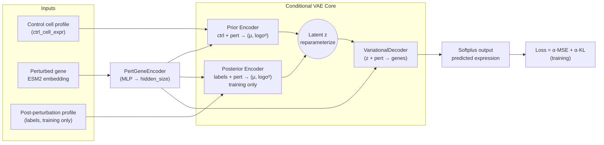
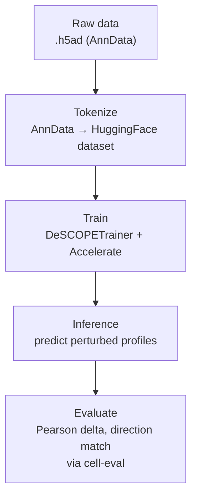

This page introduces **DeSCOPE** (*Decoding Single-Cell Omics of Perturbation Responses*) — a single-cell perturbation prediction framework for scRNA-seq, scATAC-seq, and general cell-level perturbation modeling. By the end of this page, you will understand what problem DeSCOPE solves, how its codebase is organized, and where to go next in your learning journey.

Sources: [README.md](README.md#L13-L24), [src/descope/__init__.py](src/descope/__init__.py#L39-L55)

## What Problem Does DeSCOPE Solve?

In perturbation biology experiments (e.g., Perturb-seq), scientists knock out or knock down a gene and measure how thousands of other genes respond. Because experiments are expensive, a natural question arises: *can we computationally predict the post-perturbation cell state instead of measuring it?*

DeSCOPE answers this with a **conditional Variational Autoencoder (cVAE)**. The key inputs are:

- The **control cell's expression profile** (what the cell looked like before perturbation)
- The **perturbed gene's embedding**, derived from the protein language model **ESM2**

The output is a predicted expression vector for the perturbed cell. The same framework applies to two modalities: gene expression (RNA) and chromatin accessibility (ATAC).

Sources: [README.md](README.md#L19-L24), [src/descope/models/modeling_descope.py](src/descope/models/modeling_descope.py#L117-L128)


## Architecture at a Glance

The model is intentionally compact: everything is a Multi-Layer Perceptron (MLP) block orchestrated in a VAE pattern. Three components matter:

1. **PertGeneEncoder** — projects the ESM2 gene embedding into the model's hidden space.
2. **VariationalEncoder** (two instances) — a *prior* encoder that sees only the control cell + perturbation, and a *posterior* encoder that additionally sees the true post-perturbation expression during training. Both output a mean and log-variance, from which a latent vector is sampled via the reparameterization trick.
3. **VariationalDecoder** — reconstructs the full expression vector from the latent sample plus the perturbation embedding, ending with a `softplus` activation so predictions stay non-negative.

During training, the loss combines reconstruction error (MSE) and a KL divergence between posterior and prior. During inference, only the **prior** path is used — the model has never seen the true perturbed expression, which is exactly the prediction we want.

Sources: [src/descope/models/modeling_descope.py](src/descope/models/modeling_descope.py#L15-L98), [src/descope/models/modeling_descope.py](src/descope/models/modeling_descope.py#L138-L169), [src/descope/models/modeling_descope.py](src/descope/models/modeling_descope.py#L264-L282)



> [!TIP]
> The RNA and ATAC model classes (`DeSCOPEForRNA`, `DeSCOPEForATAC`) share an identical VAE architecture — the codebase keeps them as separate classes specifically so each modality can be tuned independently. If you read one forward pass, you have read both (see the NOTE comments at [modeling_descope.py](src/descope/models/modeling_descope.py#L117-L118)).

Sources: [src/descope/models/modeling_descope.py](src/descope/models/modeling_descope.py#L199-L222), [src/descope/models/modeling_descope.py](src/descope/models/modeling_descope.py#L117-L136)

## Repository Layout

The codebase follows a thin, flat structure — one module per pipeline stage, plus a `models/` package:

```
DeSCOPE/
├── src/descope/              # Installable Python package
│   ├── arguments.py          # Data / Model / Training argument groups
│   ├── dataset.py            # HuggingFace dataset wrappers (RNA & ATAC)
│   ├── tokenizer.py          # AnnData → HuggingFace dataset conversion
│   ├── trainer.py            # DeSCOPETrainer (Accelerate-based)
│   ├── inference.py          # Prediction & evaluation orchestration
│   ├── logging.py            # Verbosity control
│   ├── utils.py              # Preprocessing helpers + metrics
│   └── models/
│       ├── configuration_descope.py   # DeSCOPEConfig
│       ├── modeling_descope.py        # cVAE components & model classes
│       ├── baselines.py               # Simple baseline models
│       └── utils.py                   # MLP builder, KL loss, output types
├── tutorials/                # Runnable end-to-end examples
│   ├── ATAC_Gene/            # scATAC perturbation pipeline
│   ├── RNA_Gene/             # scRNA genetic perturbation pipeline
│   └── RNA_Drug/             # Drug perturbation (Sciplex3, Tahoe-100M)
└── docs/                     # This documentation (Sphinx)
```

Sources: [pyproject.toml](pyproject.toml#L5-L6), [src/descope/__init__.py](src/descope/__init__.py#L1-L36)

## Key Components and Their Roles

| Module | Key Classes / Functions | Role |
|---|---|---|
| `models/modeling_descope.py` | `DeSCOPEForRNA`, `DeSCOPEForATAC` | The cVAE models; each exposes `forward()` (training) and `inference()` (prediction) |
| `models/configuration_descope.py` | `DeSCOPEConfig` | All hyperparameters (hidden size, layer counts, input length) |
| `tokenizer.py` | `TokenizerForRNA`, `TokenizerForATAC`, `tokenize_adata_to_hf_dataset_for_*` | Converts Scanpy `AnnData` objects into HuggingFace `datasets` |
| `dataset.py` | `HFDatasetForRNA`, `HFDatasetForATAC` | Dataset wrappers that fetch model-ready tensors |
| `trainer.py` | `DeSCOPETrainer` | Training loop with checkpointing, early stopping, Accelerate/DeepSpeed support |
| `inference.py` | `InferenceForRNA`, `InferenceForATAC` | Runs prediction and computes perturbation metrics |
| `utils.py` | `preprocess_rna_perturbation_adata`, `pearson_delta_on_topk_de`, `direction_match_on_topk_de` | Data preprocessing and evaluation metrics |

Sources: [src/descope/__init__.py](src/descope/__init__.py#L10-L22), [src/descope/__init__.py](src/descope/__init__.py#L24-L36), [src/descope/trainer.py](src/descope/trainer.py#L35-L59)

The API deliberately mirrors the **HuggingFace Transformers** conventions (`PreTrainedModel` + config classes), so if you have used transformers before, DeSCOPE will feel familiar: construct a `DeSCOPEConfig`, instantiate a model, wrap it in a trainer. The package is published on PyPI as **`descopex`**, requires Python ≥ 3.10, and depends on PyTorch, `cell-eval` (metrics), and `wppkg` (trainer infrastructure); DeepSpeed is optional for large-scale distributed training.

Sources: [src/descope/models/modeling_descope.py](src/descope/models/modeling_descope.py#L1-L12), [pyproject.toml](pyproject.toml#L8-L26), [README.md](README.md#L71-L92)

## The End-to-End Workflow

Every tutorial in the repository follows the same three-stage pipeline, regardless of modality:



1. **Tokenize** — notebooks like `tutorials/RNA_Gene/tokenize.ipynb` read `.h5ad` files and produce HuggingFace datasets aligned to a fixed gene vocabulary.
2. **Train** — scripts like `train.py` (driven by `train_descope.sh`) configure `DeSCOPETrainer` through the three argument groups.
3. **Evaluate** — the inference module predicts perturbed states and scores them against ground truth using top-k differentially-expressed gene metrics.

Sources: [src/descope/__init__.py](src/descope/__init__.py#L16-L22), [tutorials/RNA_Gene](tutorials/RNA_Gene/README.md), [src/descope/trainer.py](src/descope/trainer.py#L49-L59)

> [!TIP]
> Before training, input data must be preprocessed with the helpers in `utils.py` — e.g., `preprocess_rna_perturbation_adata` normalizes RNA perturbation data, and ATAC data must be preprocessed consistently with the EpiAgent convention (`preprocess_atac_perturbation_adata_consistent_with_epiagent`). Skipping this step is the most common source of shape-mismatch errors for newcomers.

Sources: [src/descope/__init__.py](src/descope/__init__.py#L28-L31)

## Supported Modalities and Entry Points

| | **RNA (gene expression)** | **ATAC (chromatin accessibility)** |
|---|---|---|
| Model | `DeSCOPEForRNA` | `DeSCOPEForATAC` |
| Config / Arguments | `DeSCOPEModelArguments`, `DeSCOPEDataArguments` | Same, modality flag decides |
| Tokenizer | `TokenizerForRNA` | `TokenizerForATAC` |
| Dataset | `HFDatasetForRNA` | `HFDatasetForATAC` |
| Inference | `InferenceForRNA` | `InferenceForATAC` |
| Tutorial | `tutorials/RNA_Gene`, `tutorials/RNA_Drug` | `tutorials/ATAC_Gene` |
| Example datasets | K562_GWPS, RPE1, Norman, HEPG2, JURCAT… | Human-scATAC-Corpus (cell-by-cCRE matrices) |

Sources: [src/descope/__init__.py](src/descope/__init__.py#L10-L22), [README.md](README.md#L94-L115)

## Installation in One Breath

The full procedure lives in the Quick Start guide, but the shape of it is: create a Python ≥ 3.10 conda environment, install PyTorch (≥ 2.6 recommended), optionally DeepSpeed, then `pip install descopex` (or install from source with `pip install -e .`). Verify with:

```python
import descope
descope.welcome()
```

Sources: [README.md](README.md#L27-L92)

## Where to Go Next

Recommended reading progression for beginners:

1. **[Quick Start](2-quick-start)** — set up your environment and run your first installation checks.
2. **[Datasets Zoo and Downloads](3-datasets-zoo-and-downloads)** — pick a training dataset (K562, RPE1, Norman, and more).
3. **[Tutorial Pipeline: Tokenize, Train, Evaluate](4-tutorial-pipeline-tokenize-train-evaluate)** — walk through the full three-stage workflow hands-on.
4. **[Conditional VAE Architecture Overview](6-conditional-vae-architecture-overview)** — once comfortable with the pipeline, go deeper into *why* the prior/posterior design works.

If your interest is drug response prediction rather than genetic perturbation, jump straight to **[Drug Perturbation Case Studies: Sciplex3, Tahoe-100M](5-drug-perturbation-case-studies-sciplex3-tahoe-100m)** after the tutorial pipeline.
