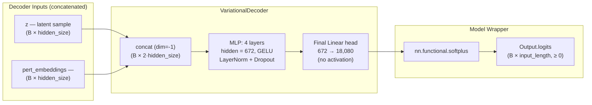
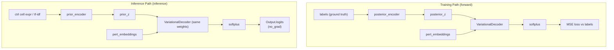

This page dissects the **generation side** of DeSCOPE's conditional VAE: the `VariationalDecoder` that maps latent variables back into gene space, and the **softplus activation** applied to its raw outputs. The design makes two deliberate choices worth understanding: the decoder MLP terminates in a *bare linear head* with no internal output activation, and the softplus transform lives *outside* the decoder, at the model-wrapper level, so that both the training path (posterior sampling) and the inference path (prior sampling) share an identical output constraint. Both `DeSCOPEForRNA` and `DeSCOPEForATAC` reuse the exact same decoder construction, differing only in what feeds it.

## The VariationalDecoder: Structural Anatomy

The `VariationalDecoder` is a thin wrapper around the shared `build_mlp` factory. Its dimensions encode the cVAE contract: it accepts the concatenation of a latent vector `z` and the perturbation embedding (hence `in_dim = config.hidden_size * 2`), and emits a vector spanning the *entire* feature space (`out_dim = config.input_length`, defaulting to 18,080 genes/cCREs). Depth, width, and regularization are all delegated to config: `variational_decoder_layers` (default 4), `hidden_size` (default 672), `hidden_act` (default `gelu`), `hidden_dropout` (default 0), and `add_layernorm` (default `True`).

Note that the `forward` method is a pure pass-through — no activation, no normalization, no clipping. This is intentional: the decoder's contract is "produce raw real-valued logits," and constraint enforcement is deferred to the caller. The class is instantiated once per model (`self.decoder = VariationalDecoder(config, in_dim=config.hidden_size * 2)`) inside both `DeSCOPEForATAC` and `DeSCOPEForRNA`, meaning the two modalities share identical decoder code paths by construction.

| Decoder Parameter | Config Source | Default | Role |
|---|---|---|---|
| `in_dim` | explicit arg | `hidden_size * 2` = 1,344 | Width of `[z ‖ pert_embedding]` concat |
| `out_dim` | `config.input_length` | 18,080 | Full gene/cCRE space reconstruction |
| Depth | `config.variational_decoder_layers` | 4 | Number of `Linear` blocks |
| Width | `config.hidden_size` | 672 | Hidden dimension throughout |
| Hidden activation | `ACT2FN[config.hidden_act]` | GELU | Nonlinearity *between* layers only |
| Regularization | `config.hidden_dropout` / `add_layernorm` | 0 / `True` | Applied to hidden states only |

Sources: [modeling_descope.py](/src/descope/models/modeling_descope.py#L76-L98), [configuration_descope.py](/src/descope/models/configuration_descope.py#L1-L28), [modeling_descope.py](/src/descope/models/modeling_descope.py#L128-L130)

## Inside build_mlp: Layer Composition Rules

The decoder's internal structure is entirely determined by the `build_mlp` utility, which follows a strict composition grammar. For `n_layers ≥ 2`, each hidden block is `[Linear → (LayerNorm) → Activation → Dropout]`, and — critically — the **final layer is a bare `nn.Linear(hidden_dim, out_dim)`** with no norm, activation, or dropout attached. This guarantees the decoder emits unconstrained real values: normalization statistics are never computed *on* the output, and gradient flow into the final weights is unattenuated by any nonlinearity.

The `n_layers == 1` branch contains a subtle edge case worth knowing before you shrink the decoder: it appends `Linear(in_dim, out_dim)` and then, if `add_layernorm=True` (the default), a `LayerNorm(out_dim)` **on the decoder output itself**. This changes the semantics of the output layer compared to deeper configurations — the final affine transform would be re-centered per-sample to zero mean/unit variance before softplus, which compresses outputs into softplus's near-linear low regime and erases learned output scale.

> [!TIP]
> If you set `variational_decoder_layers=1` while leaving `add_layernorm=True`, the LayerNorm silently moves *inside* your output contract — applied directly on decoder logits. Keep `add_layernorm` semantics in mind whenever you deviate from the default 4-layer depth.

| Position in MLP | LayerNorm | Activation | Dropout | Applies to Decoder? |
|---|---|---|---|---|
| Hidden layers 1…n−1 | ✅ if `add_layernorm` | ✅ GELU | ✅ `hidden_dropout` | Yes — all 3 hidden blocks (n=4) |
| Final layer (output) | ❌ | ❌ | ❌ | Yes — bare linear, real-valued output |
| Single-layer mode (`n_layers=1`) | ⚠️ if `add_layernorm` | ❌ | ❌ | ⚠️ Norm lands on the **output** |

Sources: [utils.py](/src/descope/models/utils.py#L103-L142), [configuration_descope.py](/src/descope/models/configuration_descope.py#L18-L20)

## Softplus Output Activation: Placement and Properties

Immediately after every decoder call, the model wrappers apply `preds = nn.functional.softplus(preds)`. Softplus computes `log(1 + eˣ)`, a smooth, monotonic bijection from ℝ to (0, ∞). Its placement is architecturally meaningful: it lives in `DeSCOPEForATAC.forward`/`inference` and `DeSCOPEForRNA.forward`/`inference` — *not* inside the `VariationalDecoder` — so the transform is guaranteed to run on both the posterior-sampled training reconstruction and the prior-sampled inference prediction with the same semantics.

The choice of softplus over its competitors is driven by three properties that matter for expression-value regression:

1. **Non-negativity** — both scRNA-seq expression values and scATAC tf-idf scores are non-negative quantities; the output head must respect the data's support.
2. **Bounded gradients** — the derivative of softplus is `σ(x) ∈ (0, 1)`, so gradients flowing back through an 18,080-wide output layer are individually bounded, unlike `exp` whose gradient grows without bound and destabilizes wide regression heads.
3. **Smoothness everywhere** — unlike ReLU, there is no dead zone: every output neuron receives gradient, and the transition to the `x ≈ x` linear regime for large `x` preserves scale fidelity for highly expressed genes.

| Candidate Output Activation | Range | Gradient Behavior | Fit for Expression Regression |
|---|---|---|---|
| **Softplus** (chosen) | (0, ∞) | `σ(x)`, bounded in (0,1) | Smooth, unbounded above, stable ✅ |
| ReLU | [0, ∞) | 0 or 1, kink at 0 | Dead neurons; non-differentiable ❌ |
| `exp` | (0, ∞) | `eˣ`, unbounded | Exploding outputs/gradients ❌ |
| Sigmoid × scale | (0, scale) | Bounded but saturating | Artificial ceiling on expression ❌ |
| Identity | ℝ | 1 | Violates non-negativity of data ❌ |

Sources: [modeling_descope.py](/src/descope/models/modeling_descope.py#L152-L153), [modeling_descope.py](/src/descope/models/modeling_descope.py#L188-L189), [modeling_descope.py](/src/descope/models/modeling_descope.py#L238-L239), [modeling_descope.py](/src/descope/models/modeling_descope.py#L274-L275)

## Dual-Path Decoding: One Head, Two Latent Sources

The same decoder instance and the same softplus transform serve two distinct dataflows, differing only in the provenance of `z`. During **training**, the posterior encoder produces `posterior_z` (the reparameterized sample given the ground-truth labels), which is concatenated with the perturbation embedding and decoded; the softplus-transformed output then enters the MSE loss against `labels`. During **inference**, the posterior is unavailable — there are no perturbed labels — so the prior encoder (conditioned on control cells) supplies `prior_z` instead. The decoder weights and output transform are therefore shared, and the train/inference gap is isolated to exactly one input tensor.

This symmetry has a practical consequence: because softplus is applied identically in both paths, evaluation metrics computed on inference outputs are directly comparable to training-time MSE — there is no train/serve skew in the output transform. The inference method is additionally decorated with `@torch.no_grad()`, so the entire decoder–softplus chain runs in inference mode with no autograd overhead.

Sources: [modeling_descope.py](/src/descope/models/modeling_descope.py#L146-L153), [modeling_descope.py](/src/descope/models/modeling_descope.py#L178-L189), [modeling_descope.py](/src/descope/models/modeling_descope.py#L232-L239), [modeling_descope.py](/src/descope/models/modeling_descope.py#L264-L275)

## Downstream Consumption: Loss, Precision, and the Output Container

The softplus-transformed predictions are consumed in two places. First, the **loss**: element-wise MSE is computed between `softplus(preds)` and `labels` via `nn.functional.mse_loss(..., reduction="none")`, then optionally reweighted by a per-feature `mse_weights` tensor before reduction. Second, the **output container**: predictions are returned in the `logits` field of `DeSCOPEForRNAOutput` / `DeSCOPEForATACOutput` (`ModelOutput` dataclasses) alongside the decomposed `loss`, `mse_loss`, and `kl_loss`. The `logits` name is conventional rather than literal — these are post-softplus, non-negative expression predictions, not unnormalized scores, and downstream evaluation code should treat them as final values.

One precision detail adjacent to the decoder output: the KL term is computed under `torch.amp.autocast(enabled=False)` with explicit `.float()` casts, while the MSE over softplus outputs runs under standard autocast precision. This split reflects the relative numerical sensitivities of the two loss branches — KL divergences involve exponentials of log-variances that degrade badly in fp16, whereas MSE on bounded-gradient softplus outputs is tolerant of reduced precision.

> [!TIP]
> The two model variants reweight weighted-MSE differently: `DeSCOPEForATAC` reduces with `(weights * elementwise).sum(dim=-1).mean()`, while `DeSCOPEForRNA` uses `(weights * elementwise).mean()`. If you port `mse_weights` between modalities, the ATAC weighting scales per-cell losses by the weight magnitude while RNA normalizes it away — verify your expected loss scale after any transfer.

| Output Field | Contents | Consumers |
|---|---|---|
| `logits` | `softplus(decoder([z ‖ pert_emb]))` — non-negative, shape `(B, input_length)` | Evaluation metrics, downstream analyses |
| `mse_loss` | Weighted/unweighted MSE on softplus outputs | Training logging, early stopping |
| `kl_loss` | Prior–posterior KL in fp32 (autocast disabled) | Training logging, ELBO composition |
| `loss` | `alpha_mse_loss · mse_loss + alpha_kl_loss · kl_loss` | Backpropagation |

Sources: [modeling_descope.py](/src/descope/models/modeling_descope.py#L155-L169), [modeling_descope.py](/src/descope/models/modeling_descope.py#L241-L255), [utils.py](/src/descope/models/utils.py#L12-L25)

## Design Rationale: Deterministic Regression over Probabilistic Heads

The codebase carries a `ZINBLoss` module (a zero-inflated negative-binomial likelihood with clamping for numerical stability and a sampling method) — but neither `DeSCOPEForRNA` nor `DeSCOPEForATAC` uses it. The main models commit to **deterministic MSE regression on softplus-bounded outputs**, a choice consistent with a tf-idf/expression-space reconstruction target rather than raw count modeling. The ZINB machinery remains available in `utils.py` as a fallback for workflows that genuinely require count-distribution likelihoods (e.g., raw UMI data without normalization), but the shipped training scripts optimize the MSE+KL objective exclusively.

| Design Dimension | MSE + Softplus (shipped) | ZINB Head (available, unused) |
|---|---|---|
| Output | Point prediction per feature | Distribution parameters (μ, θ, π) |
| Decoder head | Single `Linear → input_length` | Three heads or feature stacking |
| Loss stability | Trivially stable, bounded gradients | Requires clamping (`eps=1e-4`), `lgamma` precision care |
| Target data | Normalized expression / tf-idf | Raw integer counts with dropouts |
| Autocast compatibility | Tolerant of mixed precision | Currently force-cast to fp32 |

This completes the generation pathway: encoder outputs → variational sampling → **decoder MLP (bare linear head) → softplus → non-negative reconstruction**, with the KL branch safeguarded in fp32. For how the two variational sources of `z` are produced, continue to [Prior and Posterior Variational Encoders](9-prior-and-posterior-variational-encoders); for how the softplus output feeds the ELBO objective, see [ELBO Loss: MSE and KL Composition](16-elbo-loss-mse-and-kl-composition); for modality-specific differences upstream of the decoder, see [RNA and ATAC Model Variants](11-rna-and-atac-model-variants).
