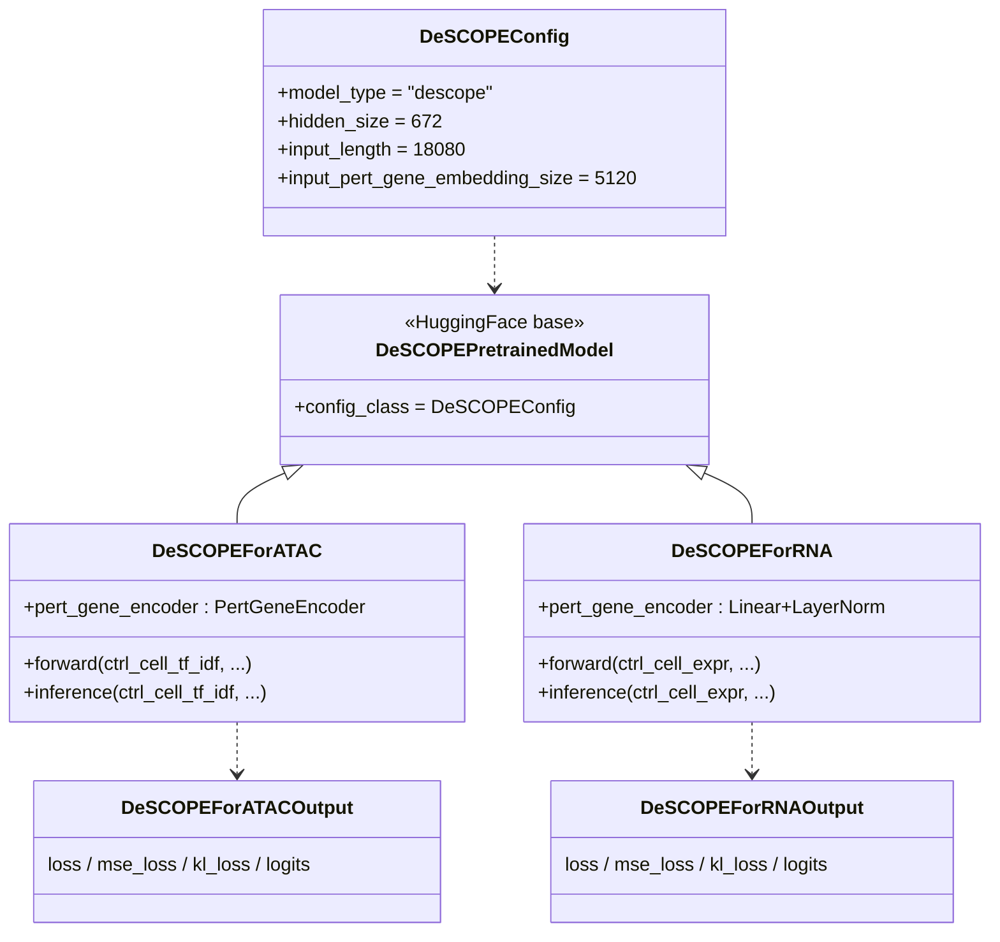
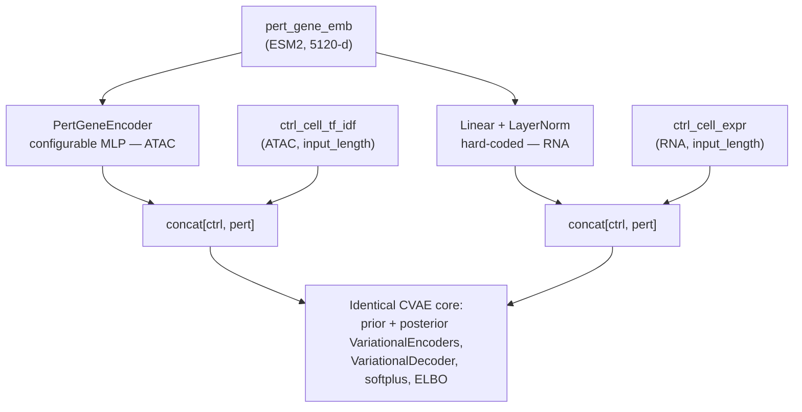

DeSCOPE ships **one conditional VAE (CVAE) design expressed as two concrete HuggingFace model classes**: `DeSCOPEForATAC` and `DeSCOPEForRNA`. At first glance they look like near-duplicates — and that is intentional. The codebase documents this choice explicitly: *"The RNA and ATAC models have identical architectures; we maintain them as two distinct models to support independent adjustment for each data modality."* This page explains why the split exists, where the variants genuinely diverge (a modality-specific input contract, a different perturbation-encoder implementation, and a subtle loss-aggregation asymmetry), and how each variant pairs with its tokenizer, dataset, and inference classes. For the mathematical core shared by both variants, start with [Conditional VAE Architecture Overview](6-conditional-vae-architecture-overview).

Sources: [modeling_descope.py](src/descope/models/modeling_descope.py#L117-L118), [modeling_descope.py](src/descope/models/modeling_descope.py#L199-L200)

## One Config, Two Model Classes

Both variants consume the same `DeSCOPEConfig` (`model_type = "descope"`), whose defaults reveal the shared design: `input_length=18080` carries the inline comment `# rna, atac`, meaning both modalities target the same feature-space width (18,080 genes for RNA, 18,080 top-ranked cCREs for ATAC), and `input_pert_gene_embedding_size=5120` matches ESM2 protein embeddings for the perturbed gene. Neither class overrides the config; every dimension flows from this single source of truth, which is why hyperparameters in the RNA and ATAC tutorial shell scripts are byte-for-byte identical.

Sources: [configuration_descope.py](src/descope/models/configuration_descope.py#L4-L28), [train_descope.sh](tutorials/ATAC_Gene/train_descope.sh#L10-L17), [train_descope.sh](tutorials/RNA_Gene/train_descope.sh#L10-L17)

The shared component classes — `PertGeneEncoder` (ESM2 5120-d → hidden 672 via `build_mlp`), `VariationalEncoder` (concatenated control vector + perturbation embedding → factorized Gaussian mean/logvar with the reparameterization trick), and `VariationalDecoder` (z + perturbation embedding → `input_length` logits passed through `softplus`) — are instantiated identically inside both variants' `__init__`. The output dataclasses `DeSCOPEForATACOutput` and `DeSCOPEForRNAOutput` are also field-identical (loss, mse_loss, kl_loss, logits); the type split exists purely so downstream trainer and evaluation code stays modality-explicit.

Sources: [modeling_descope.py](src/descope/models/modeling_descope.py#L15-L33), [modeling_descope.py](src/descope/models/modeling_descope.py#L36-L98), [utils.py](src/descope/models/utils.py#L12-L25), [utils.py](src/descope/models/utils.py#L103-L142)

## Where the Variants Actually Differ

Diffing the two classes line by line yields exactly three functional deltas: the perturbation encoder construction, the control-cell input tensor (name and semantics), and the weighted-MSE reduction. Everything else — forward-pass data flow, softplus output activation, KL computation under disabled autocast, and the prior-sampling `inference` path — is verbatim-parallel code.

| Dimension | `DeSCOPEForATAC` | `DeSCOPEForRNA` |
|---|---|---|
| Control input kwarg | `ctrl_cell_tf_idf` | `ctrl_cell_expr` |
| Input semantics | TF-IDF-normalized cCRE accessibility vector | library-normalized expression (`target_sum=1e4`) |
| `pert_gene_encoder` | `PertGeneEncoder` (`build_mlp`, honors `pert_gene_encoder_layers` / `add_layernorm` CLI args) | Hard-coded `nn.Sequential(Linear(5120→672), LayerNorm(672))` |
| Output dataclass | `DeSCOPEForATACOutput` | `DeSCOPEForRNAOutput` |
| Weighted MSE reduction (when `mse_weights` given) | `(w * e).sum(dim=-1).mean()` | `(w * e).mean()` |
| Dataset partner | `HFDatasetForATAC` (`MAIN_INPUT_NAME="ctrl_cell_tf_idf"`) | `HFDatasetForRNA` (`MAIN_INPUT_NAME="ctrl_cell_expr"`) |
| Inference partner | `InferenceForATAC` | `InferenceForRNA` |
| Default control label | `"control"` | `"non-targeting"` |

Sources: [modeling_descope.py](src/descope/models/modeling_descope.py#L120-L160), [modeling_descope.py](src/descope/models/modeling_descope.py#L202-L246), [dataset.py](src/descope/dataset.py#L324-L334), [inference.py](src/descope/inference.py#L381-L424)

The two `forward` methods read as mirrored pseudocode: embed the perturbation, condition the prior on (control, perturbation), condition the posterior on (ground-truth labels, perturbation), decode `(z, perturbation)`, apply `softplus`, then compose `alpha_mse_loss * mse + alpha_kl_loss * kl`. The KL term is computed identically in both classes inside `torch.amp.autocast(enabled=False)` on `.float()` tensors — a numerical-stability guard against bf16 mixed precision. The same mirroring holds for the `@torch.no_grad()` `inference` methods, where the posterior branch is dropped and samples are drawn from the prior directly.

Sources: [modeling_descope.py](src/descope/models/modeling_descope.py#L138-L176), [modeling_descope.py](src/descope/models/modeling_descope.py#L224-L262), [modeling_descope.py](src/descope/models/modeling_descope.py#L162-L169), [modeling_descope.py](src/descope/models/modeling_descope.py#L178-L196)

> [!TIP]
> When `mse_weights` is `None`, both variants reduce identically to a flat element-wise `.mean()` — but with weights enabled, ATAC sums across the gene axis before averaging over the batch, while RNA takes a global mean. The two reductions yield different loss magnitudes for identical inputs, so weighted-MSE checkpoints are **not** numerically comparable across variants without rescaling `alpha_mse_loss`.

## The PertGeneEncoder Divergence: Nominal, Not Architectural

The most visible code difference deserves scrutiny because it looks like an architecture change but behaves as one only under non-default hyperparameters. ATAC delegates to `PertGeneEncoder`, whose `build_mlp` call emits a single `Linear(5120, 672)` followed by `LayerNorm` when `n_layers=1` and `add_layernorm=True` — which is exactly what RNA hard-codes as a bare `nn.Sequential`. Under the tutorial defaults (`pert_gene_encoder_layers=1`, `add_layernorm=True`), the two encoders are functionally interchangeable; the practical difference is that ATAC's version responds to CLI overrides while RNA's is frozen at depth 1 regardless of config.

Sources: [modeling_descope.py](src/descope/models/modeling_descope.py#L15-L33), [modeling_descope.py](src/descope/models/modeling_descope.py#L209-L213), [utils.py](src/descope/models/utils.py#L119-L122), [train_descope.sh](tutorials/ATAC_Gene/train_descope.sh#L10-L17)

> [!TIP]
> If you raise `--pert_gene_encoder_layers` or disable `--add_layernorm` in the RNA tutorial, only the ATAC-style encoder would honor it — RNA's `nn.Sequential` ignores these flags by construction. Keep this in mind when writing ablation sweeps that must apply symmetrically to both modalities.

## The Modality Boundary: An Input-Naming Contract

The variant split is anchored by a naming contract enforced in the data layer. Each dataset subclass must define `MAIN_INPUT_NAME` — `HFDatasetForATAC` returns batches keyed by `ctrl_cell_tf_idf`, `HFDatasetForRNA` by `ctrl_cell_expr` — and the HF base dataset injects randomly sampled control cells from the same cell type under exactly that key (`batch[self.MAIN_INPUT_NAME] = ...`). Because the trainer passes batches straight into `model(**batch)`, the tensor names must match the model's `forward` keyword arguments; renaming one side without the other silently breaks training. The modality semantics behind these names are fixed upstream at tokenization: the ATAC entry point applies `preprocess_atac_perturbation_adata_consistent_with_epiagent` (top-`k` cCRE selection, TF-IDF scale) while the RNA entry point applies `preprocess_rna_perturbation_adata` (normalize-total to `target_sum=1e4`).

Sources: [dataset.py](src/descope/dataset.py#L175-L200), [dataset.py](src/descope/dataset.py#L295-L313), [dataset.py](src/descope/dataset.py#L324-L334), [tokenizer.py](src/descope/tokenizer.py#L146-L222), [tokenizer.py](src/descope/tokenizer.py#L225-L305)

## Training and Inference Pairing Matrix

Each modality follows the same four-stage pipeline — tokenize → dataset wrapper → model class → inference engine — with one class per stage per modality. The tutorial `train.py` scripts differ only in the imports and in the default `ctrl_name` (`control` for ATAC, `non-targeting` for RNA); both build `DeSCOPEConfig` dynamically from the first batch (`input_length = labels.shape[-1]`, `input_pert_gene_embedding_size = pert_gene_emb.shape[-1]`), so the same scripts adapt to any feature-space width without code edits. On the inference side, both `InferenceForATAC` and `InferenceForRNA` implement the same `load_model` / `preprocess_adata` hooks via `from_pretrained`; note that ATAC even derives its cCRE count from `model.config.input_length` at evaluation time, re-using the config as the single feature-space registry.

| Pipeline stage | ATAC variant | RNA variant |
|---|---|---|
| Tokenization | `tokenize_adata_to_hf_dataset_for_atac` | `tokenize_adata_to_hf_dataset_for_rna` |
| Training dataset | `HFDatasetForATAC` | `HFDatasetForRNA` |
| Model class | `DeSCOPEForATAC` | `DeSCOPEForRNA` |
| Inference engine | `InferenceForATAC` | `InferenceForRNA` |
| Tutorial directory | `tutorials/ATAC_Gene/` | `tutorials/RNA_Gene/` |

Sources: [train.py](tutorials/ATAC_Gene/train.py#L5-L9), [train.py](tutorials/RNA_Gene/train.py#L5-L9), [train.py](tutorials/ATAC_Gene/train.py#L52-L77), [train.py](tutorials/RNA_Gene/train.py#L52-L77), [inference.py](src/descope/inference.py#L381-L424), [train_descope.sh](tutorials/ATAC_Gene/train_descope.sh#L6-L7), [train_descope.sh](tutorials/RNA_Gene/train_descope.sh#L6-L7)

## Maintenance Implications of the Twin-Class Pattern

Because the forward/inference bodies are duplicated rather than factorized, any behavioral change — say, altering the softplus output or the KL formulation — must be applied to both classes simultaneously to keep the modalities in sync; this is precisely the risk the two inline `NOTE` comments flag for future maintainers. The duplication buys independent evolution: hyperparameters, preprocessing, and loss weighting can drift per modality without a shared class accreting `if modality == ...` branches. If you plan to add a third modality, this twin-class template — config reuse, `MAIN_INPUT_NAME` contract, mirrored output dataclass, and paired tokenizer/inference classes — is the pattern to replicate, as detailed in [Extending DeSCOPE to New Modalities](24-extending-descope-to-new-modalities).

Sources: [modeling_descope.py](src/descope/models/modeling_descope.py#L117-L118), [modeling_descope.py](src/descope/models/modeling_descope.py#L199-L200), [modeling_descope.py](src/descope/models/modeling_descope.py#L201-L283)

## Where to Go Next

The variant classes are thin modality shells around components documented in depth elsewhere: the Gaussian machinery lives in [Prior and Posterior Variational Encoders](9-prior-and-posterior-variational-encoders), the softplus output design in [Decoder and Softplus Output Design](10-decoder-and-softplus-output-design), and the ELBO composition (MSE + KL, including the `mse_weights` path) in [ELBO Loss: MSE and KL Composition](16-elbo-loss-mse-and-kl-composition). For the data half of the contract, see [Tokenization: AnnData to HuggingFace Datasets](12-tokenization-anndata-to-huggingface-datasets) and [Feature Alignment and Vocabulary Handling](14-feature-alignment-and-vocabulary-handling); for how these classes are exercised after training, continue to [Inference Pipeline Design](19-inference-pipeline-design). Configuration defaults are catalogued in [Model Configuration Reference](7-model-configuration-reference).
