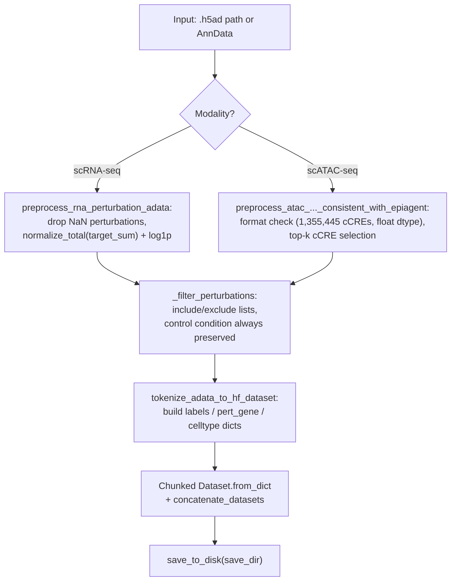
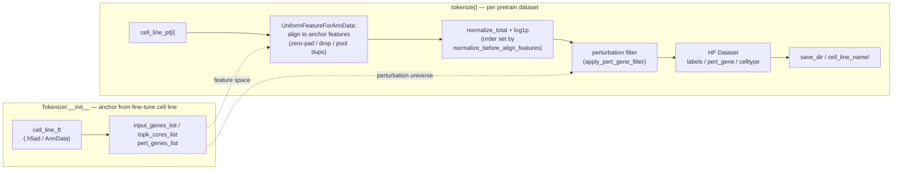

This page explains how DeSCOPE converts single-cell perturbation data from the AnnData ecosystem into HuggingFace `datasets.Dataset` objects ready for training. It covers the core conversion primitive, modality-specific preprocessing (scRNA-seq and scATAC-seq), the two `Tokenizer` classes used in multi-dataset pretraining workflows, and how the resulting datasets are consumed by the training loader. By the end, you will understand the exact on-disk schema produced by tokenization and how to prepare your own `.h5ad` files correctly.

## What "Tokenization" Means in DeSCOPE

If you arrive from Geneformer or scGPT, calibrate your expectations first: DeSCOPE's "tokenization" performs **no vocabulary encoding and no rank-based token sequences**. Here, tokenization means packaging an AnnData object into a HuggingFace `datasets.Dataset` whose rows correspond to cells and whose columns form a fixed, loader-friendly schema. Each output row carries three features: `"labels"` (the cell's full expression vector as a list of floats), `"pert_gene"` (the perturbation label, e.g., a gene name or `"non-targeting"` for controls), and `"celltype"` (the cell line or cell type name). Normalization stays in expression space — `labels` holds log-normalized values, not integer token IDs.

This schema is a **strict contract** downstream: `HFBaseDataset._check_hf_dataset_features` raises a `ValueError` if any of `["labels", "pert_gene", "celltype"]` is missing from the dataset it loads, so any custom tokenization must produce exactly these columns. The perturbation label also connects to the ESM2 embedding lookup (`load_gene_embs`), where multi-gene perturbations must be joined with `+` (e.g., `"GeneA+GeneB"`) to be decomposed and mean-pooled into an embedding.

| Feature | Content | Type | Role at training time |
|---|---|---|---|
| `labels` | Expression vector per cell (dense) | list of floats → torch | Prediction target (perturbed profile) |
| `pert_gene` | Perturbation identifier or control label | string | ESM2 embedding lookup + control masking |
| `celltype` | Cell line / cell type name | string | Within-celltype control pairing |

Sources: [tokenizer.py](/src/descope/tokenizer.py#L58-L143), [tokenizer.py](/src/descope/tokenizer.py#L95-L106), [dataset.py](/src/descope/dataset.py#L225-L235), [utils.py](/src/descope/utils.py#L438-L447)

## End-to-End Pipeline Architecture

The two public functional wrappers — `tokenize_adata_to_hf_dataset_for_rna` and `tokenize_adata_to_hf_dataset_for_atac` — compose the same five stages: load (accepting either a `.h5ad` path or an in-memory AnnData), modality-specific preprocessing, perturbation filtering, chunked HF Dataset construction, and `save_to_disk`. Both are exported from the package root alongside the class-based tokenizers, making them the intended entry points for single-dataset (fine-tuning) tokenization.

The wrappers differ in their preprocessing hooks and defaults: the RNA path defaults to `pert_col="gene"`, `ctrl_name="non-targeting"`, and `target_sum=1e4` normalization, while the ATAC path defaults to `pert_col="perturbation"`, `ctrl_name="control"`, and a `topk_ccres=50000` peak selection. Both default to `save_dir="./tokenized_dataset"` and return the in-memory dataset in addition to persisting it.

Sources: [tokenizer.py](/src/descope/tokenizer.py#L146-L222), [tokenizer.py](/src/descope/tokenizer.py#L225-L305), [__init__.py](/src/descope/__init__.py#L16-L20)

## Core Conversion: Chunked AnnData to Dataset

All pipelines funnel into `tokenize_adata_to_hf_dataset`, the single conversion primitive. It begins with parameter validation: `cell_line_name` and `cell_line_col` are mutually exclusive and one must be provided — either stamp every cell with one string, read per-cell labels from an `.obs` column, or pass a list matching `adata.n_obs`. The function then zips three parallel sequences into per-cell dictionaries: the expression row (calling `.toarray()` if `adata.X` is sparse), the whitespace-stripped perturbation labels, and the celltype assignments.

Memory management comes from the chunking loop: per-cell dicts are grouped into slices of `chunk_size` (default `20000`), each slice is merged column-wise by `_merge_list_of_dicts` (a `defaultdict(list)` transpose), converted with `Dataset.from_dict`, and the resulting chunk datasets are stitched together with `concatenate_datasets`. The chunk boundary is purely a construction-granularity control — the final object is one unified `datasets.Dataset` with Arrow-backed storage.

> [!TIP]
> Notice that the chunking only controls how HF `Dataset` objects are constructed; the per-cell dict list at [tokenizer.py L127-L134](/src/descope/tokenizer.py#L127-L134) is materialized in memory first. For very large AnnData, the dominant memory cost is the sparse→dense `.toarray()` conversion, not the chunk loop — plan RAM for a fully dense expression matrix.

Sources: [tokenizer.py](/src/descope/tokenizer.py#L108-L134), [tokenizer.py](/src/descope/tokenizer.py#L135-L143), [tokenizer.py](/src/descope/tokenizer.py#L50-L55)

## Perturbation Filtering Semantics

`_filter_perturbations` implements the include/exclude policy shared by every tokenization path (it is even imported by `dataset.py` for runtime filtering). The include and exclude lists are mutually exclusive — specifying both raises immediately — and specifying neither keeps all perturbations. Two safety behaviors matter in practice: the control condition is **always preserved** (it is force-appended to an include list and stripped from an exclude list), and perturbation labels are `.str.strip()`-ed before matching, so stray whitespace in `.obs` cannot silently drop cells. This is why the tutorial notebooks can pass `perts_to_exclude=load_gene_names_engine(...)` to hold out test perturbations without risking loss of the `non-targeting` baseline.

Sources: [tokenizer.py](/src/descope/tokenizer.py#L19-L47), [dataset.py](/src/descope/dataset.py#L12)

## Modality-Specific Preprocessing

Preprocessing diverges sharply by modality because RNA and ATAC demand different mathematical invariants. For **scRNA-seq**, `preprocess_rna_perturbation_adata` first drops cells with missing perturbation labels, then applies library-size normalization (`sc.pp.normalize_total` with `target_sum`) followed by `log1p`. A subtlety lives in `skip_raw_counts_check`: with the default `False`, a heuristic (`guess_is_lognorm` from `wppkg`) inspects the data and *skips* normalization if it already appears log-normalized; setting `True` bypasses the check and unconditionally normalizes — safe only when you are certain the input holds raw integer counts, hence the notebook's warning.

For **scATAC-seq**, `preprocess_atac_perturbation_adata_consistent_with_epiagent` enforces compatibility with the EpiAgent feature space: a hard assertion that the matrix has exactly **1,355,445 cCRE columns** with continuous (float) values, i.e., global TF-IDF must already have been applied upstream. It then retains the top-`topk_ccres` peaks by total column-sum signal using a *stable* descending sort (`np.argsort(..., kind="stable")[::-1]`) — the stability guarantee makes top-k selection deterministic under ties — and finally removes cells with NaN perturbations.

| Aspect | scRNA-seq (`preprocess_rna_perturbation_adata`) | scATAC-seq (`preprocess_atac_..._consistent_with_epiagent`) |
|---|---|---|
| Input assumption | Raw counts (or already log-normalized) | EpiAgent-format: 1,355,445 cCREs, TF-IDF floats |
| Value transform | `normalize_total(target_sum)` + `log1p` | None (TF-IDF applied upstream) |
| Feature selection | None (alignment handled by `UniformFeatureForAnnData`) | Top-k by column-sum, stable sort |
| Cell filtering | Drop NaN perturbation labels | Drop NaN perturbation labels |
| Guardrail | `guess_is_lognorm` heuristic / `skip_raw_counts_check` | Hard shape + dtype `ValueError` |

Sources: [utils.py](/src/descope/utils.py#L571-L637), [utils.py](/src/descope/utils.py#L467-L489), [utils.py](/src/descope/utils.py#L491-L520), [utils.py](/src/descope/utils.py#L523-L568)

## The Tokenizer Classes: Fine-Tune-Anchored Alignment

`TokenizerForRNA` and `TokenizerForATAC` serve the multi-dataset pretraining workflow (e.g., leave-one-out cell-type transfer). Their design rests on an **anchor principle**: the constructor takes one *fine-tune* cell line whose feature space and perturbation universe become the reference for every *pretrain* dataset tokenized afterward. `TokenizerForATAC.__init__` extracts `topk_ccres_list` (the processed `.var_names`) and `pert_genes_list` from the fine-tune AnnData; `TokenizerForRNA.__init__` analogously extracts `input_genes_list` and `pert_genes_list` (after dropping null-perturbation cells, and optionally re-keying `.var_names` from a `gene_names_col` for symbol harmonization).

Each `tokenize()` call then iterates over lists of pretrain datasets (with a `tqdm` progress bar and a length-consistency assertion), and per dataset: reads the h5ad, aligns its features to the anchor's gene/cCRE list via `UniformFeatureForAnnData`, filters cells, converts with the core primitive, and persists to a **per-dataset subdirectory** `save_dir/cell_line_name` — producing one HF Dataset folder per pretraining cell line, which is exactly the layout the training script expects.

Alignment deserves close attention. `UniformFeatureForAnnData` reindexes the matrix to the target feature names: features absent from the input are **zero-padded**, extra features are dropped, and duplicate feature names are resolved through the `DuplicatedFeatureHandling` strategy (sparse input is densified, and integer matrices are promoted to `float32` if mean pooling is selected, preventing silent truncation).

| Strategy | Behavior | Typical use |
|---|---|---|
| `max_pooling` (default) | Keep the duplicate with highest average expression | Duplicated gene symbols with one dominant assay probe |
| `mean_pooling` | Replace duplicates with their mean expression across cells | Collapse probes into consensus signal |

Ordering matters in `TokenizerForRNA._tokenize`, governed by `normalize_before_align_features`. When `True`, normalization runs *before* alignment (aligning log-normalized values); when `False` (default), alignment runs on raw counts first and normalization *after* — which is mathematically preferable because `normalize_total` should distribute library size across the final feature set, not a superseteing one. Critically, the perturbation column is **cached before** any transformation (`pert_genes` read from the file or AnnData up front) and re-assigned to `obs[pert_col]` after alignment, since `.var`-level reindexing could otherwise orphan row metadata. After alignment, cells are filtered against `pert_genes_list` when `apply_pert_gene_filter=True`; when `False`, all non-null perturbations are kept (the tutorial uses `False` for pretraining to maximize perturbation diversity).

> [!TIP]
> The ATAC tokenizer takes a stricter route than RNA: instead of zero-padding via `UniformFeatureForAnnData`, it subsets columns directly (`cell_line_pt[:, self.topk_ccres_list]` at [tokenizer.py L381](/src/descope/tokenizer.py#L381)) and runs `check_adata_format_consistent_with_epiagent` first. This implicitly requires pretrain ATAC data to share the EpiAgent cCRE universe with the fine-tune anchor — missing cCREs raise errors rather than zero-fill.

Sources: [tokenizer.py](/src/descope/tokenizer.py#L331-L360), [tokenizer.py](/src/descope/tokenizer.py#L467-L501), [tokenizer.py](/src/descope/tokenizer.py#L503-L568), [tokenizer.py](/src/descope/tokenizer.py#L570-L631), [utils.py](/src/descope/utils.py#L30-L116), [utils.py](/src/descope/utils.py#L25-L27)

## Consuming Tokenized Datasets at Training Time

`HFBaseDataset` is the bridge between tokenized disk artifacts and the training loop, and its behavior explains *why* tokenization bakes in no control pairing. On construction it validates the three-feature schema, scans `pert_gene` and `celltype` columns to build per-celltype index dictionaries of control and perturbed cells (raising `ValueError` if any celltype lacks control cells), loads ESM2 embeddings for every unique `pert_gene`, and switches the `labels` column to torch format.

At batch time (`__getitems__`), each perturbed cell is paired with a **randomly sampled control cell from the same celltype** — control-to-control rows map to themselves unless `RANDOM_MAPPING_CONTROL_TO_CONTROL` is enabled. The assembled batch contains: the control expression vector under the modality-specific `MAIN_INPUT_NAME` (`"ctrl_cell_expr"` for RNA, `"ctrl_cell_tf_idf"` for ATAC), the stacked `pert_gene_emb`, `labels` (perturbed expression), plus the raw `pert_gene`/`celltype` strings; an optional `mse_weights` tensor joins if a weights pickle is provided. Note that `valid_indices` excludes control rows by default (`INVOLVE_CONTROL_TO_CONTROL = False`), so `len(dataset)` counts perturbed cells only. This pairing-at-batch-time design keeps tokenized files compact (no duplicated control vectors) while preserving stochastic control diversity across epochs.

The older `BaseDataset`/`DatasetForATAC`/`DatasetForRNA` family is explicitly marked `# Slow | Deprecated`: it keeps a full AnnData in RAM and assembles items lazily, whereas the HF path leans on Arrow-backed storage and batched indexing.

| Concern | Legacy `BaseDataset` family | `HFBaseDataset` family |
|---|---|---|
| Storage | Whole AnnData in memory | Arrow-backed `datasets.Dataset` from disk |
| Control pairing | Per-item `__getitem__` | Batched `__getitems__` |
| Preprocessing | Re-run at construction | Frozen at tokenization time |
| Status | `Slow \| Deprecated` | Current |

Sources: [dataset.py](/src/descope/dataset.py#L175-L224), [dataset.py](/src/descope/dataset.py#L237-L266), [dataset.py](/src/descope/dataset.py#L268-L313), [dataset.py](/src/descope/dataset.py#L322-L334), [dataset.py](/src/descope/dataset.py#L22-L23)

## Practical Guidance from the Tutorials

The RNA tutorial notebook demonstrates both production workflows. **Workflow 1 (fine-tuning)** tokenizes each cell line independently with `tokenize_adata_to_hf_dataset_for_rna`, passing `perts_to_exclude=load_gene_names_engine("Test_Info_{c}.csv")` so the held-out test perturbations never enter the training set — the loader utility handles both single-column gene lists and CSVs with a `target_gene` header. **Workflow 2 (leave-one-out pretraining)** instantiates `TokenizerForRNA` on the held-out cell line as the anchor, then tokenizes the remaining cell lines into `save_dir=.../loo_{cellline_ft}`, with `apply_pert_gene_filter=False` and `duplicated_features_handling=DuplicatedFeatureHandling.max_pooling`.

Four gotchas are flagged directly in the notebook's tips:

| Pitfall | Rule | Consequence if ignored |
|---|---|---|
| Control naming | Control labels in `.obs[pert_col]` must be **identical across all h5ad files** in a pretraining run | Per-celltype control lookup fails or silently splits control pools |
| `skip_raw_counts_check` | Set `True` only when certain data are raw counts | Double normalization (or skipped normalization) corrupts `labels` |
| Multi-gene knockouts | Concatenate symbols with `+` (e.g., `"GeneA+GeneB"`) | ESM2 embedding lookup treats the string as one unknown gene |
| Gene symbol sources | Use `gene_names_col` when `.var_names` are not symbols | Alignment zero-pads almost everything against the anchor |

Sources: [tokenize.ipynb](/tutorials/RNA_Gene/tokenize.ipynb#L7-L21), [tokenize.ipynb](/tutorials/RNA_Gene/tokenize.ipynb#L48-L62), [tokenize.ipynb](/tutorials/RNA_Gene/tokenize.ipynb#L79-L103), [utils.py](/src/descope/utils.py#L330-L375)

## Where to Go Next

Tokenization is stage one of the DeSCOPE data pipeline; the natural continuation is [Perturbation Filtering and Preprocessing](13-perturbation-filtering-and-preprocessing), which dissects the filtering and normalization utilities introduced above, followed by [Feature Alignment and Vocabulary Handling](14-feature-alignment-and-vocabulary-handling) for a deep dive into `UniformFeatureForAnndata` and the ESM2 embedding registry. To see these artifacts in action, [Tutorial Pipeline: Tokenize, Train, Evaluate](4-tutorial-pipeline-tokenize-train-evaluate) walks the full workflow, and [Trainer and Accelerate Integration](15-trainer-and-accelerate-introduction) explains how `HFDatasetForRNA`/`HFDatasetForATAC` objects are wired into the training loop. For acquiring the input `.h5ad` files themselves, start from [Datasets Zoo and Downloads](3-datasets-zoo-and-downloads).