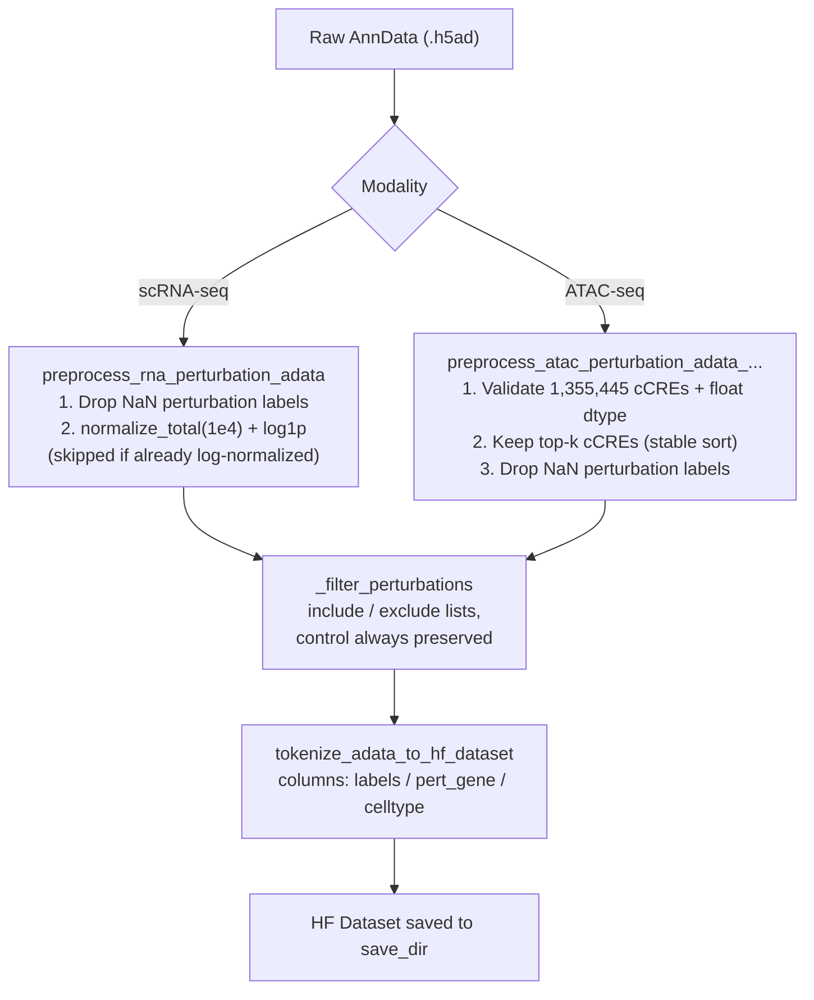
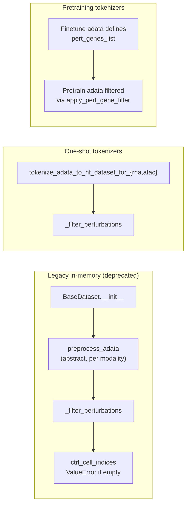
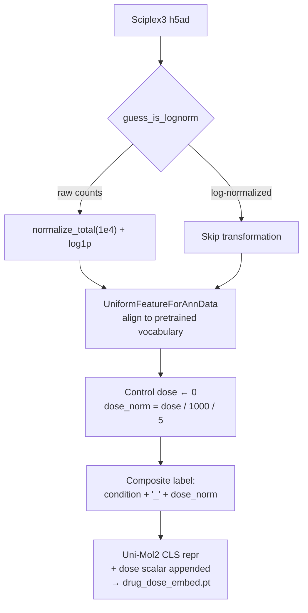

DeSCOPE treats perturbation filtering and value preprocessing as a distinct stage that runs **after** raw AnnData ingestion and **before** HuggingFace tokenization. This page explains how perturbation labels are selected, how control cells are protected from accidental removal, how expression values are normalized per modality, and how drug–dose perturbations are assembled into the composite identities the model consumes. Throughout, two modality pipelines exist in parallel — an scRNA-seq path and an ATAC-seq path — with modality-specific defaults for label columns and control names.

## Where Filtering Lives in the Pipeline

The end-to-end flow is uniform across modalities: validate and normalize expression values first, then apply the perturbation filter, then tokenize. This ordering is deliberate — normalization and feature selection can remove cells (e.g., NaN-labeled perturbations), so filtering against a *final* label set prevents you from tracking perturbations that no longer have any cells. Both the one-shot tokenizers (`tokenize_adata_to_hf_dataset_for_rna` / `..._for_atac`) and the deprecated in-memory `BaseDataset` classes follow this same preprocess → filter → tokenize sequence.

Sources: [tokenizer.py](/src/descope/tokenizer.py#L192-L222), [tokenizer.py](/src/descope/tokenizer.py#L274-L305), [dataset.py](/src/descope/dataset.py#L52-L71)

## The `_filter_perturbations` Contract

All explicit perturbation selection funnels through a single private function, `_filter_perturbations`, which enforces three rules. First, `perts_to_include` and `perts_to_exclude` are **mutually exclusive** — passing both raises a `ValueError`, and passing neither keeps every perturbation. Second, the control condition is **always preserved**: when including, `ctrl_name` is appended to the include list if missing; when excluding, `ctrl_name` is removed from the exclusion list. Third, labels are normalized via `.str.strip()` before membership testing, so trailing whitespace in `.obs` cannot silently fragment a perturbation group.

| `perts_to_include` | `perts_to_exclude` | Behavior |
|---|---|---|
| set | set | `ValueError` — cannot specify both |
| `None` | `None` | All perturbations retained (logged) |
| set | `None` | Keep listed perturbations; `ctrl_name` auto-appended |
| `None` | set | Drop listed perturbations; `ctrl_name` auto-removed from exclusion |

> [!TIP]
> The whitespace stripping happens twice by design — once in `_filter_perturbations` and again inside `tokenize_adata_to_hf_dataset` when labels are written to the HF Dataset. This redundancy means a label like `"GeneA "` never survives to training as a distinct perturbation, which would otherwise split one group into two and corrupt downstream leave-one-out evaluation.

Sources: [tokenizer.py](/src/descope/tokenizer.py#L19-L47), [tokenizer.py](/src/descope/tokenizer.py#L127-L134)

## Modality-Specific Preprocessing: RNA vs ATAC

The RNA path (`preprocess_rna_perturbation_adata`) performs two steps. It first prunes cells whose perturbation column is null, logging how many cells were removed. It then applies library-size normalization (`sc.pp.normalize_total` with `target_sum=1e4` by default) followed by `log1p` — **unless** the `guess_is_lognorm` heuristic detects the data is already log-normalized, in which case transformation is skipped. Setting `skip_raw_counts_check=True` bypasses the heuristic and forces normalization unconditionally, intended only when you know the input holds raw integer counts.

The ATAC path (`preprocess_atac_perturbation_adata_consistent_with_epiagent`) assumes the input is already value-transformed and instead validates structure: the feature axis must contain exactly 1,355,445 cCREs with continuous (float) values, as required by the EpiAgent reference implementation. It then reduces dimensionality via `select_topk_ccres`, which keeps the top-k cCREs ranked by total signal across cells using a **stable sort** so identical inputs always yield identical peak selections (default `topk_ccres=50000`). Finally, cells with NaN perturbation labels are dropped, mirroring the RNA NaN-pruning step.

| Aspect | scRNA-seq | ATAC-seq |
|---|---|---|
| Default `pert_col` | `gene` (tokenizers) / `target_gene` (legacy) | `perturbation` |
| Default `ctrl_name` | `non-targeting` | `control` |
| Value normalization | `normalize_total(1e4)` + `log1p`, guarded by `guess_is_lognorm` | None — input must already be TF-IDF float |
| Feature reduction | None here (deferred to vocabulary alignment) | Top-k cCREs by column-sum, stable sort (default 50,000) |
| Structural check | Log-normalization heuristic | Exact 1,355,445 cCREs + float dtype |
| NaN label pruning | Yes, with before/after counts | Yes |

> [!TIP]
> The two normalization flags have asymmetric semantics: `guess_is_lognorm` returning `True` **skips** normalization even when `skip_raw_counts_check=False`, while `skip_raw_counts_check=True` **always** normalizes. When preparing zero-shot evaluation data, the pretraining value of `target_sum` must be reproduced exactly — Tahoe-100M models were trained with `normalize_total=1e4`, and the Sciplex3 tutorial explicitly warns against deviating from it.

Sources: [utils.py](/src/descope/utils.py#L571-L637), [utils.py](/src/descope/utils.py#L467-L488), [utils.py](/src/descope/utils.py#L491-L520), [utils.py](/src/descope/utils.py#L523-L568), [1_prepare.ipynb](/tutorials/RNA_Drug/sciplex3_evaluation/zero-shot/1_prepare.ipynb#L62-L77)

## Filtering Across the Three Execution Contexts

Perturbation filtering executes in three distinct contexts, each layering additional constraints on top of the shared `_filter_perturbations` contract. The module-level interaction looks like this:

**Context 1 — legacy in-memory datasets.** `BaseDataset.__init__` reads (or accepts) an AnnData, densifies sparse `X`, runs the modality-specific `preprocess_adata`, then applies `_filter_perturbations`. After filtering it computes `ctrl_cell_indices` and raises `ValueError("No control cells found!")` if the control group was eliminated — a downstream guard that catches over-aggressive include/exclude lists. Each `__getitem__` then samples a random control cell as the basal input and pairs it with the perturbed cell as the label, unless the cell itself is a control (in which case basal = label). The concrete subclasses wire in the modality defaults: `DatasetForRNA` uses `pert_col="target_gene"`, `ctrl_name="non-targeting"`, and `target_sum=1e4`; `DatasetForATAC` uses `pert_col="perturbation"`, `ctrl_name="control"`, and `topk_ccres=50000`.

**Context 2 — one-shot tokenizers.** `tokenize_adata_to_hf_dataset_for_rna` and `..._for_atac` are self-contained functions that accept a path or AnnData, copy it defensively, run the modality preprocessing, apply `_filter_perturbations`, tokenize into a chunked HF Dataset (default `chunk_size=20000` to bound memory), and persist to `save_dir`. Both docstrings guarantee that the control condition survives any include/exclude filter.

**Context 3 — pretraining alignment.** `TokenizerForRNA` and `TokenizerForATAC` invert the responsibility: the *finetune* dataset defines the canonical perturbation vocabulary (`pert_genes_list`, extracted from its `.obs` after dropping nulls), and every pretraining dataset is filtered to match. The `apply_pert_gene_filter` flag controls strictness — when `False`, all pretraining perturbations are kept (ATAC still drops NaN labels), enabling the model to see a broader perturbation space during pretraining than at finetune time.

| `apply_pert_gene_filter` | ATAC pretraining behavior | RNA pretraining behavior |
|---|---|---|
| `True` (default) | Keep only perturbations in finetune's `pert_genes_list` | Same — strict intersection |
| `False` | Keep all perturbations, drop NaN-labeled cells | Keep all perturbations, no extra filter |

The RNA tokenizer also exposes `normalize_before_align_features`, which toggles whether normalization happens **before** vocabulary alignment (normalize → align) or **after** (align → normalize) — relevant when duplicated gene names must be pooled before counts are transformed.

Sources: [dataset.py](/src/descope/dataset.py#L37-L99), [dataset.py](/src/descope/dataset.py#L104-L171), [tokenizer.py](/src/descope/tokenizer.py#L146-L305), [tokenizer.py](/src/descope/tokenizer.py#L349-L360), [tokenizer.py](/src/descope/tokenizer.py#L380-L386), [tokenizer.py](/src/descope/tokenizer.py#L494-L501), [tokenizer.py](/src/descope/tokenizer.py#L559-L568)

## Cross-Dataset Perturbation Intersection

For cell-type transfer experiments, `intersect_adatas_for_celltype_transfer` implements a set-theoretic filter across two AnnData objects. It computes the intersection of source and target perturbation sets — optionally further constrained by the keys of a gene-embeddings `.pt` file, so only perturbations that actually have embeddings are kept — and asserts the control condition survives the intersection. Each side is then feature-aligned via `UniformFeatureForAnnData`, cell-filtered with `.isin(perts_to_keep)`, and cross-checked so both outputs share identical `var_names` ordering. The function writes `source.h5ad`, `target.h5ad`, and a `target_info.csv` listing each retained perturbation with its cell count — a manifest that later feeds evaluation and leave-one-out splits. Complementing this, `load_gene_names_engine` reads perturbation gene lists from single-column files or `target_gene`-keyed CSVs (deduplicating on load), providing the file-based counterpart for supplying explicit perturbation lists.

Sources: [utils.py](/src/descope/utils.py#L206-L283), [utils.py](/src/descope/utils.py#L285-L327), [utils.py](/src/descope/utils.py#L330-L375)

## Perturbation Identity Preprocessing: Embeddings and Zero-Vector Fallback

Filtering determines *which* perturbations remain; a parallel step determines *what each perturbation means numerically*. `load_gene_embs` loads a `{gene_name: tensor}` dictionary and guarantees coverage for every perturbation present in the filtered AnnData (the legacy `BaseDataset` passes `adata.obs[pert_col].unique()` as `perts_to_emb`). Missing perturbations are never dropped here — they degrade gracefully:

| Perturbation form | Embedding resolution |
|---|---|
| Known single gene | Looked up directly from the `.pt` file |
| Unknown single gene | Zero vector, logged with count |
| Multi-gene (`GeneA+GeneB`) | Mean pooling over constituents, missing genes contribute zeros |
| Alias (`TAFAZZIN`/`TAZ`) | Alias injected so both spellings resolve |

This fallback design pairs with the filtering system: if you want *hard* coverage enforcement (no zero-vector perturbations at all), you intersect against the embeddings file via `intersect_adatas_for_celltype_transfer`; if you accept soft coverage, filtering alone suffices and the zero vectors absorb the gap.

Sources: [utils.py](/src/descope/utils.py#L378-L464), [dataset.py](/src/descope/dataset.py#L68-L71)

## Case Study: Drug–Dose Perturbations in Sciplex3

Drug perturbation studies add a second axis — dose — that gene knockouts lack. The Sciplex3 zero-shot preparation notebook demonstrates the full drug preprocessing protocol. After confirming normalization state with `guess_is_lognorm` and aligning genes to the pretrained Tahoe-100M vocabulary (pad missing genes with zeros; overlap with the vocabulary becomes the "reliably predicted genes" set), dose values are calibrated: control cells get dose 0, and all doses are rescaled by `/1000/5` to convert nM to a μM-scale unit consistent with pretraining. Each cell then receives a composite label `drug_dose` (e.g., `dexamethasone_10.0`), which becomes the perturbation identifier the rest of the pipeline consumes.

The embedding step encodes the dose axis structurally: drugs receive a Uni-Mol2 CLS-token representation, and the normalized dose is **concatenated as an extra scalar** onto the embedding vector. The construction enforces dose-label discipline — non-control drugs never get a zero-dose entry and control never gets a non-zero one. Finally, ground-truth evaluation AnnData are assembled per cell type by concatenating non-control cells from the `ood` split with control cells drawn from the `test` split, and a `test_info` CSV template is generated listing each `drug_and_dose` target with cell counts (mirroring the biolord convention). This composite-label pattern is why the earlier whitespace stripping and control-preservation guarantees matter: every downstream consumer treats `drug_dose` strings exactly like gene perturbation labels.

Sources: [1_prepare.ipynb](/tutorials/RNA_Drug/sciplex3_evaluation/zero-shot/1_prepare.ipynb#L62-L127), [1_prepare.ipynb](/tutorials/RNA_Drug/sciplex3_evaluation/zero-shot/1_prepare.ipynb#L134-L157), [1_prepare.ipynb](/tutorials/RNA_Drug/sciplex3_evaluation/zero-shot/1_prepare.ipynb#L184-L198), [1_prepare.ipynb](/tutorials/RNA_Drug/sciplex3_evaluation/zero-shot/1_prepare.ipynb#L206-L244)

## Parameter Quick Reference

| Parameter | Default | Defined in | Effect |
|---|---|---|---|
| `pert_col` | `gene` (RNA tokenizers), `perturbation` (ATAC), `target_gene` (legacy RNA) | tokenizer / dataset constructors | `.obs` column holding perturbation labels |
| `ctrl_name` | `non-targeting` (RNA), `control` (ATAC) | `_filter_perturbations`, datasets | Control label, always preserved by filters |
| `perts_to_include` / `perts_to_exclude` | `None` | `_filter_perturbations` | Mutually exclusive selection lists |
| `target_sum` | `1e4` | RNA preprocessing | Library-size normalization target; must match pretraining |
| `skip_raw_counts_check` | `False` | RNA preprocessing | `True` forces normalization, bypassing the log-norm heuristic |
| `topk_ccres` | `50000` | ATAC preprocessing | Number of highest-signal cCREs retained (stable sort) |
| `apply_pert_gene_filter` | `True` | Pretraining tokenizers | Restrict pretraining perturbations to finetune vocabulary |
| `normalize_before_align_features` | `False` | `TokenizerForRNA` | Normalize before vs. after vocabulary alignment |
| `chunk_size` | `20000` | All tokenizers | Cells per HF Dataset construction chunk |

Sources: [tokenizer.py](/src/descope/tokenizer.py#L146-L305), [tokenizer.py](/src/descope/tokenizer.py#L570-L631), [dataset.py](/src/descope/dataset.py#L113-L171), [utils.py](/src/descope/utils.py#L523-L637)

## Where to Go Next

The filter output — a cleaned AnnData or a persisted HF Dataset with `labels` / `pert_gene` / `celltype` columns — is exactly what the tokenization machinery consumes; the chunked conversion mechanics are covered in [Tokenization: AnnData to HuggingFace Datasets](12-tokenization-anndata-to-huggingface-datasets), and the zero-padding / duplicate-gene-pooling details of `UniformFeatureForAnnData` belong to [Feature Alignment and Vocabulary Handling](14-feature-alignment-and-vocabulary-handling). To see how the surviving perturbation set is split for benchmarking, continue to [Leave-One-Out Evaluation Protocol](21-leave-one-out-evaluation-protocol); for how the filtered labels map to model-side perturbation conditioning, see [PertGene Encoder and ESM2 Embeddings](8-pertgene-encoder-and-esm2-embeddings).