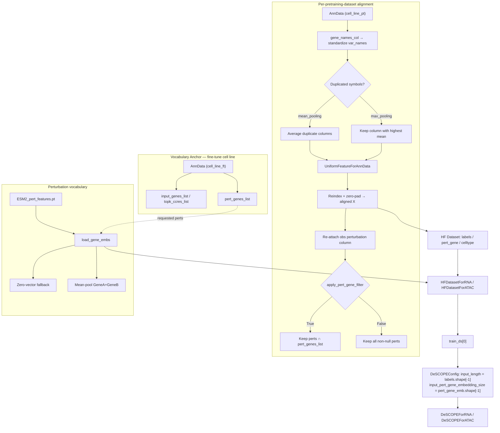

DeSCOPE must guarantee that every expression vector fed into the conditional VAE has an identical, positionally meaningful layout — column *i* must always refer to the same gene or cCRE, regardless of which dataset a cell originated from. This page dissects the machinery that enforces that contract: the **vocabulary anchor principle** (the fine-tune cell line defines the canonical feature space), the **alignment engine** that reindexes and zero-pads arbitrary AnnData objects into that space, the **duplicate-symbol resolution** strategies, modality-specific (RNA vs ATAC) alignment behavior, and the parallel **perturbation vocabulary** that maps target gene names to ESM2 embeddings.

Two distinct vocabularies operate simultaneously, and conflating them is the most common integration error:

| Vocabulary | Contents | Built by | Consumed by |
|---|---|---|---|
| **Input feature vocabulary** | Ordered gene symbols (RNA) or cCRE identifiers (ATAC) | `TokenizerForRNA` / `TokenizerForATAC` anchors | `UniformFeatureForAnnData` alignment → `labels` column → model `input_length` |
| **Perturbation vocabulary** | Target gene names (including `"GeneA+GeneB"` combos) | `ESM2_pert_features.pt` + `load_gene_embs` | `pert_gene_emb` column → model `input_pert_gene_embedding_size` |

Sources: [tokenizer.py](src/descope/tokenizer.py#L346-L347), [utils.py](src/descope/utils.py#L378-L401), [train.py](tutorials/RNA_Gene/train.py#L52-L64)

## The Vocabulary Anchor Principle

DeSCOPE does not maintain a global vocabulary registry. Instead, the **fine-tune cell line** passed to a tokenizer's constructor becomes the single source of truth: its feature names and perturbation labels are frozen into anchor lists, and every pretraining dataset is subsequently projected onto them. The source code states this invariant explicitly: *"Other cell lines used for pretraining should retain the same topk-ccres and perturbation genes as cell line (finetune)"*.

Each tokenizer class extracts its anchors in `__init__` via `_get_inputs_and_perts_from_adata_ft`:

- **`TokenizerForATAC`** first routes the fine-tune AnnData through `preprocess_atac_perturbation_adata_consistent_with_epiagent` (format validation → top-k cCRE selection → NaN-perturbation removal), then records `topk_ccres_list` (the post-selection `var_names`) and `pert_genes_list` (unique values of the perturbation column).
- **`TokenizerForRNA`** drops cells with null perturbation labels, then records `input_genes_list` (the `var_names`) and `pert_genes_list`. Optionally, `gene_names_col` standardizes identifiers first, copying `cell_line_ft.var[gene_names_col]` over `var_names` so that alignment operates on gene symbols rather than Ensembl IDs.

The downstream consequence is architectural: because alignment makes every tokenized dataset conform to the anchor, the model's input dimensions can be safely read off the **first training sample** at startup — `input_length` from `labels.shape[-1]` (the anchor vocabulary size) and `input_pert_gene_embedding_size` from `pert_gene_emb.shape[-1]` (the ESM2 dimension). There is no separate vocabulary checkpoint; the aligned data *is* the vocabulary contract.

Sources: [tokenizer.py](src/descope/tokenizer.py#L331-L360), [tokenizer.py](src/descope/tokenizer.py#L467-L501), [tokenizer.py](src/descope/tokenizer.py#L381-L386), [train.py](tutorials/RNA_Gene/train.py#L52-L64)

## Alignment Engine: UniformFeatureForAnnData

`UniformFeatureForAnnData` is the class that physically performs feature-space projection. Its contract, stated in the docstring, is to transform an input AnnData so it has *exactly* the target feature space: features present in the target but missing from the input are **filled with zeros**, features in the input but absent from the target are **dropped**, and feature order is rewritten to match the target list exactly. The class docstring includes a worked example: a 3-gene AnnData `['A','B','C']` aligned to target `['B','C','D']` yields column `'A'` dropped, `'B'`/`'C'` reordered into place, and `'D'` appended as an all-zero column.

The implementation is a vectorized gather, not a per-feature loop. In `__call__`:

1. `adata.var_names.get_indexer(target_feature_names)` resolves each target name to a source column position (or `-1` if missing).
2. A boolean `valid` mask filters out the `-1` positions.
3. A zero matrix of shape `(n_cells, len(target))` is allocated, and source columns are copied into the positions where `valid` is `True` — absent features remain zero by allocation.
4. The result is wrapped in a fresh `AnnData` whose `var_names` are the target names, and logging reports the overlap count and the number of zero-padded features.

Two operational caveats follow directly from the code. First, sparse matrices are densified at construction time (`X.toarray()`), so alignment on large datasets is memory-bound, not compute-bound. Second, the returned AnnData **contains only `X` and `var_names`** — the docstring warns that *all other attributes are cleared* — which has a direct consequence for the tokenizer pipeline described below. A `save()` method persists the aligned output, optionally converting to CSR sparse format to shrink file size.

> [!TIP]
> Because `UniformFeatureForAnnData` wipes `obs` and `var` during alignment, `TokenizerForRNA._tokenize` caches the perturbation labels *before* calling the aligner (reading `.obs[pert_col]` even in backed mode via `sc.read_h5ad(..., backed='r')` to avoid loading the full matrix) and re-attaches them afterward with `cell_line_pt.obs[pert_col] = pert_genes`. If you write custom alignment code, replicate this cache-and-restore pattern or your perturbation labels will silently vanish.

Sources: [utils.py](src/descope/utils.py#L30-L65), [utils.py](src/descope/utils.py#L145-L184), [utils.py](src/descope/utils.py#L186-L203), [tokenizer.py](src/descope/tokenizer.py#L516-L521), [tokenizer.py](src/descope/tokenizer.py#L541-L549)

## Resolving Duplicated Feature Names

Real-world genomics data routinely contains duplicated identifiers — multiple rows mapping to the same gene symbol, often from multi-mapping probes or per-transcript annotations. A `get_indexer`-based gather cannot tolerate duplicate source names, so `UniformFeatureForAnnData` resolves duplicates **eagerly, at construction time**, before any alignment occurs.

The `DuplicatedFeatureHandling` enum defines the two resolution strategies:

| Strategy | Mechanism (per duplicated name) | Semantics |
|---|---|---|
| `mean_pooling` | Replace all duplicate columns with a single column containing the **per-cell mean** across them | Preserves aggregate signal; treats duplicates as redundant measurements of one locus |
| `max_pooling` *(default)* | Keep only the duplicate column with the **highest mean expression** across cells; discard the rest | Selects the dominant measurement; assumes other duplicates are lower-quality proxies |

> [!TIP]
> The duplicate resolution uses a subtle write-back trick: `var_names_make_unique()` renames duplicates to `feature-1`, `feature-2`, …, then `var_names.get_indexer(duplicated_features)` locates the first occurrence of each original name, and the pooled values are written into those first-occurrence columns. Note also the dtype guard: integer count matrices are promoted to `float32` when `mean_pooling` is selected, preventing silent integer truncation of fractional means.

The choice is plumbed through the full tokenizer stack: `TokenizerForRNA.__init__` and both `tokenize()` entry points accept a `duplicated_features_handling` parameter, and the class-level docstring example demonstrates `DuplicatedFeatureHandling.mean_pooling` for pretraining pipelines.

Sources: [utils.py](src/descope/utils.py#L25-L27), [utils.py](src/descope/utils.py#L105-L143), [utils.py](src/descope/utils.py#L72-L84), [tokenizer.py](src/descope/tokenizer.py#L455-L465)

## Modality-Specific Alignment: RNA vs ATAC

Although both tokenizers follow the anchor principle, the *mechanics* of alignment differ fundamentally between modalities, driven by the structure of each feature universe:

| Dimension | ATAC (`TokenizerForATAC`) | RNA (`TokenizerForRNA`) |
|---|---|---|
| Feature universe | Fixed: EpiAgent's 1,355,445 cCREs, validated before anything else runs | Open-ended: arbitrary gene symbol sets |
| Vocabulary reduction | Top-k cCREs by total column sum (`topk_ccres`, default 50,000) with **stable sort** for determinism | None — anchor vocabulary is whatever the fine-tune cell line has |
| Alignment operation | **Reorder-only** column subset: `cell_line_pt[:, self.topk_ccres_list]` | Full **reindex + zero-pad** via `UniformFeatureForAnnData` |
| Symbol standardization | Not applicable (cCRE IDs are shared) | `gene_names_col` rewrites `var_names` from a `var` column |
| Duplicate handling | Not required | `DuplicatedFeatureHandling` enum |
| Extra precondition guard | `check_adata_format_consistent_with_epiagent`: exact 1,355,445 columns, float dtype (TF-IDF applied) | Raw-counts heuristic via `guess_is_lognorm` during preprocessing |

The ATAC shortcut is deliberate and safe: since every ATAC dataset must pass the EpiAgent format check — which asserts *exactly* 1,355,445 float-valued columns — all pretraining and fine-tuning inputs draw from the same cCRE universe. No feature can be genuinely "missing"; only ordering can differ, so a reorder suffices and zero-padding never triggers. The top-k selection itself is deterministic by construction: `np.argsort(peak_sum, kind="stable")` descending, then a positional slice, ensuring identical cCRE sets across runs and datasets.

RNA, by contrast, has no shared feature universe — one dataset may use Ensembl IDs, another HGNC symbols, and a third may simply lack genes the anchor requires. Hence the full `UniformFeatureForAnnData` treatment with symbol standardization, duplicate pooling, and zero-padding, plus the perturbation-side filter (`apply_pert_gene_filter`) that intersects each pretraining dataset's target genes with `pert_genes_list`.

Sources: [utils.py](src/descope/utils.py#L467-L488), [utils.py](src/descope/utils.py#L491-L519), [utils.py](src/descope/utils.py#L523-L568), [tokenizer.py](src/descope/tokenizer.py#L379-L386), [tokenizer.py](src/descope/tokenizer.py#L535-L548)

## Normalization Ordering in the RNA Tokenizer

For RNA, the tokenizer exposes a flag that controls whether library-size normalization happens **before or after** feature alignment: `normalize_before_align_features` (default `False`). Both branches end in the same state — aligned features, normalized values, preserved perturbation labels — but the intermediate semantics differ:

| Branch | Order of operations | Consequence |
|---|---|---|
| `normalize_before_align_features=True` | `preprocess_rna_perturbation_adata` (normalize_total + log1p) **→** align features | Normalization denominators computed over the dataset's *full* gene space; missing genes zero-padded *after* normalization |
| `normalize_before_align_features=False` *(default)* | Align features on raw counts **→** normalize_total + log1p | Normalization denominators computed over the *aligned* (anchor) gene space; zero-padded columns participate in normalization |

The relevant preprocessor, `preprocess_rna_perturbation_adata`, removes NaN-perturbation cells and then applies `sc.pp.normalize_total(target_sum)` + `sc.pp.log1p` — skipping normalization only if the heuristic `guess_is_lognorm` detects already-log-normalized data (unless `skip_raw_counts_check=True` forces unconditional normalization). This means both ordering branches still require count-like input, and the flag is purely about *which columns are present* when per-cell sums are computed — a decision that materially changes expression magnitudes for cells with substantial expression outside the anchor vocabulary.

Sources: [tokenizer.py](src/descope/tokenizer.py#L523-L557), [utils.py](src/descope/utils.py#L571-L637)

## Perturbation Vocabulary: ESM2 Embedding Lookup

The second vocabulary maps perturbation labels to dense conditioning vectors. The canonical store is a `.pt` file of `{gene_name: embedding_tensor}` (ESM2 protein embeddings), loaded by `load_gene_embs` with a specific set of requested perturbations. The function enforces **total coverage**: every requested perturbation gets an entry in the returned dict, using fallback logic for gaps:

| Requested perturbation case | Resolution |
|---|---|
| Present in the embedding file | Returned as-is |
| Single gene, absent from file | **Zero vector** (dimension taken from any existing embedding) |
| Multi-gene combo `"GeneA+GeneB"`, some constituents missing | Per-gene vectors (zero for missing constituents) **mean-pooled** into one embedding |
| Alias gap (`TAZ` missing, `TAFAZZIN` present) | `TAZ` seeded by copying the `TAFAZZIN` tensor |

Every fallback is logged with exact counts — how many single-gene perturbations were zero-filled, and for which multi-gene combos which constituents were missing — so silent degradation of conditioning signal is at least *observable* degradation. The multi-gene convention (`+` separator, mean pooling over constituent embeddings including zeros) means combo perturbations are supported without schema changes.

The perturbation vocabulary flows into training through two hops. First, `HFBaseDataset.__init__` calls `load_gene_embs` with `perts_to_emb=self.ds.unique("pert_gene")` — the set of labels actually present in the tokenized data — guaranteeing no `KeyError` at sample time. Second, each batch fetch re-stacks per-sample embeddings: `batch["pert_gene_emb"] = torch.stack([self.gene_embs[g] for g in batch["pert_gene"]])`. For constructing custom perturbation vocabularies or lists, `load_gene_names_engine` provides tolerant file loading (single-column TXT/CSV, or multi-column CSV keyed by a `target_gene` header, with deduplication).

Sources: [utils.py](src/descope/utils.py#L378-L464), [dataset.py](src/descope/dataset.py#L198-L205), [dataset.py](src/descope/dataset.py#L277-L286), [utils.py](src/descope/utils.py#L330-L375)

## Vocabulary Intersection for Cell-Type Transfer

A third alignment scenario arises when transferring a model between two datasets (e.g., predicting perturbation responses in a new cell type): **both** sides must land on a shared vocabulary. `intersect_adatas_for_celltype_transfer` computes the joint intersection and produces mutually aligned artifacts:

1. **Perturbation intersection**: `source_perts ∩ target_perts`, optionally further constrained to `set(gene_embs.keys()) ∪ {ctrl_name}` if an embedding file is supplied — preventing the transfer from including perturbations that would silently become zero-vector conditions.
2. **Feature intersection**: `source_features ∩ target_features`, using `feature_names_col` if identifiers live in a `var` column.
3. Each AnnData is aligned to `features_to_keep` via `UniformFeatureForAnnData`, perturbation labels are re-attached, then cells and columns are filtered to the intersections.
4. A hard assertion verifies `source.var_names == target.var_names` element-wise before anything is written.
5. Outputs: `source.h5ad`, `target.h5ad`, and `target_info.csv` (per-perturbation cell counts for the target), with an assertion that control cells survived the intersection.

This utility is the eval-side counterpart of the anchor principle: instead of one dataset projecting onto another's vocabulary, two datasets negotiate a common one.

Sources: [utils.py](src/descope/utils.py#L206-L283), [utils.py](src/descope/utils.py#L285-L327)

## Key Invariants Summary

Across all alignment paths, five invariants hold and are directly enforced in code:

1. **Positional identity** — after alignment, `var_names` equal the target list in order; feature position ⟺ feature identity ([utils.py](src/descope/utils.py#L174-L179)).
2. **Zero-padding for gaps** — absent features are zeros, never dropped silently or resampled ([utils.py](src/descope/utils.py#L172-L177)).
3. **Determinism** — ATAC top-k uses stable sorting; alignment ordering is exactly the anchor list ([utils.py](src/descope/utils.py#L515-L519)).
4. **Perturbation label preservation** — labels are cached before alignment and restored after, since aligners clear `obs` ([tokenizer.py](src/descope/tokenizer.py#L541-L549)).
5. **Dimensions derived from data** — model `input_length` and `input_pert_gene_embedding_size` are read from the first aligned sample, making alignment errors surface immediately as shape mismatches rather than silent corruption ([train.py](tutorials/RNA_Gene/train.py#L54-L64)).

## Where to Go Next

- For how the aligned `labels` vectors become HF Dataset columns and get chunked into memory-safe batches, see [Tokenization: AnnData to HuggingFace Datasets](12-tokenization-anndata-to-huggingface-datasets).
- For the normalization and perturbation-filtering steps that surround alignment, see [Perturbation Filtering and Preprocessing](13-perturbation-filtering-and-preprocessing).
- For how `pert_gene_emb` is encoded inside the model, see [PertGene Encoder and ESM2 Embeddings](8-pertgene-encoder-and-esm2-embeddings).
- For how the derived `input_length` interacts with architecture hyperparameters, see [Model Configuration Reference](7-model-configuration-reference).
- For applying alignment when adapting pretrained checkpoints to new datasets, see [Zero-Shot and Fine-Tuning Workflows](22-zero-shot-and-fine-tuning-workflows).
- For adding a new modality with its own vocabulary rules, see [Extending DeSCOPE to New Modalities](24-extending-descope-to-new-modalities).
