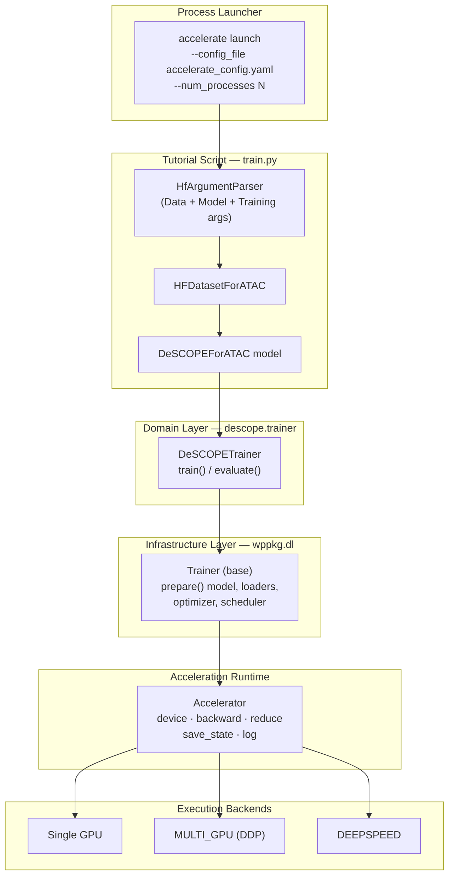
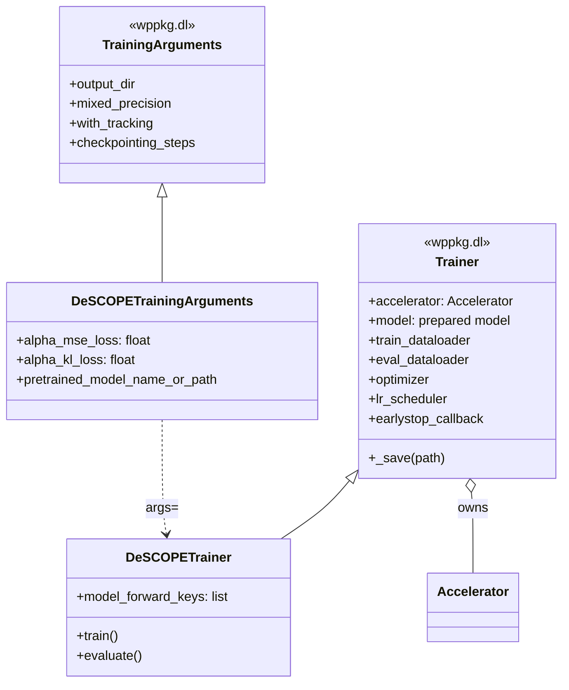

DeSCOPE's training system does not reinvent distributed training — it delegates hardware orchestration to **HuggingFace Accelerate** through a thin, domain-specific trainer layer. This page explains how `DeSCOPETrainer` composes with the external `wppkg` trainer library and the Accelerator runtime to deliver a single code path that runs identically on one GPU, multi-GPU DDP, and DeepSpeed. You will learn the inheritance contract, the launch chain, the training-step mechanics under gradient accumulation, and the distributed control signals (loss reduction, early stopping, checkpoint/resume) that make it all work.

Sources: [trainer.py](src/descope/trainer.py#L1-L47), [pyproject.toml](pyproject.toml#L20-L26)

## Architectural Role: Where the Trainer Sits

The training stack is layered so that each tier owns exactly one concern. The `accelerate launch` CLI spawns the tutorial script with a distributed topology; `train.py` parses arguments and builds the dataset and model; `DeSCOPETrainer` implements the *domain* training loop (ELBO bookkeeping, evaluation cadence, early stopping); and the inherited base `Trainer` from `wppkg` performs the *mechanical* Accelerate work — preparing the model, dataloaders, optimizer, and scheduler. Everything below that line is Accelerate's responsibility.



The backend selection is entirely declarative: the tutorial's `accelerate_config.yaml` flips a single `distributed_type` field between `MULTI_GPU` and `DEEPSPEED`, and the trainer code itself never changes.

Sources: [train.py](tutorials/ATAC_Gene/train.py#L17-L91), [accelerate_config.yaml](tutorials/ATAC_Gene/accelerate_config.yaml#L1-L3), [train_descope.sh](tutorials/ATAC_Gene/train_descope.sh#L52-L58)

## The Inheritance Contract: DeSCOPETrainer over wppkg's Trainer

`DeSCOPETrainer` subclasses `wppkg.dl.Trainer`, and its constructor does exactly one thing before handing control back: it inspects the **unwrapped** model's forward signature. This produces `model_forward_keys`, the canonical list of keyword arguments the model actually accepts — a fact that becomes crucial later when filtering batches (see [Batch Key Filtering](#batch-key-filtering-the-model_forward_keys-mechanism)). Because the base `Trainer` is an external library (pinned at `wppkg==0.1.4`), the base class's internals live outside this repository — but its observable contract is fully inferable from how `DeSCOPETrainer` consumes it:



The verifiable base-class contract, as consumed by `DeSCOPETrainer`, is summarized below. This table is the effective "API" your custom loops can rely on:

| Member | Type | Role in DeSCOPE's loop |
|---|---|---|
| `self.accelerator` | `Accelerator` | Every distributed operation: device, backward, reduce, save/load, logging |
| `self.model` | Prepared model | Already wrapped for the active backend; trained with `.train()` / `.eval()` |
| `self.train_dataloader` | Prepared loader | Sharded across processes by Accelerate |
| `self.eval_dataloader` | Prepared loader (optional) | Drives epoch-end evaluation when present |
| `self.optimizer` / `self.lr_scheduler` | Prepared objects | Stepped once per optimization step in the loop |
| `self.earlystop_callback` | Callback (optional) | Queried after each evaluation |
| `self.num_update_steps_per_epoch` | `int` | Used to reconstruct `completed_steps` on resume |
| `self._save(path)` | Method | Serializes the model artifact next to Accelerate state |
| `self.logger` | `Logger` | File-based, rank-aware logging (see below) |

Sources: [trainer.py](src/descope/trainer.py#L35-L47), [trainer.py](src/descope/trainer.py#L80-L200), [arguments.py](src/descope/arguments.py#L7-L22), [pyproject.toml](pyproject.toml#L23)

## Distributed-Aware Logging via Monkey Patching

One subtle integration detail: DeSCOPE patches the base Trainer's logger initialization at import time (`Trainer._init_logger = _init_logger`). The patched logger directs all training output to `run.log` inside `output_dir`, and it partitions verbosity by rank — the **main process** logs at `INFO` while **other processes** log only at `WARN`, keyed off `self.accelerator.local_process_index`. Console handlers are then silenced so the terminal stays clean even with many workers writing concurrently.

This is why every log line in the training loop can be written unconditionally: rank partitioning happens inside the logger, not at each call site. The progress bar, by contrast, is guarded explicitly with `disable=not self.accelerator.is_local_main_process`, so only one tqdm instance animates per machine.

Sources: [trainer.py](src/descope/trainer.py#L11-L32), [trainer.py](src/descope/trainer.py#L62)

## The Launch Chain: From CLI to TrainingArguments

Configuration flows through three independent layers, each with a distinct scope. `HfArgumentParser` consumes the three dataclass groups in `train.py`; `DeSCOPETrainingArguments` merely **extends** `wppkg.dl.TrainingArguments` with three ELBO-specific fields, inheriting the full training surface (batch size, mixed precision, tracking, checkpointing, dataloader tuning) from the base library.

| Layer | File(s) | Owns |
|---|---|---|
| Distributed topology | `accelerate_config.yaml` | `distributed_type` (`MULTI_GPU` / `DEEPSPEED`), process count |
| Training behavior | `DeSCOPETrainingArguments` (via `wppkg`) | Precision, LR schedule, accumulation, tracking, checkpoint cadence |
| Model & data | `DeSCOPEModelArguments`, `DeSCOPEDataArguments` | Architecture dims, dataset paths, control-cell name, ESM2 embeddings |

The shell launcher wires these together — note how mixed precision (`--mixed_precision=bf16`) and experiment tracking (`--with_tracking=True --report_to=tensorboard`) are ordinary training-argument flags, not backend-specific settings. This is the Accelerate design philosophy: backend strategy lives in the config file, behavior lives in arguments.

Sources: [arguments.py](src/descope/arguments.py#L6-L22), [train.py](tutorials/ATAC_Gene/train.py#L18-L22), [train_descope.sh](tutorials/ATAC_Gene/train_descope.sh#L27-L48), [train_descope.sh](tutorials/ATAC_Gene/train_descope.sh#L52-L58)

## The Training Step: Gradient Accumulation and Synchronization

The heart of the integration is the per-step sequence inside `train()`. Each micro-batch runs inside Accelerate's `accumulate(model)` context manager, which transparently suppresses gradient synchronization until the last micro-batch of the accumulation window. Every raw-PyTorch idiom has been replaced with its Accelerate counterpart:

```mermaid
sequenceDiagram
    autonumber
    participant L as Training loop
    participant AC as Accelerator
    participant MD as Model (wrapped)
    participant OPT as Optimizer + Scheduler

    L->>AC: accumulate(model) — enter context
    L->>L: filter batch → model_forward_keys
    L->>MD: model(**filtered_batch)
    MD-->>L: loss, mse_loss, kl_loss
    L->>AC: backward(loss)
    Note over L,AC: sync_gradients = False while accumulating
    Note over L,AC: On final micro-batch: sync_gradients = True
    L->>AC: clip_grad_norm_(params, max_grad_norm)
    L->>OPT: step() → lr_scheduler.step() → zero_grad()
    L->>AC: reduce(loss/mse/kl, "mean") for logging
```

| Concern | Plain PyTorch | DeSCOPE (Accelerate API) |
|---|---|---|
| Device placement | `.to("cuda")` | `k.to(self.accelerator.device)` |
| Backpropagation | `loss.backward()` | `self.accelerator.backward(loss)` |
| Accumulation window | Manual micro-step counting | `with self.accelerator.accumulate(self.model)` |
| Gradient clipping | Unconditional | `clip_grad_norm_` **only when `sync_gradients`** |
| Cross-process loss averaging | Manual all-reduce | `accelerator.reduce(loss, "mean")` |
| Step counting | Manual | `completed_steps` incremented only when `sync_gradients` |

> [!TIP]
> The gradient-clipping guard at `if self.accelerator.sync_gradients` is not decorative — clipping per micro-batch would clip *unsynchronized* partial gradients with the wrong norm scale. Gating on `sync_gradients` guarantees clipping fires exactly once per optimization step, on the fully reduced gradient. The same gate drives progress-bar updates and checkpoint cadence, giving a single source of truth for "an optimization step occurred."

The logged total batch size makes the math explicit: `per_device_train_batch_size × accelerator.num_processes × gradient_accumulation_steps` — three independently tunable dimensions reported in the startup banner so you can verify effective batch scaling before the first step runs.

Sources: [trainer.py](src/descope/trainer.py#L49-L134), [trainer.py](src/descope/trainer.py#L51-L58)

## Batch Key Filtering: The `model_forward_keys` Mechanism

Dataloaders carry keys the model must not see — dataset metadata, collation artifacts, auxiliary fields. Rather than hard-coding a key whitelist, `DeSCOPETrainer.__init__` reflects over the unwrapped model's forward signature:

```python
unwrapped_model = self.accelerator.unwrap_model(self.model)
self.model_forward_keys = list(inspect.signature(unwrapped_model.forward).parameters.keys())
```

Then in both `train()` and `evaluate()`, each batch is filtered: `{k: v.to(device) for k, v in batch.items() if k in self.model_forward_keys}`. This makes the trainer forward-compatible with any `DeSCOPE*` model variant — the batch contract is discovered, not declared.

> [!TIP]
> The `unwrap_model()` call matters: under DDP or DeepSpeed the trainer holds an Accelerate-wrapped model whose signature does not match the raw forward. Inspecting the *unwrapped* model guarantees the filter matches what `model(**kwargs)` ultimately dispatches to, regardless of backend. This is also why moving tensors to `accelerator.device` happens during filtering — one pass does key selection and device placement.

Sources: [trainer.py](src/descope/trainer.py#L44-L47), [trainer.py](src/descope/trainer.py#L110-L116), [trainer.py](src/descope/trainer.py#L208-L213)

## Distributed Loss Accounting: Reduce vs. Gather

DeSCOPE uses two distinct Accelerate aggregation primitives, chosen by purpose. During **training**, per-step losses are aggregated with `accelerator.reduce(loss.detach().clone(), "mean")` immediately at each step, then averaged over `logging_steps` by an `Accumulator` and enriched with `grad_norm` and the current learning rate before hitting the logger (and `accelerator.log` for TensorBoard when `with_tracking` is enabled). During **evaluation**, losses are accumulated per-process and joined with `accelerator.gather_for_metrics`, which handles the classic DDP pitfall of uneven final batches before the cross-process `torch.mean(torch.cat(...))`.

| Phase | Primitive | When | Result |
|---|---|---|---|
| Training logging | `accelerator.reduce(x, "mean")` | Every step | Rank-mean of current micro-batch losses |
| Evaluation metrics | `accelerator.gather_for_metrics(x)` | End of epoch | Uniformly gathered, drop-corrected metric set |
| Experiment tracking | `accelerator.log(dict, step=…)` | On `logging_steps` / epoch end | Forwards to TensorBoard etc. |

Sources: [trainer.py](src/descope/trainer.py#L129-L153), [trainer.py](src/descope/trainer.py#L205-L226)

## Early Stopping as a Distributed Control Signal

Early stopping is the one place where control flow itself must reach consensus across processes. After each evaluation, `earlystop_callback.check_early_stopping(eval_loss)` runs on every rank; if the metric has not improved, the local process calls `accelerator.set_trigger()`. Every rank then consults `accelerator.check_trigger()` — Accelerate's internally synchronized flag — so **all processes break out of the epoch loop together**, preventing the deadlock scenario where some ranks keep iterating a sharded dataloader while others have exited.

Note the documented caveat in the class docstring: early stopping is not resume-aware (a resumed run reinitializes the callback), and enabling it requires `eval_every_n_epochs` and `checkpointing_steps` to be aligned since the trainer does not auto-save the best model. The final `last_model` is always saved even when stopping triggers early.

Sources: [trainer.py](src/descope/trainer.py#L36-L43), [trainer.py](src/descope/trainer.py#L166-L182), [trainer.py](src/descope/trainer.py#L199-L203)

## Checkpoint Hooks and Resume Mechanics

Checkpointing is delegated to Accelerate's state system: interval checkpoints call `accelerator.save_state(dir)` for optimizer/scheduler/RNG state, followed by `self._save(os.path.join(dir, "model"))` for the model artifact. Two cadences coexist: integer `checkpointing_steps` fire per optimization step, while string values like `"epoch-10"` fire every N epochs (parsed at [trainer.py](src/descope/trainer.py#L184-L197)).

Resume reconstructs progress by parsing the checkpoint folder name — `epoch_{i}` or `step_{i}` — then calling `accelerator.load_state()`. For step-based resumes, the tricky part is intra-epoch position: `resume_step` is converted back through `gradient_accumulation_steps`, and the dataloader is advanced with `accelerator.skip_first_batches(train_dataloader, resume_step)` so sharded sampling continues exactly where it stopped. Deep checkpointing semantics and the best-model trade-offs are covered on the dedicated page.

Sources: [trainer.py](src/descope/trainer.py#L66-L96), [trainer.py](src/descope/trainer.py#L102-L106), [trainer.py](src/descope/trainer.py#L155-L161)

## Launch Configuration Reference

The full single-GPU launch recipe from the ATAC tutorial, grouped by concern. Swap `distributed_type` to `DEEPSPEED` in the YAML and add a DeepSpeed config file to scale out (details on the DeepSpeed page):

| Group | Flag | Example | Effect |
|---|---|---|---|
| **Precision & tracking** | `--mixed_precision` | `bf16` | Accelerate autocast policy |
| | `--with_tracking` / `--report_to` | `True` / `tensorboard` | Routes `accelerator.log` calls |
| **Optimization** | `--learning_rate` / `--lr_scheduler_type` | `1e-4` / `cosine` | Scheduler construction |
| | `--num_warmup_ratio` / `--weight_decay` | `0.1` / `1e-2` | Schedule shape & regularization |
| | `--max_grad_norm` | `1.0` | Clipping ceiling (sync-gated) |
| | `--gradient_accumulation_steps` | `1` | Micro-batches per optimization step |
| **Throughput** | `--per_device_train_batch_size` | `64` | Per-process batch size |
| | `--dataloader_num_workers` / `--dataloader_prefetch_factor` | `16` / `2` | Loader parallelism |
| | `--dataloader_pin_memory` / `--dataloader_persistent_workers` | `True` / `True` | H2D transfer & worker reuse |
| **Cadence** | `--logging_steps` / `--checkpointing_steps` | `50` / `epoch-10` | Log & checkpoint intervals |
| | `--eval_every_n_epochs` | — | Epoch-end evaluation frequency |
| **Loss weighting** | `--alpha_mse_loss` / `--alpha_kl_loss` | `1.0` / `1.0` | ELBO term coefficients |

Launch command shape:

```bash
accelerate launch \
    --config_file="./accelerate_config.yaml" \
    --num_processes=1 \
    train.py \
    $TRAINPARAMS $DATAPARAMS $MODELPARAMS
```

Sources: [train_descope.sh](tutorials/ATAC_Gene/train_descope.sh#L10-L58), [accelerate_config.yaml](tutorials/ATAC_Gene/accelerate_config.yaml#L1-L3)

## Summary and Reading Progression

The integration philosophy is strict separation of concerns: **wppkg's `Trainer`** owns Accelerate preparation, **`DeSCOPETrainer`** owns domain logic (ELBO accounting, evaluation cadence, distributed early stopping), and **Accelerate** owns all hardware semantics. Because every hardware-dependent operation routes through `self.accelerator`, the identical loop serves single-GPU, DDP, and DeepSpeed backends with zero code branching in `descope/trainer.py` itself.

Where to go next in the Training System track:

- Understand what `loss`, `mse_loss`, and `kl_loss` actually compute: [ELBO Loss: MSE and KL Composition](16-elbo-loss-mse-and-kl-composition)
- Master the save/resume/early-stop lifecycle you just saw summarized: [Checkpointing, Resuming, Early Stopping](17-checkpointing-resuming-early-stopping)
- Scale this loop across nodes with ZeRO: [Distributed Training with DeepSpeed](18-distributed-training-with-deepspeed)
- For the model whose forward signature drives `model_forward_keys`: [Model Configuration Reference](7-model-configuration-reference)
- To see this trainer inside an end-to-end workflow: [Tutorial Pipeline: Tokenize, Train, Evaluate](4-tutorial-pipeline-tokenize-train-evaluate)
