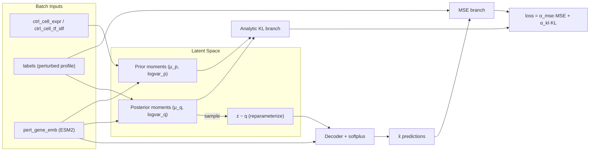
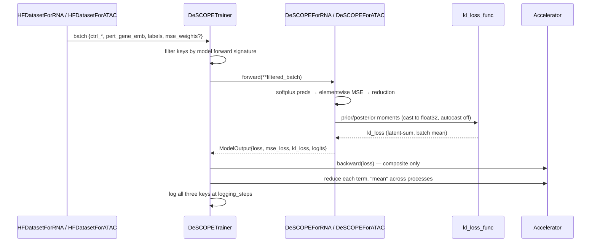

This page dissects how DeSCOPE turns its conditional VAE's probabilistic objective into concrete tensor operations: an **α-weighted sum of an MSE reconstruction term and an analytic KL divergence term**, computed inside the model forward pass and observed term-by-term by the trainer. We cover the mathematical form of each branch, the exact reduction semantics (including a subtle ATAC/RNA asymmetry), the float32 enforcement that protects the KL branch under mixed precision, the `ModelOutput` contract that carries all three losses to the training loop, and the configuration surface for tuning the balance. Architectural background for the encoders and decoder themselves is intentionally out of scope here — see [Prior and Posterior Variational Encoders](9-prior-and-posterior-variational-encoders) and [Decoder and Softplus Output Design](10-decoder-and-softplus-output-design).

Sources: [modeling_descope.py](/src/descope/models/modeling_descope.py#L155-L169), [models/utils.py](/src/descope/models/utils.py#L28-L41)

## The ELBO Objective, As Implemented

DeSCOPE trains a *conditional* VAE whose latent prior is not a fixed standard Gaussian but a learned, perturbation-aware distribution. Both the prior `p(z | ctrl, pert)` and the posterior `q(z | labels, pert)` are produced by twin `VariationalEncoder` modules fed with the same perturbation embedding but different expression contexts: the prior sees the control cell profile (`ctrl_cell_expr` / `ctrl_cell_tf_idf`), while the posterior sees the perturbed ground-truth `labels`. The variational encoders output `(z, mean, logvar)` via the reparameterization trick, and the decoder reconstructs predictions from the posterior sample.

Sources: [modeling_descope.py](/src/descope/models/modeling_descope.py#L145-L153), [modeling_descope.py](/src/descope/models/modeling_descope.py#L231-L239)

Because both distributions are diagonal Gaussians, the KL term is computed in **closed analytical form** from the four moment tensors — no Monte Carlo sampling is involved in the KL branch, so its gradient estimator is deterministic given the moments. The reconstruction term is an MSE between softplus-activated predictions and `labels`, which corresponds to a Gaussian likelihood `p(x|z) = N(x̂, I)` with unit variance, up to constants absorbed by `α_mse`. The full training objective minimized by the optimizer is:

```
loss = α_mse · MSE(x̂, x)  +  α_kl · KL( q(z | x, e) ‖ p(z | c, e) )
```

Sources: [modeling_descope.py](/src/descope/models/modeling_descope.py#L162-L168), [modeling_descope.py](/src/descope/models/modeling_descope.py#L248-L254)

The following concept map shows how data flows into the two loss branches — both terms share the perturbation embedding `e` as conditioning input, which is what makes the divergence a *conditional* KL:



Sources: [modeling_descope.py](/src/descope/models/modeling_descope.py#L138-L169)

## MSE Reconstruction Term: Elementwise Errors and Gene-Level Weighting

Both model variants begin the loss computation identically: `nn.functional.mse_loss(preds, labels, reduction="none")` produces an **elementwise** error tensor of shape `(batch_size, input_length)`, deferring all reduction decisions to the following lines. This is deliberate — it leaves room for optional **gene-level weighting**, where the dataset can supply a `mse_weights` tensor that is multiplied onto the elementwise errors before reduction. Weighted and unweighted paths are selected at runtime by a simple `is not None` check.

Sources: [modeling_descope.py](/src/descope/models/modeling_descope.py#L155-L160), [modeling_descope.py](/src/descope/models/modeling_descope.py#L241-L246)

The two modalities reduce the weighted tensor differently, and this is the one place where the loss composition is not perfectly symmetric between `DeSCOPEForATAC` and `DeSCOPEForRNA`. Note that the dataset fallback weight (`ones_weight`) is normalized by gene count, so under the fallback both weighted paths collapse to magnitudes comparable to the plain mean:

| Path | Reduction code | Semantics |
|---|---|---|
| ATAC weighted | `(mse_weights * mse_loss_elementwise).sum(dim=-1).mean()` | Per-cell weighted **sum** over genes, then batch mean |
| ATAC unweighted | `mse_loss_elementwise.mean()` | Flat mean over batch × genes |
| RNA weighted | `(mse_weights * mse_loss_elementwise).mean()` | Gene-weighted flat mean over batch × genes |
| RNA unweighted | `mse_loss_elementwise.mean()` | Flat mean over batch × genes |

Sources: [modeling_descope.py](/src/descope/models/modeling_descope.py#L157-L158), [modeling_descope.py](/src/descope/models/modeling_descope.py#L243-L244)

The weights themselves are optional and produced upstream in the data pipeline: `HFBaseDataset` accepts a `mse_weights_pkl_file` pickle mapping `(celltype, perturbation)` pairs to per-gene weight arrays, converts them to tensors at load time, and injects a stacked `mse_weights` batch entry inside `__getitems__`, falling back to the normalized ones tensor for pairs missing from the mapping. The tutorial scripts construct `HFDatasetForRNA` without this argument, so **default training runs the unweighted path** — but the hook is wired end-to-end: the trainer forwards only keys matching the model's forward signature (`model_forward_keys`), so `mse_weights` reaches `forward` automatically when the dataset produces it, and is silently dropped otherwise.

Sources: [dataset.py](/src/descope/dataset.py#L207-L214), [dataset.py](/src/descope/dataset.py#L288-L293), [trainer.py](/src/descope/trainer.py#L44-L47)

## KL Divergence: Closed-Form, Float32, Latent-Wide Scale

The KL branch is implemented as a standalone function `kl_loss_func` shared by both model variants. It receives the four moment tensors and computes the standard closed-form divergence between diagonal Gaussians:

```
KL(q ‖ p) = ½ · Σⱼ [ logvar_p,ⱼ − logvar_q,ⱼ + (σ²_q,ⱼ + (μ_q,ⱼ − μ_p,ⱼ)²) / σ²_p,ⱼ − 1 ]
```

which is exactly what the code expresses as `-0.5 * torch.sum(1 + posterior_logvar - prior_logvar - (posterior_logvar.exp() + (posterior_mean - prior_mean).pow(2)) / prior_logvar.exp(), dim=-1)`, followed by a batch mean. Because it operates on moments rather than samples, this KL estimate has **zero estimator variance** — in contrast to sampling-based approaches that would re-introduce noise through the reparameterization trick a second time.

Sources: [models/utils.py](/src/descope/models/utils.py#L28-L41)

> [!TIP]
> The KL call is wrapped in `torch.amp.autocast(enabled=False, device_type="cuda")` with explicit `.float()` casts on all four moments. Under mixed-precision training, `logvar` and its exponential are numerically fragile in bfloat16/float16 — small logvar errors explode through `exp()`. This block forces the entire divergence computation into float32 regardless of the surrounding autocast policy.

The reduction structure of the KL term deserves attention when reading training logs: it **sums over the latent dimension** (`dim=-1`, width = `hidden_size`, default 672) and then averages over the batch. The MSE term, by contrast, is a flat per-element mean over batch × genes. The two branches therefore live on structurally different scales — KL grows with latent width while MSE dilutes across the gene dimension — and the `α` coefficients are the sole mechanism for rebalancing them. Tracking `mse_loss` and `kl_loss` separately (as the trainer does, below) is what makes this imbalance diagnosable rather than invisible.

Sources: [models/utils.py](/src/descope/models/utils.py#L34-L41), [arguments.py](/src/descope/arguments.py#L56-L60)

The KL gradient flows back into **both** variational encoders — the prior encoder's moments are not frozen targets but learned parameters of a conditional prior `p(z | ctrl, pert)`. This is what separates DeSCOPE from a vanilla VAE with a fixed `N(0, I)` prior: the model simultaneously shapes where the posterior should encode perturbed profiles and where the prior expects them given only control context. At inference time, `labels` are unavailable, so the forward loss path cannot execute at all — the `@torch.no_grad()` `inference` methods sample `z` directly from the prior and return `ModelOutput` instances with all three loss fields set to `None`.

Sources: [modeling_descope.py](/src/descope/models/modeling_descope.py#L146-L148), [modeling_descope.py](/src/descope/models/modeling_descope.py#L178-L196), [modeling_descope.py](/src/descope/models/modeling_descope.py#L264-L282)

## Composition Contract: α-Weighted Sum and the ModelOutput Trio

The single composition line `loss = self.alpha_mse_loss * mse_loss + self.alpha_kl_loss * kl_loss` is the entirety of the ELBO assembly — no annealing schedule, no β-warmup, no gradient surgery between terms. Both coefficients default to `1.0` and are stored as plain instance attributes on the model, set at construction time. Only the composite `loss` is backpropagated; `mse_loss` and `kl_loss` ride along as detached telemetry.

Sources: [modeling_descope.py](/src/descope/models/modeling_descope.py#L132-L133), [modeling_descope.py](/src/descope/models/modeling_descope.py#L169), [modeling_descope.py](/src/descope/models/modeling_descope.py#L255)

The three scalars leave the model through typed `ModelOutput` dataclasses — `DeSCOPEForATACOutput` and `DeSCOPEForRNAOutput`, each carrying `loss`, `mse_loss`, `kl_loss`, and `logits`. This trio is a deliberate **contract between model and trainer**: the model owns loss mathematics and reduction policy; the trainer owns aggregation, backward, and observability, and never recomputes any loss itself. The end-to-end interaction looks like this:

Sources: [models/utils.py](/src/descope/models/utils.py#L12-L25), [modeling_descope.py](/src/descope/models/modeling_descope.py#L171-L176)



Sources: [trainer.py](/src/descope/trainer.py#L110-L117)

## Downstream Telemetry: How the Trainer Observes Each Term

During training, the trainer unpacks all three fields from the model output (L113–116) but backpropagates **only** the composite `loss` (L117). Every step, all three detached scalars are `accelerator.reduce(..., "mean")`-aggregated across processes into a three-slot `Accumulator`, which emits running means for `loss`, `mse_loss`, and `kl_loss` every `logging_steps` — alongside `grad_norm` and `lr` — to the file logger and optionally to the tracking backend. This per-term accounting is what lets a practitioner distinguish "reconstruction stalled" from "KL collapsed the posterior."

Sources: [trainer.py](/src/descope/trainer.py#L113-L117), [trainer.py](/src/descope/trainer.py#L130-L134), [trainer.py](/src/descope/trainer.py#L137-L153)

Evaluation mirrors the same decomposition. `evaluate()` runs the model under `torch.no_grad()`, gathers each term with `accelerator.gather_for_metrics` (with `.repeat(per_device_eval_batch_size)` to preserve sample weighting on the final partial batch), concatenates across devices, and returns `{eval_loss, eval_mse_loss, eval_kl_loss}`. The early-stopping callback consults **only `eval_loss`** — the composite — so the KL weight indirectly influences stopping behavior through the objective it balances.

Sources: [trainer.py](/src/descope/trainer.py#L205-L226), [trainer.py](/src/descope/trainer.py#L175-L182)

| Key | Phase | Aggregation chain | Consumer |
|---|---|---|---|
| `loss` / `mse_loss` / `kl_loss` | train | per-process value → `accelerator.reduce("mean")` → running mean over logging window | `run.log`, `accelerator.log` |
| `eval_loss` / `eval_mse_loss` / `eval_kl_loss` | eval | `gather_for_metrics` → `torch.cat` → global `torch.mean` | log dict; early stopping reads `eval_loss` |

Sources: [trainer.py](/src/descope/trainer.py#L98), [trainer.py](/src/descope/trainer.py#L222-L226)

## Tuning the Balance: Configuration Surface

Both loss coefficients are declared on `DeSCOPETrainingArguments` as HfArgumentParser fields, making them ordinary CLI flags. The tutorial entry scripts thread them into the model twice — once for scratch construction via the explicit constructor, once for fine-tuning via `from_pretrained` — so the balance is preserved across checkpoint reloads regardless of which path you take. Because `Trainer`/`Accelerate` handles the rest, no other code needs to know the split exists.

| Argument | Default | Plumbing path | Effect |
|---|---|---|---|
| `alpha_mse_loss` | 1.0 | CLI → `train_args` → `DeSCOPEForRNA/ATAC(...)` or `from_pretrained(...)` → `self.alpha_mse_loss` | Scales reconstruction branch |
| `alpha_kl_loss` | 1.0 | Same path → `self.alpha_kl_loss` | Scales KL branch |
| `mse_weights_pkl_file` (dataset kwarg) | `None` | `HFBaseDataset` → `batch["mse_weights"]` → forward signature filter → weighted reduction | Per-gene error weighting by (celltype, perturbation) |

Sources: [arguments.py](/src/descope/arguments.py#L6-L17), [train.py](/tutorials/RNA_Gene/train.py#L60-L71)

> [!TIP]
> When tuning, remember the structural scale mismatch documented above: KL is summed over the 672-wide latent dimension while MSE averages over thousands of genes per cell. If logs show `kl_loss` dominating `loss`, raising `alpha_mse_loss` and lowering `alpha_kl_loss` are not symmetric interventions — the former rescales a diluted mean, the latter rescales a latent-wide sum — so adjust `alpha_kl_loss` in smaller increments and watch `eval_kl_loss` for posterior collapse (trending toward the prior's own entropy floor).

## Where to Go Next

The loss composition sits at the confluence of the model and training subsystems. To understand *where* the moments fed into `kl_loss_func` come from — and why the prior is conditional on control context — continue with [Prior and Posterior Variational Encoders](9-prior-and-posterior-variational-encoders). For the softplus activation applied to `preds` before the MSE is ever computed (and why a non-negative output matters for count-like data), see [Decoder and Softplus Output Design](10-decoder-and-softplus-output-design). For the machinery surrounding the loss telemetry — accumulators, early stopping, checkpoint resumption semantics — proceed to [Checkpointing, Resuming, Early Stopping](17-checkpointing-resuming-early-stopping), and for the distributed aspects of `accelerator.reduce` and `gather_for_metrics`, [Trainer and Accelerate Integration](15-trainer-and-accelerate-integration).
