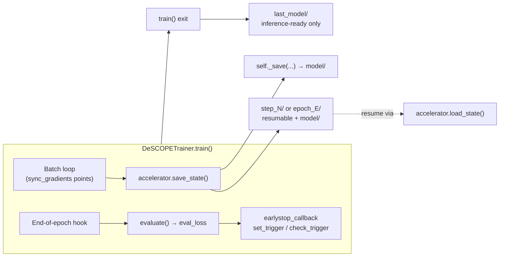
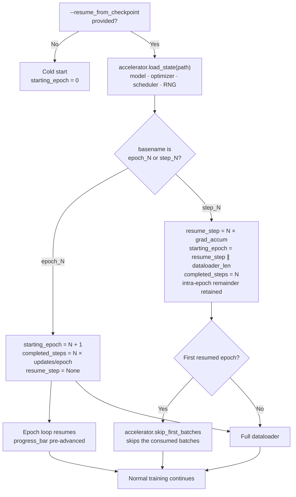

This page explains how DeSCOPE persists training state, how to resume an interrupted run bit-for-bit, and how evaluation-driven early stopping halts distributed sessions. All of this machinery lives in `DeSCOPETrainer.train()`, a single override of the training loop inherited from the external `wppkg` base trainer (pinned to `wppkg==0.1.4` in `pyproject.toml#L20-L26`). The tunable flags — `checkpointing_steps`, `resume_from_checkpoint`, `eval_every_n_epochs`, `earlystop_patience` — come from that base `TrainingArguments` dataclass; DeSCOPE itself only adds loss weights and a pretrained-model path ([arguments.py](/src/descope/arguments.py#L6-L22)).

Sources: [trainer.py](/src/descope/trainer.py#L35-L43), [arguments.py](/src/descope/arguments.py#L6-L22), [pyproject.toml](/pyproject.toml#L20-L26)

## Persistence Architecture: Two Layers of State

DeSCOPE deliberately separates checkpointing into two independent layers. The first layer is **full resumable state**, written by `self.accelerator.save_state(output_dir)` — this captures everything Accelerate knows about the run (model, optimizer, LR scheduler, RNG state across all ranks) so a later run can pick up exactly where it stopped. The second layer is an **inference-ready model snapshot**, written by `self._save(...)` into a `model/` subdirectory, loadable through the standard `from_pretrained` pathway. Every periodic checkpoint directory therefore contains both layers side by side, while the terminal snapshot `last_model/` contains only the second layer.

```
output_dir/
├── step_1000/            # step-based checkpoint (int config)
│   ├── <accelerate state>  # save_state: model + optimizer + scheduler + RNG, per-rank
│   └── model/            # _save: inference-ready weights
├── epoch_9/              # epoch-based checkpoint ("epoch" / "epoch-N" config)
│   ├── <accelerate state>
│   └── model/
├── last_model/           # always written when train() exits — model only
└── run.log               # file logger target ([logging.py wiring])
```

This split maps directly onto the two consumption scenarios: `step_N/` or `epoch_E/` directories feed `accelerator.load_state()` for crash recovery, while `model/` and `last_model/` feed downstream inference — the shipped tutorial notebook points `pretrained_model_name_or_path` straight at `./trainer_output/GM12878/last_model` ([test.ipynb](/tutorials/ATAC_Gene/test.ipynb#L29-L35)).



Sources: [trainer.py](/src/descope/trainer.py#L155-L161), [trainer.py](/src/descope/trainer.py#L184-L197), [trainer.py](/src/descope/trainer.py#L199-L203)

## Checkpointing: Intervals, Formats, and the Final Snapshot

The `checkpointing_steps` argument is polymorphic: an `int` selects **step-based** checkpointing, while a `str` selects **epoch-based** checkpointing. These two paths execute at different points in the training loop and produce differently named directories, so the format you choose determines both the granularity and the recovery semantics of your run.

| Format | Example | Emission point | Directory created |
| --- | --- | --- | --- |
| `int` | `500` | Inside the batch loop, every time `completed_steps % 500 == 0` on a real optimizer step (guarded by `sync_gradients`) | `output_dir/step_{completed_steps}/` |
| `"epoch"` | `"epoch"` | End of every epoch, after evaluation and the early-stop check | `output_dir/epoch_{epoch}/` |
| `"epoch-N"` | `"epoch-10"` | End of every Nth epoch — parsed via `split("-")[-1]` | `output_dir/epoch_{epoch}/` |

Two ordering facts matter for practitioners. First, step-based saves fire *before* the `max_train_steps` bail-out check in the batch loop, but epoch-based saves execute *after* the early-stop block — so when early stopping halts training at the end of epoch E, the `epoch_E/` checkpoint is **never written**; the only artifact from that epoch is `last_model/`. Second, the epoch directory name uses the 0-based epoch index from the `for epoch in range(...)` loop, so `epoch_9` means "state captured after the 10th epoch." Whatever you choose, `train()` unconditionally finishes with `self._save(output_dir/last_model)` followed by `wait_for_everyone()` and `end_training()` — even when early stopping triggered the exit.

> [!TIP]
> When early stopping fires at the end of an epoch, the `break` exits the epoch loop *before* the epoch-based checkpointing block runs. A `checkpointing_steps="epoch-N"` config plus active early stopping means the final epoch's resumable state is lost — only `last_model/` (weights, no optimizer state) survives from that epoch. If you need to resume near the stopping point, use step-based checkpointing.

Sources: [trainer.py](/src/descope/trainer.py#L155-L164), [trainer.py](/src/descope/trainer.py#L166-L197), [trainer.py](/src/descope/trainer.py#L199-L203), [train_descope.sh](/tutorials/ATAC_Gene/train_descope.sh#L32)

## Resuming: Exact Reconstruction of Training Progress

Resuming is driven entirely by the `--resume_from_checkpoint` flag pointing at an existing checkpoint directory. The trainer calls `accelerator.load_state(checkpoint_path)` first — restoring model, optimizer, scheduler, and RNG state — and then performs a small piece of string surgery on the directory's basename to reconstruct the loop counters. If the basename contains `epoch`, resumption starts at the *next* epoch (`starting_epoch = N + 1`, so `epoch_9` resumes at epoch index 10) with `completed_steps` rebuilt as `starting_epoch × num_update_steps_per_epoch`. If it contains `step`, the trainer multiplies by `gradient_accumulation_steps` to convert to real dataloader batches, derives `starting_epoch` from `resume_step // len(train_dataloader)`, and keeps the intra-epoch remainder for batch skipping.



The `skip_first_batches` call at the start of the resumed epoch is what makes step-based recovery *exact*: rather than replaying data the previous session already consumed, the dataloader is fast-forwarded past `resume_step` batches, and the restored RNG state keeps sampling and augmentations identical ([trainer.py](/src/descope/trainer.py#L102-L106)).

One code-level detail deserves attention: the branch that is supposed to auto-discover the most recent checkpoint by scanning the working directory ([trainer.py](/src/descope/trainer.py#L72-L77)) is unreachable — the outer guard `if self.args.resume_from_checkpoint:` only passes truthy values, and inside that block the secondary condition `is not None or != ""` is tautologically true, so the `else` fallback can never execute. In practice this means the empty/`None` value (which skips the whole block anyway) and the auto-scan path both do nothing useful.

> [!TIP]
> Always pass an explicit checkpoint directory to `--resume_from_checkpoint`. The auto-discovery fallback inherited from the upstream Accelerate example is dead code here — a falsy value (`None`/empty) never enters the resume block at all, and no directory scanning ever happens. Passing nothing simply means "train from scratch."

Sources: [trainer.py](/src/descope/trainer.py#L66-L96), [trainer.py](/src/descope/trainer.py#L102-L106)

## Early Stopping: Evaluation-Triggered Distributed Halt

Early stopping is coupled to the evaluation cadence. At the end of each epoch — and only when an `eval_dataloader` exists and `(epoch + 1) % eval_every_n_epochs == 0` — the trainer runs `evaluate()`, which computes a rank-reduced mean of `eval_loss` (along with `eval_mse_loss` and `eval_kl_loss`) via `gather_for_metrics` ([trainer.py](/src/descope/trainer.py#L205-L226)). That scalar is handed to `earlystop_callback.check_early_stopping()`, whose patience is governed by `--earlystop_patience`.

The halt mechanism is explicitly distributed-safe. On any process whose callback decides the patience budget is exhausted, the code calls `self.accelerator.set_trigger()`; immediately afterward, every process runs `self.accelerator.check_trigger()` and breaks *together*. This two-step dance avoids the classic multi-GPU failure mode where rank 0 stops training while rank 1 hangs waiting for a collective that will never arrive.

| Behavior | Detail |
| --- | --- |
| Trigger signal | `eval_loss` evaluated at end-of-epoch, gated by `eval_every_n_epochs` |
| Patience | `--earlystop_patience` evaluations without improvement |
| Cross-rank synchronization | `accelerator.set_trigger()` (deciding rank) → `accelerator.check_trigger()` (all ranks break) |
| Epoch checkpoint on halt | **Skipped** — the `break` precedes the epoch-checkpointing block |
| Final artifact | `last_model/` is still saved |
| Best-model tracking | None — the trainer never auto-saves the best snapshot |
| Resume support | **Not supported** — the callback is re-initialized from scratch on resume |

These last three rows come straight from the class docstring, which documents that early stopping does not survive resumption (the callback re-initializes), that you must align `eval_every_n_epochs` with `checkpointing_steps` if you want a snapshot near the best epoch, and that the final model is always saved ([trainer.py](/src/descope/trainer.py#L37-L42)).

Note also a deployment reality: in the shipped tutorial scripts, `DeSCOPETrainer` is constructed without any evaluation dataset ([train.py](/tutorials/ATAC_Gene/train.py#L80-L87)), so `self.eval_dataloader is None` and the entire evaluation/early-stop path is skipped — training runs to `num_train_epochs` and relies purely on scheduled checkpoints plus `last_model/`. To activate early stopping, you must supply an eval dataloader and set the patience and cadence flags.

Sources: [trainer.py](/src/descope/trainer.py#L166-L182), [trainer.py](/src/descope/trainer.py#L205-L226), [trainer.py](/src/descope/trainer.py#L37-L43), [train.py](/tutorials/ATAC_Gene/train.py#L80-L87)

## What Survives a Restart — and What Doesn't

The resume machinery is asymmetric by design: everything needed to continue *optimization* is persisted, while bookkeeping that shapes *when to stop* is not. This table is the practical checklist before interrupting a long run:

| Aspect | Restored on resume? | Mechanism |
| --- | --- | --- |
| Model weights | ✅ | `accelerator.load_state()` |
| Optimizer + LR scheduler state | ✅ | `accelerator.load_state()` |
| RNG state (sampling / dropout determinism) | ✅ | `accelerator.load_state()` |
| Dataloader position (step-based resume) | ✅ | `accelerator.skip_first_batches()` |
| Epoch / step counters | ✅ | Basename parsing of `epoch_N` / `step_N` |
| Early-stop counter and patience budget | ❌ | Callback re-initialized from zero |
| Best-epoch bookkeeping | ❌ | No best-model auto-save exists |
| Tracking (TensorBoard) continuity | ❌ | Not persisted; logs continue under a fresh session |

Sources: [trainer.py](/src/descope/trainer.py#L66-L106), [trainer.py](/src/descope/trainer.py#L37-L43)

## Configuring in Practice

The flags relevant to this page, as exercised by the reference launch script (note the epoch-based format `epoch-10` saving twice across a 20-epoch run):

| Flag | Role in checkpoint/resume/early-stop |
| --- | --- |
| `--output_dir` | Root for all `step_N/`, `epoch_E/`, `last_model/` directories and `run.log` |
| `--num_train_epochs` | Upper bound of the epoch loop |
| `--max_train_steps` | Optional global optimizer-step cap; checked inside the batch loop |
| `--checkpointing_steps` | `int` → step-based; `"epoch"` / `"epoch-N"` → epoch-based |
| `--eval_every_n_epochs` | Cadence for `evaluate()` and the early-stop check |
| `--earlystop_patience` | Evaluations without `eval_loss` improvement before `set_trigger()` |
| `--resume_from_checkpoint` | Explicit path to a `step_N/` or `epoch_E/` directory |
| `--with_tracking` | Enables `accelerator.log()` for eval metrics at each epoch |

A minimal resume invocation reuses the original training script with one added flag:

```bash
# Original launch (tutorials/ATAC_Gene/train_descope.sh)
accelerate launch --config_file="./accelerate_config.yaml" \
    --num_processes=1 train.py $TRAINPARAMS $DATAPARAMS $MODELPARAMS

# Resume from the epoch-10 boundary checkpoint
accelerate launch --config_file="./accelerate_config.yaml" \
    --num_processes=1 train.py $TRAINPARAMS $DATAPARAMS $MODELPARAMS \
    --resume_from_checkpoint="./results/descope/trainer_output/GM12878/epoch_9"
```

Because all flags are parsed by `HfArgumentParser` from the `DeSCOPETrainingArguments` dataclass ([train.py](/tutorials/ATAC_Gene/train.py#L18-L19)), resumption replays the *same* argument set as the original run — model architecture and data paths must match the checkpoint, or `load_state` will fail on shape mismatches.

Sources: [train_descope.sh](/tutorials/ATAC_Gene/train_descope.sh#L27-L58), [train.py](/tutorials/ATAC_Gene/train.py#L18-L19), [arguments.py](/src/descope/arguments.py#L6-L22)

## Where to Go Next

- [Trainer and Accelerate Integration](15-trainer-and-accelerate-integration) — the surrounding training-loop architecture, logging hooks, and how `DeSCOPETrainer` extends the `wppkg` base class
- [ELBO Loss: MSE and KL Composition](16-elbo-loss-mse-and-k-l-composition) — what `eval_loss` aggregates, which is the quantity early stopping watches
- [Distributed Training with DeepSpeed](18-distributed-training-with-deepspeed) — how `accelerator.save_state` interacts with ZeRO-sharded optimizer state in multi-rank setups
- [Inference Pipeline Design](19-inference-pipeline-design) — consuming `last_model/` via `InferenceForATAC` with `pretrained_model_name_or_path`
- [Leave-One-Out Evaluation Protocol](21-leave-one-out-evaluation-protocol) — checkpoint-per-split training strategy using the `train_descope_loo.sh` variant