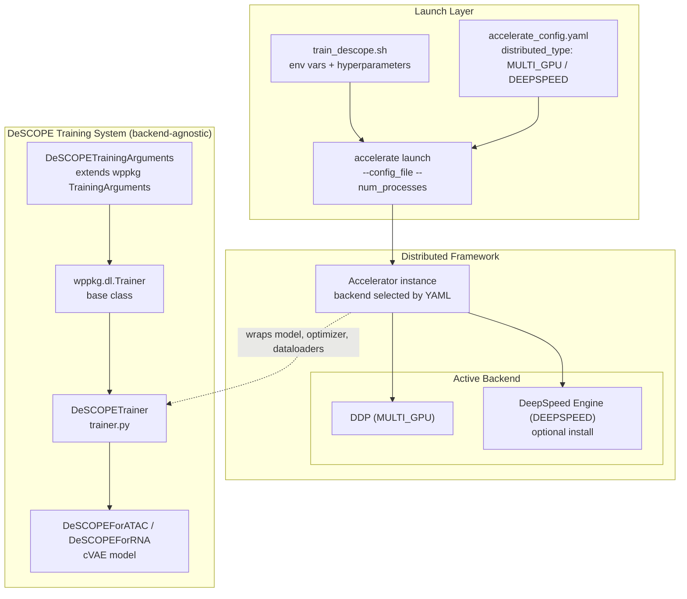
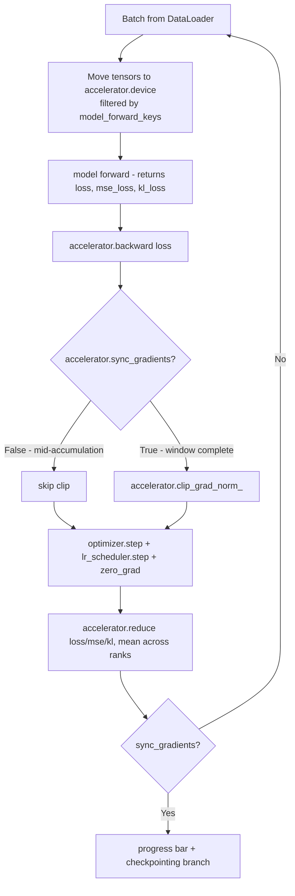
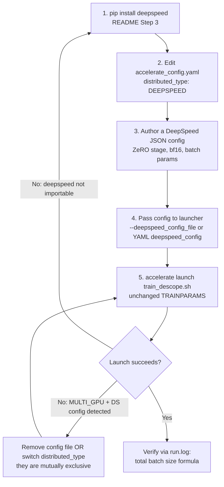

This page explains how DeSCOPE scales training across multiple GPUs, with DeepSpeed as an optional acceleration backend. The core architectural fact: **DeSCOPE contains no DeepSpeed-specific code**. Instead, the entire distributed layer is delegated to [HuggingFace Accelerate](https://github.com/huggingface/accelerate), which treats DeepSpeed as a swappable `distributed_type` backend toggled by a single YAML field. This design means the identical `DeSCOPETrainer` code path executes unchanged whether you run DDP on one GPU or ZeRO sharding on many.

Sources: [README.md](README.md#L61-L69), [pyproject.toml](pyproject.toml#L20-L26), [trainer.py](src/descope/trainer.py#L35-L47)

## Architecture: Accelerate as the Distributed Abstraction

DeSCOPE's dependency stack is deliberately layered so that no component above Accelerate knows which distributed backend is active. The `deepspeed` package is an **optional dependency** — commented out in `pyproject.toml` and documented as "Install deepspeed (optional)" in the README's Step 3 — while the mandatory dependencies (`torch`, `wppkg`) carry no DeepSpeed awareness at all. `wppkg` (the author's own utility package) supplies the base `Trainer` and `TrainingArguments`, which DeSCOPE extends via `DeSCOPETrainer` and `DeSCOPETrainingArguments`. All launch orchestration flows through the `accelerate launch` CLI, which reads `accelerate_config.yaml` and decides whether to instantiate plain DDP or a DeepSpeed engine beneath the same `Accelerator` API.

Sources: [pyproject.toml](pyproject.toml#L20-L26), [README.md](README.md#L61-L69), [arguments.py](src/descope/arguments.py#L2-L7), [trainer.py](src/descope/trainer.py#L8)



Every arrow crossing from the DeSCOPE layer into the Framework layer passes through the `Accelerator` object — never through a backend-specific import. This is the invariant that makes DeepSpeed a configuration decision rather than a code change.

Sources: [pyproject.toml](pyproject.toml#L20-L26), [trainer.py](src/descope/trainer.py#L8-L32)

## The Three-Point Integration Contract

DeepSpeed enters the system at exactly three points, none of which touch library code:

| # | Integration Point | Location | Mechanism |
|---|---|---|---|
| 1 | **Installation** (optional) | `pyproject.toml`, `README.md` Step 3 | `deepspeed` is commented out of dependencies; installed separately via `pip install deepspeed` with system-specific build requirements |
| 2 | **Backend selection** | `accelerate_config.yaml` (shipped in all 4 tutorial dirs) | `distributed_type: MULTI_GPU` (default) or `DEEPSPEED`, plus a config-file convention |
| 3 | **Execution** | `src/descope/trainer.py` | Every distributed operation routes through `self.accelerator.*` calls, which behave identically under DDP or DeepSpeed |

Sources: [pyproject.toml](pyproject.toml#L22), [README.md](README.md#L61-L69), [accelerate_config.yaml](tutorials/ATAC_Gene/accelerate_config.yaml#L1-L3), [trainer.py](src/descope/trainer.py#L111-L133)

The backend selector ships identically in all four tutorial directories (`ATAC_Gene`, `RNA_Gene`, `RNA_Drug/sciplex3_evaluation/fine-tune`, `RNA_Drug/tahoe100m_pretrain`), and its two comments encode the entire activation contract:

```yaml
# Specify distributed_type as `DEEPSPEED` or `MULTI_GPU`
# If you are using MULTI_GPU, please do not pass a DeepSpeed config file.
distributed_type: MULTI_GPU  # DEEPSPEED
```

The second comment is a warning about Accelerate's validation rules: a `MULTI_GPU` run must not receive a DeepSpeed config file, while a `DEEPSPEED` run requires one (supplied via Accelerate's `--deepspeed_config_file` launch flag or the YAML's `deepspeed_config` field). Notably, the repository ships **no** DeepSpeed JSON config — scaling memory via ZeRO stage 2/3 is left as an explicit operator choice, keeping the default footprint minimal.

Sources: [accelerate_config.yaml](tutorials/ATAC_Gene/accelerate_config.yaml#L1-L3), [accelerate_config.yaml](tutorials/RNA_Drug/tahoe100m_pretrain/accelerate_config.yaml#L1-L3), [accelerate_config.yaml](tutorials/RNA_Drug/sciplex3_evaluation/fine-tune/accelerate_config.yaml#L1-L3), [get_repo_structure: tutorials](tutorials/)

## Accelerator-Mediated Training Loop

The `DeSCOPETrainer.train()` loop is the definitive proof of backend-agnosticism. Each step performs six distributed operations, all through the `Accelerator` facade:

| Accelerator Call | Line | Purpose | Behavior under DeepSpeed |
|---|---|---|---|
| `accelerator.accumulate(model)` | L111 | Gradient-accumulation context manager | Enables `sync_gradients` gating; engine defers all-reduce until accumulation completes |
| `batch.to(accelerator.device)` | L112 | Per-rank device placement | Resolves to the local GPU assigned by the launcher |
| `accelerator.backward(loss)` | L117 | Backward pass | Invokes the DeepSpeed engine's backward, triggering ZeRO gradient partitioning |
| `accelerator.sync_gradients` gate | L118 | Guard for reduction boundaries | `True` only on the final micro-step of an accumulation window |
| `accelerator.clip_grad_norm_(...)` | L119 | Global-norm clipping | Coordinates the norm computation across ZeRO-sharded gradients |
| `optimizer.step()` | L120 | Parameter update | Inside DeepSpeed, this is the engine's fused step; ZeRO stages perform the gradient all-reduce here |

Sources: [trainer.py](src/descope/trainer.py#L110-L122)

The gradient-accumulation pattern is structurally significant: clipping is *conditionally skipped* on non-sync steps (only executed when `sync_gradients` is `True`), ensuring the global gradient norm is computed once per optimization step rather than per micro-batch. `optimizer.step()` and `lr_scheduler.step()` also fire unconditionally inside the `accumulate` context — Accelerate internally no-ops them until the accumulation window closes.

Sources: [trainer.py](src/descope/trainer.py#L111-L122)



> [!TIP]
> The `DeSCOPETrainer.__init__` (L44-47) extracts `model_forward_keys` from `accelerator.unwrap_model(self.model)` — the *unwrapped* model. Under DeepSpeed the trainer's `self.model` is a `DeepSpeedEngine` wrapper, not the raw `nn.Module`, so introspecting its signature directly would fail. This unwrap-then-introspect pattern is what lets `filtered_batch = {k: v ... if k in self.model_forward_keys}` (L112) work identically under both backends: any fix you make to batch collation must preserve exactly these forward-argument names.

Sources: [trainer.py](src/descope/trainer.py#L44-L47), [trainer.py](src/descope/trainer.py#L110-L113)

## Cross-Rank Metric Aggregation: Two Strategies

DeSCOPE uses two distinct Accelerate aggregation primitives, each suited to a different statistical context:

| Context | Primitive | Semantics | Why This Choice |
|---|---|---|---|
| Training metrics (`loss`, `mse_loss`, `kl_loss`) | `accelerator.reduce(tensor, "mean")` (L131-133) | Scalar reduction across ranks | Cheap; runs every micro-step without inflating communication |
| Evaluation metrics | `accelerator.gather_for_metrics(tensor)` (L214-216) | Full tensor gather with automatic drop-last trimming | Requires the *complete* per-batch loss distribution so the mean over concatenated tensors is unbiased across uneven rank batches |

The evaluation path uses `gather_for_metrics` because the eval set may not divide evenly across ranks — naive averaging of per-rank means would weight small final batches identically to full ones. Note the `loss.repeat(per_device_eval_batch_size)` before gathering: it restores each scalar to its batch weight so the post-gather `torch.mean` reproduces the true dataset-level average.

Sources: [trainer.py](src/descope/trainer.py#L129-L134), [trainer.py](src/descope/trainer.py#L205-L226)

> [!TIP]
> Under any distributed backend — DDP or DeepSpeed — *every rank* must execute the same sequence of collective calls (`reduce`, `gather_for_metrics`, `backward`, `clip_grad_norm_`). Both call sites in `DeSCOPETrainer` are unconditional inside the loops precisely to avoid distributed deadlocks. If you subclass the trainer and add rank-conditional collectives (e.g., `if accelerator.is_main_process: accelerator.reduce(...)`), only the main rank enters the collective and all other ranks hang at the next barrier.

Sources: [trainer.py](src/descope/trainer.py#L129-L134), [trainer.py](src/descope/trainer.py#L214-L216)

## Launch Topologies Shipped in the Repository

The three tutorial pipelines demonstrate two canonical topologies, all sharing the same `TRAINPARAMS` structure — only device selection, process count, and batch scale differ:

| Tutorial | `CUDA_VISIBLE_DEVICES` | `--num_processes` | `per_device_train_batch_size` | Scale Profile |
|---|---|---|---|---|
| `ATAC_Gene/train_descope.sh` | `"0"` | 1 | 64 | Single-GPU reference run |
| `RNA_Gene/train_descope.sh` | `"0"` | 1 | 64 | Single-GPU reference run |
| `RNA_Drug/tahoe100m_pretrain/train_descope.sh` | `"4,5,6,7"` | 4 | 256 | 4-GPU multi-node-capable pretraining (Tahoe-100M) |

The `total_batch_size` invariant is computed and logged at loop entry (L51): `per_device_train_batch_size × num_processes × gradient_accumulation_steps`. All shipped configs use `gradient_accumulation_steps=1`, so effective batch equals 64 (gene pipelines) or 1024 (Tahoe pretrain). Every script pins `--mixed_precision=bf16` — a `TrainingArguments` field that Accelerate applies regardless of backend, and which DeepSpeed honors through its own bf16 pathway.

Sources: [train_descope.sh](tutorials/ATAC_Gene/train_descope.sh#L51-L58), [train_descope.sh](tutorials/RNA_Gene/train_descope.sh#L51-L58), [train_descope.sh](tutorials/RNA_Drug/tahoe100m_pretrain/train_descope.sh#L51-L58), [trainer.py](src/descope/trainer.py#L51-L59)

## Checkpointing and Resume: Accelerate State Management

Checkpointing is where backend differences are most consequential, and again DeSCOPE handles them transparently. Each save event performs two writes:

1. **`accelerator.save_state(output_dir)`** (L159/L195) — the distributed-complete snapshot. Under DeepSpeed with ZeRO sharding, this writes per-rank optimizer/parameter shards plus the launcher metadata; under DDP it writes consolidated states from the main process. The directory is named `step_{n}` or `epoch_{n}`, and the trainer's resume logic (L67-96) parses these names to reconstruct `starting_epoch` and `resume_step`, then calls `accelerator.load_state(checkpoint_path)` and `skip_first_batches` to skip already-consumed micro-batches without changing the RNG/data schedule.
2. **`self._save(...model)`** (L161/L197) — the deployable model artifact, written into a `model` subdirectory of the same checkpoint.

Epoch-based checkpointing accepts a `"epoch-N"` string format (parsed at L185-190), used by all shipped scripts as `epoch-10` (or `epoch-2` for Tahoe).

Sources: [trainer.py](src/descope/trainer.py#L66-L96), [trainer.py](src/descope/trainer.py#L155-L161), [trainer.py](src/descope/trainer.py#L184-L197)

The shutdown sequence is backend-relevant too: after saving the final model (L200), the trainer calls `accelerator.wait_for_everyone()` (L201) — a barrier ensuring no rank exits before the final `save_state` completes on any rank — followed by `accelerator.end_training()` (L202), which finalizes the tracking integrations (TensorBoard, given `--report_to=tensorboard`) and releases the distributed resources held by the active backend. The rank-aware logger (L11-32) completes the multi-process discipline: the main process logs at `INFO`, all other ranks at `WARN`, all writing to a single `run.log` without interleaved duplicates.

Sources: [trainer.py](src/descope/trainer.py#L199-L203), [trainer.py](src/descope/trainer.py#L11-L29)

## DDP vs. DeepSpeed: Choosing Your Backend

Because the toggle is purely configuration, the decision reduces to workload characteristics:

| Dimension | `MULTI_GPU` (DDP, default) | `DEEPSPEED` |
|---|---|---|
| Memory footprint | Full optimizer states + parameters on every GPU | ZeRO stages shard optimizer states/parameters/gradients across GPUs |
| Dependency burden | None beyond PyTorch | Optional `deepspeed` install with system-specific build (README Step 3) |
| Config artifacts | YAML only — *must not* pass a DS config file | YAML + a DeepSpeed JSON config you supply |
| Code path changes | None | None — identical `trainer.py` |
| Best fit for DeSCOPE | The shipped model scale (hidden_size 672, ~9 encoder/decoder layers) fits comfortably on a single modern GPU; 4-GPU DDP suffices for Tahoe-100M pretraining | Very large `input_length` (ATAC cCRE dimensionality) or scaled-up variants where optimizer-state memory dominates |

Sources: [accelerate_config.yaml](tutorials/ATAC_Gene/accelerate_config.yaml#L1-L3), [pyproject.toml](pyproject.toml#L22), [README.md](README.md#L61-L69), [train_descope.sh](tutorials/RNA_Drug/tahoe100m_pretrain/train_descope.sh#L33-L34)

## Activating DeepSpeed: Step-by-Step



Common failure modes, all derivable from the shipped configuration:

| Symptom | Root Cause | Fix |
|---|---|---|
| Accelerate rejects launch: DS config present with `MULTI_GPU` | YAML left at `distributed_type: MULTI_GPU` while a config file is passed | Follow the YAML's own comment: switch to `DEEPSPEED` first |
| `ImportError: deepspeed` | Optional dependency not installed | Complete README Step 3; DeepSpeed often needs a local compiler toolchain |
| Different batch semantics after switching backends | DeepSpeed configs may re-declare `train_batch_size`/micro-batch | Keep DeepSpeed `train_micro_batch_size_per_gpu` equal to `per_device_train_batch_size` from `TRAINPARAMS` |
| bf16 errors on pre-Ampere hardware | `--mixed_precision=bf16` requires bf16-capable GPUs | Switch `TRAINPARAMS` to `fp16` (both backends honor this field) |

Sources: [README.md](README.md#L61-L69), [accelerate_config.yaml](tutorials/ATAC_Gene/accelerate_config.yaml#L1-L3), [train_descope.sh](tutorials/ATAC_Gene/train_descope.sh#L27-L48), [trainer.py](src/descope/trainer.py#L51-L59)

## Related Pages

For the surrounding training-system context: the trainer's construction, callback wiring, and argument plumbing are covered in [Trainer and Accelerate Integration](15-trainer-and-accelerate-integration); checkpoint formats, resume semantics, and the early-stopping trigger (`accelerator.set_trigger` / `check_trigger`, L176-182) are detailed in [Checkpointing, Resuming, Early Stopping](17-checkpointing-resuming-early-stopping); the loss terms being reduced (`mse_loss`, `kl_loss`) are derived in [ELBO Loss: MSE and KL Composition](16-elbo-loss-mse-and-kl-composition); and the end-to-end execution recipe spanning tokenize → train → test lives in [Tutorial Pipeline: Tokenize, Train, Evaluate](4-tutorial-pipeline-tokenize-train-evaluate).