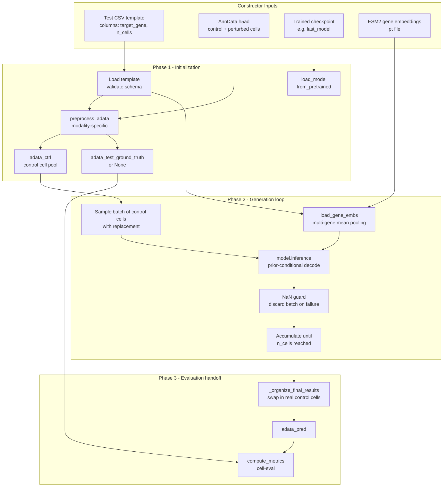
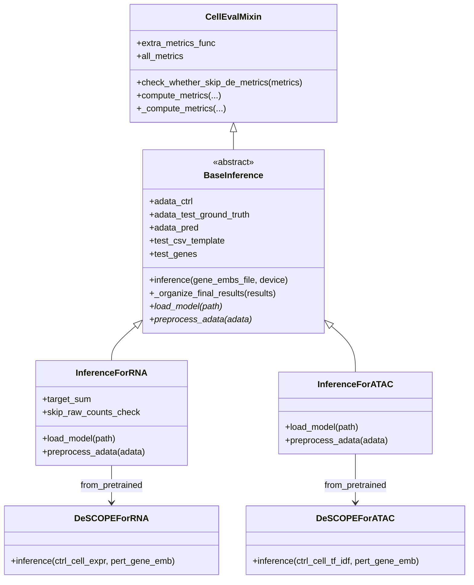
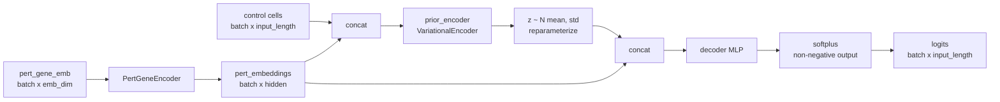

DeSCOPE's inference system answers a single question: *given a population of unperturbed control cells and a perturbation identity, what would the perturbed cells look like?* Rather than predicting a single bulk profile, the pipeline **generates** cell-level counterfactuals by decoding latent variables sampled from a learned conditional prior — one synthetic cell per requested quota, driven entirely by control cells and gene embeddings. This page explains how that generation machinery is designed: the class topology in `src/descope/inference.py`, the conditional sampling loop, modality-specific preprocessing contracts, gene embedding resolution, and the handoff to metric computation. Metric definitions themselves are covered in [Perturbation Metrics via Cell-Eval](20-perturbation-metrics-via-cell-eval), and evaluation protocols in [Leave-One-Out Evaluation Protocol](21-leave-one-out-evaluation-protocol) and [Zero-Shot and Fine-Tuning Workflows](22-zero-shot-and-fine-tuning-workflows).

Sources: [inference.py](src/descope/inference.py#L286-L348), [modeling_descope.py](src/descope/models/modeling_descope.py#L178-L196)

## End-to-End Architecture

The pipeline is staged into three phases — **initialization**, **generation**, and **evaluation handoff** — connected through four artifacts held on the inference object: `adata_ctrl` (the control cell pool), `adata_test_ground_truth` (real perturbed cells, when available), `adata_pred` (the generated cells), and the test CSV template (the per-perturbation generation quota). The initialization phase consumes a trained checkpoint, a raw AnnData file, and the CSV template; the generation phase consumes control cells plus ESM2 gene embeddings; the evaluation phase compares `adata_pred` against `adata_test_ground_truth` through cell-eval. This separation means a perturbation never needs to be present in the input AnnData to be generated — only its embedding must exist, which is what makes zero-shot evaluation structurally possible.



Sources: [inference.py](src/descope/inference.py#L200-L241), [inference.py](src/descope/inference.py#L286-L348), [inference.py](src/descope/inference.py#L350-L370)

## Class Topology: Mixin and Template Method

The module is organized around two compositional patterns. **`CellEvalMixin`** is a standalone capability class that wraps the external `cell-eval` library — it exposes metric discovery (`all_metrics`, `all_de_metrics`), metric computation, and a registry of four DeSCOPE-specific extra metrics. **`BaseInference`** is an abstract base class that inherits `CellEvalMixin` and applies the *template method* pattern: it fixes the entire generation algorithm in `inference()` while deferring exactly two hooks to subclasses — `load_model()` and `preprocess_adata()`. The concrete classes `InferenceForRNA` and `InferenceForATAC` are therefore thin: each supplies only a HuggingFace-style `from_pretrained` call and a preprocessing function; everything else (sampling, quota enforcement, result assembly, evaluation) is shared. This design guarantees that RNA and ATAC evaluations execute byte-identical generation logic, eliminating a whole class of modality-specific inference bugs.



Sources: [inference.py](src/descope/inference.py#L70-L97), [inference.py](src/descope/inference.py#L199-L206), [inference.py](src/descope/inference.py#L372-L391), [inference.py](src/descope/inference.py#L394-L424)

## Constructor Contract: Template, Data, and Model

`BaseInference.__init__` enforces a strict contract before any generation can run. The test CSV template must contain exactly two columns — `target_gene` and `n_cells` — validated by `_check_test_csv_template`, which raises on missing columns. The template drives both *what* is generated (each row's `target_gene` selects a gene embedding) and *how much* (each row's `n_cells` sets the generation quota). The unique target genes are extracted into `self.test_genes`, with the control name appended so control cells also receive an embedding. After loading the model and preprocessing the AnnData, the constructor splits the data two ways: `_prepare_control_adata` extracts all cells whose `obs[pert_col]` equals `ctrl_name` (raising if none exist — inference is impossible without a control pool), and `_prepare_test_adata` extracts cells for all test genes, downgrading to `None` with a warning if any test gene is absent from the data. Finally, if the template lacks a control row, one is appended with `n_cells = len(adata_ctrl)` so the control population is also counted in the generation pass. Notably, this `{"target_gene", "n_cells"}` schema matches exactly the `target_info.csv` emitted by `intersect_adatas_for_celltype_transfer`, which is how cross-dataset templates are produced upstream.

| Template column | Type | Role in pipeline |
|---|---|---|
| `target_gene` | str | Selects the perturbation gene embedding; drives `test_genes` |
| `n_cells` | int | Generation quota per perturbation; controls `adata_pred` size |

Sources: [inference.py](src/descope/inference.py#L200-L241), [inference.py](src/descope/inference.py#L249-L284), [utils.py](src/descope/utils.py#L323-L327)

## The Generation Loop: Prior-Conditional Sampling

The heart of the pipeline is `BaseInference.inference()`, decorated with `@torch.no_grad()`. For each template row, the loop repeatedly samples `batch_size` control cells **with replacement** via `random.choices`, converts them to a dense float32 tensor, and tiles the target gene's embedding across the batch so each control cell is paired with the perturbation condition. It then calls the model's `inference()` method and reads back `.logits` — the generated expression vectors. Three robustness mechanisms shape the loop. First, a **NaN guard**: if any generated cell contains NaN, the entire batch is discarded and re-sampled, preventing a single numerical failure from contaminating the output. Second, a **quota loop**: batches accumulate until `n_cells` is reached, with the final batch trimmed to remove overshoot. Third, **seeded stochasticity**: `random.seed(seed)` fixes control-cell selection across runs, so the only run-to-run variation left is which cells are drawn — the latent sampling noise comes from torch's global RNG (`torch.randn_like` inside the reparameterization), not the Python seed.

> [!TIP]
> At the model level, inference deliberately routes through the **prior** encoder, not the posterior: `DeSCOPEForATAC.inference()` concatenates the control cell with the perturbation embedding and samples `z ~ N(prior_mean, prior_logvar)`, never touching the posterior encoder or ground-truth labels. This is what makes the model generative at test time — the posterior encoder exists purely for training-time ELBO computation (see [Prior and Posterior Variational Encoders](9-prior-and-posterior-variational-encoders)). Note also that the `seed` argument governs only control-cell selection via Python's `random` module; latent noise is drawn from torch's unseeded global RNG.



Sources: [inference.py](src/descope/inference.py#L286-L348), [modeling_descope.py](src/descope/models/modeling_descope.py#L55-L58), [modeling_descope.py](src/descope/models/modeling_descope.py#L178-L196), [modeling_descope.py](src/descope/models/modeling_descope.py#L264-L282)

## Modality Preprocessing Contracts

The two subclasses attach fundamentally different preprocessing semantics to the same base algorithm, reflecting the different scales on which each modality is modeled. For **RNA**, `preprocess_rna_perturbation_adata` removes cells with missing perturbation labels, then decides adaptively whether to normalize: if `skip_raw_counts_check=False`, a heuristic (`guess_is_lognorm` from the `wppkg` package) detects already log-normalized data and skips re-normalization; if `True`, it unconditionally applies `normalize_total(target_sum=1e4)` followed by `log1p`. For **ATAC**, `preprocess_atac_perturbation_adata_consistent_with_epiagent` first validates EpiAgent compatibility — the AnnData must contain exactly 1,355,445 cCREs with floating-point (TF-IDF) values — then selects the top-k most active cCREs by total column signal (with a stable sort for deterministic selection, where k comes from `model.config.input_length`), and finally drops cells with NaN perturbation labels. The ATAC path receives no log-normalization because the model operates in TF-IDF space, a distinction that also propagates into evaluation as we will see below.

| Dimension | `InferenceForRNA` | `InferenceForATAC` |
|---|---|---|
| Model class | `DeSCOPEForRNA.from_pretrained` | `DeSCOPEForATAC.from_pretrained` |
| Input representation | log1p-normalized expression | TF-IDF values over top-k cCREs |
| `pert_col` default | `"target_gene"` | `"perturbation"` |
| `ctrl_name` default | `"non-targeting"` | `"control"` |
| Normalization | heuristic-detect `normalize_total` + `log1p` | none (TF-IDF required upstream) |
| Feature selection | full `var_names` of input adata | top-k cCREs by total signal (stable sort) |
| Extra constructor params | `target_sum=1e4`, `skip_raw_counts_check=False` | — |

Sources: [inference.py](src/descope/inference.py#L381-L424), [utils.py](src/descope/utils.py#L571-L637), [utils.py](src/descope/utils.py#L491-L568)

## Gene Embedding Resolution

Before generation, `load_gene_embs` resolves the test perturbations into conditioning vectors from a `.pt` file containing a `{gene_name: tensor}` dictionary — in the tutorials, ESM2-derived protein embeddings. The loader handles three cases that matter for real-world perturbation panels. Gene aliases are patched explicitly (a `TAFAZZIN` entry is duplicated as `TAZ`). Single-gene perturbations absent from the file are substituted with **zero vectors** — the generation proceeds, but the perturbation conditioning is silently neutral, so the log listing missing perturbations deserves a careful read. Multi-gene combinatorial perturbations, denoted with `+` (e.g., `"GeneA+GeneB"`), are resolved by splitting on `+`, substituting zeros for any missing constituent, and **mean-pooling** the constituent embeddings into one vector. This design means combinatorial conditions are never blocked at inference time; they degrade gracefully toward the mean of the available constituents.

> [!TIP]
> Because missing single-gene perturbations are zero-filled rather than rejected, a typo in the CSV template produces *plausible-looking but condition-free* predictions — every generated cell reflects only the prior over control cells. When results look suspiciously uniform across perturbations, check the "missing perturbations" log emitted by `load_gene_embs` first.

Sources: [utils.py](src/descope/utils.py#L378-L464), [inference.py](src/descope/inference.py#L303)

## From Tensors to AnnData: Result Assembly

The raw generation output is a flat NumPy array of shape `(total_cells, n_features)`, which `_organize_final_results` re-materializes into a valid `AnnData`. The `obs[pert_col]` column is reconstructed by expanding each template row's `target_gene` across its `n_cells`, preserving the exact per-perturbation quotas; `var_names` are inherited from the control AnnData, anchoring the feature axis to the model's expected gene order. One step is critical for metric validity: when `use_generated_control_cells=False` (the only permitted setting — the flag is guarded by a hard assertion declaring generated controls "internal debugging only"), the pipeline **discards** the generated control cells and concatenates the *real* control pool into `adata_pred` instead. This matters because cell-eval's bulk metrics compute perturbation effects as `Δ = bulk_perturbation − bulk_control`; substituting real controls guarantees that both sides of the comparison in [Perturbation Metrics via Cell-Eval](20-perturbation-metrics-via-cell-eval) use identical control baselines, isolating generation quality from control-cell noise.

Sources: [inference.py](src/descope/inference.py#L295-L301), [inference.py](src/descope/inference.py#L344-L370), [test.ipynb](tutorials/RNA_Gene/test.ipynb#L44-L52)

## Evaluation Handoff: The CellEvalMixin

`CellEvalMixin` bridges generated AnnData to the external cell-eval library, with one deliberate deviation: `compute_metrics()` monkey-patches `cell_eval._evaluator._build_anndata_pair` with `_build_anndata_pair_NOCHECK`, bypassing cell-eval's default validation that expression matrices be log1p-normalized. This is a necessity, not an oversight — ATAC predictions live in TF-IDF space (format checks would fail), and RNA predictions come out of a softplus decoder as non-negative but *not* log1p-scale values (see [Decoder and Softplus Output Design](10-decoder-and-softplus-output-design)). The stricter, validating path remains available via `_compute_metrics()` for users whose data conforms. Under the hood, the mixin instantiates a `MetricsEvaluator`, computes only the requested subset of the metric registry (skipping differential-expression computation entirely when no DE metrics are selected, via `skip_de`), and returns two Polars DataFrames (per-perturbation and aggregated results) plus the evaluator itself — the latter is the gateway to the extra metrics, which operate on `evaluator.anndata_pair`.

| Metric source | Examples | Access pattern |
|---|---|---|
| cell-eval built-in | `pearson_delta`, `overlap_at_N`, `discrimination_score_l1`, `mae` | `compute_metrics(metrics_to_calculate=[...])` |
| DeSCOPE extra | `pearson`, `pearson_delta_on_topk_de`, `direction_match_on_topk_de`, `edistance` | `infer.extra_metrics_func.<name>(evaluator.anndata_pair, ...)` |

The extra metrics exploit the same cell-eval artifacts: `pearson_delta_on_topk_de` reads the DE CSV that cell-eval wrote to `outdir`, ranks genes by FDR, and correlates predicted vs. real perturbation effects (bulk differences) over the top-k genes; `direction_match_on_topk_de` measures sign agreement, optionally splitting up- from down-regulated genes. Their mathematical definitions and interpretation belong to [Perturbation Metrics via Cell-Eval](20-perturbation-metrics-via-cell-eval); here the architectural point is that all of them hang off the single evaluator object returned by `compute_metrics`.

Sources: [inference.py](src/descope/inference.py#L35-L67), [inference.py](src/descope/inference.py#L126-L196), [utils.py](src/descope/utils.py#L640-L707), [utils.py](src/descope/utils.py#L728-L757)

## Canonical Usage Pattern

Both tutorials (`tutorials/RNA_Gene/test.ipynb`, `tutorials/ATAC_Gene/test.ipynb`) instantiate the pipeline identically in four steps, differing only in constructor parameters. Step 1 constructs the inference object with the CSV template, the H5AD data, and the trained checkpoint path (e.g., `./trainer_output/HEPG2/last_model`, produced by the training system described in [Checkpointing, Resuming, Early Stopping](17-checkpointing-resuming-early-stopping)). Step 2 calls `infer.inference(...)` with the gene embedding file, device, and `batch_size=256`, keeping `use_generated_control_cells=False` as both notebooks warn emphatically. Step 3 computes metrics: cell-eval built-ins through `compute_metrics`, then the extra metrics off the returned evaluator. Step 4 aggregates per-perturbation scores into a summary table by mapping the extra-metric dictionaries onto the results DataFrame. The complete walk-through with real datasets is in [Tutorial Pipeline: Tokenize, Train, Evaluate](4-tutorial-pipeline-tokenize-train-evaluate) and the drug-perturbation case studies in [Drug Perturbation Case Studies: Sciplex3, Tahoe-100M](5-drug-perturbation-case-studies-sciplex3-tahoe-100m).

```python
# Step 1 - Initialize (RNA example; ATAC uses pert_col="perturbation", ctrl_name="control")
infer = InferenceForRNA(
    test_csv_template_fp="Test_Info.csv",
    adata="HEPG2.h5ad",
    pretrained_model_name_or_path="./trainer_output/HEPG2/last_model",
    pert_col="target_gene",
    ctrl_name="non-targeting",
    target_sum=1e4,
    skip_raw_counts_check=True,
)

# Step 2 - Generate
infer.inference(
    gene_embs_file="ESM2_pert_features.pt",
    device=torch.device("cuda:0"),
    batch_size=256,
    use_generated_control_cells=False,   # always
)

# Step 3 - Evaluate (built-ins + extras off the shared evaluator)
results, agg_results, evaluator = infer.compute_metrics(
    adata_pred=infer.adata_pred,
    adata_real=infer.adata_test_ground_truth,
    metrics_to_calculate=["pearson_delta", "overlap_at_N", "discrimination_score_l1", "mae"],
    control_pert=infer.ctrl_name,
    pert_col=infer.pert_col,
    de_method="wilcoxon",
    num_threads=32,
    outdir="./cell-eval-outdir/HEPG2",
)
pearson_delta_on_topk_de, _ = infer.extra_metrics_func.pearson_delta_on_topk_de(
    data=evaluator.anndata_pair, de_real="./cell-eval-outdir/HEPG2/real_de.csv", topk=20
)
```

Sources: [test.ipynb](tutorials/RNA_Gene/test.ipynb#L29-L119), [test.ipynb](tutorials/ATAC_Gene/test.ipynb#L29-L117), [test.ipynb](tutorials/RNA_Gene/test.ipynb#L146-L183)

## Design Trade-offs

Several decisions in the loop trade statistical purity for robustness and scale, and it is worth reading them explicitly. The with-replacement control-cell sampling means a small control pool can still fill large quotas, but the generated population is a bootstrap sample of the pool rather than an exhaustive draw; the quota coming from the CSV template (rather than from actual perturbed-cell counts) deliberately decouples generation size from data availability — essential for zero-shot conditions that have no observed cells at all. The discard-and-retry NaN handling favors simplicity over gradient-clip-style repair, at the cost of a mild selection bias toward numerically stable latent draws. And the template-driven architecture means the same code path serves seen, unseen, and combinatorial perturbations uniformly — the only modality-specific logic lives behind the two abstract hooks. For extending these patterns to new modalities, see [Extending DeSCOPE to New Modalities](24-extending-descope-to-new-modalities).

| Decision | Benefit | Cost |
|---|---|---|
| With-replacement control sampling | Works with any pool size; deterministic under seed | Bootstrap duplication in small pools |
| Template-driven quotas | Enables zero-shot generation; decouples from data | Quota realism depends on template authorship |
| NaN batch discard | Simple, prevents silent corruption | Mild bias toward stable latent regions |
| Real-control substitution in `adata_pred` | Identical baselines for `Δ` metrics | `adata_pred` is not purely model output |
| Zero-fill missing gene embeddings | Graceful degradation for novel perts | Silent neutral conditioning if unchecked |

Sources: [inference.py](src/descope/inference.py#L286-L348), [inference.py](src/descope/inference.py#L350-L370), [utils.py](src/descope/utils.py#L438-L449)

## Where to Go Next

To go deeper on this pipeline's neighbors: [Perturbation Metrics via Cell-Eval](20-perturbation-metrics-via-cell-eval) details every metric surfaced by `CellEvalMixin`; [Leave-One-Out Evaluation Protocol](21-leave-one-out-evaluation-protocol) and [Zero-Shot and Fine-Tuning Workflows](22-zero-shot-and-fine-tuning-workflows) show how this inference machinery is orchestrated for benchmarking and transfer; and the conditioning inputs consumed here — ESM2 gene embeddings and the decoder's output transform — are dissected in [PertGene Encoder and ESM2 Embeddings](8-pertgene-encoder-and-esm2-embeddings) and [Decoder and Softplus Output Design](10-decoder-and-softplus-output-design). For the module-level inventory of everything discussed above, consult [API Reference and Module Layout](23-api-reference-and-module-layout).
