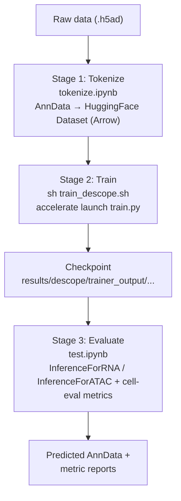
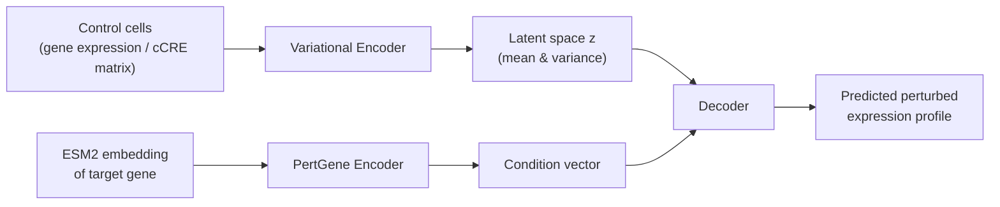

This page gets you from zero to your first single-cell perturbation prediction with **DeSCOPE** in under an hour. You will install the package, verify the environment, run a complete prediction-and-evaluation workflow using the public API, and preview the end-to-end Tokenize → Train → Evaluate pipeline. No prior experience with the codebase is assumed — only basic Python and familiarity with running Jupyter notebooks.

Sources: [README.md](/README.md#L13-L25)

## What is DeSCOPE? (30-Second Orientation)

DeSCOPE (**Dec**oding **S**ingle-Cell **O**mics of **P**erturbation R**e**sponses) is a framework for predicting how individual cells respond to genetic perturbations. It supports both **scRNA-seq** and **scATAC-seq** modalities and is built on a **conditional Variational Autoencoder (cVAE)**, where each perturbed gene is represented by an embedding derived from **ESM2** (a protein language model). In plain terms: you give DeSCOPE a batch of untreated control cells plus the identity of the gene you plan to perturb, and it generates what those cells' expression profiles would look like after the perturbation.


Sources: [README.md](/README.md#L19-L25)

## Installation

DeSCOPE ships on PyPI under the name `descopex` and requires **Python ≥ 3.10**. The install follows four steps: create an isolated environment, install PyTorch first (so you get the correct CUDA build for your machine), optionally install DeepSpeed, then install the package itself.

```bash
# Step 1: Create and activate a Python 3.10 environment
conda create -n descope python=3.10
conda activate descope

# Step 2: Install PyTorch for your CUDA version (torch ≥ 2.6 recommended)
# Example for CUDA 12.6:
pip install torch==2.7.1 torchvision==0.22.1 torchaudio==2.7.1 --index-url https://download.pytorch.org/whl/cu126

# Step 3 (optional, for multi-GPU training): install DeepSpeed
pip install deepspeed

# Step 4: Install DeSCOPE
pip install descopex
# ...or from source:
git clone https://github.com/Peg-Wu/DeSCOPE.git
cd DeSCOPE
pip install -e .
```

The summary table below collects the four steps and their purpose:

| Step | Action | Why It Matters |
| :--- | :--- | :--- |
| 1. Environment | `conda create -n descope python=3.10` | Isolates dependencies; Python ≥ 3.10 is a hard requirement |
| 2. PyTorch | `pip install torch==...` (per your CUDA) | Must match your GPU driver; old versions are unsupported |
| 3. DeepSpeed *(optional)* | `pip install deepspeed` | Only needed if you plan distributed/large-scale training |
| 4. DeSCOPE | `pip install descopex` | Pulls the core runtime dependencies automatically |

Installing `descopex` automatically pulls its pinned runtime stack — `torch`, `wppkg==0.1.4`, `cell-eval==0.6.6` (the evaluation backend), and `pdex==0.1.28` — so there is nothing else to wire up manually.

Sources: [README.md](/README.md#L27-L85), [docs/source/Installation.md](/docs/source/Installation.md#L1-L57), [pyproject.toml](/pyproject.toml#L19-L26)

## Verify Your Installation

Before touching any data, confirm the package resolves correctly. The library exposes a one-line health check that prints the version banner, repository links, and author contacts:

```python
import descope
descope.welcome()
```

If the ASCII-art banner prints without import errors, your environment is ready. Note that simply importing `descope` also surfaces the entire public API — models (`DeSCOPEForRNA`, `DeSCOPEForATAC`, `DeSCOPEConfig`), tokenizers (`TokenizerForRNA`, `TokenizerForATAC`), inference tools (`InferenceForRNA`, `InferenceForATAC`), and the `DeSCOPETrainer` are all exported at the top level.

Sources: [src/descope/__init__.py](/src/descope/__init__.py#L1-L36), [src/descope/__init__.py](/src/descope/__init__.py#L39-L71)

## Your First Perturbation Prediction

The fastest way to see DeSCOPE work end-to-end is the inference API. The library ships runnable notebooks in `tutorials/RNA_Gene/test.ipynb` and `tutorials/ATAC_Gene/test.ipynb` that demonstrate the full flow in three cells: **initialize → predict → evaluate**. Here is the RNA workflow (the ATAC variant is identical, swapping in `InferenceForATAC`):

```python
import torch
from descope.inference import InferenceForRNA

# 1. Initialize the inference tool
infer = InferenceForRNA(
    test_csv_template_fp="Test_Info_HEPG2.csv",   # CSV listing perturbations to simulate
    adata="HEPG2.h5ad",                            # AnnData containing control + perturbed cells
    pretrained_model_name_or_path="./trainer_output/HEPG2/last_model",
    pert_col="target_gene",                        # obs column holding perturbation labels
    ctrl_name="non-targeting",                     # label of the control population
    target_sum=1e4,
    skip_raw_counts_check=True,
)

# 2. Run the generation loop (always keep use_generated_control_cells=False)
infer.inference(
    gene_embs_file="ESM2_pert_features.pt",        # precomputed ESM2 embeddings per gene
    device=torch.device("cuda:0"),
    batch_size=256,
    use_generated_control_cells=False,
)

# 3. Evaluate predictions against ground truth
metrics_to_calculate = ["pearson_delta", "overlap_at_50", "mae", "discrimination_score_l1"]
results, agg_results, evaluator = infer.compute_metrics(
    adata_pred=infer.adata_pred,
    adata_real=infer.adata_test_ground_truth,
    metrics_to_calculate=metrics_to_calculate,
    control_pert=infer.ctrl_name,
    pert_col=infer.pert_col,
)
```

Under the hood, step 2 samples control cells in batches, pairs each with the ESM2 embedding of the target gene, runs the model's `inference()` forward pass, and accumulates exactly `n_cells` predictions per perturbation before assembling a predicted `AnnData` in `infer.adata_pred` [inference.py](/src/descope/inference.py#L286-L348). Step 3 delegates to the bundled `cell-eval` library through the `CellEvalMixin` that every inference class inherits [inference.py](/src/descope/inference.py#L70-L158).

The constructor arguments you will most often touch:

| Parameter | Default | Purpose |
| :--- | :--- | :--- |
| `test_csv_template_fp` | required | CSV specifying which perturbations to generate; must contain `target_gene` and `n_cells` columns |
| `adata` | required | Path to a `.h5ad` file (or an `AnnData` object) that includes your control cells |
| `pretrained_model_name_or_path` | required | Directory of a trained checkpoint (loaded via `from_pretrained`) |
| `pert_col` | `"perturbation"` | Column in `adata.obs` that labels each cell's perturbation |
| `ctrl_name` | `"control"` | Label identifying the control population inside `pert_col` |
| `target_sum` / `skip_raw_counts_check` | RNA-specific | Normalization target and count-format validation toggle for scRNA inputs |

Sources: [tutorials/RNA_Gene/test.ipynb](/tutorials/RNA_Gene/test.ipynb#L10-L120), [src/descope/inference.py](/src/descope/inference.py#L199-L241)

> [!TIP]
> The test CSV template is validated at construction time: it **must** contain the columns `target_gene` and `n_cells`, or initialization raises a `ValueError` listing the missing columns. `n_cells` controls how many simulated cells are generated per perturbation, matching real dataset scale.

> [!TIP]
> Never set `use_generated_control_cells=True` — the constructor actively asserts against it. Final predictions always splice in the **real** control cells rather than model-generated ones, which keeps evaluation stable [inference.py](/src/descope/inference.py#L295-L300).

## The End-to-End Tutorial Pipeline (5-Minute Tour)

While the inference API lets you evaluate a pretrained checkpoint immediately, the full DeSCOPE workflow for training your own model follows a fixed three-stage pattern, mirrored identically in all three tutorial folders (`tutorials/RNA_Gene/`, `tutorials/ATAC_Gene/`). Each stage has a dedicated artifact: notebooks handle tokenization and evaluation, and a shell script drives training.



The three commands you would actually run:

```bash
# Stage 1 — open and run tokenize.ipynb to convert .h5ad into a tokenized HF dataset

# Stage 2 — train (edit paths inside the script first)
sh train_descope.sh       # standard training
sh train_descope_loo.sh   # leave-one-out variant (held-out perturbation protocol)

# Stage 3 — open and run test.ipynb for inference + metrics
```

Each training script is organized into three commented parameter blocks — `MODELPARAMS` (architecture: hidden size, layer counts), `DATAPARAMS` (dataset directory, control label, ESM2 embedding file), and `TRAINPARAMS` (epochs, batch size, learning rate, mixed precision) — then launched through Hugging Face `accelerate` with a local `accelerate_config.yaml`, so a single machine or a multi-GPU cluster uses the same entrypoint.

Sources: [tutorials/RNA_Gene/README.md](/tutorials/RNA_Gene/README.md#L1-L25), [tutorials/ATAC_Gene/README.md](/tutorials/ATAC_Gene/README.md#L1-L25), [tutorials/RNA_Gene/train_descope.sh](/tutorials/RNA_Gene/train_descope.sh#L1-L58)

## Pick a Starter Dataset

Every tutorial needs an `.h5ad` perturbation dataset and a matching ESM2 gene-embedding file. The repository's Datasets Zoo curates public scRNA-seq and scATAC-seq resources with direct download links. For a first run, start **small**: the table below is ordered roughly by download size, and `HEPG2` (5.2 GB) is the exact dataset used in the bundled `test.ipynb` example.

| Dataset | Size | Source (Paper) | Notes for Beginners |
| :--- | :--- | :--- | :--- |
| HEPG2 | 5.2 GB | Nadig et al., 2025 | Smallest scRNA option; used in the official test notebook |
| RPE1 | 8.1 GB | Replogle et al., 2022 | Classic genome-wide Perturb-seq benchmark |
| JURKAT | 8.7 GB | Nadig et al., 2025 | T-cell line dataset |
| K562_ESSENTIAL | 9.9 GB | Replogle et al., 2022 | Default dataset in `train_descope.sh` |
| Norman_K562 | — | Norman et al., 2019 | combinatorial-perturbation benchmark |
| K562_GWPS | 61.3 GB | Replogle et al., 2022 | Full genome-wide screen — download last |
| PC-9 | — | DeSCOPE authors | In-house dataset (Zenodo) |
| Human-scATAC-Corpus | — | — | Cell-by-cCRE matrices for the ATAC modality |

One important shortcut: the **ESM2 gene embeddings** that inference requires (the `gene_embs_file` argument) can be obtained alongside the H1 dataset from the [Virtual Cell Challenge 2025](https://virtualcellchallenge.org/) — the README explicitly calls this out, so you do not need to run ESM2 yourself to get started.

Sources: [README.md](/README.md#L94-L114)

## Architecture at a Glance

A minimal mental model will make every later page easier to read. DeSCOPE treats perturbation prediction as **conditional generation**: control cells flow through an encoder into a probabilistic latent space, and the decoder reconstructs expression *conditioned on* the target gene's ESM2 embedding. Training optimizes an ELBO objective (reconstruction + KL divergence), which is why you see both `alpha_mse_loss` and `alpha_kl_loss` in the training script.



Two concrete model classes implement this design — `DeSCOPEForRNA` and `DeSCOPEForATAC` — and both are Hugging Face `PreTrainedModel` subclasses, which is why checkpoints load with a familiar `from_pretrained(...)` call in the inference classes.

Sources: [src/descope/inference.py](/src/descope/inference.py#L18-L30), [tutorials/RNA_Gene/train_descope.sh](/tutorials/RNA_Gene/train_descope.sh#L10-L48), [README.md](/README.md#L23-L24)

## Repository Layout

Familiarizing yourself with the directory structure maps each Quick Start step to its source of truth:

```
DeSCOPE/
├── src/descope/            # The installable package (imported as `descope`)
│   ├── __init__.py         #   Public API exports + welcome()
│   ├── tokenizer.py        #   Stage 1: AnnData → HF Dataset tokenizers
│   ├── trainer.py          #   Stage 2: DeSCOPETrainer (accelerate-based)
│   ├── inference.py        #   Stage 3: InferenceForRNA / InferenceForATAC
│   ├── models/             #   cVAE architectures + configs
│   ├── dataset.py          #   HFDatasetForRNA / HFDatasetForATAC
│   ├── arguments.py        #   Data/Model/Training argument groups
│   └── utils.py            #   Metrics, preprocessing, embedding loaders
├── tutorials/
│   ├── RNA_Gene/           #   tokenize.ipynb, train_descope.sh, test.ipynb
│   ├── ATAC_Gene/          #   Same three-stage pattern for scATAC
│   └── RNA_Drug/           #   Drug perturbation case studies
└── docs/source/            #   Read the Docs pages (you are here)
```

Sources: [src/descope/__init__.py](/src/descope/__init__.py#L10-L22), [tutorials/RNA_Gene](/tutorials/RNA_Gene/README.md#L1-L25)

## Where to Go Next

With the environment installed and the inference workflow demonstrated, the natural progression through this documentation is:

1. **[Overview](1-overview)** — if you have not read it yet, it frames the problem domain and paper context before hands-on work.
2. **[Datasets Zoo and Downloads](3-datasets-zoo-and-downloads)** — deeper guidance on acquiring and preparing the starter datasets listed above.
3. **[Tutorial Pipeline: Tokenize, Train, Evaluate](4-tutorial-pipeline-tokenize-train-evaluate)** — a line-by-line walkthrough of the three-stage workflow previewed in this page.
4. **[Drug Perturbation Case Studies: Sciplex3, Tahoe-100M](5-drug-perturbation-case-studies-sciplex3-tahoe-100m)** — apply the same pipeline to drug-response data once the gene-perturbation flow feels comfortable.
5. **[Conditional VAE Architecture Overview](6-conditional-vae-architecture-overview)** — when you are ready to look under the hood of the diagram above.
