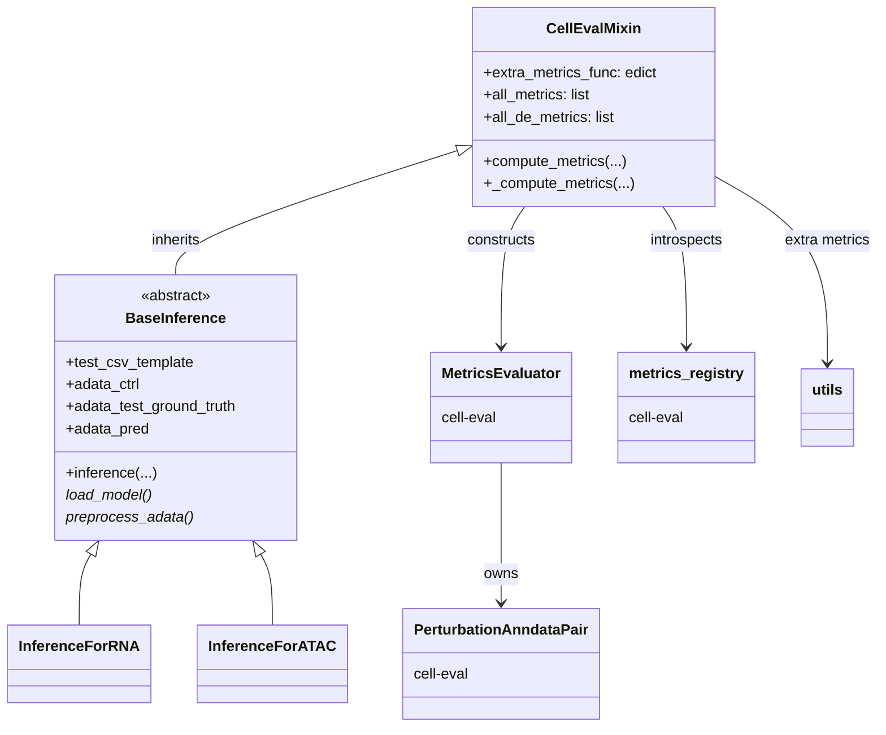
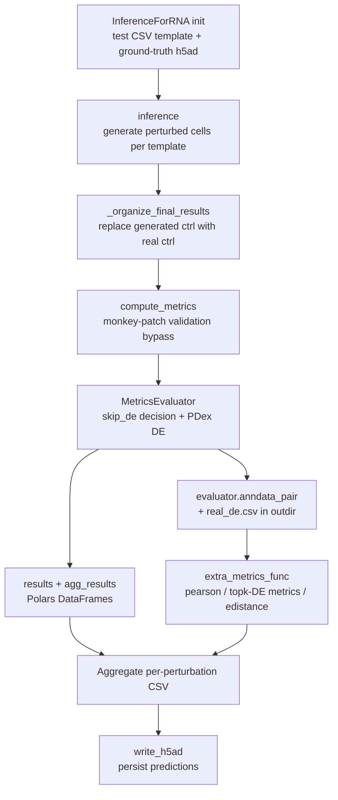

Evaluating a perturbation-prediction model requires more than a single loss value: it demands bulk-profile correlations, differential-expression (DE) agreement, and distributional distances computed across hundreds of perturbations. DeSCOPE delegates this to **cell-eval** (ArcInstitute's evaluation framework, pinned at version `0.6.6`) and layers a small set of domain-specific extra metrics on top. This page explains the integration architecture, why DeSCOPE bypasses cell-eval's input validation, how each metric is computed, and how the pieces assemble into the end-to-end evaluation workflow used in the Sciplex3 and Tahoe-100M case studies.

Sources: [pyproject.toml](pyproject.toml#L15-L22), [inference.py](src/descope/inference.py#L1-L30), [2_inference.ipynb](tutorials/RNA_Drug/sciplex3_evaluation/zero-shot/2_inference.ipynb#L1-L10)

## Integration Architecture: The CellEvalMixin

DeSCOPE's evaluation layer is built on a single inheritance strategy: the `CellEvalMixin` class carries all metric-computation capability, and both concrete inference classes inherit it through `BaseInference(CellEvalMixin, ABC)`. This means any `InferenceForRNA` or `InferenceForATAC` instance — the same objects that generate predictions — is also a fully equipped metrics evaluator. The mixin wraps cell-eval's `MetricsEvaluator`, introspects the `metrics_registry` for available metrics, and exposes four DeSCOPE-specific "extra metrics" as an attribute-style dictionary.



The mixin's constructor registers exactly four extra metrics — `pearson`, `pearson_delta_on_topk_de`, `direction_match_on_topk_de`, and `edistance` — into an `EasyDict` so they can be called with attribute syntax (`infer.extra_metrics_func.pearson(...)`). Registry introspection properties (`all_metrics`, `all_de_metrics`, `all_anndata_pair_metrics`) proxy directly to cell-eval's `metrics_registry.list_metrics()`, letting users discover the available built-in metric names at runtime before committing to a selection.

Sources: [inference.py](src/descope/inference.py#L70-L124), [inference.py](src/descope/inference.py#L199-L232)

## The Validation Bypass: Why DeSCOPE Monkey-Patches Cell-Eval

Cell-eval enforces a strict contract by default: both `real` and `pred` AnnData objects must contain log1p-normalized expression. DeSCOPE deliberately violates this contract, and the reason is documented in the source itself. For **ATAC**, the prediction target is TF-IDF values, which are neither counts nor log-normalized. For **RNA**, the decoder can output negative values (an artifact of the regression-based VAE decoder), which is legal input for metrics but fails cell-eval's log-normalization heuristic check (`guess_is_lognorm`).

The bypass is implemented in two cooperating pieces. First, `_build_anndata_pair_NOCHECK` is a drop-in replacement for cell-eval's internal pair builder that skips the commented-out `_convert_to_normlog` validation calls. Second, the public `compute_metrics` method monkey-patches it into place:

```python
cell_eval._evaluator._build_anndata_pair = _build_anndata_pair_NOCHECK
```

This is process-global patching — it affects every subsequent `MetricsEvaluator` construction in the Python session, not just calls through this mixin. The docstring notes that users who *want* format validation should call the private `self._compute_metrics` instead, which constructs `MetricsEvaluator` without the patch. This is a deliberate API design: the validated path remains one attribute-access away, while the unvalidated path is the default for model evaluation.

> [!TIP]
> The monkey-patch means the expression scale of your `adata_pred` is passed to cell-eval *as-is*. If you hand-craft predictions outside the DeSCOPE inference pipeline (e.g., baseline methods), ensure they are on the same scale as your ground truth — nothing will warn you about scale mismatches, and metrics like `pearson` will silently degrade.

Sources: [inference.py](src/descope/inference.py#L35-L67), [inference.py](src/descope/inference.py#L160-L196), [pyproject.toml](pyproject.toml#L15-L22)

## Built-In vs. Extra Metrics: A Two-Tier System

DeSCOPE's metric surface splits cleanly into two tiers with different provenance, signatures, and lifecycles. Built-in metrics are cell-eval's own implementations, invoked in bulk through `evaluator.compute(profile="full", skip_metrics=...)`. Extra metrics are DeSCOPE-local functions in `utils.py` that consume `evaluator.anndata_pair` — the `PerturbationAnndataPair` the evaluator constructed — plus, for the top-k DE metrics, a DE results CSV that cell-eval writes to the output directory.

| Dimension | Built-in metrics (cell-eval) | Extra metrics (DeSCOPE) |
|---|---|---|
| Source | `metrics_registry` in cell-eval 0.6.6 | `src/descope/utils.py` |
| Invocation | `infer.compute_metrics(metrics_to_calculate=[...])` | `infer.extra_metrics_func.<name>(...)` |
| Input | `adata_pred`, `adata_real` → handled internally | `evaluator.anndata_pair` + optional `de_real` CSV |
| Return | Polars `results` (per-perturbation) + `agg_results` (aggregated) | `dict[str, float]` + mean float |
| DE dependency | Computed internally by `MetricsEvaluator` (or skipped via `skip_de`) | Reads precomputed `real_de.csv` from the outdir |
| Examples | `mse`, `mse_delta`, `overlap_at_100`, `precision_at_200`, `de_spearman_lfc_sig`, `pr_auc`, `roc_auc` | `pearson`, `pearson_delta_on_topk_de`, `direction_match_on_topk_de`, `edistance` |

The Sciplex3 tutorial illustrates the typical built-in selection: error metrics (`mse`, `mae`, and their `_delta` variants), rank-overlap and precision-at-N curves (N ∈ {50, 100, 200, 500}), DE-level agreement (`de_direction_match`, `de_spearman_lfc_sig`), and discrimination (`discrimination_score_l1`, `pr_auc`, `roc_auc`). Note that the notebook subsets both predicted and ground-truth AnnData to a precomputed list of "reliably predicted genes" *before* calling `compute_metrics` — performance is evaluated strictly on the gene subset the model can express.

Sources: [inference.py](src/descope/inference.py#L126-L158), [inference.py](src/descope/inference.py#L99-L116), [2_inference.ipynb](tutorials/RNA_Drug/sciplex3_evaluation/zero-shot/2_inference.ipynb#L44-L137)

## Extra Metric Reference

Each extra metric operates on the bulk (mean) expression profiles that cell-eval's `PerturbationAnndataPair` exposes via `iter_bulk_arrays()`. The key algorithmic distinctions lie in *what* is correlated and *over which genes*.

| Metric | Compares | Gene scope | Default topk | Output |
|---|---|---|---|---|
| `pearson` | Bulk perturbed profile (pred vs. real) | All genes | — | per-pert. dict + mean |
| `pearson_delta_on_topk_de` | Perturbation effect Δ = bulk_pert − bulk_ctrl | Top-k DE genes (lowest FDR) | 20 | per-pert. dict + mean |
| `direction_match_on_topk_de` | Sign of Δ (pred vs. real) | Top-k DE genes, optionally split up/down by `percent_change` | 100 | up/down dicts + means |
| `edistance` | Perturbation group vs. control group | All genes (distance-based) | — | per-pert. dict |

`pearson_delta_on_topk_de` is the most statistically interesting: rather than correlating absolute expression (which is dominated by highly-expressed housekeeping genes), it correlates the *change* induced by the perturbation, restricted to the genes the perturbation most strongly affects. It builds a cache mapping each perturbation to its top-k genes by sorting the real DE CSV on `fdr` ascending, then uses `bulk_array.perturbation_effect(which="pred"/"real")` to obtain Δ vectors. `direction_match_on_topk_de` follows the same caching pattern but computes sign-agreement accuracy (`np.mean(np.sign(x_de) == np.sign(y_de))`), and can stratify results into up-regulated (`percent_change > 0`) and down-regulated (`percent_change < 0`) gene sets — yielding four return values when `separate_up_down_regulated=True`.

`edistance` is architecturally different: it takes a single AnnData (not a pair) and computes the energy distance `2·E[‖X−Y‖] − E[‖X−X′‖] − E[‖Y−Y′‖]` between each perturbation group and the control group, using `sklearn.metrics.pairwise_distances`. Its performance optimization is worth noting — the within-control distance `sigma_y` is precomputed once and reused across all perturbations rather than recomputed per iteration.

> [!TIP]
> The top-k DE metrics read `real_de.csv` — the DE table cell-eval writes to `outdir` for the *real* AnnData — not the predicted DE. This is intentional: the metric asks "how well do predicted effects agree with ground-truth effects on genes the ground truth says matter?" If you delete the outdir before computing extra metrics, re-run `compute_metrics` first or generate the DE table independently with `build_de`.

Sources: [utils.py](src/descope/utils.py#L844-L890), [utils.py](src/descope/utils.py#L640-L707), [utils.py](src/descope/utils.py#L710-L841), [utils.py](src/descope/utils.py#L893-L971)

## Supporting Infrastructure: DE Computation and Skipping Logic

Two supporting mechanisms make the system efficient at scale. The first is `build_de` in `utils.py`, a standalone differential-expression utility that wraps `pdex.parallel_differential_expression` (the `pdex` package, also pinned in `pyproject.toml`). It asserts log-normalization via `wppkg.guess_is_lognorm` (unless `check_log_norm=False`), builds pdex kwargs referencing the control group and perturbation column, and writes `de.csv` to an optional outdir — the same format cell-eval produces, making it a compatible substitute when you need DE tables without a full evaluation run.

The second is the DE-skipping decision embedded in `compute_metrics`. The private helper `check_whether_skip_de_metrics` intersects the requested metric names with `all_de_metrics`; if no DE-type metric is requested, `skip_de=True` is passed to `MetricsEvaluator`, avoiding the most expensive stage of evaluation (per-perturbation Wilcoxon tests via pdex). For large perturbation panels this can cut evaluation time substantially — but remember that skipping DE also means no `real_de.csv` is written, so the top-k extra metrics cannot run afterward.

Sources: [utils.py](src/descope/utils.py#L974-L1019), [inference.py](src/descope/inference.py#L118-L158), [pyproject.toml](pyproject.toml#L15-L22)

## End-to-End Evaluation Workflow

The complete evaluation flow, as exercised in the Sciplex3 zero-shot notebook, chains prediction generation, format assembly, metric computation, and artifact persistence. Note the strict guard in the inference stage: `use_generated_control_cells` is asserted `False` at the source level because substituting model-generated control cells makes results unstable — the final predicted AnnData always concatenates *real* control cells from `_organize_final_results`.



In the notebook, this translates to: select metrics from `infer.all_metrics`; optionally subset both AnnData objects to reliably predicted genes; call `compute_metrics(...)` receiving `(results, agg_results, evaluator)`; then compute extra metrics against `evaluator.anndata_pair` and `./cell-eval-outdir/{celltype}/real_de.csv`. The final aggregation maps the per-perturbation dicts onto the built-in `results` frame by `perturbation` key and writes `results_for_each_perturbation.csv`, giving a single unified per-drug scorecard.

Sources: [inference.py](src/descope/inference.py#L286-L348), [inference.py](src/descope/inference.py#L350-L370), [2_inference.ipynb](tutorials/RNA_Drug/sciplex3_evaluation/zero-shot/2_inference.ipynb#L44-L245)

## Artifact Contract of the Output Directory

Every `compute_metrics` call materializes artifacts into `outdir` (default `./cell-eval-outdir`), which becomes both a debugging aid and a dependency for downstream extra metrics:

| Artifact | Producer | Consumers |
|---|---|---|
| `real_de.csv` / `pred_de.csv` | cell-eval (pdex DE) | `pearson_delta_on_topk_de`, `direction_match_on_topk_de` |
| `results`, `agg_results` frames | `evaluator.compute()` | final aggregation step |
| `descope_preds.h5ad` | `infer.write_h5ad(...)` | reproducibility / later re-analysis |

The tutorial parameterizes the outdir per cell type (`./cell-eval-outdir/{celltype}`) since Sciplex3 evaluation loops over multiple cell lines (e.g., A549), keeping each panel's DE tables and per-perturbation CSVs isolated.

Sources: [2_inference.ipynb](tutorials/RNA_Drug/sciplex3_evaluation/zero-shot/2_inference.ipynb#L126-L137), [2_inference.ipynb](tutorials/RNA_Drug/sciplex3_evaluation/zero-shot/2_inference.ipynb#L164-L245), [inference.py](src/descope/inference.py#L243-L247)

## Where to Go Next

The evaluation layer sits at the end of the model lifecycle, so its inputs are defined upstream. To understand how `adata_pred` is generated — the control-cell sampling loop, gene-embedding injection, and NaN-batch rejection — see [Inference Pipeline Design](19-inference-pipeline-design). The leave-one-out protocol that structures which perturbations land in the test template is covered in [Leave-One-Out Evaluation Protocol](21-leave-one-out-evaluation-protocol), while zero-shot versus fine-tuned evaluation on Sciplex3 and Tahoe-100M — the setting where these metrics were used to produce the published performance figures — is detailed in [Zero-Shot and Fine-Tuning Workflows](22-zero-shot-and-fine-tuning-workflows). For a hands-on walkthrough including training, follow [Tutorial Pipeline: Tokenize, Train, Evaluate](4-tutorial-pipeline-tokenize-train-evaluate).
