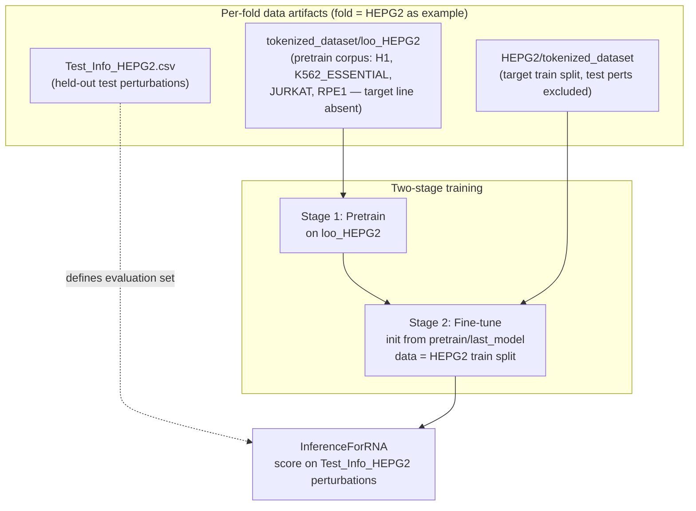
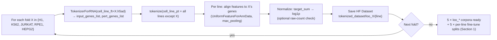
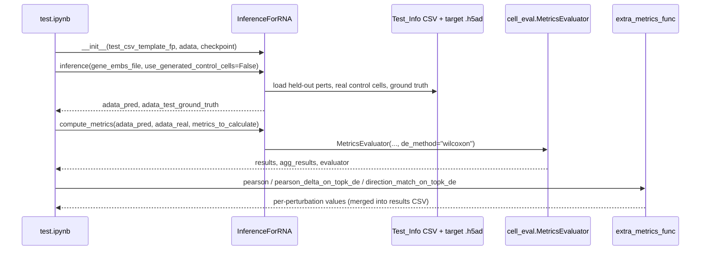

This page documents how DeSCOPE quantifies **cross-context generalization** through its leave-one-out (LOO) evaluation protocol: for each evaluation target, the protocol withholds the target from pretraining, trains in two stages (pretrain → fine-tune), and scores predictions strictly on a pre-registered set of held-out test perturbations. We trace the full path from data splits (`Test_Info` CSVs, `loo_*` tokenized corpora) through the two-stage training scripts to the cell-eval-based scoring stack in `inference.py`.

## Protocol at a Glance

In the RNA_Gene tutorial, the protocol iterates over five cell lines — `H1`, `K562_ESSENTIAL`, `JURKAT`, `RPE1`, `HEPG2`. For each target cell line `cellline_ft`, the "left-out" set is the target itself: the pretraining corpus is built from the remaining four lines (`cellline_pt = [c for c in cellline if c != cellline_ft]`), while the target's own test perturbations — enumerated in `Test_Info_{cellline_ft}.csv` — are excluded from its training tokenization. The result per fold is three disjoint artifacts: (1) a cross-cell-line pretraining corpus `tokenized_dataset/loo_{cellline_ft}` that never contains the target line, (2) a target-line training split with test perturbations filtered out, and (3) the target-line test perturbations used only at scoring time. The `DeSCOPE_LOO` model produced by this loop is then compared against standard `DeSCOPE` training to isolate the contribution of pretraining on other cell lines.

The diagram's prerequisite: read `loo_{X}` as "pretraining corpus for the fold whose fine-tune target is X" — the naming encodes which cell line was left out of pretraining, not which data the corpus contains.

Sources: [tokenize.ipynb](tutorials/RNA_Gene/tokenize.ipynb#L19-L77), [train_descope_loo.sh](tutorials/RNA_Gene/train_descope_loo.sh#L4-L8), [README.md](tutorials/RNA_Gene/README.md#L11-L24)

## The Held-Out Boundary: Test Perturbations and Control Preservation

The boundary between "trainable" and "evaluable" data is enforced at tokenization time by `_filter_perturbations`. Its contract is strict and matters for protocol integrity: `perts_to_include` and `perts_to_exclude` are mutually exclusive (specifying both raises `ValueError`), perturbation labels are whitespace-stripped before matching, and — critically — **control cells are always preserved**: in exclude mode, `ctrl_name` is removed from the exclusion list before filtering; in include mode, it is appended if absent. In the tutorial's Section 1, every cell line is tokenized with `perts_to_exclude=load_gene_names_engine(Test_Info_{c}.csv)`, so the shipped training datasets structurally cannot contain the perturbations later used for scoring, while control cells survive as the conditioning baseline for prediction.

| Filter configuration | Cells retained | Control handling |
|---|---|---|
| `perts_to_include` only | Cells whose label ∈ include list | `ctrl_name` force-appended to the list |
| `perts_to_exclude` only | Cells whose label ∉ exclude list | `ctrl_name` force-removed from the list |
| Both `None` | All cells | Unconditional retention |
| Both specified | — | Rejected with `ValueError` |

> [!TIP]
> Control-cell preservation inside `_filter_perturbations` is what makes the evaluation sound: inference conditions every prediction on real control cells, so an exclusion filter that dropped controls would silently corrupt the entire protocol.

Sources: [tokenizer.py](src/descope/tokenizer.py#L23-L47), [tokenize.ipynb](tutorials/RNA_Gene/tokenize.ipynb#L31-L47)

One subtlety worth internalizing: leakage prevention is **scoped per fold, not global**. Section 2 of `tokenize.ipynb` reads the pretraining lines' raw `.h5ad` files directly and passes `apply_pert_gene_filter=False`, meaning each `loo_*` corpus retains *all* perturbations present in the non-target lines — including those lines' own `Test_Info` perturbations. Only the fold's target line has its test perturbations withheld. This is deliberate: the hypothesis under test is transfer from other cell contexts to the target, not perturbation-level memorization within the target.

Sources: [tokenize.ipynb](tutorials/RNA_Gene/tokenize.ipynb#L49-L77), [tokenizer.py](src/descope/tokenizer.py#L586-L598)

## Assembling the Cross-Cell-Line Pretraining Corpora

`TokenizerForRNA` solves the hard constraint of multi-dataset pretraining: heterogeneous cell lines must be projected into a single model input space. On construction with the fold's fine-tune line, `__init__` extracts two registries from the target AnnData — `input_genes_list` (gene symbols from `var_names`, after dropping cells with null perturbation labels) and `pert_genes_list` (the target's unique perturbation labels). Every pretraining line is then tokenized by `_tokenize`, which aligns its feature axis onto `input_genes_list` via `UniformFeatureForAnnData` (with `DuplicatedFeatureHandling.max_pooling` to collapse duplicate gene symbols across platforms), restores the pretraining line's original perturbation labels, and applies `preprocess_rna_perturbation_adata` (library-size normalization to `target_sum` + `log1p`, with an optional raw-counts integer check). The tutorial disables `apply_pert_gene_filter`, so no cells are dropped for having perturbations unseen in the target line.

Each pretraining line is persisted as an independent Hugging Face Dataset under `save_dir/{cell_line_name}` inside the `loo_{cellline_ft}` directory — so `tokenize()` produces, per fold, a directory of per-line Arrow datasets (e.g., `loo_HEPG2/H1`, `loo_HEPG2/JURKAT`, …). Per-dataset configuration variability is handled in the loop itself: `H1` uses `pert_col="target_gene"` and `target_sum=5e4`, the other lines use `pert_col="gene"` and `target_sum=1e4`. The notebook also flags a protocol-level invariant: **control-cell names must be identical across all `.h5ad` files**, since `ctrl_name` is a single global parameter consumed identically by training and inference.

| `TokenizerForRNA` parameter | Role in the LOO corpora | Tutorial value |
|---|---|---|
| `cell_line_ft` | Defines the unified gene space & perturbation registry | The left-out target line's `.h5ad` |
| `input_genes_list` | Feature-alignment target for every pretraining line | From `cell_line_ft.var_names` |
| `apply_pert_gene_filter` | Whether pretraining cells are restricted to target-line perturbations | `False` (keep all) |
| `duplicated_features_handling` | Merges duplicate gene symbols during alignment | `max_pooling` |
| `target_sum` | Library-size normalization depth | `1e4` (or `5e4` for H1) |
| `save_dir` | Per-fold corpus root; subdirectory per pretraining line | `tokenized_dataset/loo_{ft}` |

Sources: [tokenizer.py](src/descope/tokenizer.py#L517-L552), [tokenizer.py](src/descope/tokenizer.py#L554-L631), [tokenize.ipynb](tutorials/RNA_Gene/tokenize.ipynb#L49-L77)

## Stage Structure: Pretrain, Then Fine-Tune

`train_descope_loo.sh` operationalizes the fold as two sequential `accelerate launch train.py` invocations that share `MODELPARAMS`, `DATAPARAMS`, and `TRAINPARAMS` (seed 42, 20 epochs, cosine LR `1e-4`, bf16, per-device batch 64, `alpha_mse_loss=alpha_kl_loss=1.0`). Stage 1 points `--tokenized_datasets_dir` at the `loo_K562_ESSENTIAL` corpus and writes to a dedicated `trainer_output_pretrain` directory. Stage 2 re-launches training with two changes: `--pretrained_model_name_or_path="$pretrain_output_dir/last_model"` initializes weights from the pretraining run's final checkpoint, and `--tokenized_datasets_dir` switches to the target line's Section-1 dataset (test perturbations already excluded). Output directories are deliberately separated (`trainer_output_pretrain` vs `trainer_output_finetune` under `./results/descope_loo/`) so the stage handoff is explicit on disk.

| Dimension | Standard (`train_descope.sh`) | LOO (`train_descope_loo.sh`) |
|---|---|---|
| Training stages | Single run on the target line's split | Pretrain on N−1 other lines → fine-tune on target split |
| Initialization | Random | `pretrain_output_dir/last_model` |
| Data seen by the target line | Train split only (test perts excluded) | Identical — plus prior exposure to *other* lines |
| Output layout | `results/descope/trainer_output/` | `results/descope_loo/trainer_output_{pretrain,finetune}/` |
| What the eval measures | In-line prediction of unseen perturbations | Marginal gain from cross-cell-line pretraining |
| Cost | 1 training run per line | 2 runs × 5 folds (per-fold pretraining is fold-specific) |

The trade-off is symmetric: the standard configuration is cheaper and answers "can the model generalize to new perturbations within a line?", whereas LOO answers the strictly stronger question "does pretraining on other cell lines improve that generalization?" — at the price of re-running the pretraining stage for every fold, since each fold's corpus must exclude a different line. For the ATAC modality, the `ATAC_Gene` tutorial ships the same script pair, applying an analogous protocol over ATAC perturbation data (see [RNA and ATAC Model Variants](11-rna-and-atac-model-variants)).

Sources: [train_descope_loo.sh](tutorials/RNA_Gene/train_descope_loo.sh#L4-L84), [train_descope.sh](tutorials/RNA_Gene/train_descope.sh#L1-L59)

## Scoring the Held-Out Perturbations

Evaluation runs in `test.ipynb` against the fine-tuned checkpoint. `InferenceForRNA` is constructed with four protocol-critical arguments: `test_csv_template_fp=Test_Info_{line}.csv` (re-registering the held-out perturbation set for prediction), the target line's raw `.h5ad` (source of real control cells and ground truth), the fine-tune checkpoint path, and the same `pert_col`/`ctrl_name`/`target_sum` contract used at tokenization. The `infer.inference()` call then predicts responses for every held-out perturbation, conditioned on `gene_embs_file` (the ESM2-derived perturbation-gene embedding table shared with training — see [PertGene Encoder and ESM2 Embeddings](8-pertgene-encoder-and-esm2-embeddings)).

Two implementation details in `inference.py` are essential to reading the numbers correctly. First, `compute_metrics` deliberately monkey-patches `cell_eval._evaluator._build_anndata_pair` with `_build_anndata_pair_NOCHECK`, bypassing cell-eval's log1p-format validation — the docstring states this exists because model outputs may be raw or non-log-transformed (e.g., negative values); if you want validated comparison, the private `_compute_metrics` remains available. Second, the notebook's evaluation contract mandates `use_generated_control_cells=False` — predictions must be conditioned on *real* control cells from the target `.h5ad`, never synthesized ones.

> [!TIP]
> Never flip `use_generated_control_cells=True` in the LOO evaluation: the protocol's claim is about generalization to held-out perturbations measured against real experimental controls, and generated controls would change the quantity being measured.

Sources: [test.ipynb](tutorials/RNA_Gene/test.ipynb#L10-L48), [inference.py](src/descope/inference.py#L19-L45), [inference.py](src/descope/inference.py#L113-L146)

The metric layer combines cell-eval's registry with DeSCOPE-specific extras. `CellEvalMixin.all_metrics` exposes the library's full metric registry; the notebook selects a subset for the aggregate report, while `extra_metrics_func` provides custom implementations attached to the returned `evaluator.anndata_pair`. Metrics are computed per perturbation and aggregated; `results.to_pandas()` is enriched with the extra-metric columns and exported as `results_for_each_perturbation.csv`, alongside the predicted AnnData via `infer.write_h5ad` (the `real_de.csv` produced by the wilcoxon DE pass feeds the top-k DE metrics).

| Metric | Source | What it captures |
|---|---|---|
| `pearson_delta` | cell-eval built-in | Correlation of predicted vs real *perturbation deltas* (vs control) |
| `overlap_at_50/100/200/500` | cell-eval built-in | Top-N DE gene overlap between prediction and ground truth |
| `discrimination_score_l1` | cell-eval built-in | L1-based separation of perturbed from control profiles |
| `mae` | cell-eval built-in | Absolute expression error |
| `pearson` | `extra_metrics_func` | Profile-level correlation, averaged across perturbations |
| `pearson_delta_on_topk_de` (topk=20) | `extra_metrics_func` | Delta accuracy restricted to top-20 ground-truth DE genes |
| `direction_match_on_topk_de` (topk=100, up/down split) | `extra_metrics_func` | Sign agreement on top-100 up- and down-regulated DE genes |
| `edistance` | `extra_metrics_func` | available E-distance metric on the AnnData pair |

Sources: [test.ipynb](tutorials/RNA_Gene/test.ipynb#L50-L127), [inference.py](src/descope/inference.py#L47-L111), [test.ipynb](tutorials/RNA_Gene/test.ipynb#L129-L151)

## Interpreting Results and Where to Go Next

Interpretation follows the fold structure: each fold yields one `results_for_each_perturbation.csv` whose rows are the perturbations registered in `Test_Info_{line}.csv`, so per-perturbation failures (e.g., low `direction_match` on specific genes) can be traced individually, while `agg_results` supports the headline DeSCOPE-vs-DeSCOPE_LOO comparison. Because the only experimental variable between the two arms is the pretraining corpus (identical fine-tune data, seed, hyperparameters, and evaluation set), any aggregate delta is attributable to cross-cell-line pretraining — which is precisely the claim the protocol is designed to isolate. When extending the protocol to new modalities or datasets, preserve its three invariants: test perturbations excluded from the target's training split, target line absent from its own fold's pretraining corpus, and evaluation conditioned on real control cells. For deeper mechanics, continue with [Perturbation Metrics via Cell-Eval](20-perturbation-metrics-via-cell-eval) for the metric implementations, [Inference Pipeline Design](19-inference-pipeline-design) for the prediction internals, [Zero-Shot and Fine-Tuning Workflows](22-zero-shot-and-fine-tuning-workflows) for how this protocol generalizes to other transfer scenarios, and [Tokenization: AnnData to HuggingFace Datasets](12-tokenization-anndata-to-huggingface-datasets) / [Feature Alignment and Vocabulary Handling](14-feature-alignment-and-vocabulary-handling) for the corpus-construction layer. The end-to-end reproduction guide remains [Tutorial Pipeline: Tokenize, Train, Evaluate](4-tutorial-pipeline-tokenize-train-evaluate).
