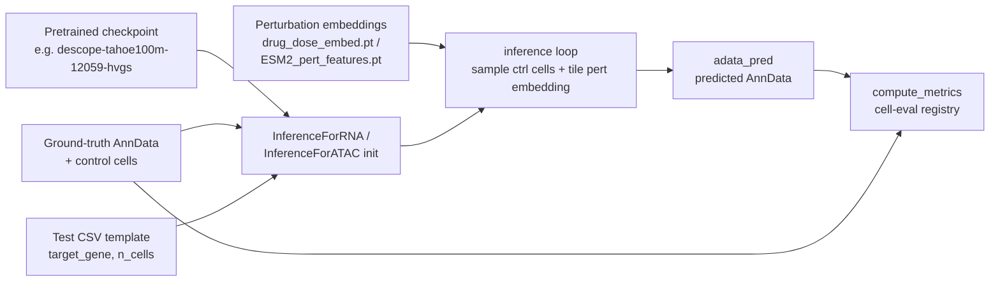
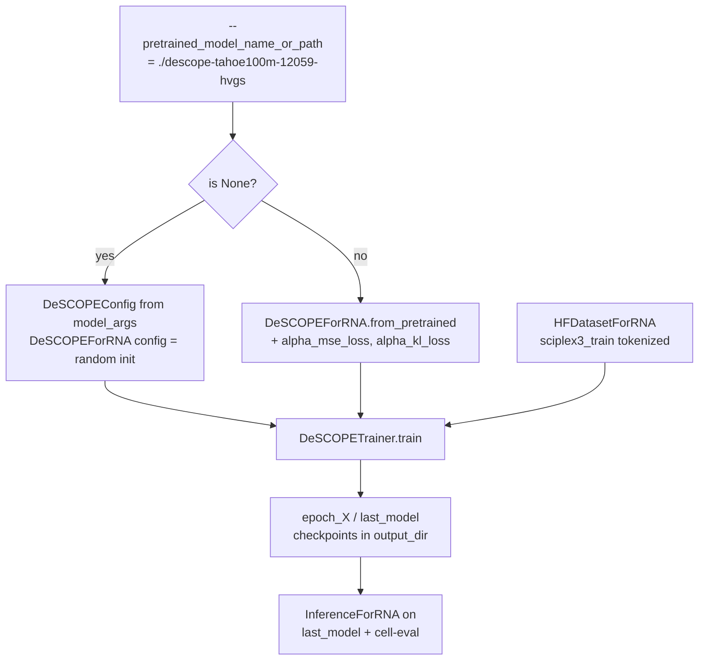
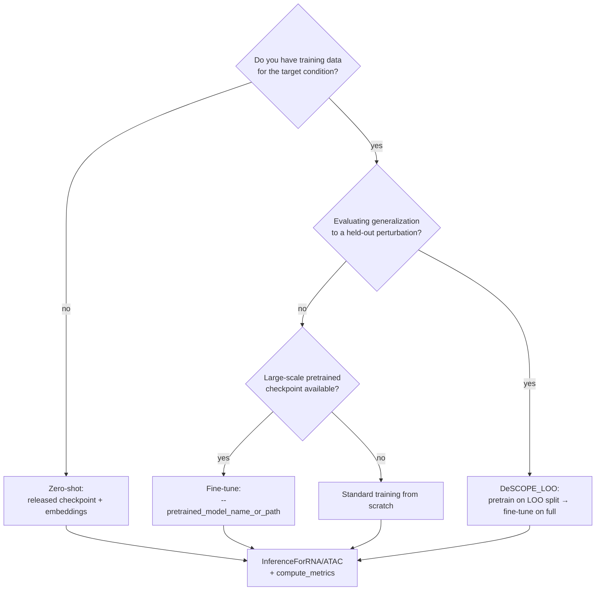

DeSCOPE exposes two distinct paths for applying a model to perturbation prediction: the **zero-shot workflow**, where a pretrained checkpoint is used directly for inference on new perturbations without any gradient updates, and the **fine-tuning workflow**, where the same checkpoint serves as weight initialization for continued training on target data. Both paths share one infrastructure component — the `pretrained_model_name_or_path` switch — but diverge in entry point, data requirements, and evaluation semantics. This page documents both workflows as implemented in `src/descope/` and demonstrated across the three tutorial suites, at the boundary between the training system and the inference/evaluation system.

## The Central Switch: `pretrained_model_name_or_path`

The entire zero-shot vs. fine-tuning distinction in DeSCOPE reduces to a single optional field on `DeSCOPETrainingArguments`:

```python
pretrained_model_name_or_path: Optional[str] = field(
    default=None, metadata={"help": "Path to a pretrained model."}
)
```

Every training entry script in the repository follows an identical branching pattern around this value. When it is `None`, a fresh `DeSCOPEConfig` is built from the dataset shapes and `DeSCOPEModelArguments`, and training proceeds from random initialization. When it points to a checkpoint directory, the model is reconstructed via the Hugging Face `from_pretrained` interface with only the loss weights (`alpha_mse_loss`, `alpha_kl_loss`) supplied as overrides:

```python
if train_args.pretrained_model_name_or_path is None:
    config = DeSCOPEConfig(...)          # from model_args + dataset shapes
    model = DeSCOPEForRNA(config=config, ...)
else:
    model = DeSCOPEForRNA.from_pretrained(
        train_args.pretrained_model_name_or_path,
        alpha_mse_loss=train_args.alpha_mse_loss,
        alpha_kl_loss=train_args.alpha_kl_loss
    )
```

This gives fine-tuning zero additional code: the model branch changes, while the dataset, trainer, and evaluation loop remain byte-for-byte identical to standard training.

Sources: [arguments.py](/src/descope/arguments.py#L18-L22), [2_train.py](/tutorials/RNA_Drug/sciplex3_evaluation/fine-tune/2_train.py#L56-L81), [train.py](/tutorials/ATAC_Gene/train.py#L52-L77)

## The Zero-Shot Workflow: Inference Without Adaptation

Zero-shot evaluation answers one question: *how well does a checkpoint predict perturbations it has never trained on?* The implementation lives entirely in `src/descope/inference.py`, which provides modality-specific subclasses (`InferenceForRNA`, `InferenceForATAC`) of an abstract `BaseInference`. No training code is invoked at any point.

The workflow proceeds in three stages, orchestrated in the tutorial notebooks:



**Stage 1 — Initialization.** The constructor performs three preparations. It loads a CSV template whose required columns are `target_gene` and `n_cells`, defining which perturbations to generate and at what cell counts. It loads the pretrained model through `from_pretrained` (dispatched to `DeSCOPEForRNA` or `DeSCOPEForATAC` by the subclass). Finally, it splits the input AnnData into `adata_ctrl` (cells matching the control label — `"control"` for ATAC, `"non-targeting"`/`"control_0.0"` for RNA) and `adata_test_ground_truth`; if the AnnData lacks some test perturbations, ground truth registration is skipped with a warning, deferring to manual provision at metric time.

Sources: [inference.py](/src/descope/inference.py#L199-L241), [inference.py](/src/descope/inference.py#L250-L266), [inference.py](/src/descope/inference.py#L268-L284)

**Stage 2 — Generation.** The `inference()` method is the zero-shot engine. For each row of the template, it repeatedly samples control-cell batches uniformly at random (seeded for reproducibility), tiles the target perturbation's embedding across the batch, and calls `model.inference(...)` under `torch.no_grad()` to obtain predicted expression logits. Batches containing NaN are discarded wholesale and resampled; generation continues until the requested `n_cells` is met, with the final batch truncated. Notably, the model conditions *only* on the perturbation embedding — meaning prediction of an unseen drug or gene depends entirely on that embedding being present in the embedding file passed via `gene_embs_file`.

Sources: [inference.py](/src/descope/inference.py#L286-L348)

**Stage 3 — Evaluation.** Results are assembled into `adata_pred`, with one deliberate substitution: generated control cells are discarded and replaced by *real* control cells (`use_generated_control_cells` is asserted `False` and marked as unstable for internal debugging only). Metrics are then computed through `CellEvalMixin.compute_metrics`, which routes to the cell-eval `MetricsEvaluator` with DeSCOPE's built-in format validation bypassed (predictions may contain negative or un-normalized values), plus four extra metrics (`pearson`, `pearson_delta_on_topk_de`, `direction_match_on_topk_de`, `edistance`). Metric selection in the Sci-Plex3 zero-shot notebook spans 21 built-in metrics from `pearson_delta` to `pr_auc`/`roc_auc`, computed on a filtered set of reliably predicted genes.

Sources: [inference.py](/src/descope/inference.py#L160-L196), [inference.py](/src/descope/inference.py#L91-L97), [inference.py](/src/descope/inference.py#L350-L370), [2_inference.ipynb](/tutorials/RNA_Drug/sciplex3_evaluation/zero-shot/2_inference.ipynb#L100-L120)

> [!TIP]
> The zero-shot workflow's only "leakage surface" is the embedding file. Since `load_gene_embs` restricts embeddings to `self.test_genes` derived from the CSV template, generalization to an unseen perturbation requires that perturbation's embedding (ESM2 for genes, drug-dose vectors for drugs) to exist in the `.pt` file — no model retraining compensates for a missing embedding.

## The Fine-Tuning Workflow: Continued Training on Target Data

Fine-tuning reuses the full training stack — [Trainer and Accelerate Integration](15-trainer-and-accelerate-integration), [ELBO Loss: MSE and KL Composition](16-elbo-loss-mse-and-kl-composition), [Checkpointing, Resuming, Early Stopping](17-checkpointing-resuming-early-stopping) — with weights seeded from a pretrained checkpoint instead of random initialization. The canonical demonstration is the Sci-Plex3 fine-tuning directory under `tutorials/RNA_Drug/sciplex3_evaluation/fine-tune/`, where the Tahoe-100M pretrained model `descope-tahoe100m-12059-hvgs` adapts to drug perturbation prediction.



Three properties of this workflow deserve precision:

**Loss weights transfer at load time.** `from_pretrained` accepts `alpha_mse_loss` and `alpha_kl_loss` as constructor overrides, so the ELBO weighting is a fine-tuning hyperparameter adjustable independently of the checkpoint's original training configuration.

**Fine-tuning is not resuming.** The trainer supports `resume_from_checkpoint`, which calls `accelerator.load_state` to restore optimizer, scheduler, and RNG state, and reconstructs `starting_epoch` from the `epoch_X`/`step_X` directory name. Fine-tuning via `pretrained_model_name_or_path` restores *model weights only* — the optimizer and LR schedule start fresh, and training begins at epoch 0 with a full `num_train_epochs` budget. These are intentionally different mechanisms for different intents.

**The checkpoint contract.** The trainer always writes the final model to `output_dir/last_model`, and periodic checkpoints to `epoch_X/model` (e.g. `--checkpointing_steps=epoch-10`). Both `train_descope.sh` scripts in the ATAC/RNA gene tutorials and the LOO stage-2 script reference `last_model` as the handoff artifact — the same directory that `InferenceForATAC` consumes as `pretrained_model_name_or_path` in `test.ipynb`.

Sources: [train_descope.sh](/tutorials/RNA_Drug/sciplex3_evaluation/fine-tune/train_descope.sh#L8-L58), [2_train.py](/tutorials/RNA_Drug/sciplex3_evaluation/fine-tune/2_train.py#L75-L91), [trainer.py](/src/descope/trainer.py#L67-L96), [trainer.py](/src/descope/trainer.py#L199-L200), [test.ipynb](/tutorials/ATAC_Gene/test.ipynb#L29-L35)

## The DeSCOPE_LOO Two-Stage Protocol

The gene-perturbation tutorials encode a more rigorous variant of fine-tuning: **pretrain-then-fine-tune** within a leave-one-out (LOO) evaluation design. `train_descope_loo.sh` chains two complete training runs in one script:

1. **Stage 1 — Pretraining** on a tokenized dataset named `loo_GM12878`: the dataset *excludes* the held-out target perturbation, producing a checkpoint at `$pretrain_output_dir/last_model`.
2. **Stage 2 — Fine-tuning** with `--pretrained_model_name_or_path="$pretrain_output_dir/last_model"` on the full `GM12878` dataset.

Both stages use identical hyperparameters (20 epochs, lr 1e-4 cosine schedule, bf16, batch 64). The distinction is purely in the data split and the checkpoint handoff. This separates *perturbation-generalization* capacity (stage 1, zero knowledge of the held-out target) from *in-distribution adaptation* capacity (stage 2), and pairs with the [Leave-One-Out Evaluation Protocol](21-leave-one-out-evaluation-protocol) described in the dedicated page.

Sources: [train_descope_loo.sh](/tutorials/ATAC_Gene/train_descope_loo.sh#L3-L9), [train_descope_loo.sh](/tutorials/ATAC_Gene/train_descope_loo.sh#L56-L98)

## Workflow Comparison

DeSCOPE ships four operational configurations for producing evaluation-ready checkpoints. All converge on the same inference/evaluation entry point:

| Workflow | Entry artifact | `pretrained_model_name_or_path` source | Training involved | Primary use case |
|---|---|---|---|---|
| **Zero-shot** | `InferenceForRNA`/`InferenceForATAC` | Released checkpoint (e.g. `descope-tahoe100m-12059-hvgs`) | None | Assessing generalization to unseen drugs/perturbations |
| **Standard training** | `train.py` + `train_descope.sh` | `None` (random init) | From scratch, 20 epochs | Single cell-line / single-dataset modeling |
| **LOO fine-tuning** | `train_descope_loo.sh` (2 stages) | Stage-1 `last_model` | Pretrain (LOO split) → fine-tune (full data) | Controlled held-out-perturbation evaluation |
| **Drug case fine-tuning** | `2_train.py` + `train_descope.sh` | Tahoe-100M release checkpoints (2k / 5k / 12059 HVGs) | Fine-tune on Sci-Plex3 | Cross-dataset adaptation to drug perturbation |

The three Tahoe-100M checkpoints differ only in gene vocabulary size (each paired with its `merged_*_hvgs.pkl` vocabulary file), trading model capacity and gene coverage against computational cost; the 12059-HVG variant covers 482 of Sci-Plex3's 2,000 genes, and its zero-shot metrics are computed on exactly those genes. The repository's own performance figure compares the zero-shot checkpoint against fine-tuned variants on Sci-Plex3:


One documented behavior when interpreting these comparisons: the `DeSCOPE_Pretrain_12059_HVGs (zero-shot)` variant shows notably high DE overlap, which the tutorial attributes to a general trend where **DE overlap on the validation set typically declines continuously during training** — a caution against assuming fine-tuning strictly dominates zero-shot on every metric.

Sources: [RNA_Drug README](/tutorials/RNA_Drug/README.md#L15-L23), [RNA_Drug README](/tutorials/RNA_Drug/README.md#L29-L39), [sciplex3_evaluation README](/tutorials/RNA_Drug/sciplex3_evaluation/README.md#L1), [train_descope.sh](/tutorials/RNA_Drug/sciplex3_evaluation/fine-tune/train_descope.sh#L6-L8)

## Choosing a Path and Instrumenting It

For intermediate users, the decision logic compresses to data availability and evaluation intent:



Regardless of path, the terminal step is identical: instantiate `InferenceForRNA` or `InferenceForATAC` with the checkpoint directory, a test CSV template, control-cell-bearing AnnData, and the perturbation embedding file; run `infer.inference(...)`; then score with `infer.compute_metrics(...)`. The modality subclasses differ in preprocessing only — ATAC extracts the top-k cCREs from `model.config.input_length` via the EpiAgent-consistent preprocessing, while RNA applies library-size normalization to `target_sum` with an optional raw-counts check.

> [!TIP]
> Keep `skip_raw_counts_check=False` when your AnnData is already log-normalized (as the Sci-Plex3 notebook notes, "Avoid doing log-normalization twice"), and set it to `True` only when feeding raw counts. This flag, modality-specific to `InferenceForRNA`, is the single most common source of silently wrong zero-shot metrics.

Sources: [inference.py](/src/descope/inference.py#L381-L424), [2_inference.ipynb](/tutorials/RNA_Drug/sciplex3_evaluation/zero-shot/2_inference.ipynb#L29-L69), [test.ipynb](/tutorials/ATAC_Gene/test.ipynb#L95-L117)

## Next Steps

- To understand the generation loop and modality preprocessing internals behind the zero-shot path, continue to [Inference Pipeline Design](19-inference-pipeline-design) and the metric definitions in [Perturbation Metrics via Cell-Eval](20-perturbation-metrics-via-cell-eval).
- For the experimental design rationale behind the LOO protocol used in `train_descope_loo.sh`, see [Leave-One-Out Evaluation Protocol](21-leave-one-out-evaluation-protocol).
- To build the tokenized inputs and perturbation embedding files consumed by both workflows, start from [Tutorial Pipeline: Tokenize, Train, Evaluate](4-tutorial-pipeline-tokenize-train-evaluate) and the drug-specific walkthrough in [Drug Perturbation Case Studies: Sciplex3, Tahoe-100M](5-drug-perturbation-case-studies-sciplex3-tahoe-100m).
- For the training mechanics (optimizer, scheduling, distributed execution) shared by standard training and fine-tuning, refer to [Trainer and Accelerate Integration](15-trainer-and-accelerate-integration) and [Distributed Training with DeepSpeed](18-distributed-training-with-deepspeed).