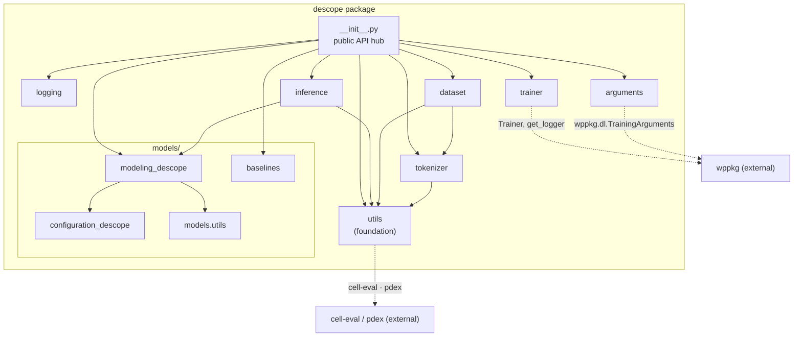

This page is the cartographic entry point to DeSCOPE's codebase: it maps every module in the `descope` package, documents the curated public API surface, and explains how the Sphinx documentation pipeline mirrors that structure. It is deliberately an orientation layer — architectural mechanics (VAE internals, ELBO composition, distributed training) are treated in their own Deep Dive pages, and this page signposts those instead of duplicating them. All claims below are verified directly against source; line references are provided per paragraph.

## Package Architecture at a Glance

DeSCOPE uses a standard `src` layout: all importable code lives under `src/descope/`, and Hatchling is configured to package exactly that directory (`packages = ["src/descope"]`) — meaning there is no namespace trickery, and the distribution name (`descopex`) differs intentionally from the import name (`descope`) [pyproject.toml](pyproject.toml#L5-L10). The package is flat at the top level — seven sibling modules plus one `models/` subpackage — with dependencies flowing strictly downward: `utils` is the shared foundation, `tokenizer` depends on it, `dataset` depends on both, and `inference` composes `utils` with the model classes [src/descope/dataset.py](src/descope/dataset.py#L12-L17), [src/descope/inference.py](src/descope/inference.py#L21-L30). External scientific dependencies enter only through two channels: `wppkg` (the in-house training/CLI toolkit) into `trainer` and `arguments`, and `cell-eval`/`pdex` into `inference` and `utils` [src/descope/trainer.py](src/descope/trainer.py#L7-L8), [src/descope/inference.py](src/descope/inference.py#L16-L19).



The abbreviated tree below shows each module's role at a glance; the sections that follow document each layer's public surface:

```
src/descope/
├── __init__.py        # version + curated public API hub (71 lines)
├── arguments.py       # three dataclasses for CLI/config (85 lines)
├── dataset.py         # torch Dataset lineages: legacy + HF-backed (335 lines)
├── inference.py       # evaluation mixin + inference engine (424 lines)
├── logging.py         # rank-aware library logger (144 lines)
├── tokenizer.py       # AnnData → HuggingFace Dataset (631 lines)
├── trainer.py         # DeSCOPETrainer over wppkg (227 lines)
├── utils.py           # preprocessing, alignment, metrics (1019 lines)
└── models/            # config, cVAE models, outputs, baselines
```

Sources: [pyproject.toml](pyproject.toml#L1-L10), [src/descope/__init__.py](src/descope/__init__.py#L1-L71), [src/descope/dataset.py](src/descope/dataset.py#L12-L17), [src/descope/inference.py](src/descope/inference.py#L16-L30)

## The Public API Surface: What `import descope` Gives You

The package root is a **hand-curated re-export hub**, not a bare `from . import *`: every public symbol is listed explicitly, grouped by subsystem in a fixed order — logging, models, dataset, arguments, tokenizer, inference, trainer, utils [src/descope/__init__.py](src/descope/__init__.py#L1-L36). This means `import descope` pulls the full stack into memory (PyTorch, scanpy, transformers via transitive imports), and it also guarantees a stable namespace: `descope.DeSCOPETrainer` and `descope.tokenizer.TokenizerForRNA` resolve to the same object, so downstream code can use either import style interchangeably. The root also pins `__version__ = "1.0.0"` and provides a `welcome()` banner printer with contact information, which is the only function defined (not re-exported) at the root [src/descope/__init__.py](src/descope/__init__.py#L39-L71).

> [!TIP]
> **Import side effect**: line 8 of `__init__.py` calls `set_verbosity_info()` at module import time — the moment any script does `import descope`, the library's root logger verbosity is globally reset to INFO, overriding any prior logging customization. If you need custom logging, configure it *after* importing descope, or use `descope.logging.get_logger` for an independent logger that ignores this default [src/descope/__init__.py](src/descope/__init__.py#L8), [src/descope/logging.py](src/descope/logging.py#L66-L89).

The full top-level export inventory:

| Subsystem | Symbols exported at root |
|---|---|
| Logging | `set_verbosity_info`, `set_verbosity_warning` |
| Models | `DeSCOPEConfig`, `DeSCOPEForATAC`, `DeSCOPEForRNA`, `mean_baseline` |
| Datasets | `HFDatasetForATAC`, `HFDatasetForRNA` |
| Arguments | `DeSCOPEDataArguments`, `DeSCOPEModelArguments`, `DeSCOPETrainingArguments` |
| Tokenizer | `TokenizerForATAC`, `TokenizerForRNA`, `tokenize_adata_to_hf_dataset_for_atac`, `tokenize_adata_to_hf_dataset_for_rna` |
| Inference | `InferenceForATAC`, `InferenceForRNA` |
| Trainer | `DeSCOPETrainer` |
| Utils | `UniformFeatureForAnnData`, `intersect_adatas_for_celltype_transfer`, `load_gene_names_engine`, `load_gene_embs`, `preprocess_atac_perturbation_adata_consistent_with_epiagent`, `preprocess_rna_perturbation_adata`, `pearson_delta_on_topk_de`, `direction_match_on_topk_de`, `pearson`, `edistance`, `build_de` |

Sources: [src/descope/__init__.py](src/descope/__init__.py#L1-L36), [src/descope/__init__.py](src/descope/__init__.py#L39-L71), [src/descope/logging.py](src/descope/logging.py#L66-L89)

## Data Preparation Layer: `tokenizer` and `dataset`

The `descope.tokenizer` module owns the AnnData → HuggingFace conversion. Its core primitive is `tokenize_adata_to_hf_dataset`, which converts cells into a three-column Dataset (`labels`, `pert_gene`, `celltype`) in memory-bounded chunks (`chunk_size=20000` default) [src/descope/tokenizer.py](src/descope/tokenizer.py#L58-L143). On top of it sit two modality-specific entry points that each run preprocessing then filtering then tokenization: `tokenize_adata_to_hf_dataset_for_atac` (top-k cCRE selection at 50,000 by default) and `tokenize_adata_to_hf_dataset_for_rna` (CPM-like normalization with `target_sum=1e4`), both saving to disk via `save_to_disk` [src/descope/tokenizer.py](src/descope/tokenizer.py#L146-L222), [src/descope/tokenizer.py](src/descope/tokenizer.py#L225-L305). The `TokenizerForATAC` / `TokenizerForRNA` classes wrap this machinery for **multi-cell-line pretraining**: they are initialized with a *finetune* cell line whose feature list and perturbation gene list become the contract, and their `tokenize()` method iterates over lists of *pretrain* cell lines, aligning each to that contract [src/descope/tokenizer.py](src/descope/tokenizer.py#L308-L435), [src/descope/tokenizer.py](src/descope/tokenizer.py#L438-L631). The only private names are `_filter_perturbations` (include/exclude filtering that always preserves the control condition) and `_merge_list_of_dicts`; both are excluded from the rendered docs [src/descope/tokenizer.py](src/descope/tokenizer.py#L19-L55), [docs/source/descope.tokenizer.rst](docs/source/descope.tokenizer.rst#L8-L10).

`descope.dataset` contains **two parallel lineages**, and the module's own comments label them: the `# Slow | Deprecated` family — abstract `BaseDataset` (torch `Dataset` + ABC) with concrete `DatasetForATAC`/`DatasetForRNA` — and the `# Fast` family — `HFBaseDataset`, which wraps an already-tokenized `datasets.Dataset` instead of a raw AnnData object [src/descope/dataset.py](src/descope/dataset.py#L22-L23), [src/descope/dataset.py](src/descope/dataset.py#L174-L178). The HF family enforces its contract at construction time: `_check_hf_dataset_features` raises `ValueError` unless the dataset carries exactly `labels`, `pert_gene`, and `celltype` columns, and `__init_subclass__` forces every subclass to declare a non-None `MAIN_INPUT_NAME` class attribute [src/descope/dataset.py](src/descope/dataset.py#L180-L189), [src/descope/dataset.py](src/descope/dataset.py#L225-L235). `HFBaseDataset` also implements `__getitems__` (plural) for batched fetching, injects `pert_gene_emb` from ESM2 embeddings via `load_gene_embs`, optionally attaches `mse_weights` from a pickle file, and provides a passthrough `collate_fn` [src/descope/dataset.py](src/descope/dataset.py#L207-L214), [src/descope/dataset.py](src/descope/dataset.py#L277-L320). The concrete production classes are deliberately trivial — `HFDatasetForATAC` and `HFDatasetForRNA` only set class attributes (`MAIN_INPUT_NAME` = `ctrl_cell_tf_idf` vs `ctrl_cell_expr`) — because all behavior lives in the base [src/descope/dataset.py](src/descope/dataset.py#L323-L334).

| Class | Lineage | Input contract | Batch key (`MAIN_INPUT_NAME`) |
|---|---|---|---|
| `BaseDataset` → `DatasetForATAC` / `DatasetForRNA` | Slow (deprecated) | raw AnnData or `.h5ad` path | `ctrl_cell_tf_idf` / `ctrl_cell_expr` |
| `HFBaseDataset` → `HFDatasetForATAC` / `HFDatasetForRNA` | Fast (production) | tokenized `datasets.Dataset` with `labels`, `pert_gene`, `celltype` | `ctrl_cell_tf_idf` / `ctrl_cell_expr` |

Sources: [src/descope/tokenizer.py](src/descope/tokenizer.py#L58-L143), [src/descope/tokenizer.py](src/descope/tokenizer.py#L146-L305), [src/descope/tokenizer.py](src/descope/tokenizer.py#L308-L631), [src/descope/dataset.py](src/descope/dataset.py#L174-L235), [src/descope/dataset.py](src/descope/dataset.py#L277-L334), [docs/source/descope.tokenizer.rst](docs/source/descope.tokenizer.rst#L1-L10)

## Model Layer: the `models` Subpackage

The `models` subpackage is where the cVAE lives, structured exactly as HuggingFace convention dictates. `configuration_descope.py` defines a single `DeSCOPEConfig(PretrainedConfig)` with `model_type = "descope"` and defaults that define the reference architecture: `hidden_size=672`, `input_pert_gene_embedding_size=5120` (the ESM2 embedding width), and `input_length=18080` (the shared RNA/ATAC feature dimension) [src/descope/models/configuration_descope.py](src/descope/models/configuration_descope.py#L4-L28). `modeling_descope.py` builds the network from four components — `PertGeneEncoder` (projects ESM2 embeddings to hidden size), `VariationalEncoder` (emits mean/logvar chunks and performs reparameterization), `VariationalDecoder` (reconstructs `input_length` outputs) — composed into `DeSCOPEPretrainedModel(PreTrainedModel)` and then the two concrete heads, `DeSCOPEForATAC` and `DeSCOPEForRNA` [src/descope/models/modeling_descope.py](src/descope/models/modeling_descope.py#L15-L130). A source comment makes the design intent explicit: the RNA and ATAC models are architecturally identical but are kept as **two distinct classes** so each modality can evolve independently [src/descope/models/modeling_descope.py](src/descope/models/modeling_descope.py#L117-L118). Supporting files complete the layer: `models/utils.py` holds the typed model outputs (`DeSCOPEForATACOutput`/`DeSCOPEForRNAOutput`, each carrying `loss`, `mse_loss`, `kl_loss`, `logits`), the closed-form `kl_loss_func`, and an auxiliary `ZINBLoss`; `baselines.py` provides the `mean_baseline` function with its `MeanBaselineType` enum (`perturbed_mean` / `matching_mean`), implementing published baseline predictors for benchmarking [src/descope/models/utils.py](src/descope/models/utils.py#L12-L44), [src/descope/models/baselines.py](src/descope/models/baselines.py#L12-L27).

Notably, `DeSCOPEModelArguments` in `arguments.py` mirrors `DeSCOPEConfig` field-for-field with identical defaults (`hidden_act="gelu"`, `hidden_size=672`, `hidden_dropout=0`, `pert_gene_encoder_layers=1`, `variational_encoder_layers=4`, `variational_decoder_layers=4`) — the dataclass is the CLI-facing twin of the config object, so the two must be kept in sync when adding hyperparameters [src/descope/arguments.py](src/descope/arguments.py#L49-L80), [src/descope/models/configuration_descope.py](src/descope/models/configuration_descope.py#L6-L28). For the mathematical and architectural treatment of these components, see [Conditional VAE Architecture Overview](6-conditional-vae-architecture-overview) and [Model Configuration Reference](7-model-configuration-reference); this page intentionally stops at the API boundary.

| Class | Base class | File | Role |
|---|---|---|---|
| `DeSCOPEConfig` | `PretrainedConfig` | configuration_descope.py | Serialization-ready hyperparameter container |
| `PertGeneEncoder` | `nn.Module` | modeling_descope.py | ESM2 embedding → hidden space |
| `VariationalEncoder` | `nn.Module` | modeling_descope.py | Mean/logvar heads + reparameterization |
| `VariationalDecoder` | `nn.Module` | modeling_descope.py | Latent → `input_length` reconstruction |
| `DeSCOPEPretrainedModel` | `PreTrainedModel` | modeling_descope.py | Shared base; enables `from_pretrained` |
| `DeSCOPEForATAC` / `DeSCOPEForRNA` | `DeSCOPEPretrainedModel` | modeling_descope.py | Concrete models (identical architecture) |
| `DeSCOPEForATACOutput` / `DeSCOPEForRNAOutput` | `ModelOutput` dataclass | models/utils.py | Typed forward outputs |
| `mean_baseline` | function | baselines.py | Mean-predictor baselines for benchmarking |

Sources: [src/descope/models/configuration_descope.py](src/descope/models/configuration_descope.py#L4-L28), [src/descope/models/modeling_descope.py](src/descope/models/modeling_descope.py#L15-L130), [src/descope/models/utils.py](src/descope/models/utils.py#L12-L44), [src/descope/models/baselines.py](src/descope/models/baselines.py#L12-L27), [src/descope/arguments.py](src/descope/arguments.py#L49-L80)

## Training Layer: `trainer` and `arguments`

`DeSCOPETrainer` extends the `Trainer` from the external `wppkg` library, inheriting the accelerate-based training loop, and the module makes one unusual move at import time: it **monkey-patches** `Trainer._init_logger` (line 32) so every Trainer instance writes per-run log files into `args.output_dir/run.log` with console output silenced except on the main process [src/descope/trainer.py](src/descope/trainer.py#L11-L32). The subclass adds forward-signature introspection — `self.model_forward_keys` is derived from the unwrapped model's `forward` parameters, which is how the Trainer decides which batch dict keys to pass through under accelerate wrapping — plus explicit resume-from-checkpoint logic that parses `epoch_*` / `step_*` checkpoint directory names [src/descope/trainer.py](src/descope/trainer.py#L44-L96). Its class docstring states three operational constraints you should treat as contract: early stopping does not survive resume; `eval_every_n_epochs` must align with `checkpointing_steps` because the best model is not auto-saved; and the final model is always saved even when early stopping fires [src/descope/trainer.py](src/descope/trainer.py#L36-L43). Loss bookkeeping uses an `Accumulator` named over `loss`, `mse_loss`, `kl_loss` — the three quantities defined by the model outputs in `models/utils.py` [src/descope/trainer.py](src/descope/trainer.py#L98).

The `descope.arguments` module defines the three dataclasses that parameterize a run, all configured as `field()`-based dataclasses with `metadata={"help": ...}` strings for CLI generation [src/descope/arguments.py](src/descope/arguments.py#L1-L4). `DeSCOPETrainingArguments` extends `wppkg.dl.TrainingArguments` (inheriting the standard accelerate argument set) and adds exactly three fields: the ELBO weights `alpha_mse_loss` and `alpha_kl_loss`, and `pretrained_model_name_or_path` for finetuning checkpoints [src/descope/arguments.py](src/descope/arguments.py#L6-L22). `DeSCOPEDataArguments` points training at tokenized data with `tokenized_datasets_dir`, `keep_in_memory`, `ctrl_name`, and `gene_embs_file`; `DeSCOPEModelArguments` carries the architecture hyperparameters discussed above [src/descope/arguments.py](src/descope/arguments.py#L25-L46). The full ELBO semantics of `alpha_mse_loss`/`alpha_kl_loss` are covered in [ELBO Loss: MSE and KL Composition](16-elbo-loss-mse-and-kl-composition), and checkpoint/resume behavior in [Checkpointing, Resuming, Early Stopping](17-checkpointing-resuming-early-stopping).

| Dataclass | Inherits | Added fields (defaults) |
|---|---|---|
| `DeSCOPETrainingArguments` | `wppkg.dl.TrainingArguments` | `alpha_mse_loss=1.0`, `alpha_kl_loss=1.0`, `pretrained_model_name_or_path=None` |
| `DeSCOPEDataArguments` | (none) | `tokenized_datasets_dir="./tokenized_dataset/K562"`, `keep_in_memory=False`, `ctrl_name="control"`, `gene_embs_file="./ESM2_pert_features.pt"` |
| `DeSCOPEModelArguments` | (none) | `hidden_act="gelu"`, `hidden_size=672`, `hidden_dropout=0`, `pert_gene_encoder_layers=1`, `variational_encoder_layers=4`, `variational_decoder_layers=4`, … |

Sources: [src/descope/trainer.py](src/descope/trainer.py#L11-L43), [src/descope/trainer.py](src/descope/trainer.py#L44-L98), [src/descope/arguments.py](src/descope/arguments.py#L1-L46), [src/descope/arguments.py](src/descope/arguments.py#L49-L80)

## Inference and Evaluation Layer: `inference`

`descope.inference` is built on a **mixin + template-method** composition. `CellEvalMixin` bridges to the external `cell-eval` package: it exposes `all_metrics` / `all_de_metrics` / `all_anndata_pair_metrics` properties that read the cell-eval metrics registry live, and its own `extra_metrics_func` dict (`pearson`, `pearson_delta_on_topk_de`, `direction_match_on_topk_de`, `edistance`) exposed as an attribute-style `edict` [src/descope/inference.py](src/descope/inference.py#L70-L116). Its `compute_metrics` method wraps cell-eval's `MetricsEvaluator` and deliberately disables cell-eval's default format validation, because DeSCOPE models can emit raw-scale or negative predictions that would fail a log1p check [src/descope/inference.py](src/descope/inference.py#L160-L196). `BaseInference(CellEvalMixin, ABC)` is the engine: it consumes a test CSV template with required columns `target_gene` and `n_cells`, splits input AnnData into control and ground-truth subsets, then `inference()` generates predictions batch-by-batch by sampling control cells, attaching the target gene's ESM2 embedding, and discarding any batch containing NaN logits until the requested cell count is met [src/descope/inference.py](src/descope/inference.py#L199-L284), [src/descope/inference.py](src/descope/inference.py#L286-L348). `_organize_final_results` performs a subtle correction — generated "control" predictions are **discarded and replaced with real control cells** before assembly into the predicted AnnData [src/descope/inference.py](src/descope/inference.py#L350-L370). The concrete subclasses are again minimal: `InferenceForATAC` fixes ATAC preprocessing and `DeSCOPEForATAC.from_pretrained`; `InferenceForRNA` adds `target_sum`/`skip_raw_counts_check` knobs and wires `DeSCOPEForRNA.from_pretrained` [src/descope/inference.py](src/descope/inference.py#L381-L424).

> [!TIP]
> **Metric-scale warning**: `compute_metrics` patches `cell_eval._evaluator._build_anndata_pair` at line 183 to skip log1p/normalization validation entirely (the strict variant remains available as `_compute_metrics`). If you compare DeSCOPE results against other tools, confirm all parties evaluate on the same value scale — this bypass exists precisely because DeSCOPE's softplus-free raw outputs may include negatives [src/descope/inference.py](src/descope/inference.py#L160-L196).

Evaluation methodology — how these metrics are orchestrated, and the leave-one-out protocol built on them — is documented in [Inference Pipeline Design](19-inference-pipeline-design), [Perturbation Metrics via Cell-Eval](20-perturbation-metrics-via-cell-eval), and [Leave-One-Out Evaluation Protocol](21-leave-one-out-evaluation-protocol).

Sources: [src/descope/inference.py](src/descope/inference.py#L70-L196), [src/descope/inference.py](src/descope/inference.py#L199-L348), [src/descope/inference.py](src/descope/inference.py#L350-L424)

## Utility and Logging Layer

`descope.utils` is the largest module (1,019 lines) and serves two audiences. As infrastructure, it holds the shared preprocessing primitives that the tokenizer, datasets, and inference modules all import — `preprocess_rna_perturbation_adata`, `preprocess_atac_perturbation_adata_consistent_with_epiagent`, `load_gene_embs` — plus the feature-alignment machinery: `UniformFeatureForAnnData`, a callable class that reindexes any AnnData onto a target feature list, zero-padding missing genes and resolving duplicates via the `DuplicatedFeatureHandling` enum (`mean_pooling` or `max_pooling`) [src/descope/utils.py](src/descope/utils.py#L25-L116), [src/descope/tokenizer.py](src/descope/tokenizer.py#L8-L14). As a toolkit, it provides the evaluation metrics (`pearson`, `edistance`, `pearson_delta_on_topk_de`, `direction_match_on_topk_de`, `build_de`) and data-joining helpers (`intersect_adatas_for_celltype_transfer`, `load_gene_names_engine`) that `inference.py` consumes through `CellEvalMixin` [src/descope/utils.py](src/descope/utils.py#L14-L22), [src/descope/inference.py](src/descope/inference.py#L21-L29). Feature alignment semantics belong to [Feature Alignment and Vocabulary Handling](14-feature-alignment-and-vocabulary-handling); this page records only the API positions.

`descope.logging` is a self-contained, dependency-free module implementing a HuggingFace-style verbosity API. The private `_configure_logger` centralizes handler wiring with **rank-aware levels** — on non-main processes (`local_rank` not in `[-1, 0]`) console output drops to WARN, and file handlers are only attached on rank 0, which prevents duplicate log lines under distributed training [src/descope/logging.py](src/descope/logging.py#L5-L40). Public entry points are `setup_root_logger` and `get_logger` (the latter creates a non-propagating independent logger), plus the `set_verbosity_*` shortcut family spanning DEBUG through CRITICAL, each funneling into `set_verbosity` [src/descope/logging.py](src/descope/logging.py#L43-L144).

Sources: [src/descope/utils.py](src/descope/utils.py#L1-L120), [src/descope/tokenizer.py](src/descope/tokenizer.py#L8-L14), [src/descope/inference.py](src/descope/inference.py#L21-L29), [src/descope/logging.py](src/descope/logging.py#L5-L40), [src/descope/logging.py](src/descope/logging.py#L43-L144)

## The ATAC/RNA Naming Symmetry

The single most important pattern for navigating this API is the **five-fold ATAC/RNA symmetry**: every functional layer offers exactly one class per modality under parallel naming, and pairing is positional rather than incidental. Each pair shares its base implementation and differs only in modality constants — notably the batch dictionary key (`ctrl_cell_tf_idf` for ATAC vs `ctrl_cell_expr` for RNA) and the obs-column/control-label defaults (`perturbation`/`control` vs `gene`/`non-targeting`) [src/descope/dataset.py](src/descope/dataset.py#L111-L141), [src/descope/inference.py](src/descope/inference.py#L381-L413). When reading any Deep Dive page, you can mentally substitute the other modality's counterpart and remain correct — the exception being preprocessing details, which genuinely differ and are covered in [Perturbation Filtering and Preprocessing](13-perturbation-filtering-and-preprocessing).

| Layer | ATAC variant | RNA variant | Distinguishing defaults |
|---|---|---|---|
| Tokenizer (batch) | `TokenizerForATAC` | `TokenizerForRNA` | `topk_ccres=50000` vs `target_sum=1e4` |
| Tokenize (single cell line) | `tokenize_adata_to_hf_dataset_for_atac` | `tokenize_adata_to_hf_dataset_for_rna` | `pert_col="perturbation"` vs `pert_col="gene"` |
| Dataset | `HFDatasetForATAC` | `HFDatasetForRNA` | `MAIN_INPUT_NAME="ctrl_cell_tf_idf"` vs `"ctrl_cell_expr"` |
| Model | `DeSCOPEForATAC` | `DeSCOPEForRNA` | Identical architecture, separate checkpoints |
| Inference | `InferenceForATAC` | `InferenceForRNA` | `ctrl_name="control"` vs `"non-targeting"` |

Sources: [src/descope/dataset.py](src/descope/dataset.py#L110-L141), [src/descope/dataset.py](src/descope/dataset.py#L323-L334), [src/descope/inference.py](src/descope/inference.py#L381-L424), [src/descope/tokenizer.py](src/descope/tokenizer.py#L146-L237)

## Sphinx Autodoc Layout

The published API docs are generated from `docs/source/`, and their structure encodes an editorial decision. `API.rst` is a pure aggregator: seven sections (Tokenizer, Dataset, Trainer, Inference, Utils, Logging, Arguments), each a one-file toctree pointing at a matching `descope.<module>.rst` [docs/source/API.rst](docs/source/API.rst#L1-L58). Each leaf file follows an identical autodoc recipe — `automodule` with `:members:`, `:undoc-members:`, `:show-inheritance:` — so the rendered docs are exhaustive for documented and undocumented public members alike, while `:exclude-members:` strips the private helpers that violate the abstraction boundary (verified: `_filter_perturbations`, `_merge_list_of_dicts` in the tokenizer page) [docs/source/descope.tokenizer.rst](docs/source/descope.tokenizer.rst#L1-L10). Conspicuously, **there is no `descope.models` entry** in the API toctree — the model layer is instead documented narratively in the Deep Dive section of this catalog, keeping generated reference output focused on the usage-facing modules [docs/source/API.rst](docs/source/API.rst#L1-L58), [docs/source/index.rst](docs/source/index.rst#L6-L16). The rendered pages sit in a site-wide toctree ordered Installation → Datasets → Tutorials → API → Acknowledgements, making API the reference anchor after the tutorial material [docs/source/index.rst](docs/source/index.rst#L9-L16).

| Documentation file | Automodule target | Exclusions |
|---|---|---|
| `descope.tokenizer.rst` | `descope.tokenizer` | `_filter_perturbations`, `_merge_list_of_dicts` |
| `descope.dataset.rst` | `descope.dataset` | (same recipe) |
| `descope.trainer.rst` | `descope.trainer` | (same recipe) |
| `descope.inference.rst` | `descope.inference` | (same recipe) |
| `descope.utils.rst` | `descope.utils` | (same recipe) |
| `descope.logging.rst` | `descope.logging` | (same recipe) |
| `descope.arguments.rst` | `descope.arguments` | (same recipe) |

Sources: [docs/source/API.rst](docs/source/API.rst#L1-L58), [docs/source/descope.tokenizer.rst](docs/source/descope.tokenizer.rst#L1-L10), [docs/source/index.rst](docs/source/index.rst#L1-L16)

## Package Metadata and Dependencies

`pyproject.toml` pins the contract that makes this layout installable and reproducible. The build uses Hatchling; the distribution is `descopex` at version 1.0.0 (matching `descope.__version__`), MIT-licensed, and requires Python ≥ 3.10 [pyproject.toml](pyproject.toml#L1-L19). The dependency list is short and telling: `torch` (with deepspeed deliberately commented as optional, referencing README install instructions), the in-house `wppkg==0.1.4`, evaluation stack `cell-eval==0.6.6` (with the note that 0.6.6 was the experimentally validated version), and `pdex==0.1.28` for parallel differential expression [pyproject.toml](pyproject.toml#L20-L26). Note what is *not* pinned — `scanpy`, `transformers`, `datasets`, `accelerate` — these arrive transitively through `wppkg` and `cell-eval`, so reproducibility depends on the pinned intermediaries resolving consistent versions. The three exact pins correspond precisely to the three integration seams identified in the dependency graph: training loop (`wppkg`), metrics (`cell-eval`), and DE computation (`pdex`) [pyproject.toml](pyproject.toml#L20-L26).

| Property | Value | Note |
|---|---|---|
| Distribution / import name | `descopex` / `descope` | Deliberate divergence |
| Version | 1.0.0 | Mirrored in `src/descope/__init__.py` |
| Build backend | Hatchling | `packages = ["src/descope"]` |
| Python | ≥ 3.10 | Modern typing syntax (`list[str]`) used throughout |
| Hard pins | `wppkg==0.1.4`, `cell-eval==0.6.6`, `pdex==0.1.28` | Version-sensitive integrations |
| Optional | `deepspeed` | Commented out; see README |

Sources: [pyproject.toml](pyproject.toml#L1-L36), [src/descope/__init__.py](src/descope/__init__.py#L1)

## Extending and Navigating from Here

For the working developer, the practical reading order through this codebase follows the dependency graph bottom-up: `utils` (alignment + metrics primitives) → `tokenizer` (dataset contracts) → `dataset` (batch semantics) → `models` (forward signatures) → `trainer` → `inference`. The Deep Dive catalog mirrors this exactly, so after this overview, continue with the layer that matches your current task: data work starts at [Tokenization: AnnData to HuggingFace Datasets](12-tokenization-anndata-to-huggingface-datasets), training work at [Trainer and Accelerate Integration](15-trainer-and-accelerate-integration), evaluation work at [Inference Pipeline Design](19-inference-pipeline-design), and model internals at [Conditional VAE Architecture Overview](6-conditional-vae-architecture-overview). If your goal is to add a new modality beyond ATAC and RNA, the final page — [Extending DeSCOPE to New Modalities](24-extending-descope-to-new-modalities) — walks the concrete steps, and the symmetry table above tells you exactly which five classes you will need to parallel.
