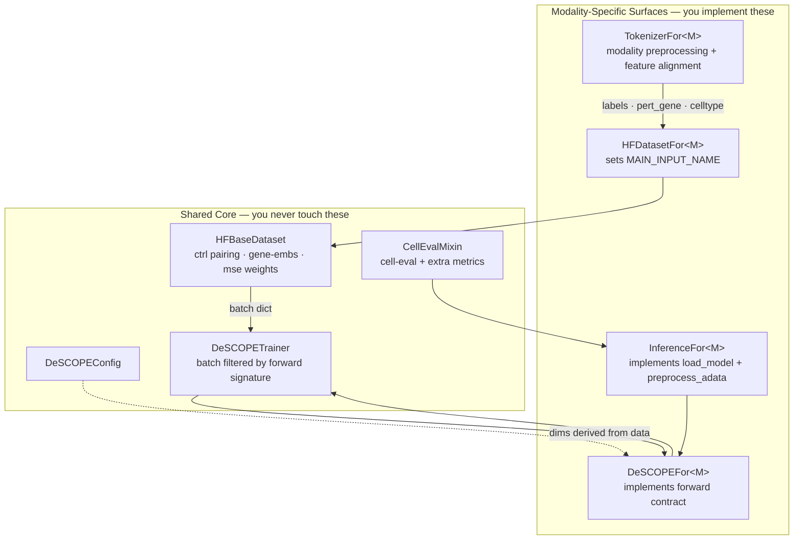
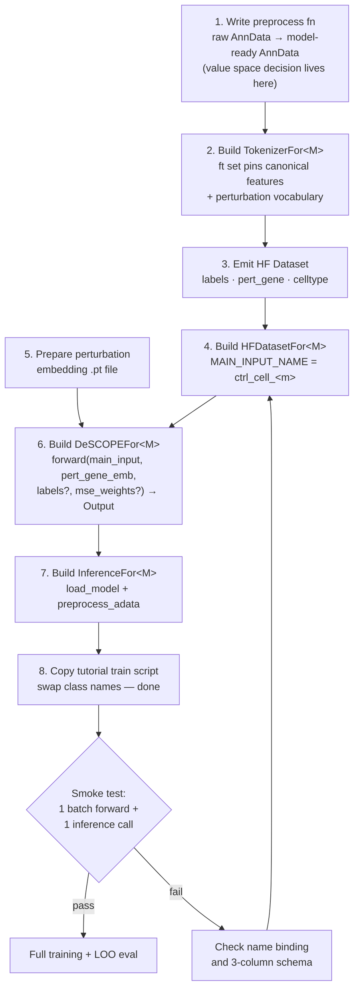

DeSCOPE ships with two first-class modalities — scRNA-seq (`DeSCOPEForRNA`) and scATAC-seq (`DeSCOPEForATAC`) — but the framework was deliberately structured so that a third, fourth, or Nth modality (spatial transcriptomics, CITE-seq protein counts, methylation arrays) requires **no changes to the training or evaluation core**. This page is the authoritative guide for advanced developers: it documents the extension doctrine extracted from the codebase, the five enforced contracts your new modality must satisfy, and a step-by-step implementation workflow with verified code anchors.

Sources: [modeling_descope.py](src/descope/models/modeling_descope.py#L117-L118), [__init__.py](src/descope/__init__.py#L13-L26)

## The Modality Extension Doctrine

The codebase states its own extension philosophy in a NOTE that precedes both model classes: *"The RNA and ATAC models have identical architectures; we maintain them as two distinct models to support independent adjustment for each data modality."* This is the governing principle. Rather than building a single config-switched model, DeSCOPE maintains a **parallel class triple per modality** — Tokenizer, HFDataset, Model, plus a fourth surface for Inference — while keeping every mechanism that operates *across* modalities (trainer, control-cell pairing, ELBO machinery, metrics) in shared base classes. The two tutorial training scripts are line-for-line identical except for the class names they import, which is the strongest evidence that adding a modality is a "fill in the parallel slots" exercise, not a core surgery task.

Sources: [modeling_descope.py](src/descope/models/modeling_descope.py#L117-L118), [modeling_descope.py](src/descope/models/modeling_descope.py#L199-L200), [train.py (ATAC)](tutorials/ATAC_Gene/train.py#L44-L85), [train.py (RNA)](tutorials/RNA_Gene/train.py#L44-L85)



### Per-Modality Class Matrix

Each existing modality fills every row of this matrix identically in shape; a new modality adds one more row:

| Extension surface | ATAC slot | RNA slot | Base class / contract |
|---|---|---|---|
| Tokenizer class | `TokenizerForATAC` | `TokenizerForRNA` | ft-set defines canonical features + perturbation set |
| Function tokenizer | `tokenize_adata_to_hf_dataset_for_atac` | `tokenize_adata_to_hf_dataset_for_rna` | Emits the 3-column HF schema |
| Model | `DeSCOPEForATAC` | `DeSCOPEForRNA` | Subclass `DeSCOPEPretrainedModel` |
| Model output | `DeSCOPEForATACOutput` | `DeSCOPEForRNAOutput` | `ModelOutput` with `loss/mse_loss/kl_loss/logits` |
| HF Dataset | `HFDatasetForATAC` | `HFDatasetForRNA` | Subclass `HFBaseDataset` + `MAIN_INPUT_NAME` |
| Inference | `InferenceForATAC` | `InferenceForRNA` | Subclass `BaseInference` (ABC) |
| Forward main input kwarg | `ctrl_cell_tf_idf` | `ctrl_cell_expr` | Must match dataset `MAIN_INPUT_NAME` |
| Preprocessing fn | `preprocess_atac_perturbation_adata_consistent_with_epiagent` | `preprocess_rna_perturbation_adata` | AnnData in → model-ready AnnData out |
| Default `ctrl_name` / `pert_col` | `"control"` / `"perturbation"` | `"non-targeting"` / `"gene"` | Conventions, overridable via args |

Sources: [modeling_descope.py](src/descope/models/modeling_descope.py#L119-L196), [modeling_descope.py](src/descope/models/modeling_descope.py#L201-L283), [models/utils.py](src/descope/models/utils.py#L12-L25), [dataset.py](src/descope/dataset.py#L324-L334), [inference.py](src/descope/inference.py#L381-L391), [tokenizer.py](src/descope/tokenizer.py#L308-L435), [tokenizer.py](src/descope/tokenizer.py#L438-L631)

## The Five Enforced Contracts

DeSCOPE does not rely on convention alone — several contracts are enforced at runtime, which means a new modality either satisfies them or fails fast and loudly. Understanding these is the difference between a clean integration and a mysterious `KeyError` deep in training.

| # | Contract | Enforcement point | Failure mode if violated |
|---|---|---|---|
| 1 | Tokenized HF dataset has columns `labels`, `pert_gene`, `celltype` | `HFBaseDataset._check_hf_dataset_features` | `ValueError` listing missing features at dataset construction |
| 2 | Dataset subclass defines non-None `MAIN_INPUT_NAME` | `__init_subclass__` hook on the base class | `NotImplementedError` at class definition time |
| 3 | Batch keys ⊆ model `forward` parameter names | `DeSCOPETrainer.__init__` introspects `forward` signature; train loop filters the batch | Extra keys silently dropped; a missing forward kwarg means it stays `None` — a silent data bug |
| 4 | Model forward returns an output with `loss`, `mse_loss`, `kl_loss` | `DeSCOPETrainer` reads these attributes directly | `AttributeError` in the training loop |
| 5 | Inference subclass implements `load_model` + `preprocess_adata` | `BaseInference` abstract methods | `TypeError` at instantiation |

Sources: [dataset.py](src/descope/dataset.py#L225-L235), [dataset.py](src/descope/dataset.py#L169-L185), [trainer.py](src/descope/trainer.py#L43-L46), [trainer.py](src/descope/trainer.py#L109-L115), [inference.py](src/descope/inference.py#L372-L378)

> [!TIP]
> Contract 3 is the linchpin that decouples modality from the trainer: `DeSCOPETrainer` builds `self.model_forward_keys` from `inspect.signature(unwrapped_model.forward)` and filters every batch to those keys before calling the model. Your `MAIN_INPUT_NAME` string must therefore be *exactly* the first parameter name of your model's `forward` — this is how `HFDatasetForATAC("ctrl_cell_tf_idf")` binds to `DeSCOPEForATAC.forward(ctrl_cell_tf_idf, ...)` and `HFDatasetForRNA("ctrl_cell_expr")` binds to `DeSCOPEForRNA.forward(ctrl_cell_expr, ...)` with zero trainer modifications.

### Contract 1 in Depth: The Three-Column HF Schema

Every modality converges on the same tokenized artifact: a HuggingFace `Dataset` with exactly three columns — `"labels"` (the model-ready feature vector per cell), `"pert_gene"` (the perturbation identity string), and `"celltype"` (the context label used to pair controls). The shared function `tokenize_adata_to_hf_dataset` produces this for both existing modalities, and `_check_hf_dataset_features` rejects anything missing them at load time. This schema is *the* interchange format of the framework: everything downstream (control pairing, embedding lookup, cell-eval export) keys off these names.

Sources: [tokenizer.py](src/descope/tokenizer.py#L58-L124), [dataset.py](src/descope/dataset.py#L225-L235)

### Contract 2 & 3 in Depth: The Name Binding

`HFBaseDataset.__getitems__` constructs the batch by selecting a random control cell per `celltype` for each perturbed cell and stores it under `batch[self.MAIN_INPUT_NAME]` (control cells map to themselves, keeping the VAE's prior path well-defined). Alongside it, the batch carries `pert_gene_emb` (stacked from the embedding file via `load_gene_embs`) and optional `mse_weights`. The trainer then keeps only keys matching your model's forward signature — so `pert_gene`, `celltype`, and other metadata flow through the dataset but never reach the model unless you declare them.

Sources: [dataset.py](src/descope/dataset.py#L277-L313), [dataset.py](src/descope/dataset.py#L202-L205), [trainer.py](src/descope/trainer.py#L109-L112)

## Architecture Is Dimension-Fluid: What the Config Does (and Doesn't) Encode

`DeSCOPEConfig` is deliberately modality-agnostic. It carries only two modality-relevant scalars: `input_length` (the feature-vector width — 18,080 for both existing modalities by default) and `input_pert_gene_embedding_size` (the perturbation-identity embedding width — 5,120 for ESM2). Crucially, `DeSCOPEModelArguments` exposes **no** `input_length` argument at all. Instead, both tutorial scripts derive the full configuration from the dataset itself: `input_length=train_ds[0]["labels"].shape[-1]` and `input_pert_gene_embedding_size=train_ds[0]["pert_gene_emb"].shape[-1]`. The practical consequence for extension work is profound: **your tokenized dataset and embedding file define the architecture**, so the same model code instantiates correctly for any feature count or embedding width without touching the config class.

Sources: [configuration_descope.py](src/descope/models/configuration_descope.py#L1-L28), [arguments.py](src/descope/arguments.py#L10-L85), [train.py (ATAC)](tutorials/ATAC_Gene/train.py#L52-L64)

> [!TIP]
> Because architecture dims are read from `train_ds[0]`, feature alignment in tokenization is not just hygiene — it is what pins the network's input/output width. If your modality has a different natural feature count (say, 5,000 proteins), do not pad to 18,080; simply tokenize to your true width and `input_length` follows. All MLPs are built by the dimension-parameterized `build_mlp`, and the variational encoders take `in_dim` as an explicit constructor argument (`VariationalEncoder(config, in_dim=config.input_length + config.hidden_size)`), so nothing else needs to change.

Sources: [models/utils.py](src/descope/models/utils.py#L104-L133), [modeling_descope.py](src/descope/models/modeling_descope.py#L36-L73), [modeling_descope.py](src/descope/models/modeling_descope.py#L128-L130)

## Step-by-Step: Adding a New Modality



### Step 1 — Preprocessing: Decide the Value Space

This is the only place where genuine modality science lives. For RNA, `preprocess_rna_perturbation_adata` performs raw-count validation, `normalize_total(target_sum=1e4)`, and `log1p`; for ATAC, `preprocess_atac_perturbation_adata_consistent_with_epiagent` selects top-k cCREs and produces TF-IDF values — with no log1p step, which is why the inference mixin documents that ATAC predictions bypass cell-eval's log-normality checks. Your preprocessing function must output AnnData whose `.X` is the dense regression target the decoder's `softplus` can represent: **non-negative, fixed-width, deterministic per cell**. Everything about the value distribution (counts vs. TF-IDF vs. binary accessibility) is absorbed here; the model itself never knows.

Sources: [tokenizer.py](src/descope/tokenizer.py#L280-L305), [inference.py](src/descope/inference.py#L130-L167), [modeling_descope.py](src/descope/models/modeling_descope.py#L152-L153)

### Step 2 — Tokenizer: The Fine-tune-Anchors-Pretrain Pattern

Both `TokenizerForATAC` and `TokenizerForRNA` implement the same template: `__init__` consumes a *fine-tune* AnnData and extracts two canonical lists — the feature vocabulary (`topk_ccres_list` / `input_genes_list`) and the perturbation set (`pert_genes_list`). Then `tokenize()` loops over *pretrain* datasets, reindexes each onto the fine-tune anchor via `UniformFeatureForAnnData` (a generic, modality-neutral utility that reindexes features, zero-pads missing ones, and resolves duplicates via mean/max pooling), optionally filters perturbations to the anchor set, and saves one HF dataset per cell line under `save_dir/<cell_line_name>`. Clone this pattern: your `TokenizerFor<M>` only needs to substitute the modality preprocessing call in the alignment pipeline — the anchor/align/save machinery is directly reusable.

Sources: [tokenizer.py](src/descope/tokenizer.py#L308-L360), [tokenizer.py](src/descope/tokenizer.py#L362-L435), [tokenizer.py](src/descope/tokenizer.py#L467-L568), [utils.py](src/descope/utils.py#L30-L36)

### Step 3 — HFDatasetFor<M>: A Three-Line Class

If your tokenized data follows the schema, the dataset subclass is trivial — this is the entire definition of both existing variants:

```python
class HFDatasetForM(HFBaseDataset):
    MAIN_INPUT_NAME = "ctrl_cell_m"          # must equal your model's 1st forward kwarg
    INVOLVE_CONTROL_TO_CONTROL = False       # True to train on ctrl→ctrl pairs too
    RANDOM_MAPPING_CONTROL_TO_CONTROL = False
```

The base class supplies everything else: schema validation, per-celltype control/perturbation index maps, gene-embedding loading keyed by `pert_gene`, per-(celltype, perturbation) MSE weight lookup, and batched `__getitems__` with random control pairing. You inherit `collate_fn` (identity) which passes pre-collated batch dicts straight to the trainer.

Sources: [dataset.py](src/descope/dataset.py#L324-L334), [dataset.py](src/descope/dataset.py#L237-L266), [dataset.py](src/descope/dataset.py#L318-L320)

### Step 4 — DeSCOPEFor<M>: Copy the Canonical forward

The two model classes are architecturally identical — four components wired identically: `PertGeneEncoder` (projects the perturbation embedding to `hidden_size`), a prior `VariationalEncoder` over `[control state ‖ perturbation embedding]`, a posterior `VariationalEncoder` over `[target state ‖ perturbation embedding]`, and a `VariationalDecoder` producing `input_length` outputs passed through `softplus`. Your new class must preserve four invariants: (1) the first forward parameter is your `MAIN_INPUT_NAME`; (2) `pert_gene_emb` is the second; (3) `labels` and `mse_weights` are optional; (4) the return value carries `loss`, `mse_loss`, `kl_loss`, `logits`. Two subtle details are worth copying verbatim: the MSE loss is elementwise-then-weighted (`(mse_weights * mse_loss_elementwise).sum(dim=-1).mean()` in ATAC), and KL is computed under `torch.amp.autocast(enabled=False)` in float32 to survive mixed-precision training.

Sources: [modeling_descope.py](src/descope/models/modeling_descope.py#L119-L176), [modeling_descope.py](src/descope/models/modeling_descope.py#L210-L216), [modeling_descope.py](src/descope/models/modeling_descope.py#L162-L168)

Before/after comparison — the complete delta between existing modalities in model code:

| Aspect | `DeSCOPEForATAC` | `DeSCOPEForRNA` | Your `DeSCOPEFor<M>` |
|---|---|---|---|
| Perturbation encoder | `PertGeneEncoder(config)` MLP | `nn.Sequential(Linear → LayerNorm)` | Either — independent per the NOTE doctrine |
| First forward kwarg | `ctrl_cell_tf_idf` | `ctrl_cell_expr` | `ctrl_cell_<m>` (= `MAIN_INPUT_NAME`) |
| Variational encoder `in_dim` | `input_length + hidden_size` | identical | identical formula |
| Decoder output | `input_length` → `softplus` | identical | identical |
| Output dataclass | `DeSCOPEForATACOutput` | `DeSCOPEForRNAOutput` | `DeSCOPEFor<M>Output` (same 4 fields) |
| Weighted MSE reduction | `.sum(dim=-1).mean()` | `.mean()` | Choose one — this is a free variable |

Sources: [modeling_descope.py](src/descope/models/modeling_descope.py#L127-L130), [modeling_descope.py](src/descope/models/modeling_descope.py#L210-L213), [modeling_descope.py](src/descope/models/modeling_descope.py#L156-L160), [modeling_descope.py](src/descope/models/modeling_descope.py#L242-L246)

### Step 5 — InferenceFor<M>: Implement Two Abstract Methods

`BaseInference` handles the heavy lifting: test-template CSV validation (`target_gene`, `n_cells` columns), control/test AnnData partitioning, batched generation by sampling control cells and repeating the perturbation embedding, NaN-filtering, and reassembling a predicted AnnData (real controls substituted back for evaluation). It also inherits `CellEvalMixin`, so metrics come free. You implement exactly two methods: `load_model` (a `from_pretrained` call on your model class) and `preprocess_adata` (your Step-1 preprocessing, sized by `self.model.config.input_length`). Note that `BaseInference.inference` calls `self.model.inference(<main_input>, pert_gene_emb=...)` *positionally* — your model's `inference` method must accept the main input first, mirroring `forward`.

Sources: [inference.py](src/descope/inference.py#L200-L241), [inference.py](src/descope/inference.py#L286-L348), [inference.py](src/descope/inference.py#L372-L391)

### Step 6 — Training Script: Swap the Imports, Derive the Config

Copy either tutorial's `train.py` and change three import lines plus the two construction sites (`HFDatasetFor<M>`, `DeSCOPEFor<M>`). Everything else — HfArgumentParser wiring, dataset concatenation from the tokenized directory, the `INVOLVE_CONTROL_TO_CONTROL` training flag, pretrained-model resume via `DeSCOPEFor<M>.from_pretrained`, and `DeSCOPETrainer` assembly with `data_collator=train_ds.collate_fn` — transfers unchanged. The `DeSCOPEDataArguments` you pass in (`tokenized_datasets_dir`, `ctrl_name`, `gene_embs_file`) is already modality-neutral.

Sources: [train.py (RNA)](tutorials/RNA_Gene/train.py#L17-L91), [arguments.py](src/descope/arguments.py#L29-L40)

## Choosing the Perturbation Identity Embedding

The `pert_gene_emb` input is a swappable interface, not a gene-only assumption. The default `gene_embs_file` is `./ESM2_pert_features.pt`, and `load_gene_embs` simply needs a dict-like mapping from perturbation name (as it appears in `pert_gene`) to a tensor — width flows into `input_pert_gene_embedding_size` automatically. The RNA_Drug case study proves this end-to-end: the Tahoe-100M pipeline extracts combined drug-and-dose embeddings via `1_extract_drug_embeddings.ipynb`, stores them as `tahoe100m_drug_dose_embed.pt`, and trains with the identical model machinery. For a new modality, you therefore decide only *what semantic identity* conditions the perturbation — protein sequence embeddings, molecule embeddings, guide-RNA embeddings — and serialize a `.pt` file whose keys cover every value in your `pert_gene` column (including your control label if you eval it).

Sources: [arguments.py](src/descope/arguments.py#L37-L40), [dataset.py](src/descope/dataset.py#L202-L205), [train.py (ATAC)](tutorials/ATAC_Gene/train.py#L55), [README.md (Tahoe)](tutorials/RNA_Drug/tahoe100m_pretrain/README.md#L1-L2)

## Validation Checklist and Common Pitfalls

| Check | Command/Method | Why it fails silently otherwise |
|---|---|---|
| HF schema present | `_check_hf_dataset_features` runs on init | Caught at construction — safe |
| `MAIN_INPUT_NAME` == forward kwarg 1 | Compare strings manually | Trainer filters keys silently; a mismatch means the model trains on `None` inputs → NaN loss |
| Embedding file covers all `pert_gene` values | `set(ds.unique("pert_gene")) ⊆ set(torch.load(file).keys())` | `KeyError` only when a rare perturbation is sampled |
| `labels` width == tokenizer anchor width | `train_ds[0]["labels"].shape[-1]` vs anchor list length | Zero-padded dead features silently dilute MSE |
| Value space ≥ 0 | Inspect `.X.min()` post-preprocessing | `softplus` cannot produce negatives → systematic floor bias |
| KL runs in fp32 | Copy the `autocast(enabled=False)` block | fp16 KL under DeepSpeed overflows to NaN |

Sources: [dataset.py](src/descope/dataset.py#L225-L235), [trainer.py](src/descope/trainer.py#L109-L112), [dataset.py](src/descope/dataset.py#L277-L286), [modeling_descope.py](src/descope/models/modeling_descope.py#L162-L168)

## Where to Go Next

Before writing code, ground yourself in the mechanics your extension will ride on: the data path is fully specified in [Tokenization: AnnData to HuggingFace Datasets](12-tokenization-anndata-to-huggingface-datasets) and [Feature Alignment and Vocabulary Handling](14-feature-alignment-and-vocabulary-handling); the architectural rationale behind the components you are cloning is covered in [Conditional VAE Architecture Overview](6-conditional-vae-architecture-overview) and [RNA and ATAC Model Variants](11-rna-and-atac-model-variants). Once your modality trains, evaluation and deployment details live in [Inference Pipeline Design](19-inference-pipeline-design) and [Leave-One-Out Evaluation Protocol](21-leave-one-out-evaluation-protocol), with the complete public surface enumerated in [API Reference and Module Layout](23-api-reference-and-module-layout).