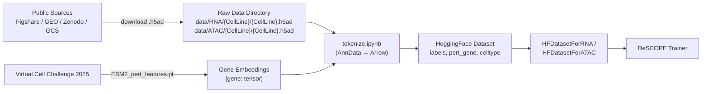

This page is your map to every dataset DeSCOPE consumes and every companion file you must download alongside them. DeSCOPE predicts single-cell perturbation responses from two major modalities — scRNA-seq and scATAC-seq — plus a drug-perturbation branch built on the massive Tahoe-100M corpus. Here you will learn what each dataset is, where to fetch it, how much disk space to budget, and exactly where to place the files so the library's data pipeline can find them.


## The Zoo at a Glance

Before diving into individual datasets, it helps to understand the overall shape of the data flow. Every entry in the zoo follows the same lifecycle: you download raw **`.h5ad`** (AnnData) files from a public repository, organize them in a local directory, tokenize them into Hugging Face Arrow datasets, and finally hand them to the training system:



The one companion asset every path depends on is the **ESM2 gene embedding file** (`ESM2_pert_features.pt`), which we cover in its own section below. Note that no dataset in this zoo is distributed *inside* the repository itself — DeSCOPE only ships the vocabulary pickles and pretrained drug models it authored; all perturbation data lives on external hosts such as Figshare, NCBI GEO, Zenodo, and Google Cloud Storage.

Sources: [Datasets.md](docs/source/Datasets.md#L1-L21), [README.md](README.md#L94-L114), [dataset.py](src/descope/dataset.py#L37-L71)

## scRNA-seq Perturbation Datasets

The core of the zoo is a collection of seven CRISPR-based gene perturbation datasets, spanning both perturb-seq style screens and targeted knockout studies. Each entry lists its source paper, on-disk size (where reported), and direct download link:

| Paper | Dataset | Size | Host | Notes |
| :--- | :--- | :--- | :--- | :--- |
| [Replogle et al., 2022](https://www.cell.com/cell/fulltext/S0092-8674(22)00597-9) | K562_GWPS | 61.3 GB | [Figshare](https://plus.figshare.com/ndownloader/files/35775507) | Genome-wide perturbation screen — the largest download |
| [Replogle et al., 2022](https://www.cell.com/cell/fulltext/S0092-8674(22)00597-9) | K562_ESSENTIAL | 9.9 GB | [Figshare](https://plus.figshare.com/ndownloader/files/35773219) | Essential-gene subset |
| [Replogle et al., 2022](https://www.cell.com/cell/fulltext/S0092-8674(22)00597-9) | RPE1 | 8.1 GB | [Figshare](https://plus.figshare.com/ndownloader/files/35775606) | — |
| [Nadig et al., 2025](https://www.nature.com/articles/s41588-025-02169-3) | HEPG2 | 5.2 GB | [NCBI GEO (GSE264667)](https://www.ncbi.nlm.nih.gov/geo/download/?acc=GSE264667&format=file&file=GSE264667%5Fhepg2%5Fraw%5Fsinglecell%5F01%2Eh5ad) | Direct `.h5ad` link |
| [Nadig et al., 2025](https://www.nature.com/articles/s41588-025-02169-3) | JURKAT | 8.7 GB | [NCBI GEO (GSE264667)](https://www.ncbi.nlm.nih.gov/geo/download/?acc=GSE264667&format=file&file=GSE264667%5Fjurkat%5Fraw%5Fsinglecell%5F01%2Eh5ad) | Direct `.h5ad` link |
| [Norman et al., 2019](https://www.science.org/doi/10.1126/science.aax4438) | Norman_K562 | — | [NCBI GEO (GSE133344)](https://www.ncbi.nlm.nih.gov/geo/query/acc.cgi?acc=GSE133344) | GEO accession page; includes multi-gene combinations |
| Ours (DeSCOPE team) | PC-9 | — | [Zenodo](https://zenodo.org/records/21622013) | Authored by the DeSCOPE team |

In addition to the tabular entries, the **H1** dataset comes from the [Virtual Cell Challenge 2025](https://virtualcellchallenge.org/) ([direct download](https://storage.googleapis.com/vcc_data_prod/datasets/state/competition_support_set.zip)). H1 is a special case in the RNA_Gene tutorial: it is the only cell line that uses `pert_col="target_gene"` and `target_sum=5e4` instead of the library defaults.

> [!TIP]
> **Critical insight**: the Virtual Cell Challenge support-set ZIP is also where the project recommends obtaining the **ESM2 gene embeddings** — a single download gives you both the H1 dataset and the embedding file every training run requires.

Sources: [Datasets.md](docs/source/Datasets.md#L3-L16), [README.md](README.md#L96-L109), [tokenize.ipynb](tutorials/RNA_Gene/tokenize.ipynb#L20-L36)

## scATAC-seq Data

For the chromatin-accessibility modality, DeSCOPE consumes cell-by-cCRE (or cell-by-peak) matrices sourced from the **[Human-scATAC-Corpus](https://health.tsinghua.edu.cn/human-scatac-corpus/download.php)** hosted by Tsinghua University. Unlike the scRNA-seq catalog, this is a corpus-level resource: you select and download the cell lines you need, then organize them into per-cell-line `.h5ad` files yourself.

The ATAC tutorials operate on five cell lines — `K562`, `K562_1`, `K562_2`, `MCF7`, and `GM12878` — and apply a `topk_ccres=50000` filter, meaning only the 50,000 most relevant cCREs are retained per cell line. Budget your download and disk space accordingly: accessibility matrices are sparse but wide.

Sources: [Datasets.md](docs/source/Datasets.md#L18-L21), [README.md](README.md#L112-L114), [tokenize.ipynb](tutorials/ATAC_Gene/tokenize.ipynb#L20-L36), [dataset.py](src/descope/dataset.py#L110-L136)

## Essential Companion Asset: ESM2 Gene Embeddings

Every dataset class in DeSCOPE expects a PyTorch file named **`ESM2_pert_features.pt`** (the default path is `./ESM2_pert_features.pt`). This file is a dictionary mapping gene names to ESM2-derived embedding tensors: `{gene_name: torch.Tensor}`. The model uses these embeddings to condition its predictions on *which* gene was perturbed — without this file, training cannot start.

The loading logic in `load_gene_embs` has two behaviors worth knowing as a beginner:

1. **Missing genes become zero vectors** — if a perturbation in your data has no entry in the embedding file, it is silently embedded as zeros.
2. **Multi-gene perturbations are averaged** — perturbations like `"GeneA+GeneB"` (the required concatenation convention for combinatorial knockouts) are embedded as the mean of their constituent gene embeddings, zeros included.

| Aspect | Detail |
| :--- | :--- |
| File name | `ESM2_pert_features.pt` |
| Format | `{gene_name: torch.Tensor}` dictionary, loadable via `torch.load` |
| Default lookup path | `./ESM2_pert_features.pt` (working directory) |
| Recommended source | [Virtual Cell Challenge 2025](https://virtualcellchallenge.org/) support-set ZIP |
| Used by | All dataset classes (legacy and HuggingFace-based) |

> [!TIP]
> **Critical insight**: when running the leave-one-out (`DeSCOPE_LOO`) pretraining across multiple cell lines, the names of control cells in `obs[pert_col]` must be **identical across all `.h5ad` files** — the tutorial notebooks flag this as the single most common setup mistake, and the tokenizer cannot merge datasets with inconsistent control labels.

Sources: [Datasets.md](docs/source/Datasets.md#L15-L16), [dataset.py](src/descope/dataset.py#L204-L208), [utils.py](src/descope/utils.py#L378-L399), [tokenize.ipynb](tutorials/RNA_Gene/tokenize.ipynb#L4-L11)

## Where Your Downloads Go: Expected File Layout

The tutorial notebooks make no assumptions about a magic install directory — they reference explicit paths like `/fse/home/wupengpeng/perturbation_data_origin/RNA/{CellLine}/{CellLine}.h5ad`, which are the *authors'* machine paths. You should mirror this structure locally and edit the notebook paths to match your own layout:

```
your_data_root/
├── RNA/
│   ├── H1/
│   │   ├── H1.h5ad
│   │   └── Test_Info_H1.csv
│   ├── K562_ESSENTIAL/
│   │   ├── K562_ESSENTIAL.h5ad
│   │   └── Test_Info_K562_ESSENTIAL.csv
│   ├── JURKAT/ ...
│   ├── RPE1/ ...
│   └── HEPG2/ ...
├── ATAC/
│   ├── K562/
│   │   ├── K562.h5ad
│   │   └── Test_Info_K562.csv
│   ├── K562_1/ ...  K562_2/ ...  MCF7/ ...  GM12878/ ...
└── ESM2_pert_features.pt
```

Two conventions in this layout matter for correctness:

- **`Test_Info_{CellLine}.csv`** files list the held-out perturbation gene names per cell line. They are fed into `load_gene_names_engine` as `perts_to_exclude` during tokenization, implementing the evaluation split. The loader accepts either a single-column gene list or a CSV with a `target_gene` header.
- **Metadata column conventions differ by modality.** The table below summarizes what your `.h5ad` files must contain so the tokenizers and dataset classes can find perturbation labels and control cells:

| Modality | Perturbation column (`pert_col`) | Control label (`ctrl_name`) | Notes |
| :--- | :--- | :--- | :--- |
| scRNA-seq (most cell lines) | `"gene"` | `"non-targeting"` | H1 uses `"target_gene"` instead |
| scRNA-seq (H1 only) | `"target_gene"` | `"non-targeting"` | Also uses `target_sum=5e4` |
| scATAC-seq | `"perturbation"` | `"control"` | top-k cCRE filtering applied downstream |
| Multi-gene knockouts | symbols joined by `+` | — | e.g., `"GeneA+GeneB"` |

Sources: [tokenize.ipynb](tutorials/RNA_Gene/tokenize.ipynb#L20-L80), [tokenize.ipynb](tutorials/ATAC_Gene/tokenize.ipynb#L20-L110), [utils.py](src/descope/utils.py#L330-L375), [dataset.py](src/descope/dataset.py#L109-L165)

## Who Consumes These Files: The Dataset Classes

DeSCOPE ships **two generations** of dataset classes. The legacy family reads `.h5ad` files directly and is explicitly marked `# Slow | Deprecated`; the current family consumes the Arrow-format datasets produced by tokenization and is marked `# Fast`. As a beginner, target the `HF*` classes — the legacy classes remain in the codebase mainly for reference and backward compatibility.

| Class | Generation | Input | `MAIN_INPUT_NAME` | Preprocessing |
| :--- | :--- | :--- | :--- | :--- |
| `BaseDataset` | Slow (deprecated) | `.h5ad` path or `AnnData` | — (abstract) | subclass-defined |
| `DatasetForATAC` | Slow (deprecated) | `.h5ad` / `AnnData` | `ctrl_cell_tf_idf` | EpiAgent-consistent cCRE filtering |
| `DatasetForRNA` | Slow (deprecated) | `.h5ad` / `AnnData` | `ctrl_cell_expr` | raw-count checks + normalization |
| `HFBaseDataset` | Fast | `datasets.Dataset` (Arrow) | — (abstract) | expects pre-tokenized features |
| `HFDatasetForATAC` | Fast | Arrow dataset | `ctrl_cell_tf_idf` | none (done at tokenization) |
| `HFDatasetForRNA` | Fast | Arrow dataset | `ctrl_cell_expr` | none (done at tokenization) |

The Fast classes validate your Arrow dataset strictly: it **must** contain the features `labels`, `pert_gene`, and `celltype`, or construction fails with an explicit error listing the missing features. At training time, each `__getitem__` call assembles a sample by pairing the perturbed cell with a randomly drawn control cell of the same cell type, and injects the corresponding ESM2 embedding for the perturbed gene.

Sources: [dataset.py](src/descope/dataset.py#L22-L106), [dataset.py](src/descope/dataset.py#L109-L165), [dataset.py](src/descope/dataset.py#L200-L335)

## Drug Perturbation Assets: Tahoe-100M and Sci-Plex3

The drug branch of the zoo works differently: instead of downloading one raw `.h5ad` per cell line, you work with the enormous **Tahoe-100M** corpus (approximately **60,000 genes**) and the **Sci-Plex3** evaluation set. To make Tahoe-100M tractable, the team pre-filtered genes by highly variable genes (HVGs) and frequency analysis — the preprocessing scripts live at `tahoe100m_pretrain/HVGs/calc_hvgs.py` and `calc_freq.ipynb`.

Three pretrained DeSCOPE checkpoints (each trained 10 epochs, batch size 1024) are hosted on Hugging Face, and each pairs with a gene-vocabulary pickle that **is** shipped in this repository:

| Pretrained Model | Gene Vocabulary (in-repo) | Hugging Face Repository |
| :--- | :--- | :--- |
| `descope-tahoe100m-2k-hvgs` | `tahoe100m_pretrain/HVGs/merged_2k_hvgs.pkl` | [wpp02/descope-tahoe100m-2k-hvgs](https://huggingface.co/wpp02/descope-tahoe100m-2k-hvgs) |
| `descope-tahoe100m-5k-hvgs` | `tahoe100m_pretrain/HVGs/merged_5k_hvgs.pkl` | [wpp02/descope-tahoe100m-5k-hvgs](https://huggingface.co/wpp02/descope-tahoe100m-5k-hvgs) |
| `descope-tahoe100m-12059-hvgs` | `tahoe100m_pretrain/HVGs/merged_12059_hvgs.pkl` | [wpp02/descope-tahoe100m-12059-hvgs](https://huggingface.co/wpp02/descope-tahoe100m-12059-hvgs) |

Choose the vocabulary size based on your compute budget — larger vocabularies cover more genes (the 12059-HVG model covers **482 of the 2,000** genes evaluated on Sci-Plex3). The recommended strategy is **pretraining on Tahoe-100M once, then fine-tuning on downstream datasets**, which avoids repeating expensive preprocessing and tokenization; the zero-shot fine-tune-free workflow is also supported. Repository assets also include `tahoe100m_drug_dose_embed.pt` (drug-dose embeddings) and `tahoe_100m_all_genes.pkl`.


Sources: [README.md](tutorials/RNA_Drug/README.md#L1-L40), [repo structure: tutorials/RNA_Drug/tahoe100m_pretrain/](tutorials/RNA_Drug/tahoe100m_pretrain)

## Suggested Reading Path

You now know what to download and where to put it. Here is the recommended progression through the documentation:

1. **[Quick Start](2-quick-start)** — if you have not yet installed `descopex` and verified your environment.
2. **[Tutorial Pipeline: Tokenize, Train, Evaluate](4-tutorial-pipeline-tokenize-train-evaluate)** — the end-to-end walkthrough that turns the `.h5ad` files you just downloaded into Arrow datasets and trained checkpoints.
3. **[Tokenization: AnnData to HuggingFace Datasets](12-tokenization-anndata-to-huggingface-datasets)** — the deep dive into the exact conversion step this page only sketched.
4. **[Drug Perturbation Case Studies: Sciplex3, Tahoe-100M](5-drug-perturbation-case-studies-sciplex3-tahoe-100m)** — once your drug assets are in place, follow the complete pretrain → fine-tune/zero-shot workflows.
