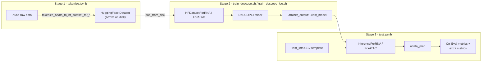
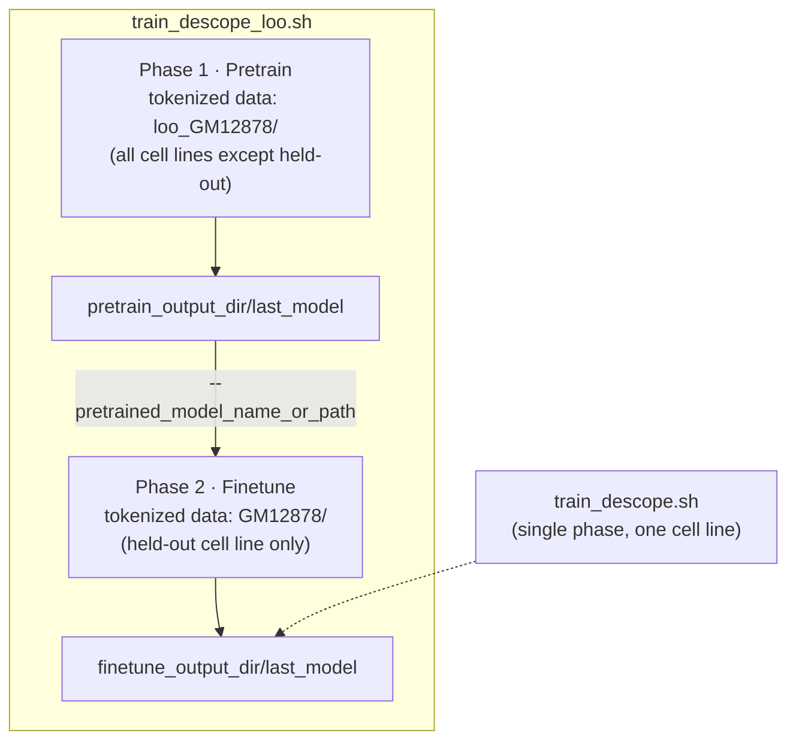

This page walks you through DeSCOPE's hands-on tutorial pipeline end to end: converting raw `.h5ad` single-cell data into Hugging Face datasets, training a model (either the standard DeSCOPE or the leave-one-out DeSCOPE_LOO variant), and running inference plus metric computation on unseen perturbations. Everything here is driven by the runnable artifacts in `tutorials/ATAC_Gene/` and `tutorials/RNA_Gene/` — the third folder, `tutorials/RNA_Drug/`, is a larger-scale case study covered separately in [Drug Perturbation Case Studies: Sciplex3, Tahoe-100M](5-drug-perturbation-case-studies-sciplex3-tahoe-100m).

Sources: [Tutorials.md](/docs/source/Tutorials.md#L1-L8), [README.md](/tutorials/ATAC_Gene/README.md#L1-L25), [README.md](/tutorials/RNA_Drug/README.md#L1-L8)

## Pipeline at a Glance

Both gene-perturbation tutorials share an identical three-stage execution flow, differing only in which modality-specific classes they import. Stage 1 converts AnnData into Arrow-format Hugging Face datasets, Stage 2 trains the conditional VAE, and Stage 3 generates predicted cells and scores them against real data. The entire workflow is chained by file paths: each stage consumes the output directory of the previous one.



Sources: [README.md](/tutorials/ATAC_Gene/README.md#L7-L24), [train.py](/tutorials/ATAC_Gene/train.py#L20-L72), [test.ipynb](/tutorials/ATAC_Gene/test.ipynb#L12-L46)

Each tutorial folder contains the same set of files, so once you understand one modality you can transfer that knowledge directly:

```
tutorials/ATAC_Gene/           tutorials/RNA_Gene/
├── README.md                  ├── README.md
├── accelerate_config.yaml     ├── accelerate_config.yaml
├── tokenize.ipynb             ├── tokenize.ipynb
├── train.py                   ├── train.py
├── train_descope.sh           ├── train_descope.sh
├── train_descope_loo.sh       ├── train_descope_loo.sh
└── test.ipynb                 └── test.ipynb
```

Sources: [README.md](/tutorials/RNA_Gene/README.md#L1-L25), [tokenize.ipynb](/tutorials/ATAC_Gene/tokenize.ipynb#L1-L123)

The only differences between the two variants are the modality-specific API names, which follow a strict one-to-one mapping:

| Pipeline Role | RNA_Gene API | ATAC_Gene API |
| :--- | :--- | :--- |
| One-shot tokenization | `tokenize_adata_to_hf_dataset_for_rna` | `tokenize_adata_to_hf_dataset_for_atac` |
| LOO pretrain tokenization | `TokenizerForRNA` | `TokenizerForATAC` |
| Dataset wrapper in training | `HFDatasetForRNA` | `HFDatasetForATAC` |
| Model class | `DeSCOPEForRNA` | `DeSCOPEForATAC` |
| Inference engine | `InferenceForRNA` | `InferenceForATAC` |
| Default control label | `non-targeting` | `control` |

Sources: [train.py](/tutorials/RNA_Gene/train.py#L4-L17), [train.py](/tutorials/ATAC_Gene/train.py#L4-L17), [tokenizer.py](/src/descope/tokenizer.py#L146-L157), [inference.py](/src/descope/inference.py#L381-L424)

## The Test CSV Template: The Pipeline's Contract

Before touching any notebook, you must prepare a test CSV template (named `Test_Info_{cellline}.csv` in the tutorials) that declares which unseen genes to predict and how many cells to generate per gene. This file is surprisingly load-bearing: it is consumed at *two* ends of the pipeline — during tokenization to exclude test perturbations from the training set, and during inference to drive cell generation. It must contain exactly two columns, `target_gene` and `n_cells`, and the control label does not need to appear (the inference pipeline always uses real, experimentally observed control cells rather than synthetic ones).

| Column | Meaning | Example values |
| :--- | :--- | :--- |
| `target_gene` | Perturbation genes held out from training; multi-gene knockouts are joined with `+` (e.g., `GeneA+GeneB`); a `non-targeting`/`control` entry is optional and ignored if present | `PRCP`, `MED13`, `non-targeting` |
| `n_cells` | Number of cells to generate for that target gene | `4331`, `2787` |

Sources: [Tutorials.md](/docs/source/Tutorials.md#L10-L33), [tokenize.ipynb](/tutorials/ATAC_Gene/tokenize.ipynb#L4-L21), [inference.py](/src/descope/inference.py#L216-L219)

> [!TIP]
> Notice how `perts_to_exclude=load_gene_names_engine(f".../Test_Info_{c}.csv")` appears in the tokenization cell of both tutorials. This is the mechanism that makes genes truly "unseen": the same CSV that defines your evaluation targets also filters them out of the training data, guaranteeing the leave-one-out protocol is leak-free.

Sources: [tokenize.ipynb](/tutorials/ATAC_Gene/tokenize.ipynb#L30-L51), [tokenizer.py](/src/descope/tokenizer.py#L14-L45)

## Stage 1: Tokenize AnnData into Hugging Face Datasets

Run `tokenize.ipynb` to transform raw `.h5ad` files into tokenized Arrow datasets. Conceptually, tokenization performs a **before → after** transformation on your data:

| | Before (raw AnnData) | After (tokenized HF Dataset) |
| :--- | :--- | :--- |
| Storage format | `.h5ad` file, expression matrix in `.X`, labels in `.obs[pert_col]` | Arrow dataset on disk via `save_to_disk` |
| Columns | Gene × cell matrix + metadata | Three columns: `"labels"` (expression vector), `"pert_gene"` (perturbation label or control), `"celltype"` |
| Perturbation set | Everything observed, including test genes | Test genes excluded via `perts_to_exclude` |
| Feature space | Whatever the file contains | Unified: top-`50000` variable cCREs (ATAC) or the finetune file's gene set (RNA) |

Sources: [tokenizer.py](/src/descope/tokenizer.py#L93-L107), [tokenizer.py](/src/descope/tokenizer.py#L187-L222), [README.md](/tutorials/ATAC_Gene/README.md#L9-L11)

The notebook has two sections that matter: **`1. DeSCOPE`** tokenizes each cell line individually for fine-tuning, while **`2. DeSCOPE_LOO`** tokenizes the *remaining* cell lines jointly for pretraining. If you only plan to run standard DeSCOPE, Section 1 alone suffices; DeSCOPE_LOO requires both. In Section 2, a `TokenizerForRNA`/`TokenizerForATAC` object is first initialized on the held-out cell line — this freezes its feature space and perturbation vocabulary — and then `.tokenize()` is called on every other cell line, aligning each one to that frozen space before saving to `loo_{cellline}` directories.

Sources: [tokenize.ipynb](/tutorials/ATAC_Gene/tokenize.ipynb#L30-L87), [tokenizer.py](/src/descope/tokenizer.py#L331-L358), [tokenizer.py](/src/descope/tokenizer.py#L467-L501)

Key tokenization parameters you will actually edit:

| Parameter | Where used | Purpose |
| :--- | :--- | :--- |
| `perts_to_exclude` | Section 1 | Removes the CSV's test genes from training data |
| `topk_ccres=50000` | ATAC only | Keeps the 50,000 most variable cCREs as the input feature space |
| `target_sum` | RNA only | Per-cell normalization target (e.g., `1e4`; `5e4` for the H1 cell line) |
| `pert_col` / `ctrl_name` | Both | Column holding perturbation labels; the control label (RNA defaults to `non-targeting`, ATAC to `control`) |
| `skip_raw_counts_check` | RNA only | Bypasses the integer-counts assertion; set `True` only if you are certain inputs are raw counts |
| `duplicated_features_handling` | RNA LOO only | Strategy for duplicate gene symbols, e.g., `DuplicatedFeatureHandling.max_pooling` |
| `apply_pert_gene_filter=False` | Section 2 | Keeps *all* perturbations in pretraining cell lines rather than only those in the finetune set |

Sources: [tokenize.ipynb](/tutorials/RNA_Gene/tokenize.ipynb#L30-L87), [tokenizer.py](/src/descope/tokenizer.py#L238-L272), [tokenizer.py](/src/descope/tokenizer.py#L413-L435), [tokenizer.py](/src/descope/tokenizer.py#L578-L579)

Two data-hygiene rules are emphasized directly in the notebook's Tips cell. First, when tokenizing pretraining cell lines for LOO, **control cell names must be identical across all `.h5ad` files**, because DeSCOPE_LOO merges those datasets and needs one consistent control label. Second, multi-gene knockouts must concatenate gene symbols with a plus sign, e.g. `'GeneA+GeneB'`.

Sources: [tokenize.ipynb](/tutorials/ATAC_Gene/tokenize.ipynb#L4-L21), [tokenize.ipynb](/tutorials/RNA_Gene/tokenize.ipynb#L4-L25), [Tutorials.md](/docs/source/Tutorials.md#L32-L33)

## Stage 2: Train with the DeSCOPE Trainer

Training is launched from bash — never by running `train.py` directly — because the scripts invoke `accelerate launch` with a distributed configuration. `train_descope.sh` runs a single standard training job, while `train_descope_loo.sh` runs a **two-phase protocol**: pretrain on all cell lines except the held-out one, then finetune on the held-out line by loading the pretrain checkpoint via `--pretrained_model_name_or_path`.



Sources: [train_descope.sh](/tutorials/ATAC_Gene/train_descope.sh#L52-L59), [train_descope_loo.sh](/tutorials/ATAC_Gene/train_descope_loo.sh#L43-L97)

Inside `train.py`, the flow is always the same three steps regardless of modality: parse the three argument dataclasses, build the dataset wrapper, then hand everything to `DeSCOPETrainer`. The dataset loading has a built-in convenience — it first tries `load_from_disk` on the directory as a whole, and on `FileNotFoundError` falls back to concatenating the per-cell-line subdirectories beneath it, which is exactly how the LOO pretrain directory is laid out. A small but important line is `HFDatasetForATAC.INVOLVE_CONTROL_TO_CONTROL = True`, which includes control-to-control pairs in training. Finally, when training from scratch, the model's `input_length` and embedding size are **inferred from the data itself** (`train_ds[0]["labels"].shape[-1]` and `pert_gene_emb` shape), so tokenization output and model dimensions can never disagree.

Sources: [train.py](/tutorials/ATAC_Gene/train.py#L20-L64), [train.py](/tutorials/RNA_Gene/train.py#L20-L64), [train.py](/tutorials/ATAC_Gene/train.py#L66-L72)

Every flag in the shell scripts maps to one of three argument groups parsed by `HfArgumentParser`:

| Parameter Group | Data Arguments | Model Arguments | Training Arguments |
| :--- | :--- | :--- | :--- |
| Purpose | Where data lives | Architecture shape | Optimization loop |
| Key fields | `tokenized_datasets_dir`, `keep_in_memory`, `ctrl_name`, `gene_embs_file` | `hidden_act`, `hidden_size`, `hidden_dropout`, `pert_gene_encoder_layers`, `variational_encoder_layers`, `variational_decoder_layers`, `add_layernorm` | `seed`, `num_train_epochs`, `per_device_train_batch_size`, `learning_rate`, `lr_scheduler_type`, `alpha_mse_loss`, `alpha_kl_loss`, `pretrained_model_name_or_path` |
| Tutorial defaults | Paths set at script top | `gelu`, `672`, `0`, `1`, `4`, `4`, `True` | `42`, `20`, `64`, `1e-4`, `cosine`, `1.0`, `1.0`, unset (scratch) / pretrain dir (LOO finetune) |

Sources: [arguments.py](/src/descope/arguments.py#L5-L85), [train_descope.sh](/tutorials/ATAC_Gene/train_descope.sh#L6-L50)

The `alpha_mse_loss` and `alpha_kl_loss` fields are DeSCOPE-specific extensions of a standard `TrainingArguments` class: they weight the MSE reconstruction term and the KL divergence term of the ELBO objective (both default `1.0` in the tutorials). Two other settings worth knowing as a beginner: `checkpointing_steps=epoch-10` saves a checkpoint every 10 epochs, and `--mixed_precision=bf16` plus the `dataloader_*` flags are pure throughput knobs that don't change model semantics.

Sources: [arguments.py](/src/descope/arguments.py#L5-L15), [train_descope.sh](/tutorials/ATAC_Gene/train_descope.sh#L32-L50), [train_descope_loo.sh](/tutorials/ATAC_Gene/train_descope_loo.sh#L20-L42)

Distributed behavior comes from `accelerate_config.yaml`, which is deliberately minimal — its only decision is `distributed_type: MULTI_GPU` or `DEEPSPEED` (if you choose MULTI_GPU, do not pass a DeepSpeed config file). The launcher combines this file with `--num_processes=1` and the three parameter blocks into one training invocation.

Sources: [accelerate_config.yaml](/tutorials/ATAC_Gene/accelerate_config.yaml#L1-L3), [train_descope.sh](/tutorials/ATAC_Gene/train_descope.sh#L52-L59)

## Stage 3: Inference and Evaluation with test.ipynb

`test.ipynb` is organized as five sequential steps, and its outputs are everything you need for reporting: per-perturbation metrics, aggregate metrics, and a predicted AnnData on disk. First, initialize the inference engine by pointing it at three things — the test CSV template, the original `.h5ad` (the source of real control cells), and the trained checkpoint (`./trainer_output/GM12878/last_model`). Initialization immediately validates the CSV (`target_gene`/`n_cells` columns are mandatory and a missing-column error is raised otherwise), splits the ground truth into control and test subsets, and loads the model weights.

Sources: [test.ipynb](/tutorials/ATAC_Gene/test.ipynb#L12-L24), [inference.py](/src/descope/inference.py#L199-L247), [inference.py](/src/descope/inference.py#L249-L256)

Second, call `infer.inference(...)`. The loop samples real control cells in batches, pairs each batch with the ESM2 embedding of the target gene from `gene_embs_file`, and decodes `n_cells` predicted cells per target gene — dropping any batch that contains NaN outputs. For RNA data you'll additionally pass `target_sum` and `skip_raw_counts_check` at initialization, mirroring tokenization.

Sources: [test.ipynb](/tutorials/ATAC_Gene/test.ipynb#L41-L46), [inference.py](/src/descope/inference.py#L286-L348), [test.ipynb](/tutorials/RNA_Gene/test.ipynb#L14-L24)

> [!TIP]
> The notebook screams this in bold for a reason: always keep `use_generated_control_cells=False`. The code enforces it with a hard assertion — generated controls exist only for internal debugging, and using them in evaluation causes result instability. Final metrics must always compare predictions against *real, experimentally observed* control cells, which the pipeline substitutes into the output automatically.

Sources: [test.ipynb](/tutorials/ATAC_Gene/test.ipynb#L25-L46), [inference.py](/src/descope/inference.py#L295-L300), [inference.py](/src/descope/inference.py#L364-L368)

Third, compute metrics via `infer.compute_metrics(...)`, which wraps the cell-eval library. Browse `infer.all_metrics` to see the full catalog, pick your subset, and receive a `(results, agg_results, evaluator)` tuple — per-perturbation scores, aggregate scores, and a live evaluator object.

| Metric Category | Examples from the tutorial | What it measures |
| :--- | :--- | :--- |
| Distributional | `pearson_delta`, `mae`, `discrimination_score_l1` | Agreement between predicted and real expression profiles |
| DE-overlap | `overlap_at_50/100/200/500`, `overlap_at_N` | Overlap of top differentially-expressed genes vs. ground truth |
| Extra (DeSCOPE-added) | `pearson`, `pearson_delta_on_topk_de`, `direction_match_on_topk_de` | Correlation and up/down-regulation direction on top-k DE genes |

Sources: [test.ipynb](/tutorials/ATAC_Gene/test.ipynb#L47-L95), [Tutorials.md](/docs/source/Tutorials.md#L35-L105), [inference.py](/src/descope/inference.py#L70-L97), [inference.py](/src/descope/inference.py#L160-L196)

Fourth, run the extra metrics through `infer.extra_metrics_func`, e.g., `direction_match_on_topk_de` with `separate_up_down_regulated=True` returns separate up- and down-regulated direction-match scores. Fifth, aggregate per-perturbation results into a pandas DataFrame, join the extra metrics by mapping on the `perturbation` column, and export `results_for_each_perturbation.csv`; finally, save the predicted AnnData via `infer.write_h5ad(...)` as `descope_preds.h5ad`.

Sources: [test.ipynb](/tutorials/ATAC_Gene/test.ipynb#L96-L210), [test.ipynb](/tutorials/ATAC_Gene/test.ipynb#L211-L221), [Tutorials.md](/docs/source/Tutorials.md#L107-L176)

## Troubleshooting Common Pitfalls

| Symptom | Root Cause | Fix |
| :--- | :--- | :--- |
| `Missing required columns in test csv template: [...]` | CSV lacks `target_gene` or `n_cells` | Re-export the CSV with exactly those two columns |
| LOO pretraining merges data incorrectly | Control cell labels differ across `.h5ad` files | Rename controls to one consistent label before Section 2 of tokenization |
| Hard assertion crash during `infer.inference` | `use_generated_control_cells=True` | Keep `False` for all evaluations; generated controls are debug-only |
| `Detected NaN, drop current batch.` in logs | Numerical instability in a decoded batch | Expected behavior — the batch is regenerated automatically; no action needed |
| Test genes appear "seen" during training | `perts_to_exclude` not wired to `Test_Info_*.csv` | Pass `load_gene_names_engine(...)` output as `perts_to_exclude` in Section 1 |
| RNA tokenization asserts non-integer values | Input is already normalized, not raw counts | Set `skip_raw_counts_check=True` only if you have verified your data yourself |

Sources: [inference.py](/src/descope/inference.py#L249-L256), [inference.py](/src/descope/inference.py#L295-L300), [inference.py](/src/descope/inference.py#L331-L333), [tokenize.ipynb](/tutorials/ATAC_Gene/tokenize.ipynb#L4-L21), [tokenize.ipynb](/tutorials/RNA_Gene/tokenize.ipynb#L8-L9)

## Where to Go Next

You have now run the full tokenize → train → evaluate loop for gene perturbation prediction. Natural next steps, following the documentation catalog: if you want the drug-perturbation workflow with pretrained Tahoe-100M checkpoints, continue to [Drug Perturbation Case Studies: Sciplex3, Tahoe-100M](5-drug-perturbation-case-studies-sciplex3-tahoe-100m). To understand what happened inside each stage, read [Tokenization: AnnData to HuggingFace Datasets](12-tokenization-anndata-to-huggingface-datasets), [Trainer and Accelerate Integration](15-trainer-and-accelerate-integration), [Inference Pipeline Design](19-inference-pipeline-design), and for evaluation theory, [Perturbation Metrics via Cell-Eval](20-perturbation-metrics-via-cell-eval) plus [Leave-One-Out Evaluation Protocol](21-leave-one-out-evaluation-protocol). If you need a refresher on where to download the datasets used here, revisit [Datasets Zoo and Downloads](3-datasets-zoo-and-downloads).