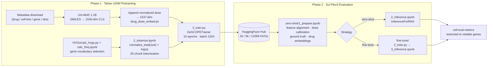
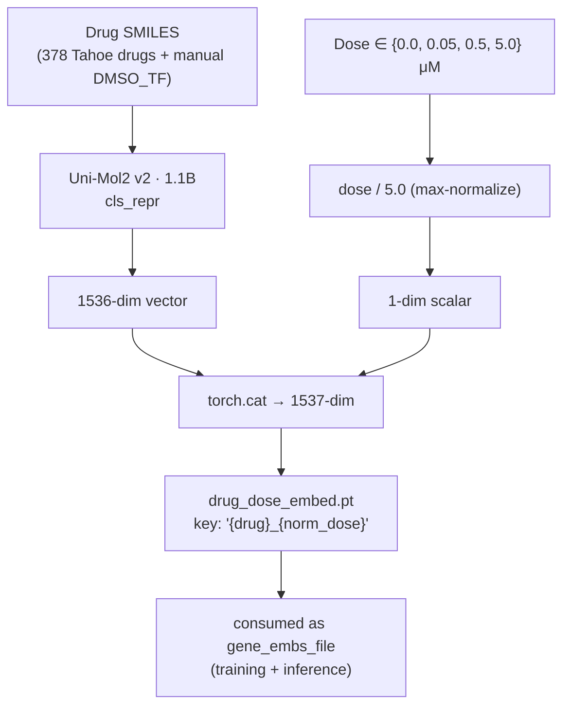
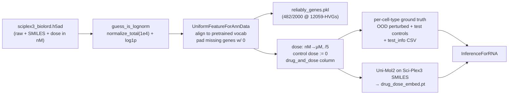

This page walks through DeSCOPE's flagship drug perturbation workflow: pretraining on the full Tahoe-100M dataset (~50 billion cells across ~60,000 genes, hundreds of drugs, dozens of cancer cell lines), then transferring that model to the Sci-Plex3 benchmark via either **zero-shot inference** or **fine-tuning**. The workflow lives in `tutorials/RNA_Drug/` and exercises nearly every subsystem in the library — molecular drug encodings, chunked tokenization, accelerate-based training, and cell-eval-backed evaluation — making it the best end-to-end reference for intermediate developers.

## Case Study Workflow at a Glance

The tutorial is organized as two sequential phases. Phase 1 builds a general-purpose drug perturbation model from Tahoe-100M; Phase 2 evaluates that model on Sci-Plex3, a chemically *disjoint* dataset, which is what makes the zero-shot result meaningful. The entire pipeline hinges on one architectural idea: a perturbation is encoded as a **Uni-Mol2 molecular embedding of the drug's SMILES concatenated with a scalar normalized dose**, so the model can, in principle, respond to any drug expressible as SMILES — not just the ones seen in training.



The repository layout mirrors this flow exactly:

```
tutorials/RNA_Drug/
├── sciplex3_evaluation/
│   ├── fine-tune/          # 1_prepare → 2_train.py → 3_inference (+ accelerate config, shell script)
│   └── zero-shot/          # 1_prepare.ipynb → 2_inference.ipynb
├── tahoe100m_pretrain/
│   ├── 1_extract_drug_embeddings.ipynb   # Uni-Mol2 drug/dose vectors
│   ├── 2_tokenize.ipynb                  # AnnData → HF datasets, chunked
│   ├── 3_train.py                        # full-dataset pretraining
│   ├── 4_test.ipynb
│   ├── HVGs/                             # per-plate 5k HVGs + merged 2k/5k/12059 vocabularies
│   ├── tahoe100m_drug_dose_embed.pt      # committed drug-dose embedding artifact
│   └── tahoe_100m_all_genes.pkl
└── scrna_drug_perturbation_performance.png
```

Sources: [README.md](tutorials/RNA_Drug/README.md#L1-L4), [README.md](tutorials/RNA_Drug/tahoe100m_pretrain/README.md#L1-L2), [README.md](tutorials/RNA_Drug/sciplex3_evaluation/README.md#L1-L1)

## Pretrained Models and Gene Vocabularies

Tahoe-100M contains roughly **60,000 genes**, which is computationally prohibitive to model directly. The authors therefore built gene vocabularies via highly-variable-gene (HVG) selection and gene-frequency analysis (`HVGs/calc_hvgs.py`, `HVGs/calc_freq.ipynb`), and released three pretrained checkpoints — one per vocabulary size — so you can trade gene coverage against memory/compute. All three were trained for 10 epochs at batch size 1024.

| Pretrained Model | Gene Vocabulary File | Hugging Face Repo |
| :--- | :--- | :--- |
| `descope-tahoe100m-2k-hvgs` | `tahoe100m_pretrain/HVGs/merged_2k_hvgs.pkl` | `wpp02/descope-tahoe100m-2k-hvgs` |
| `descope-tahoe100m-5k-hvgs` | `tahoe100m_pretrain/HVGs/merged_5k_hvgs.pkl` | `wpp02/descope-tahoe100m-5k-hvgs` |
| `descope-tahoe100m-12059-hvgs` | `tahoe100m_pretrain/HVGs/merged_12059_hvgs.pkl` | `wpp02/descope-tahoe100m-12059-hvgs` |

The vocabulary files are not just training artifacts — they are the **interface between the two datasets**. Sci-Plex3 preparation downloads a checkpoint, reads its `.pkl` vocabulary, and uses it to align genes before any model runs. Choose the vocabulary whose overlap with your downstream data is highest.

Sources: [README.md](tutorials/RNA_Drug/README.md#L8-L23)

## Phase 1: Tahoe-100M Pretraining

### Step 1 — Molecular Drug Embeddings via Uni-Mol2

Notebook `1_extract_drug_embeddings.ipynb` proceeds in three stages. First, it pulls four Tahoe-100M metadata parquet files from the Hub: `obs_metadata.parquet` (drug + dose per cell), `drug_metadata.parquet` (SMILES + target), `cell_line_metadata.parquet`, and `gene_metadata.parquet`. Second, it builds a drug-name → canonical-SMILES map over **378 drugs** — with one manual fix: control cells are labeled `DMSO_TF` in `obs_metadata`, but that "drug" is absent from `drug_metadata`, so its SMILES `"CSC(C)=O"` is inserted by hand. Third, it runs `unimol_tools.UniMolRepr` (the **Uni-Mol2 1.1B** model) on the SMILES list and extracts the CLS-token representation — a 1536-dim vector per drug.

The final stage turns a drug embedding into a *drug-dose* embedding. Tahoe-100M has exactly four dose levels — 0.0 μM (DMSO controls), 0.05 μM, 0.5 μM, 5.0 μM — and each dose is **max-normalized by 5.0** before being appended as a scalar to the embedding's last dimension:

```python
norm_dose = float(d / max_dose)
results[f"{drug}_{norm_dose}"] = torch.cat([embed, torch.tensor([norm_dose], dtype=torch.float32)])
```

Two guard clauses enforce semantics: non-control drugs skip dose 0, and `DMSO_TF` skips all non-zero doses. The result — `tahoe100m_drug_dose_embed.pt` — is a dictionary keyed by `"{drug}_{norm_dose}"` with 1537-dim tensors, exactly the format `HFDatasetForRNA` and `InferenceForRNA` expect from their `gene_embs_file` argument.



Sources: [1_extract_drug_embeddings.ipynb](tutorials/RNA_Drug/tahoe100m_pretrain/1_extract_drug_embeddings.ipynb#L77-L91), [1_extract_drug_embeddings.ipynb](tutorials/RNA_Drug/tahoe100m_pretrain/1_extract_drug_embeddings.ipynb#L1208-L1218), [1_extract_drug_embeddings.ipynb](tutorials/RNA_Drug/tahoe100m_pretrain/1_extract_drug_embeddings.ipynb#L1253-L1269), [1_extract_drug_embeddings.ipynb](tutorials/RNA_Drug/tahoe100m_pretrain/1_extract_drug_embeddings.ipynb#L1276-L1284), [1_extract_drug_embeddings.ipynb](tutorials/RNA_Drug/tahoe100m_pretrain/1_extract_drug_embeddings.ipynb#L1335-L1352)

### Step 2 — Chunked Tokenization

Notebook `2_tokenize.ipynb` converts plate-level `.h5ad` files into HuggingFace datasets. The critical preprocessing function, `generate_condition_col_for_tahoe100m`, parses the `drugname_drugconc` column (a stringified tuple of drug name and dose), strips whitespace on `obs["drug"]`, **drops two problematic drugs** (`Sacubitril/Valsartan`, `Verteporfin`), and normalizes doses to the same `dose / 5.0` scale as Step 1, producing a `condition` column of the form `"{drug}_{norm_dose}"`. This means the tokenized dataset's perturbation keys and the drug-dose embedding dictionary share an identical naming convention — a silent but load-bearing contract.

Because Tahoe-100M plates are enormous, each AnnData is split into 20 row-chunks (bump `n_chunks` if chunk `.X` doesn't fit in dense memory), and per chunk the notebook manually applies `sc.pp.normalize_total(target_sum=1e4)` followed by `sc.pp.log1p`, filters columns down to the chosen vocabulary (e.g., `merged_2k_hvgs.pkl`), and calls the library tokenizer:

```python
tokenize_adata_to_hf_dataset_for_rna(
    adata=adata_chunk,
    cell_line_col="cell_line",
    target_sum=1e4,
    pert_col="condition",
    ctrl_name="DMSO_TF_0.0",
    save_dir=f".../Tahoe_100M/2k_hvgs/{plate}_chunk{i}"
)
```

Note the control name `DMSO_TF_0.0` — dose 0.0 marks the vehicle control, and this string becomes the reference condition the model trains against.

Sources: [2_tokenize.ipynb](tutorials/RNA_Drug/tahoe100m_pretrain/2_tokenize.ipynb#L36-L58), [2_tokenize.ipynb](tutorials/RNA_Drug/tahoe100m_pretrain/2_tokenize.ipynb#L83-L112)

### Step 3 — Training Script Anatomy

`3_train.py` is deliberately thin — it composes library primitives rather than implementing logic. It parses the three standard argument groups (`DeSCOPEDataArguments`, `DeSCOPEModelArguments`, `DeSCOPETrainingArguments`) via `HfArgumentParser`, then loads tokenized data in one of two ways: either the save directory is a single `load_from_disk` dataset, or — as produced by Step 2's per-plate, per-chunk outputs — each subdirectory is loaded and stitched together with `concatenate_datasets`. The `HFDatasetForRNA` wrapper then attaches the control name and the drug-dose embedding file at tensor-construction time.

A detail worth noticing: when training from scratch, the `DeSCOPEConfig` is *derived from the data itself* rather than hardcoded — `input_pert_gene_embedding_size` comes from `train_ds[0]["pert_gene_emb"].shape[-1]` (1537 here) and `input_length` from `train_ds[0]["labels"].shape[-1]` (the vocabulary size). This is what makes the same script work unchanged across the 2k/5k/12059 vocabularies. If `pretrained_model_name_or_path` is set instead, `DeSCOPEForRNA.from_pretrained` bypasses config construction — which is precisely the hook the fine-tuning phase exploits. Training is handed to `DeSCOPETrainer` together with `train_ds.collate_fn` and an accelerate config (`accelerate_config.yaml`, `train_descope.sh`).

Sources: [3_train.py](tutorials/RNA_Drug/tahoe100m_pretrain/3_train.py#L22-L53), [3_train.py](tutorials/RNA_Drug/tahoe100m_pretrain/3_train.py#L55-L91)

## Phase 2: Sci-Plex3 Evaluation

### Zero-Shot Preparation

The zero-shot track (`sciplex3_evaluation/zero-shot/`) demonstrates transfer to a dataset DeSCOPE never saw. Sci-Plex3 data comes from Hetzel et al. (2022) — `sciplex_complete_middle_subset.h5ad` from the chemCPA collection — and preparation in `1_prepare.ipynb` runs four ordered transformations:

1. **Normalization check.** `guess_is_lognorm(adata)` decides whether `normalize_total` + `log1p` should run; if applied, `target_sum` must equal **1e4** because that is what Tahoe-100M was pretrained with.
2. **Feature alignment.** `UniformFeatureForAnnData` (with `DuplicatedFeatureHandling.mean_pooling`) reorders/extends the AnnData's genes to exactly match the pretrained vocabulary — retaining overlapping genes, zero-padding missing ones. Before aligning, the notebook computes *gene coverage* — for the 12059-HVG model, only **482 of Sci-Plex3's 2,000 genes** overlap the vocabulary — and persists that intersection as `reliably_genes.pkl`. These are the "reliably predicted genes" that every later metric will be restricted to.
3. **Dose unit calibration.** Sci-Plex3 doses are in nM, Tahoe-100M in μM. The notebook sets control-cell dose explicitly to 0, converts nM → μM (`/1000`), then applies the same max-normalization (`/5`) used in pretraining, and builds a `drug_and_dose` condition column (`"{condition}_{dose_norm}"`).
4. **Ground truth + drug embeddings.** Per cell type, ground-truth AnnData files are written by concatenating OOD-split perturbed cells with control cells from the test split, alongside a `test_info_{celltype}.csv` template (rows: condition, cell count — matching the biolord convention). Finally, Uni-Mol2 embeddings are extracted for Sci-Plex3's own SMILES list, doses appended under the identical concat-and-key scheme, and saved as `drug_dose_embed.pt`.



Sources: [1_prepare.ipynb](tutorials/RNA_Drug/sciplex3_evaluation/zero-shot/1_prepare.ipynb#L41-L44), [1_prepare.ipynb](tutorials/RNA_Drug/sciplex3_evaluation/zero-shot/1_prepare.ipynb#L62-L77), [1_prepare.ipynb](tutorials/RNA_Drug/sciplex3_evaluation/zero-shot/1_prepare.ipynb#L84-L127), [1_prepare.ipynb](tutorials/RNA_Drug/sciplex3_evaluation/zero-shot/1_prepare.ipynb#L134-L198), [1_prepare.ipynb](tutorials/RNA_Drug/sciplex3_evaluation/zero-shot/1_prepare.ipynb#L206-L244)

### Zero-Shot Inference and Metrics

`2_inference.ipynb` instantiates `InferenceForRNA` with the downloaded checkpoint directory, the ground-truth AnnData, the `test_csv_template` produced in preparation, `pert_col="drug_and_dose"`, `ctrl_name="control_0.0"`, `target_sum=1e4`, and `skip_raw_counts_check=False` (data is already log-normalized, so double normalization must be avoided). The single inference call passes the drug-dose embedding file and a batch size of 256:

```python
infer.inference(
    gene_embs_file="./drug_dose_embed.pt",
    device=torch.device("cuda:0"),
    batch_size=256,
    use_generated_control_cells=False
)
```

> [!TIP]
> **Always set `use_generated_control_cells=False` in perturbation evaluation** — the notebook flags this with double exclamation marks. Predictions are compared against *real* control cells, so letting the model hallucinate its own controls would contaminate every downstream metric.

Metric computation happens in two layers. First, the **built-in cell-eval metrics**: predictions and ground truth are subset to `reliably_genes.pkl`, then `infer.compute_metrics(...)` runs the selected list (Pearson on deltas, MSE/MAE and their delta variants, discrimination score, DE overlap/precision at N∈{50,100,200,500}, direction match, Spearman LFC on significant DE genes, PR-AUC/ROC-AUC) with Wilcoxon DE testing and results written to an output directory. Second, **extra metrics** from `infer.extra_metrics_func`: overall Pearson, Pearson delta on top-k DE genes (`topk=20`), and up/down-regulated direction match on top-k DE genes (`topk=100`).

| Layer | Function | Metrics | Notes |
| :--- | :--- | :--- | :--- |
| Built-in | `infer.compute_metrics` | `pearson_delta`, `mse(_delta)`, `mae(_delta)`, `discrimination_score_l1`, `overlap_at_N`, `precision_at_N`, `de_direction_match`, `de_spearman_lfc_sig`, `pr_auc`, `roc_auc` | Computed on reliable genes only; Wilcoxon DE; results to `cell-eval-outdir/{celltype}` |
| Extra | `infer.extra_metrics_func.*` | `pearson`, `pearson_delta_on_topk_de` (k=20), `direction_match_on_topk_de` (k=100, split up/down) | Uses `evaluator.anndata_pair` and `real_de.csv` from the built-in run |

Sources: [2_inference.ipynb](tutorials/RNA_Drug/sciplex3_evaluation/zero-shot/2_inference.ipynb#L20-L70), [2_inference.ipynb](tutorials/RNA_Drug/sciplex3_evaluation/zero-shot/2_inference.ipynb#L89-L148), [2_inference.ipynb](tutorials/RNA_Drug/sciplex3_evaluation/zero-shot/2_inference.ipynb#L155-L200)

### Fine-Tuning Alternative

If zero-shot quality is insufficient, the `sciplex3_evaluation/fine-tune/` directory (`1_prepare.ipynb` → `2_train.py` → `3_inference.ipynb`, plus `accelerate_config.yaml` and `train_descope.sh`) adapts the pretrained checkpoint to Sci-Plex3. The mechanism is already present in Phase 1's training script: passing `pretrained_model_name_or_path` switches `3_train.py` from scratch-training to `DeSCOPEForRNA.from_pretrained`, so fine-tuning reuses the identical script path with a Sci-Plex3 tokenized dataset. The tutorial README recommends this **pretrain + fine-tune** strategy as the default, precisely to avoid re-tokenizing Tahoe-100M redundantly; the alternative **DeSCOPE_LOO** leave-one-out strategy offers stronger task-specific adaptation but at a substantially higher compute cost.

Sources: [README.md](tutorials/RNA_Drug/README.md#L27-L31), [3_train.py](tutorials/RNA_Drug/tahoe100m_pretrain/3_train.py#L75-L81)

## Cross-Dataset Consistency Invariants

The entire transfer workflow depends on a handful of numeric and string conventions being identical across both datasets. Violating any of them produces silently wrong results rather than errors:

| Invariant | Tahoe-100M (pretraining) | Sci-Plex3 (evaluation) | Enforced By |
| :--- | :--- | :--- | :--- |
| Library size target | `normalize_total(target_sum=1e4)` + `log1p` | same (checked via `guess_is_lognorm`) | tokenizer / inference `target_sum` arg |
| Dose normalization | `dose / 5.0` (max 5 μM) | `dose / 1000 / 5` (nM → μM → norm) | condition-column builders |
| Control condition string | `DMSO_TF_0.0` | `control_0.0` | `ctrl_name` argument, dose-0 guard clauses |
| Control SMILES | manually added `CSC(C)=O` | from dataset's `SMILES` column | drug embedding dicts |
| Perturbation key format | `"{drug}_{norm_dose}"` | `"{drug}_{dose_norm}"` | `pert_col` + `gene_embs_file` keys |
| Gene ordering | merged HVG `.pkl` vocabulary | zero-padded alignment to same `.pkl` | `UniformFeatureForAnnData` |
| Metric gene subset | — | intersection AnnData ∩ vocab (`reliably_genes.pkl`) | subsetting before `compute_metrics` |

Sources: [2_tokenize.ipynb](tutorials/RNA_Drug/tahoe100m_pretrain/2_tokenize.ipynb#L36-L112), [1_prepare.ipynb](tutorials/RNA_Drug/sciplex3_evaluation/zero-shot/1_prepare.ipynb#L62-L158), [2_inference.ipynb](tutorials/RNA_Drug/sciplex3_evaluation/zero-shot/2_inference.ipynb#L20-L40)

## Performance Summary

The published result uses the 12059-HVG pretrained model on Sci-Plex3. Two interpretive notes from the authors matter when reading the figure: the model's metrics are calculated only on its 482 in-vocabulary genes out of Sci-Plex3's 2,000, and the zero-shot checkpoint shows notably high DE overlap — a known artifact of perturbation tasks, since **DE overlap on the validation set typically trends downward continuously during training**.


> [!TIP]
> When benchmarking against this figure, replicate the gene-subsetting step exactly — metrics computed on all 2,000 genes instead of the 482 reliable genes are not comparable, because zero-padded genes contribute trivially easy predictions.

Sources: [README.md](tutorials/RNA_Drug/README.md#L33-L40)

## Where to Go Next

This page showed the *what* and *how* of the drug workflow; the Deep Dive section explains the *why*. Recommended progression:

- Return to the general pipeline if you haven't yet run it: [Tutorial Pipeline: Tokenize, Train, Evaluate](4-tutorial-pipeline-tokenize-train-evaluate)
- Understand the conditional VAE that the trainer above instantiates: [Conditional VAE Architecture Overview](6-conditional-vae-architecture-overview)
- Go deeper on the data steps used here — [Tokenization: AnnData to HuggingFace Datasets](12-tokenization-anndata-to-huggingface-datasets), [Feature Alignment and Vocabulary Handling](14-feature-alignment-and-vocabulary-handling)
- Formalize the inference and evaluation layers — [Inference Pipeline Design](19-inference-pipeline-design), [Perturbation Metrics via Cell-Eval](20-perturbation-metrics-via-cell-eval), [Zero-Shot and Fine-Tuning Workflows](22-zero-shot-and-fine-tuning-workflows), [Leave-One-Out Evaluation Protocol](21-leave-one-out-evaluation-protocol)
- For download links and dataset provenance: [Datasets Zoo and Downloads](3-datasets-zoo-and-downloads)