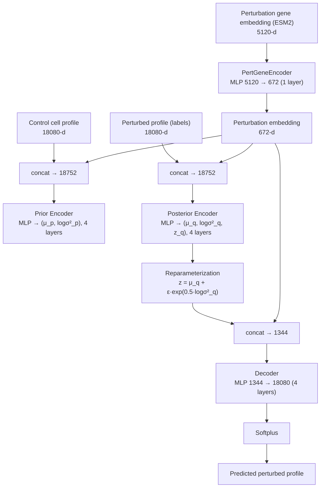
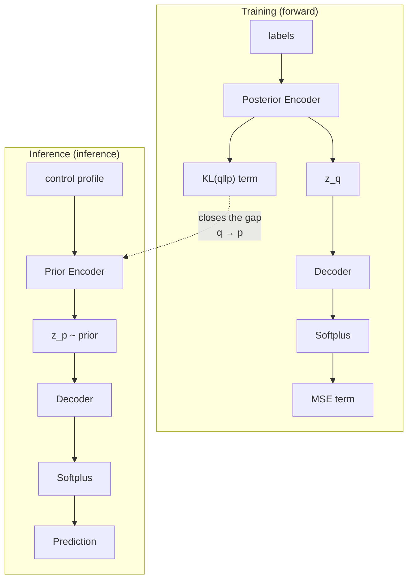

This page is the architectural entry point for DeSCOPE's deep-dive catalog: it explains how perturbation response prediction is framed as **conditional variational inference** and maps the four neural modules that implement it. Everything here is grounded in the two files that define the model family — `modeling_descope.py` (architecture and forward logic) and `configuration_descope.py` (dimensions and depths). Deeper treatments of each subsystem are deferred to their dedicated pages, linked at the end of each section.

## DeSCOPE in One View: A cVAE for Perturbation Response

DeSCOPE treats "predict how a cell responds to a perturbation" as a **conditional generative problem**: given a control cell profile and an embedding of the perturbed gene, the model generates the perturbed cell profile. The generative backbone is a conditional Variational Autoencoder (cVAE) in which the perturbed gene is represented by an **ESM2-derived protein embedding** rather than a learned token lookup. This design is stated directly in the project README and is visible in the canonical architecture figure below.


Sources: [README.md](/README.md#L20-L26), [configuration_descope.py](/src/descope/models/configuration_descope.py#L16-L17)

## Architectural Map

All model code lives in a compact `src/descope/models` package with a strict separation of concerns: configuration, network definitions, model assembly, and shared utilities (MLP builder, KL function, output dataclasses). The public classes `DeSCOPEForATAC` and `DeSCOPEForRNA` are re-exported at the package root, alongside `DeSCOPEConfig`.

```
src/descope/
├── models/
│   ├── baselines.py            # mean_baseline fallback model
│   ├── configuration_descope.py  # DeSCOPEConfig (dims, depths, activations)
│   ├── modeling_descope.py     # PertGeneEncoder, VariationalEncoder, VariationalDecoder,
│   │                           #   DeSCOPEForATAC, DeSCOPEForRNA
│   └── utils.py                # build_mlp, kl_loss_func, output dataclasses
├── __init__.py                 # exports DeSCOPEConfig, DeSCOPEForATAC, DeSCOPEForRNA, ...
└── trainer.py / inference.py   # consume the models (see Training / Inference pages)
```

Sources: [modeling_descope.py](/src/descope/models/modeling_descope.py#L1-L12), [__init__.py](/src/descope/__init__.py#L12-L14)

The full graph is small — four module types, wired once per modality. The diagram below shows the wiring with default dimensions from `DeSCOPEConfig` (`hidden_size=672`, `input_pert_gene_embedding_size=5120`, `input_length=18080`).



Sources: [modeling_descope.py](/src/descope/models/modeling_descope.py#L119-L136), [configuration_descope.py](/src/descope/models/configuration_descope.py#L6-L20)

## Conditioning: One Embedding, Three Concatenation Points

The "C" in cVAE is implemented with a deliberately minimal pattern: the perturbation embedding is projected once and then **concatenated at every stage** of the generative pipeline. In each `forward` pass, the projected embedding is fused (i) with the control profile into the prior encoder, (ii) with the ground-truth perturbed labels into the posterior encoder, and (iii) with the latent sample `z` into the decoder. The perturbation thus acts as a **shared conditioning backbone** threading through prior, posterior, and reconstruction.

> [!TIP]
> Because the same projected embedding (`pert_embeddings`, 672-d) is reused in all three concatenations, the perturbation signal is the only feature shared across the prior, posterior, and decoder — this is what lets the prior alone (used at inference) generalize to unseen perturbations whose ESM2 embeddings differ from training genes.

Sources: [modeling_descope.py](/src/descope/models/modeling_descope.py#L145-L152), [modeling_descope.py](/src/descope/models/modeling_descope.py#L231-L238)

## Core Building Blocks

Every trainable module is an MLP built by a single factory, `build_mlp`, which applies the pattern `Linear → LayerNorm (optional) → activation → Dropout` and omits activation/LayerNorm on the final projection layer. This keeps depth, width, dropout, and activation uniformly controlled by `DeSCOPEConfig`. The defaults define the canonical shapes: 672-d hidden state, 1-layer perturbation projector, 4-layer variational encoders, 4-layer decoder, GELU activations.

| Module | Class | Input → Output | Default depth | Role |
| --- | --- | --- | --- | --- |
| Perturbation projector | `PertGeneEncoder` | 5120 → 672 | 1 | Projects ESM2 gene embedding into model space |
| Prior encoder | `VariationalEncoder(in_dim=input_length+672)` | 18752 → 672×2 | 4 | Outputs `(μ_p, logσ²_p)` of the prior Gaussian |
| Posterior encoder | `VariationalEncoder(in_dim=input_length+672)` | 18752 → 672×2 | 4 | Outputs `(μ_q, logσ²_q)` and sampled `z_q` |
| Decoder | `VariationalDecoder(in_dim=hidden_size*2)` | 1344 → 18080 | 4 | Reconstructs the full perturbed profile |

Sources: [modeling_descope.py](/src/descope/models/modeling_descope.py#L15-L98), [utils.py](/src/descope/models/utils.py#L103-L111), [configuration_descope.py](/src/descope/models/configuration_descope.py#L5-L20)

The `VariationalEncoder` does something subtle with its single MLP: the network emits `hidden_size * 2` values, and `torch.chunk(..., 2, dim=-1)` splits the output into mean and log-variance halves — no separate heads are used. The reparameterization trick is then applied inline (`std = exp(0.5·logvar)`, `z = mean + ε·std`), making the latent sample differentiable w.r.t. the encoder parameters.

> [!TIP]
> Model assembly follows the HuggingFace convention: both top-level models subclass `DeSCOPEPretrainedModel`, which binds `config_class = DeSCOPEConfig`, then call `self.post_init()`. This means the full cVAE is a standard `PreTrainedModel` — it can be saved, reloaded with `from_pretrained`, and configured entirely through `DeSCOPEConfig` kwargs.

Sources: [modeling_descope.py](/src/descope/models/modeling_descope.py#L67-L73), [modeling_descope.py](/src/descope/models/modeling_descope.py#L55-L58), [modeling_descope.py](/src/descope/models/modeling_descope.py#L101-L102)

## Dual-Path Data Flow: Training vs Inference

The architecture has two deliberately different execution paths. **Training** uses the posterior path: the ground-truth perturbed profile (`labels`) is fed to the posterior encoder alongside the perturbation embedding, producing `z_q` for reconstruction — the classic VAE setup where the approximate posterior sees the data. **Inference** uses the prior path only: `inference()` is decorated with `@torch.no_grad()`, samples `z` from the prior (conditioned on control profile + perturbation), and never touches `labels`. The two paths share the same perturbation embedding, decoder, and softplus output stage.



| Aspect | `forward()` (training) | `inference()` (deployment) |
| --- | --- | --- |
| Latent source | Posterior: `[labels ‖ pert_emb]` | Prior: `[ctrl_profile ‖ pert_emb]` |
| Uses ground-truth labels | Yes | No (`@torch.no_grad()`) |
| Decoder input | `[z_q ‖ pert_emb]` | `[z_p ‖ pert_emb]` |
| Returns | `loss`, `mse_loss`, `kl_loss`, `logits` | `logits` only (losses = `None`) |

Sources: [modeling_descope.py](/src/descope/models/modeling_descope.py#L138-L176), [modeling_descope.py](/src/descope/models/modeling_descope.py#L178-L196)

## ELBO Objective at a Glance

Both top-level models optimize a weighted ELBO: `loss = alpha_mse_loss × MSE + alpha_kl_loss × KL`, with both weights defaulting to `1.0` and settable at construction time. The MSE term compares softplus-activated predictions against labels and supports an optional per-feature `mse_weights` tensor for weighted supervision. The KL term closes the gap between the posterior and the conditioned prior; it is computed under `torch.amp.autocast(enabled=False)` with explicit `.float()` casts — the prior log-variance sits in a denominator, so this is done in float32 for numerical stability under mixed-precision training. The full loss composition, weighting strategy, and per-modality differences are covered in [ELBO Loss: MSE and KL Composition](16-elbo-loss-mse-and-kl-composition).

Sources: [modeling_descope.py](/src/descope/models/modeling_descope.py#L155-L169), [utils.py](/src/descope/models/utils.py#L28-L41)

## Output Contract

Both models return HuggingFace `ModelOutput` dataclasses rather than bare tensors, giving downstream trainer and inference code a uniform interface: a total `loss`, its `mse_loss` and `kl_loss` components for logging, and `logits` holding the predicted (softplus-activated) profile.

| Field | Type | Training | Inference |
| --- | --- | --- | --- |
| `loss` | scalar or `None` | Weighted ELBO total | `None` |
| `mse_loss` | scalar or `None` | Reconstruction MSE | `None` |
| `kl_loss` | scalar or `None` | KL(q‖p), batch-mean | `None` |
| `logits` | `(batch, input_length)` | Predictions | Predictions |

Sources: [utils.py](/src/descope/models/utils.py#L12-L25)

## RNA and ATAC: Two Classes, One Blueprint

The repository maintains `DeSCOPEForRNA` and `DeSCOPEForATAC` as **two structurally identical classes** — the source notes this explicitly: identical architectures, kept separate to allow independent per-modality adjustment. The only architectural divergence is the perturbation projector: ATAC uses the configurable `PertGeneEncoder` (built via `build_mlp`), while RNA uses a hard-coded `Linear → LayerNorm` pair. Input tensor names also differ semantically (`ctrl_cell_expr` for RNA transcript expression, `ctrl_cell_tf_idf` for ATAC TF-IDF profiles), but their shapes and roles are identical. Full details live in [RNA and ATAC Model Variants](11-rna-and-atac-model-variants).

| Aspect | `DeSCOPEForRNA` | `DeSCOPEForATAC` |
| --- | --- | --- |
| Perturbation projector | `nn.Sequential(Linear, LayerNorm)` | `PertGeneEncoder` (configurable MLP) |
| Control input name | `ctrl_cell_expr` | `ctrl_cell_tf_idf` |
| Encoder/prior/decoder wiring | Identical | Identical |
| Loss & output contract | `DeSCOPEForRNAOutput` | `DeSCOPEForATACOutput` |

Sources: [modeling_descope.py](/src/descope/models/modeling_descope.py#L117-L118), [modeling_descope.py](/src/descope/models/modeling_descope.py#L209-L213), [modeling_descope.py](/src/descope/models/modeling_descope.py#L127)

## Recommended Reading Path

This page established the skeleton. The catalog decomposes it along four axes — follow them in this order for a complete mental model:

1. **Component deep dives**: [PertGene Encoder and ESM2 Embeddings](8-pertgene-encoder-and-esm2-embeddings) → [Prior and Posterior Variational Encoders](9-prior-and-posterior-variational-encoders) → [Decoder and Softplus Output Design](10-decoder-and-softplus-output-design)
2. **Configuration surface**: every dimension and depth referenced above maps to a config field — see [Model Configuration Reference](7-model-configuration-reference)
3. **Objective**: how the two loss terms interact in practice — [ELBO Loss: MSE and KL Composition](16-elbo-loss-mse-and-kl-composition)
4. **Lifecycle**: how these models are driven end-to-end — [Trainer and Accelerate Integration](15-trainer-and-accelerate-integration) and [Inference Pipeline Design](19-inference-pipeline-design)