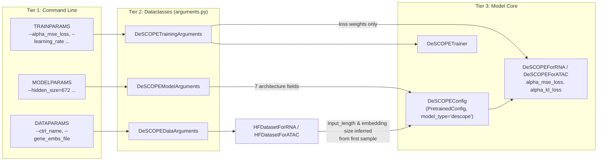

This page is the complete reference for every configuration surface in DeSCOPE: the three CLI argument dataclasses in `arguments.py`, the serializable `DeSCOPEConfig`, the DeSCOPE-specific training fields, and how all of them flow into `DeSCOPEForRNA` / `DeSCOPEForATAC`. It covers defaults, types, CLI syntax, and the checkpoint/reload contract. For architectural behavior of the components these knobs control, see [Conditional VAE Architecture Overview](6-conditional-vae-architecture-overview).

## Configuration Architecture: From CLI to Model

DeSCOPE uses a three-tier configuration contract. Tier 1 is the command line, parsed by HuggingFace's `HfArgumentParser` into three orthogonal dataclasses. Tier 2 is `DeSCOPEConfig`, a `PretrainedConfig` subclass that captures the architecture and is JSON-serializable. Tier 3 is the model constructor, where loss weights are injected directly rather than through config.



Every training entrypoint — `tutorials/RNA_Gene/train.py`, `tutorials/ATAC_Gene/train.py`, and the Tahoe-100M pretraining script — parses the identical triple `(DeSCOPEDataArguments, DeSCOPEModelArguments, DeSCOPETrainingArguments)` via `parser.parse_args_into_dataclasses()`, so the configuration surface is stable across all pipelines.

Sources: [arguments.py](/src/descope/arguments.py#L1-L85), [train.py](/tutorials/RNA_Gene/train.py#L18-L22), [configuration_descope.py](/src/descope/models/configuration_descope.py#L4-L28)

## DeSCOPEModelArguments

`DeSCOPEModelArguments` is the CLI-exposed architecture surface. All seven fields map one-to-one onto `DeSCOPEConfig` attributes and ultimately parameterize the MLPs built by `build_mlp`.

| Field | Type | Default | CLI flag | Consumed by |
|---|---|---|---|---|
| `hidden_act` | `str` | `"gelu"` | `--hidden_act` | Activation lookup via `ACT2FN[config.hidden_act]` in every `build_mlp` call |
| `hidden_size` | `int` | `672` | `--hidden_size` | Width of all hidden layers; also defines latent dimension |
| `hidden_dropout` | `float` | `0` | `--hidden_dropout` | `nn.Dropout` inside each hidden block |
| `pert_gene_encoder_layers` | `int` | `1` | `--pert_gene_encoder_layers` | `PertGeneEncoder` MLP depth (see RNA/ATAC note below) |
| `variational_encoder_layers` | `int` | `4` | `--variational_encoder_layers` | Prior and posterior encoder depth |
| `variational_decoder_layers` | `int` | `4` | `--variational_decoder_layers` | Decoder depth |
| `add_layernorm` | `bool` | `True` | `--add_layernorm` | `nn.LayerNorm` after each `Linear` in `build_mlp` |

`hidden_size` is the highest-leverage field: it is not merely layer width. The variational encoder outputs `hidden_size * 2` values split into `mean` and `logvar` vectors, so the latent space `z` is `hidden_size`-dimensional, and the decoder input is `hidden_size * 2` (`z` concatenated with the perturbation embedding). Changing `hidden_size` therefore reshapes the latent bottleneck and decoder input simultaneously. The activation field accepts any key from `transformers.activations.ACT2FN` (`gelu`, `relu`, `silu`, `tanh`, ...), and `build_mlp` applies activation and dropout only to hidden blocks — the final projection layer is a bare `Linear` with no activation or dropout.

Sources: [arguments.py](/src/descope/arguments.py#L49-L85), [modeling_descope.py](/src/descope/models/modeling_descope.py#L36-L98), [models/utils.py](/src/descope/models/utils.py#L103-L142)

## DeSCOPEConfig: The Persistence Contract

`DeSCOPEConfig` is the serializable architecture record. It extends `transformers.PretrainedConfig`, registers `model_type = "descope"`, and is the class bound to all DeSCOPE models via `config_class = DeSCOPEConfig` on the `DeSCOPEPretrainedModel` base. This binding is what makes `save_pretrained` / `from_pretrained` round-trips restore the full architecture without re-specifying model arguments.

| Field | Type | Default | Description |
|---|---|---|---|
| `hidden_act` | `str` | `"gelu"` | Activation function for hidden layers |
| `hidden_size` | `int` | `672` | Hidden width; latent `z` is `hidden_size`-dim |
| `hidden_dropout` | `float` | `0` | Dropout rate in hidden blocks |
| `pert_gene_encoder_layers` | `int` | `1` | Perturbation gene encoder depth |
| `variational_encoder_layers` | `int` | `4` | Prior/posterior variational encoder depth |
| `variational_decoder_layers` | `int` | `4` | Decoder depth |
| `input_pert_gene_embedding_size` | `int` | `5120` | Input perturbation embedding width (matches ESM2); **inferred from data** |
| `input_length` | `int` | `18080` | Output dimension (number of genes/peaks); **inferred from data** |
| `add_layernorm` | `bool` | `True` | LayerNorm after hidden `Linear` layers |

The two `input_*` dimensions are the only config fields not exposed on `DeSCOPEModelArguments`; they are computed from the first training sample at model-construction time, as detailed in the next section. The defaults of `5120` and `18080` document the reference setup: ESM2-derived perturbation embeddings and the gene/peak vocabulary size used in the RNA and ATAC tutorials.

Sources: [configuration_descope.py](/src/descope/models/configuration_descope.py#L4-L28), [modeling_descope.py](/src/descope/models/modeling_descope.py#L101-L102)

## DeSCOPETrainingArguments

`DeSCOPETrainingArguments` extends the accelerate-style `TrainingArguments` from `wppkg.dl` and adds exactly three DeSCOPE-specific fields. Because it inherits the base class, every standard training knob (`seed`, `learning_rate`, `num_train_epochs`, `per_device_train_batch_size`, `gradient_accumulation_steps`, `max_grad_norm`, `lr_scheduler_type`, `weight_decay`, `num_warmup_ratio`, `mixed_precision`, `checkpointing_steps`, `resume_from_checkpoint`, dataloader options, and tracking options) is available on the CLI — all of these are exercised in the tutorial launch scripts.

| DeSCOPE field | Type | Default | CLI flag | Effect |
|---|---|---|---|---|
| `alpha_mse_loss` | `float` | `1.0` | `--alpha_mse_loss` | Weight of the reconstruction MSE term in `loss = α_mse · mse + α_kl · kl` |
| `alpha_kl_loss` | `float` | `1.0` | `--alpha_kl_loss` | Weight of the KL divergence term; see [ELBO Loss: MSE and KL Composition](16-elbo-loss-mse-and-kl-composition) |
| `pretrained_model_name_or_path` | `Optional[str]` | `None` | `--pretrained_model_name_or_path` | When `None`, model trains from scratch with a fresh `DeSCOPEConfig`; otherwise loads via `from_pretrained` |

> [!TIP]
> The loss weights are stored directly on the model module (`self.alpha_mse_loss = alpha_mse_loss`), **not** inside `DeSCOPEConfig`. They therefore do not round-trip through `config.json`: when resuming with `--pretrained_model_name_or_path`, you must re-pass `alpha_mse_loss` and `alpha_kl_loss` on the command line, exactly as every tutorial script does in its `from_pretrained` branch. Omitting them silently reverts to the defaults of `1.0`.

Sources: [arguments.py](/src/descope/arguments.py#L6-L22), [modeling_descope.py](/src/descope/models/modeling_descope.py#L218-L219), [modeling_descope.py](/src/descope/models/modeling_descope.py#L169), [train.py](/tutorials/RNA_Gene/train.py#L71-L77)

## DeSCOPEDataArguments

`DeSCOPEDataArguments` points the model at its tokenized inputs. These fields configure `HFDatasetForRNA` / `HFDatasetForATAC` (see [Tokenization: AnnData to HuggingFace Datasets](12-tokenization-anndata-to-huggingface-datasets)), and two of them indirectly determine model dimensions.

| Field | Type | Default | CLI flag | Description |
|---|---|---|---|---|
| `tokenized_datasets_dir` | `str` | `"./tokenized_dataset/K562"` | `--tokenized_datasets_dir` | Path to tokenized HF dataset(s); if the direct path is not a dataset, each subdirectory is loaded and concatenated |
| `keep_in_memory` | `bool` | `False` | `--keep_in_memory` | Materialize the dataset in RAM via `load_from_disk` |
| `ctrl_name` | `str` | `"control"` | `--ctrl_name` | Label identifying control cells in the tokenized dataset; **must match the tokenization-time naming** |
| `gene_embs_file` | `str` | `"./ESM2_pert_features.pt"` | `--gene_embs_file` | `.pt` file of perturbation embeddings; its width becomes `input_pert_gene_embedding_size` |

The defaults encode the reference K562 RNA pipeline, but the tutorials demonstrate that `ctrl_name` and `gene_embs_file` are dataset-specific: the K562 RNA tutorial uses `ctrl_name="non-targeting"`, the GM12878 ATAC tutorial uses `ctrl_name="control"`, and the Tahoe-100M drug pretraining uses `ctrl_name="DMSO_TF_0.0"` with drug-dose embeddings (`tahoe100m_drug_dose_embed.pt`) replacing the ESM2 gene embedding file. The embedding file's width flows directly into `input_pert_gene_embedding_size`, so swapping embedding sources (e.g., drug-dose vectors for gene-disease vectors) requires no config changes — the dimension is discovered at runtime.

Sources: [arguments.py](/src/descope/arguments.py#L25-L46), [train.py](/tutorials/RNA_Gene/train.py#L44-L49), [train_descope.sh](/tutorials/RNA_Gene/train_descope.sh#L5-L7), [train_descope.sh](/tutorials/ATAC_Gene/train_descope.sh#L5-L7), [train_descope.sh](/tutorials/RNA_Drug/tahoe100m_pretrain/train_descope.sh#L5-L7)

## Data-Inferred Input Dimensions

The two structural dimensions — input perturbation embedding width and output vocabulary length — are deliberately excluded from the CLI and inferred from the first dataset sample in every entrypoint script:

```python
config = DeSCOPEConfig(
    input_pert_gene_embedding_size=train_ds[0]["pert_gene_emb"].shape[-1],
    input_length=train_ds[0]["labels"].shape[-1],
    ...
)
```

| Config field | Inferred from | Reference default | Meaning |
|---|---|---|---|
| `input_pert_gene_embedding_size` | `train_ds[0]["pert_gene_emb"].shape[-1]` | `5120` (ESM2) | Width of perturbation representation input to the perturbation encoder |
| `input_length` | `train_ds[0]["labels"].shape[-1]` | `18080` | Output width of the decoder (genes for RNA, peaks for ATAC) |

This design means the same `MODELPARAMS` block works unchanged across the gene-perturbation tutorials (18,080-dim vocabularies), the Tahoe-100M pretraining (2k-HVG vocabulary), and any new tokenized dataset — the model always conforms to the data. The consequence for tuning is that `input_length` is only adjustable upstream, through tokenization and vocabulary selection (see [Feature Alignment and Vocabulary Handling](14-feature-alignment-and-vocabulary-handling)), never at training time.

Sources: [train.py](/tutorials/RNA_Gene/train.py#L54-L64), [train.py](/tutorials/ATAC_Gene/train.py#L54-L64), [3_train.py](/tutorials/RNA_Drug/tahoe100m_pretrain/3_train.py#L58-L68), [configuration_descope.py](/src/descope/models/configuration_descope.py#L14-L15)

## Canonical Launch Configurations

The tutorial shell scripts are executable configuration references: `MODELPARAMS`, `DATAPARAMS`, and `TRAINPARAMS` blocks are assembled and forwarded to `accelerate launch`. The model-parameter block is byte-identical across all three published pipelines, confirming that `672`/`gelu`/`1-4-4` depths is the validated production configuration:

```bash
MODELPARAMS="
    --hidden_act=gelu \
    --hidden_size=672 \
    --hidden_dropout=0 \
    --pert_gene_encoder_layers=1 \
    --variational_encoder_layers=4 \
    --variational_decoder_layers=4 \
    --add_layernorm=True"
```

Where the pipelines diverge is exclusively in `TRAINPARAMS` and `DATAPARAMS` — scale-related training hyperparameters and dataset identity:

| Parameter | Gene tutorials (K562 / GM12878) | Tahoe-100M pretrain |
|---|---|---|
| `num_train_epochs` | `20` | `10` |
| `per_device_train_batch_size` | `64` | `256` |
| `gradient_accumulation_steps` | `1` | `1` |
| `learning_rate` | `1e-4` | `1e-4` |
| `lr_scheduler_type` | `cosine` | `cosine` |
| `num_warmup_ratio` | `0.1` | `0.05` |
| `logging_steps` | `50` | `200` |
| `checkpointing_steps` | `epoch-10` | `epoch-2` |
| `dataloader_num_workers` | `16` | `8` |
| `accelerate num_processes` | `1` | `4` |
| `ctrl_name` | `non-targeting` / `control` | `DMSO_TF_0.0` |
| `gene_embs_file` | `ESM2_pert_features.pt` | `tahoe100m_drug_dose_embed.pt` |
| `alpha_mse_loss` / `alpha_kl_loss` | `1.0` / `1.0` | `1.0` / `1.0` |

Note the two checkpointing formats supported by the trainer: integer steps (`--checkpointing_steps=500`) or the string form `epoch-N` meaning "every N epochs" (`epoch-10` in the gene tutorials, `epoch-2` in Tahoe pretraining).

Sources: [train_descope.sh](/tutorials/ATAC_Gene/train_descope.sh#L10-L59), [train_descope.sh](/tutorials/RNA_Gene/train_descope.sh#L27-L58), [train_descope.sh](/tutorials/RNA_Drug/tahoe100m_pretrain/train_descope.sh#L27-L58), [trainer.py](/src/descope/trainer.py#L184-L197)

## RNA vs ATAC: Divergent Config Consumption

Both model classes accept the same `DeSCOPEConfig` and share identical variational encoder/decoder construction, but they consume the perturbation-encoder configuration differently. The source comments state the two architectures are kept as distinct classes to support independent adjustment per modality ([modeling_descope.py](/src/descope/models/modeling_descope.py#L117-L118)).

| Config field | `DeSCOPEForRNA` | `DeSCOPEForATAC` |
|---|---|---|
| `input_pert_gene_embedding_size` | `nn.Linear` input width | `build_mlp` input width |
| `hidden_size` | `nn.Linear` output width | `build_mlp` output width |
| `pert_gene_encoder_layers` | **not consumed** — encoder is hardcoded as one `Linear` + `LayerNorm` | honored — depth of the `build_mlp` encoder |
| `hidden_act` / `hidden_dropout` / `add_layernorm` (pert encoder) | **not consumed** — `LayerNorm` always applied, no activation/dropout | honored — full `build_mlp` behavior |
| `variational_encoder_layers` | honored (prior + posterior) | honored (prior + posterior) |
| `variational_decoder_layers` | honored | honored |
| Forward signature | `ctrl_cell_expr` | `ctrl_cell_tf_idf` |
| Output dataclass | `DeSCOPEForRNAOutput` | `DeSCOPEForATACOutput` |

> [!TIP]
> If you increase `pert_gene_encoder_layers` or change `hidden_act`/`hidden_dropout` expecting an effect on the RNA pipeline, verify against the checkpoint's parameter shapes first: `DeSCOPEForRNA` constructs its perturbation encoder as `nn.Sequential(nn.Linear(emb_size, hidden_size), nn.LayerNorm(hidden_size))` regardless of those fields. Only the ATAC variant routes these values through `PertGeneEncoder`/`build_mlp`.

For component-level behavior of these submodules, see [PertGene Encoder and ESM2 Embeddings](8-pertgene-encoder-and-esm2-embeddings), [Prior and Posterior Variational Encoders](9-prior-and-posterior-variational-encoders), and the modality comparison in [RNA and ATAC Model Variants](11-rna-and-atac-model-variants).

Sources: [modeling_descope.py](/src/descope/models/modeling_descope.py#L15-L33), [modeling_descope.py](/src/descope/models/modeling_descope.py#L199-L222), [modeling_descope.py](/src/descope/models/modeling_descope.py#L208-L213)

## Checkpoint and Reload Semantics

The configuration lifecycle closes with the checkpoint contract. During training, the `DeSCOPETrainer` writes checkpoints to `output_dir/epoch_{i}/model` (or `step_{i}/model`) whenever `checkpointing_steps` triggers, and always persists the final model to `output_dir/last_model`. Because every DeSCOPE model carries `config_class = DeSCOPEConfig`, reloading through `from_pretrained` reconstructs the architecture from the serialized config — no `DeSCOPEConfig` or model-argument re-specification is needed at resume or fine-tune time.

The three-field reload checklist for `--pretrained_model_name_or_path` is therefore: (1) architecture — restored automatically from the checkpoint config; (2) loss weights — re-pass `alpha_mse_loss`/`alpha_kl_loss` explicitly; (3) data dims — nothing to do, since they live in the restored config and the new dataset must match them (mismatched vocabulary requires re-tokenization, not config overrides). Distributed/DeepSpeed checkpoint state is handled separately by the accelerate layer; see [Checkpointing, Resuming, Early Stopping](17-checkpointing-resuming-early-stopping) and [Distributed Training with DeepSpeed](18-distributed-training-with-deepspeed).

Sources: [trainer.py](/src/descope/trainer.py#L155-L161), [trainer.py](/src/descope/trainer.py#L184-L200), [modeling_descope.py](/src/descope/models/modeling_descope.py#L101-L102), [train.py](/tutorials/RNA_Gene/train.py#L71-L77)

## Related Pages

- [Conditional VAE Architecture Overview](6-conditional-vae-architecture-overview) — how the configured components compose into the CVAE
- [PertGene Encoder and ESM2 Embeddings](8-pertgene-encoder-and-esm2-embeddings) — internals of the module governed by `pert_gene_encoder_layers`
- [RNA and ATAC Model Variants](11-rna-and-atac-model-variants) — modality-specific class behavior
- [Tokenization: AnnData to HuggingFace Datasets](12-tokenization-anndata-to-huggingface-datasets) — how `tokenized_datasets_dir` content is produced
- [ELBO Loss: MSE and KL Composition](16-elbo-loss-mse-and-kl-composition) — semantics of `alpha_mse_loss` and `alpha_kl_loss`
- [Trainer and Accelerate Integration](15-trainer-and-accelerate-integration) — how `DeSCOPETrainingArguments` drives the training loop
- [API Reference and Module Layout](23-api-reference-and-module-layout) — module-level index of `descope.arguments` and `descope.models`