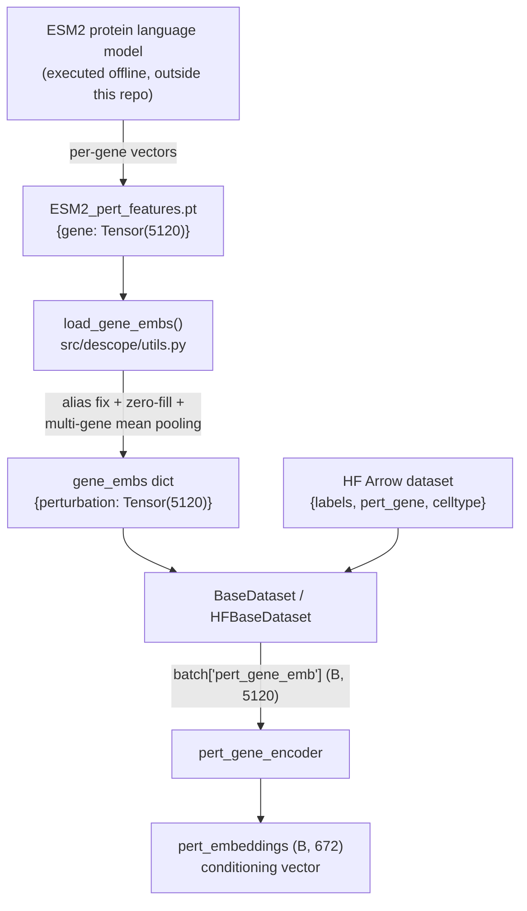
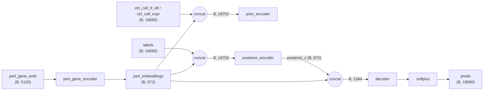
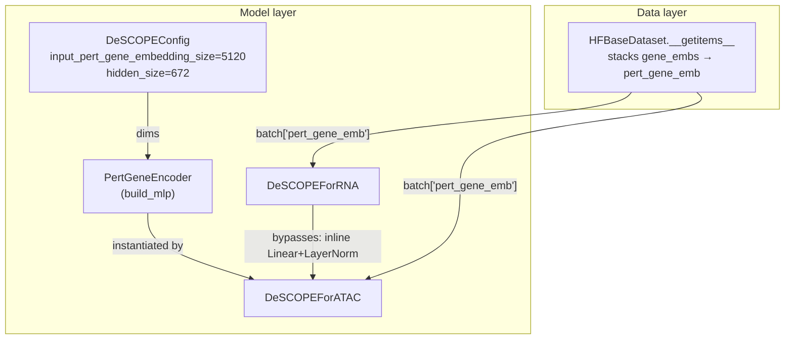

The perturbation conditioning pathway is the only mechanism by which DeSCOPE learns *which* perturbation a cell is subjected to. This page documents the two components that implement it: the **ESM2 embedding supply chain** — precomputed protein-language-model vectors stored in `ESM2_pert_features.pt` and resolved at dataset load time — and the **`PertGeneEncoder`**, the neural head that projects a 5120-dimensional ESM2 vector into the 672-dimensional conditioning signal consumed by every branch of the conditional VAE. All claims below are traced to the implementation; where RNA and ATAC models diverge, the divergence is documented explicitly because it has direct configuration consequences.

## The Embedding Supply Chain: From ESM2 to Batch Tensor

DeSCOPE does **not** run ESM2 inside the training loop. Perturbation features are consumed as a precomputed PyTorch artifact — a dictionary file mapping gene symbols to embedding tensors, with the default path `./ESM2_pert_features.pt` hard-coded as a constructor default in every dataset class (`dataset.py` defaults it in `BaseDataset`, `DatasetForATAC`, `DatasetForRNA`, and `HFBaseDataset`). The `.pt` file maps `{gene_name: torch.Tensor}` and is loaded via `torch.load(..., weights_only=False)` inside `load_gene_embs`.

At dataset construction time, the embedding dictionary is filtered to the perturbations actually present in the data: `BaseDataset` loads embeddings for the unique values of the perturbation column, while the fast `HFBaseDataset` requests `self.ds.unique("pert_gene")` from the Arrow-backed dataset. The stored HF dataset features are only `labels`, `pert_gene`, and `celltype` — the embedding itself is **injected at batch-assembly time** in `__getitems__`, where per-sample vectors are stacked into `batch["pert_gene_emb"]`. This design keeps embedding tensors out of the serialized dataset and lets you swap the `.pt` file without re-tokenizing.

Sources: [dataset.py](/src/descope/dataset.py#L37-L71), [dataset.py](/src/descope/dataset.py#L190-L224), [utils.py](/src/descope/utils.py#L378-L404), [dataset.py](/src/descope/dataset.py#L277-L286)

> [!TIP]
> Because the repo ships no ESM2 inference script, `ESM2_pert_features.pt` is a first-class input artifact: if your perturbation set contains genes absent from the file, they will be silently replaced by zero vectors (with a log warning) — validate coverage before a long training run.

## Embedding Resolution Rules in `load_gene_embs`

`load_gene_embs` is the single normalization layer between the raw `.pt` dictionary and the model's expectations. It guarantees that every perturbation named in `perts_to_emb` receives a tensor, applying three deterministic fallback rules. First, a **gene alias** is patched: if `TAFAZZIN` exists but `TAZ` does not, the entry is duplicated under `TAZ`. Second, **multi-gene perturbations** — denoted by `+` in the perturbation label (e.g., `"GeneA+GeneB"`), a convention the tokenizer notebooks also enforce — are reduced by **mean pooling** over their constituent gene vectors, so a dual knockout occupies the same 5120-dimensional slot as a single knockout. Third, **missing genes become zero vectors**: an absent single-gene perturbation receives a zero tensor, and an absent gene inside a multi-gene combination contributes a zero vector to the mean. All three resolutions are reported through structured logging that distinguishes missing single-gene perturbations from multi-gene perturbations with partially missing constituents.

| Case in `perts_to_emb` | Resolution | Effect on conditioning signal |
|---|---|---|
| Gene present in `.pt` file | Returned as-is | Full ESM2 semantic content |
| `TAZ` (alias) | Copied from `TAFAZZIN` entry | Full content under alternate symbol |
| Multi-gene `"GeneA+GeneB"`, both present | Mean of the two 5120-d vectors | Joint perturbation represented in shared space |
| Multi-gene, one constituent missing | Mean includes a zero vector for the missing gene | Attenuated embedding, flagged in logs |
| Single gene missing entirely | Zero vector (5120-d) | No-op conditioning; model sees bias-like input |

Note that `BaseDataset.__getitem__` additionally casts each retrieved embedding with `.to(torch.float32)`, guarding against mixed-precision artifacts stored in the file.

Sources: [utils.py](/src/descope/utils.py#L404-L416), [utils.py](/src/descope/utils.py#L418-L450), [utils.py](/src/descope/utils.py#L390-L395), [dataset.py](/src/descope/dataset.py#L79-L99)

## The `PertGeneEncoder` Architecture

`PertGeneEncoder` is a thin wrapper around a feed-forward network constructed by the repository's generic `build_mlp` factory. Its contract is fixed by tensor shape: input `(batch_size, input_pert_gene_embedding_size)`, output `(batch_size, hidden_size)` — a compression from 5120 to 672 dimensions. The default configuration (`pert_gene_encoder_layers=1`) makes this a single linear projection followed by LayerNorm, because `build_mlp` treats depth 1 specially: a one-layer stack is `Linear → [LayerNorm]` with **no activation or dropout**, while deeper stacks follow the canonical `Linear → LayerNorm → activation → Dropout` block pattern repeated through hidden layers, terminated by a bare final `Linear` (no trailing normalization or activation). The final-layer asymmetry matters: the encoder's output is never non-negative or normalized unless `add_layernorm` semantics of the *last block* apply — which they do not for `n_layers > 1`.

| Config parameter | Default | Role in `PertGeneEncoder` |
|---|---|---|
| `input_pert_gene_embedding_size` | `5120` (`# ESM2: 5120`) | Input width; matches ESM2-15B's 5120-d hidden size |
| `hidden_size` | `672` | Output width; also the MLP hidden width for deeper stacks |
| `pert_gene_encoder_layers` | `1` | MLP depth (minimum 1, enforced) |
| `hidden_act` | `"gelu"` | Activation resolved via `ACT2FN` (layers ≥ 2 only) |
| `hidden_dropout` | `0` | Dropout rate (layers ≥ 2 only) |
| `add_layernorm` | `True` | LayerNorm after each `Linear` except the final one |

The 5120 default is annotated in `DeSCOPEConfig` with the comment `# ESM2: 5120`, consistent with the hidden width of the ESM2-15B checkpoint (`esm2_t48_15B_UR50D`). If you substitute a smaller ESM2 variant (e.g., 3B → 2560-d), you must override `input_pert_gene_embedding_size` in the config or the projection matrix will be shape-mismatched at model construction.

| `pert_gene_encoder_layers` | Constructed module composition |
|---|---|
| `1` (default) | `Linear(5120, 672) → LayerNorm(672)` |
| `2` | `Linear(5120, 672) → LayerNorm → GELU → Dropout → Linear(672, 672)` |
| `n ≥ 3` | First block + `(n−2)` × `[Linear(672, 672) → LayerNorm → GELU → Dropout]` + final `Linear(672, 672)` |

Sources: [modeling_descope.py](/src/descope/models/modeling_descope.py#L15-L33), [utils.py](/src/descope/models/utils.py#L103-L142), [configuration_descope.py](/src/descope/models/configuration_descope.py#L4-L28)

> [!TIP]
> The RNA model does not actually instantiate `PertGeneEncoder`: the call is commented out and replaced by an inline `nn.Sequential(nn.Linear(5120, 672), nn.LayerNorm(672))` in `DeSCOPEForRNA.__init__`. Consequently, `pert_gene_encoder_layers` only takes effect for ATAC checkpoints unless you re-enable the class — a common source of confusion when porting configurations between modalities.

## RNA vs. ATAC: Two Conditioning Heads with One Interface

Both model classes satisfy the same interface — an attribute named `pert_gene_encoder` that maps `(B, 5120) → (B, 672)` — but their implementations differ. `DeSCOPEForATAC` uses the configurable `PertGeneEncoder` MLP; `DeSCOPEForRNA` uses a hard-coded `Linear + LayerNorm` pair. The source comments explain the design intent: the RNA and ATAC architectures are otherwise identical, and are deliberately maintained as two distinct model classes *to support independent adjustment for each data modality*. The divergent conditioning head is exactly that independent adjustment point — RNA embeddings evidently needed only a linear affine projection with normalization, while ATAC retains depth/activation flexibility.

| Aspect | `DeSCOPEForATAC` | `DeSCOPEForRNA` |
|---|---|---|
| Conditioning head | `PertGeneEncoder(config)` (configurable MLP) | Inline `nn.Sequential(Linear, LayerNorm)` |
| Honors `pert_gene_encoder_layers` / `hidden_act` / `hidden_dropout` | Yes | No (MLP instantiation commented out) |
| Input → output shape | `(B, 5120) → (B, 672)` | `(B, 5120) → (B, 672)` |
| Normalization | LayerNorm per `build_mlp` / `add_layernorm` | `LayerNorm(672)` always, appended to the linear map |
| Modality input name | `ctrl_cell_tf_idf` | `ctrl_cell_expr` |

This split explains why checkpoint state dicts are not interchangeable across modalities even though every downstream module shape matches: the parameter names and layer structures under `pert_gene_encoder` differ.

Sources: [modeling_descope.py](/src/descope/models/modeling_descope.py#L117-L137), [modeling_descope.py](/src/descope/models/modeling_descope.py#L199-L216), [modeling_descope.py](/src/descope/models/modeling_descope.py#L209-L213)

## Conditioning Mechanics in the Forward Pass

The projected `pert_embeddings` tensor is the glue of the conditional VAE: the *same* conditioning vector is concatenated onto the input of **all three** generative branches. In `DeSCOPEForATAC.forward`, `pert_embeddings` is concatenated with the control-cell profile to form the prior encoder input, with the ground-truth target profile (`labels`) to form the posterior encoder input, and with the sampled latent `posterior_z` to form the decoder input. The identical pattern holds in `DeSCOPEForRNA.forward` (with `ctrl_cell_expr`) and in both `inference()` paths — inference differs only in sampling `z` from the prior instead of the posterior, while conditioning on `pert_embeddings` identically. This means the perturbation identity modulates not only what the model *predicts*, but where the latent distribution is centered and how it is decoded.

The dimensional arithmetic follows directly from the config: encoders receive `input_length + hidden_size = 18080 + 672 = 18752`, and the decoder receives `hidden_size * 2 = 1344`. Note that the model is fully agnostic to ESM2 semantics downstream of the projection — from the VAE's perspective, `pert_gene_emb` is just a 5120-d real vector, so any alternative perturbation featurization of matching width (or zero vectors for missing entries, per the resolution rules above) flows through unchanged.

Sources: [modeling_descope.py](/src/descope/models/modeling_descope.py#L138-L176), [modeling_descope.py](/src/descope/models/modeling_descope.py#L224-L262), [modeling_descope.py](/src/descope/models/modeling_descope.py#L178-L196), [modeling_descope.py](/src/descope/models/modeling_descope.py#L264-L282), [configuration_descope.py](/src/descope/models/configuration_descope.py#L13-L27)

## Summary of Component Responsibilities

To close the loop: ESM2 embeddings enter DeSCOPE as a static dictionary artifact, are normalized by `load_gene_embs` (aliasing, mean pooling for `+`-combined perturbations, zero-vector fallbacks), and are attached to training batches by the dataset classes rather than stored in the serialized HF dataset. The `PertGeneEncoder` head then performs a single learned compression from the 5120-d protein-language space into the 672-d conditioning space, producing the tensor that conditions the prior, posterior, and decoder simultaneously. The two concrete consequences for advanced users are (1) embedding coverage is validated only through logs, so auditing `load_gene_embs` output against your perturbation list is a required pre-training step, and (2) head architecture is modality-dependent, with RNA fixed to a linear+LayerNorm projection regardless of encoder-depth configuration.

| Component | Module | Contract |
|---|---|---|
| `ESM2_pert_features.pt` | External artifact | `{gene: Tensor(5120)}`, loaded with `weights_only=False` |
| `load_gene_embs` | `descope.utils` | Guarantees an entry per requested perturbation; zero-fill + mean-pool fallbacks |
| `HFBaseDataset` / `BaseDataset` | `descope.dataset` | Injects `pert_gene_emb` into each batch; float32 cast |
| `PertGeneEncoder` | `descope.models.modeling_descope` | `(B, 5120) → (B, 672)`; configurable via `build_mlp` |
| `DeSCOPEForATAC` / `DeSCOPEForRNA` | `descope.models.modeling_descope` | Consume `pert_embeddings` in prior, posterior, and decoder branches |

Sources: [utils.py](/src/descope/utils.py#L378-L464), [dataset.py](/src/descope/dataset.py#L277-L313), [modeling_descope.py](/src/descope/models/modeling_descope.py#L145-L153)

To continue through the core model components, proceed to [Prior and Posterior Variational Encoders](9-prior-and-posterior-variational-encoders) and [Decoder and Softplus Output Design](10-decoder-and-softplus-output-design), which detail the branches that consume `pert_embeddings`; [RNA and ATAC Model Variants](11-rna-and-atac-model-variants) expands on the modality split introduced above, and [Model Configuration Reference](7-model-configuration-reference) enumerates every knob summarized in the parameter table.