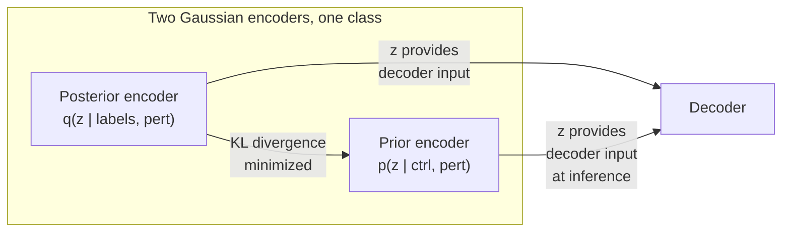
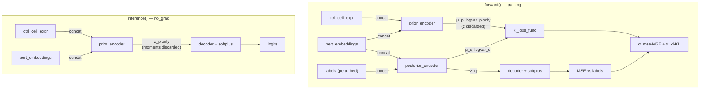

DeSCOPE's generative core is a conditional VAE whose variational machinery is implemented in a single reusable class: `VariationalEncoder`. Two instances of this class — the **prior encoder** and the **posterior encoder** — parameterize two diagonal Gaussian distributions over the latent space, conditioned on different inputs. This page dissects the class anatomy, explains how one implementation plays two distinct probabilistic roles, traces the reparameterization trick, and documents the data-dependent KL divergence that binds the two encoders together during training.

## Role in the Conditional VAE

In classical VAEs, the prior is a fixed standard normal $\mathcal{N}(0, I)$, and only the posterior (recognition) network is learned. DeSCOPE departs from this convention: **both** distributions are amortized by neural networks and both are *conditional*. The prior encoder learns $p(z \mid x_{\text{ctrl}}, x_{\text{pert}})$ — a latent distribution predicted from the control cell profile and the perturbation embedding, i.e., what the model *believes* should happen under a perturbation. The posterior encoder learns $q_\phi(z \mid y, x_{\text{pert}})$ — a latent distribution inferred from the ground-truth perturbed expression profile, i.e., what actually *happened*. Training pulls these two distributions together via KL divergence, so that at inference time — when only the prior branch is available — sampling from the learned prior yields latents that the decoder can translate into realistic perturbed profiles.



This prior/posterior split is why `forward` and `inference` in the model classes look asymmetric: training uses the posterior for reconstruction while measuring agreement with the prior; inference discards the posterior entirely and samples from the prior.

Sources: [modeling_descope.py](src/descope/models/modeling_descope.py#L36-L73), [modeling_descope.py](src/descope/models/modeling_descope.py#L178-L196)

## One Class, Two Roles: The `VariationalEncoder`

Both encoders are instances of the same `VariationalEncoder(nn.Module)`, parameterized by an `in_dim` constructor argument. Internally it holds a single MLP built by `build_mlp`, configured to project `in_dim → hidden_size * 2`. The doubled output width is the design decision that fuses distribution parameterization into one linear layer: the final projection outputs a concatenated vector of width `2·hidden_size`, which `forward` splits into `mean` and `logvar` halves via `torch.chunk(chunks=2, dim=-1)`. There are no separate heads for the two moments — one matrix multiply produces both.

```python
self.encoder = build_mlp(
    in_dim=in_dim,
    out_dim=config.hidden_size * 2,  # mean, logvar
    hidden_dim=config.hidden_size,
    n_layers=self.n_encoder_layers,      # default: 4
    dropout=config.hidden_dropout,
    activation=ACT2FN[config.hidden_act],
    add_layernorm=config.add_layernorm
)
```

The forward pass returns a three-tuple — sampled latent, mean, and log-variance — leaving the consumption decision to the caller:

| Output | Shape | Training consumer | Inference consumer |
|---|---|---|---|
| `z` | `(batch, hidden_size)` | Decoder (posterior only) | Decoder (prior only) |
| `mean` | `(batch, hidden_size)` | KL loss | Discarded |
| `logvar` | `(batch, hidden_size)` | KL loss | Discarded |

Two structural details of `build_mlp` matter for variational correctness. First, the **final projection layer carries no activation and no LayerNorm** — `mean` and `logvar` must be able to take any real value, so squashing them with GELU or normalizing them would corrupt the distribution parameterization. LayerNorm and activations are applied only to hidden layers. Second, the default depth of 4 layers (`variational_encoder_layers=4`) with `hidden_size=672` gives the block three GELU-transformed hidden layers followed by the bare moment projection.

| Layer index (4-layer config) | Structure |
|---|---|
| Hidden 1 | `Linear(in_dim → 672)` → `LayerNorm` → `GELU` → `Dropout` |
| Hidden 2–3 | `Linear(672 → 672)` → `LayerNorm` → `GELU` → `Dropout` |
| Output | `Linear(672 → 1344)` — no activation, no norm |

Sources: [modeling_descope.py](src/descope/models/modeling_descope.py#L36-L53), [modeling_descope.py](src/descope/models/modeling_descope.py#L60-L73), [utils.py](src/descope/models/utils.py#L103-L142), [configuration_descope.py](src/descope/models/configuration_descope.py#L4-L28)

## Divergent Conditioning: What Each Encoder Sees

The two encoder instances are declared side by side in every model class with an identical input dimension — `in_dim = input_length + hidden_size` — but they are **separate modules with independent weights**; nothing is tied between them. Their probabilistic identities come entirely from what is concatenated into their inputs at call time:

- **Prior branch**: `torch.cat([ctrl_cell_expr, pert_embeddings], dim=-1)` — the control expression profile (TF-IDF normalized for ATAC, raw expression for RNA) concatenated with the perturbation embedding. No information about the true perturbed outcome enters this branch.
- **Posterior branch**: `torch.cat([labels, pert_embeddings], dim=-1)` — the ground-truth perturbed expression vector concatenated with the same perturbation embedding.

| Property | Prior encoder | Posterior encoder |
|---|---|---|
| Class | `VariationalEncoder` | `VariationalEncoder` |
| Input dim | `input_length + hidden_size` | `input_length + hidden_size` |
| Expression input | Control profile (`ctrl_cell_expr` / `ctrl_cell_tf_idf`) | Ground-truth perturbed profile (`labels`) |
| Conditioning shared input | `pert_embeddings` | `pert_embeddings` |
| Weights | Independent parameters | Independent parameters |
| Role in loss | KL target (learned prior) | KL source + reconstruction latent |
| Availability at inference | Active | Not invoked |

The asymmetric information access is the mechanism behind the model's inductive bias: because the posterior sees the answer and the prior does not, the KL term acts as a *conditional* regularizer that transfers perturbation-specific structure from the informative branch into the blind branch, rather than merely pulling latents toward a fixed standard normal.

Sources: [modeling_descope.py](src/descope/models/modeling_descope.py#L128-L130), [modeling_descope.py](src/descope/models/modeling_descope.py#L214-L216), [modeling_descope.py](src/descope/models/modeling_descope.py#L146-L151)

## Reparameterization and Latent Sampling

Gradient flow through a discrete sampling step would be broken, so `VariationalEncoder.reparameterize` implements the standard continuous relaxation. The log-variance is exponentiated to a standard deviation via `std = torch.exp(0.5 * logvar)`, Gaussian noise `eps = torch.randn_like(std)` is drawn, and the latent is reconstructed as `mean + eps * std`. This keeps the sampling operation differentiable with respect to both moments: gradients reach `mean` directly and reach `logvar` through the multiplicative noise path.

```python
def reparameterize(self, mean, logvar):
    std = torch.exp(0.5 * logvar)
    eps = torch.randn_like(std)
    return mean + eps * std
```

Note that the encoder's `forward` **always samples** — `z = self.reparameterize(mean, logvar)` runs unconditionally, even when the caller only needs the moments. During training, the prior's sampled `z` is immediately discarded (`_, prior_mean, prior_logvar = self.prior_encoder(...)`) because the KL divergence is computed analytically between closed-form Gaussians and requires no samples from the prior. The discarded sample costs a small amount of compute but has zero effect on gradients, since nothing downstream consumes it. Conversely, during inference the prior's moments are discarded and its `z` becomes the sole latent fed to the decoder.

Sources: [modeling_descope.py](src/descope/models/modeling_descope.py#L55-L58), [modeling_descope.py](src/descope/models/modeling_descope.py#L67-L73), [modeling_descope.py](src/descope/models/modeling_descope.py#L146-L148)

## Dataflow: Training versus Inference

The full picture of which branches are live in each mode:



During training the posterior is the *workhorse*: its sampled latent `z_q` is concatenated with `pert_embeddings` and passed to the decoder, and its moments anchor one side of the KL computation. The prior contributes only its moments. During inference the roles invert: only the prior runs, its moments are thrown away, and its sampled `z` is the model's generative pathway from `(control, perturbation)` to predicted perturbed expression. The `inference` method is wrapped in `@torch.no_grad()` and never touches the posterior — it structurally guarantees that no ground-truth perturbed data leaks into prediction.

> [!TIP]
> The KL term is computed inside `torch.amp.autocast(enabled=False, device_type="cuda")` with explicit `.float()` casts on all four moment tensors. This is deliberate mixed-precision hygiene: `logvar.exp()` can overflow in fp16/bf16, and KL divergences are notoriously sensitive to precision loss. If you replicate this pattern elsewhere, disable autocast for the KL computation the same way.

Sources: [modeling_descope.py](src/descope/models/modeling_descope.py#L138-L176), [modeling_descope.py](src/descope/models/modeling_descope.py#L178-L196), [modeling_descope.py](src/descope/models/modeling_descope.py#L162-L168)

## The KL Term: Divergence Against a Learned Prior

Because the prior is a *learned* Gaussian rather than a fixed standard normal, DeSCOPE cannot use the textbook closed-form KL against $\mathcal{N}(0, I)$. Instead, `kl_loss_func` in `models/utils.py` implements the generalized KL divergence between two diagonal Gaussians:

$$D_{KL}(q \,\|\, p) = \tfrac{1}{2} \sum_j \left[ \log\frac{\sigma_{p,j}^2}{\sigma_{q,j}^2} + \frac{\sigma_{q,j}^2 + (\mu_{q,j} - \mu_{p,j})^2}{\sigma_{p,j}^2} - 1 \right]$$

implemented as:

```python
kl_loss = -0.5 * torch.sum(
    1
    + posterior_logvar
    - prior_logvar
    - (posterior_logvar.exp() + (posterior_mean - prior_mean).pow(2)) / prior_logvar.exp(),
    dim=-1
)
return kl_loss.mean()
```

The reduction strategy is worth reading precisely: the divergence is **summed across the latent dimension** (`dim=-1`, giving one scalar per cell) and then **averaged across the batch**, so the reported KL is the mean per-cell divergence. Every term is asymmetric in `prior`/`posterior` roles — swapping the argument order changes the value — so the call signature in `forward` (`prior moments first, posterior moments second`) is semantically load-bearing.

> [!TIP]
> If you modify the encoders' output layout — for example, changing the chunk order in `forward` or the moment split — remember that `kl_loss_func` receives positionally-matched tensors. The formula assumes the variance ratio uses the prior as denominator; a silent argument swap would still run without error but optimize the wrong divergence.

The scalar outputs of the prior/posterior pair — `mse_loss` and `kl_loss` — are combined as `loss = alpha_mse_loss * mse_loss + alpha_kl_loss * kl_loss` in the model's forward; the weighting defaults and tuning guidance live in the ELBO page, and the full loss composition is covered there.

Sources: [utils.py](src/descope/models/utils.py#L28-L41), [modeling_descope.py](src/descope/models/modeling_descope.py#L162-L169), [modeling_descope.py](src/descope/models/modeling_descope.py#L248-L255)

## Configuration Surface

The encoders' shape and depth are governed by a small set of config fields, all exposed both on `DeSCOPEConfig` and as CLI arguments via `DeSCOPEModelArguments`. Training scripts thread them through directly when building the model from scratch.

| Parameter | Config field | CLI argument | Default | Effect on encoders |
|---|---|---|---|---|
| Latent/output width | `hidden_size` | `--hidden_size` | `672` | Hidden width; moments are `2 × 672` |
| Encoder depth | `variational_encoder_layers` | `--variational_encoder_layers` | `4` | MLP depth for **both** prior and posterior |
| Activation | `hidden_act` | `--hidden_act` | `"gelu"` | Hidden-layer activation |
| Hidden dropout | `hidden_dropout` | `--hidden_dropout` | `0` | Dropout on hidden layers |
| LayerNorm placement | `add_layernorm` | `--add_layernorm` | `True` | Norm on hidden layers (never on moment projection) |
| Expression input width | `input_length` | derived from dataset | `18080` | Prior/posterior `in_dim = input_length + hidden_size` |
| Perturbation embedding width | `input_pert_gene_embedding_size` | derived from ESM2 file | `5120` | Upstream of `pert_embeddings` (hidden_size after encoding) |

Note that `variational_encoder_layers` configures the prior and posterior *jointly* — there is no per-branch depth control. The one architectural asymmetry that does exist between model variants sits *upstream* of both encoders: `DeSCOPEForRNA` builds its `pert_gene_encoder` as a bare `Linear → LayerNorm` pair rather than the multi-layer `PertGeneEncoder` used by the ATAC variant, but since both reduce the perturbation embedding to `hidden_size`, the variational encoders' input dimension is identical across modalities.

Sources: [configuration_descope.py](src/descope/models/configuration_descope.py#L4-L28), [arguments.py](src/descope/arguments.py#L71-L85), [train.py](tutorials/RNA_Gene/train.py#L54-L70), [modeling_descope.py](src/descope/models/modeling_descope.py#L210-L216)

## Key Takeaways

Three facts anchor this subsystem for advanced readers. First, `VariationalEncoder` is a deliberately minimal design — one MLP, a doubled-width projection, a chunk, a reparameterization — and the entire prior/posterior distinction is expressed through call-site conditioning rather than class hierarchy. Second, the prior is conditional and learned, which makes the generalized KL formula with prior-variance denominators mandatory; standard-normal KL code is incompatible with this architecture. Third, the train/inference asymmetry (posterior-active vs prior-active) is enforced structurally in separate methods, so generative sampling at prediction time can never accidentally route through ground-truth labels.

Where to go next:

- How the perturbation embedding that conditions both encoders is produced: [PertGene Encoder and ESM2 Embeddings](8-pertgene-encoder-and-esm2-embeddings)
- What the decoder does with the sampled latent, including the softplus output head: [Decoder and Softplus Output Design](10-decoder-and-softplus-output-design)
- How the KL term combines with MSE into the full ELBO, including `alpha_kl_loss` tuning: [ELBO Loss: MSE and KL Composition](16-elbo-loss-mse-and-kl-composition)
- The full set of tunable fields in context: [Model Configuration Reference](7-model-configuration-reference)
- Where the RNA/ATAC duplication (and the upstream `pert_gene_encoder` difference) fits in: [RNA and ATAC Model Variants](11-rna-and-atac-model-variants)
