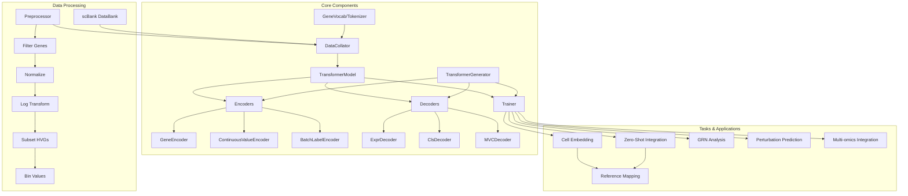
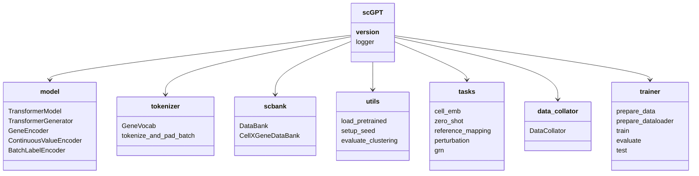

# Overview

<details>
<summary>Relevant source files</summary>

The following files were used as context for generating this wiki page:

- [README.md](README.md)
- [scgpt/__init__.py](scgpt/__init__.py)
- [scgpt/data_collator.py](scgpt/data_collator.py)

</details>


scGPT is a foundation model for single-cell multi-omics data analysis using generative AI. This page provides a high-level overview of the scGPT system, its purpose, main components, and capabilities. For specific details about implementation, please refer to the individual component pages referenced throughout this document.

Sources: [README.md:1-14](), [pyproject.toml:1-9]()

## Purpose and Scope

scGPT aims to advance single-cell genomics research by applying transformer-based deep learning models to analyze gene expression data. The system enables various analytical tasks including data integration, cell type annotation, perturbation prediction, gene regulatory network inference, and multi-omics integration. The scGPT framework implements specialized transformer architectures optimized for processing gene expression data, with support for both pretraining on large datasets and fine-tuning for specific downstream tasks.

Sources: [README.md:3-4](), [pyproject.toml:4]()

## System Architecture

The scGPT system consists of several interconnected components organized in a modular architecture. The following diagram illustrates the high-level architecture of the system:



Sources: [scgpt/__init__.py:18-29](), [README.md:57-69]()

## Data Flow Pipeline

The following diagram illustrates the data flow pipeline from raw gene expression data to processed cell embeddings:

```mermaid
flowchart LR
    Raw["Raw Gene Expression Data"] --> Preproc["Preprocessor"]
    Preproc --> Filtered["Filtered Data"]
    Filtered --> Token["Tokenizer/GeneVocab"]
    Token --> Genes["Gene Tokens"]
    Genes --> DataCol["DataCollator"]
    Values["Expression Values"] --> DataCol
    DataCol --> Batches["Padded/Masked Batches"]
    Batches --> Model["scGPT Model"]
    Model --> Embedding["Cell Embeddings"]
    
    subgraph "DataCollator Operations"
        Padding["Padding"]
        Truncation["Truncation/Sampling"]
        Masking["Value Masking (MLM)"]
        Binning["Expression Binning"]
    end
    
    DataCol -.- "DataCollator Operations"
```

Sources: [scgpt/data_collator.py:10-50](), [scgpt/__init__.py:19-20]()

## Core Components

### Model Architecture

The scGPT system is built around two primary model architectures:

1. **TransformerModel**: A general-purpose model for tasks like cell type classification and embedding generation
2. **TransformerGenerator**: A specialized model for perturbation prediction

Both models leverage transformer architecture with customized encoders and decoders specifically designed for gene expression data. For more details on model architecture, see [Model Architecture](#2.1).

### Data Processing

The data processing pipeline handles preparation of single-cell RNA-seq data for input to the transformer models. Key steps include:

- Gene filtering
- Normalization
- Log transformation
- Highly Variable Gene (HVG) selection
- Expression value binning
- Tokenization
- Data collation with padding and masking

For more details on data processing, see [Data Processing](#2.2).

Sources: [scgpt/data_collator.py:11-47]()

### Training System

The training system orchestrates model training, evaluation, and testing workflows. It provides functionality for batch preparation, loss computation, optimization, and evaluation metrics tracking. For more details on the training system, see [Training System](#2.3).

Sources: [scgpt/__init__.py:21-29]()

## Tasks and Applications

scGPT supports multiple analytical tasks for single-cell data:

| Task | Description | Related Page |
|------|-------------|--------------|
| Zero-Shot Integration | Integration of single-cell datasets without task-specific fine-tuning | [Zero-Shot Integration](#3.1) |
| Reference Mapping | Transfer of cell type annotations from reference to query datasets | [Reference Mapping](#3.2) |
| Cell Embedding | Generation of low-dimensional cell representations | [Cell Embedding](#3.3) |
| Perturbation Prediction | Prediction of cellular responses to genetic or chemical perturbations | [Perturbation Prediction](#3.4) |
| GRN Analysis | Inference of gene regulatory networks | [GRN Analysis](#3.5) |
| Multi-omics Integration | Integration of multiple data modalities (RNA, ATAC, etc.) | [Multi-omics Integration](#3.6) |

Sources: [README.md:74-85]()

## Pretrained Models

scGPT provides several pretrained model checkpoints for different applications:

| Model name | Description | 
|------------|-------------|
| whole-human (recommended) | Pretrained on 33 million normal human cells |
| continual pretrained | For zero-shot cell embedding related tasks |
| brain | Pretrained on 13.2 million brain cells |
| blood | Pretrained on 10.3 million blood and bone marrow cells |
| heart | Pretrained on 1.8 million heart cells |
| lung | Pretrained on 2.1 million lung cells |
| kidney | Pretrained on 814 thousand kidney cells |
| pan-cancer | Pretrained on 5.7 million cells of various cancer types |

These models serve as the foundation for various downstream tasks and can be used directly or fine-tuned for specific applications. For more details on available models, see [Pretrained Models](#4).

Sources: [README.md:57-69]()

## Code Organization

The scGPT codebase is organized into several key modules:



Sources: [scgpt/__init__.py:18-29]()

## Installation and Dependencies

scGPT works with Python >= 3.7.13 and R >= 3.6.1. The main dependencies include:

- PyTorch (>=1.13.0)
- scanpy (^1.9.1)
- scvi-tools (>=0.16.0,<1.0)
- datasets (^2.3.0)
- flash-attention (optional, recommended)

For a complete guide on installation, see [Installation Guide](#6).

Sources: [README.md:28-54](), [pyproject.toml:11-26]()

## Getting Started

To get started with scGPT, you can:

1. Install the package using pip: `pip install scgpt "flash-attn<1.0.5"`
2. Download a pretrained model checkpoint
3. Use the model for:
   - Cell embedding generation
   - Zero-shot integration
   - Reference mapping
   - Fine-tuning for specific tasks

For detailed tutorials and examples, refer to the task-specific pages in the [Tasks and Applications](#3) section.

Sources: [README.md:32-38]()

---