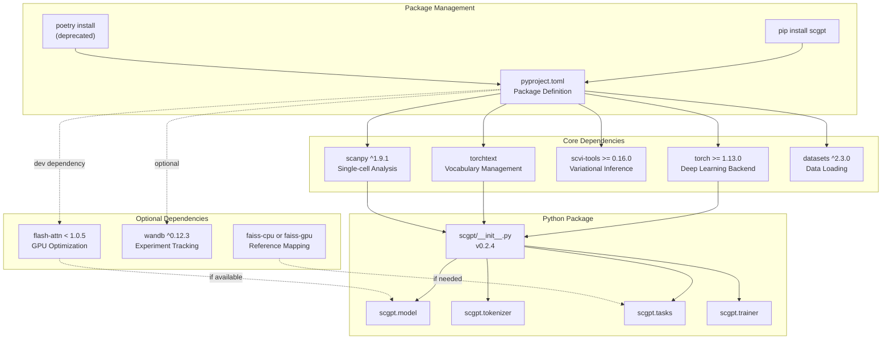
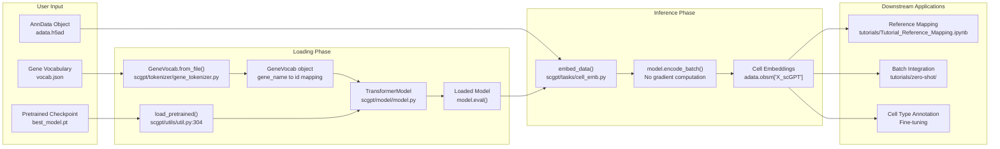
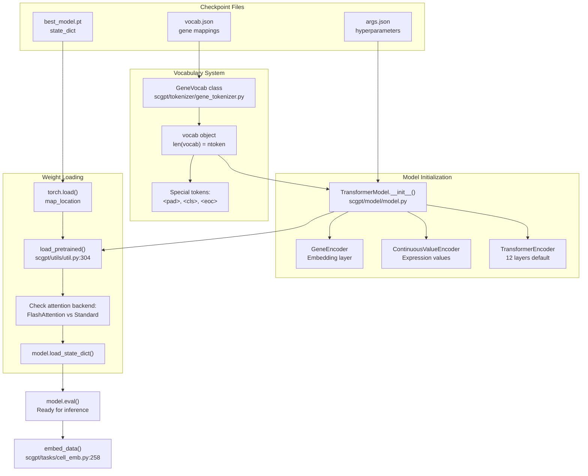
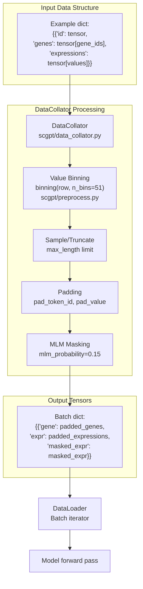

# Getting Started

<details>
<summary>Relevant source files</summary>

The following files were used as context for generating this wiki page:

- [.readthedocs.yaml](.readthedocs.yaml)
- [README.md](README.md)
- [docs/environment.yml](docs/environment.yml)
- [docs/requirements.txt](docs/requirements.txt)
- [pyproject.toml](pyproject.toml)
- [scgpt/data_collator.py](scgpt/data_collator.py)

</details>


This page guides you through the initial setup and first steps with scGPT, from installation to running your first cell embedding task. It covers the essential prerequisites, basic installation via pip, and a minimal working example using pretrained models.

For detailed installation instructions including optional dependencies and troubleshooting, see [Installation](#2.1). For comprehensive examples of pretrained model usage, see [Quick Start with Pretrained Models](#2.2).

---

## Prerequisites

scGPT requires the following environment:

| Component | Requirement | Purpose |
|-----------|-------------|---------|
| **Python** | >= 3.7.13 | Core language runtime |
| **R** | >= 3.6.1 | Required by some dependencies (scvi-tools, scanpy) |
| **CUDA** | 11.7+ recommended | For GPU acceleration with flash-attention |
| **GPU** | Optional but recommended | Significantly faster training and inference |

**Sources:** [README.md:30](), [pyproject.toml:12]()

---

## Basic Installation

The simplest installation uses pip to install the scGPT package from PyPI:

```bash
pip install scgpt "flash-attn<1.0.5"
```

The `flash-attn` dependency is optional but strongly recommended for performance. If you encounter installation issues with `flash-attn`, scGPT will automatically fall back to standard PyTorch attention mechanisms.

**Known issue (as of 2023.09):** If you encounter errors related to Google's `orbax` package, use:

```bash
pip install scgpt "flash-attn<1.0.5" "orbax<0.1.8"
```

### Optional: Experiment Tracking

For logging training metrics and visualizations, install Weights & Biases:

```bash
pip install wandb
```

**Sources:** [README.md:28-54](), [pyproject.toml:1-41]()

---

## Installation Dependencies Flow



**Sources:** [pyproject.toml:11-27](), [pyproject.toml:28-36](), [README.md:28-44]()

---

## Your First scGPT Application

The most common use case is generating cell embeddings from scRNA-seq data using a pretrained model. This requires three steps: loading data, loading a pretrained model, and generating embeddings.

### Step 1: Prepare Your Data

scGPT expects data in AnnData format, commonly used in single-cell analysis:

```python
import scanpy as sc

# Load your single-cell data
adata = sc.read_h5ad("your_data.h5ad")

# Basic preprocessing
sc.pp.filter_cells(adata, min_genes=200)
sc.pp.filter_genes(adata, min_cells=3)
```

### Step 2: Load Pretrained Model and Vocabulary

```python
import torch
from scgpt.model import TransformerModel
from scgpt.tokenizer import GeneVocab
from scgpt.utils import load_pretrained

# Load gene vocabulary
vocab = GeneVocab.from_file("vocab.json")

# Initialize model architecture
model = TransformerModel(
    ntoken=len(vocab),
    d_model=512,
    nhead=8,
    d_hid=512,
    nlayers=12,
    vocab=vocab,
    pad_token=vocab["<pad>"],
    pad_value=0,
)

# Load pretrained weights
load_pretrained(model, torch.load("best_model.pt", map_location="cpu"))
model.eval()
```

### Step 3: Generate Cell Embeddings

```python
from scgpt.tasks.cell_emb import embed_data

# Generate embeddings
adata = embed_data(
    model=model,
    adata=adata,
    gene_ids=adata.var.index.tolist(),
    batch_size=64,
    return_new_adata=True,
)

# Embeddings stored in adata.obsm['X_scGPT']
print(adata.obsm['X_scGPT'].shape)  # (n_cells, d_model)
```

**Sources:** [README.md:56-69](), [README.md:18]()

---

## Basic Usage Workflow: From Data to Embeddings



This diagram maps the typical zero-shot workflow to specific code entities. The `embed_data()` function in [scgpt/tasks/cell_emb.py]() is the primary interface for generating embeddings, while `load_pretrained()` in [scgpt/utils/util.py:304]() handles checkpoint loading across different backends (CPU, GPU, flash-attn).

**Sources:** [README.md:18](), [README.md:56-69]()

---

## Pretrained Model Zoo

scGPT provides several pretrained models for different use cases:

| Model Name | Training Data | Download Link | Use Case |
|------------|---------------|---------------|----------|
| **whole-human** | 33M normal human cells | [Google Drive](https://drive.google.com/drive/folders/1oWh_-ZRdhtoGQ2Fw24HP41FgLoomVo-y) | **Recommended default** |
| **continual pretrained** | Continual pretraining on diverse batches | [Google Drive](https://drive.google.com/drive/folders/1_GROJTzXiAV8HB4imruOTk6PEGuNOcgB) | Zero-shot embedding tasks |
| **brain** | 13.2M brain cells | [Google Drive](https://drive.google.com/drive/folders/1vf1ijfQSk7rGdDGpBntR5bi5g6gNt-Gx) | Brain-specific analysis |
| **blood** | 10.3M blood/bone marrow cells | [Google Drive](https://drive.google.com/drive/folders/1kkug5C7NjvXIwQGGaGoqXTk_Lb_pDrBU) | Hematology studies |
| **pan-cancer** | 5.7M cancer cells | [Google Drive](https://drive.google.com/drive/folders/13QzLHilYUd0v3HTwa_9n4G4yEF-hdkqa) | Cancer research |

Each checkpoint folder contains:
- `best_model.pt`: Model weights
- `vocab.json`: Gene vocabulary mapping gene names to token IDs
- `args.json`: Training configuration

**Note:** The `whole-human` model is recommended as the default starting point for most applications. Organ-specific models may provide competitive performance when the fine-tuning dataset shares similar cell type context with the training data.

**Sources:** [README.md:56-69]()

---

## Model Loading Architecture



The `load_pretrained()` function at [scgpt/utils/util.py:304]() handles automatic compatibility across different attention backends (flash-attn, standard PyTorch). This allows the same checkpoint to be loaded on CPU, GPU with flash-attention, or GPU with standard attention without modification.

**Sources:** [README.md:18](), [scgpt/data_collator.py:1-203]()

---

## Data Collation for Model Input

Once a model is loaded, raw AnnData needs to be converted into model-compatible batches. The `DataCollator` class handles this transformation:



The `DataCollator` parameters:
- `do_padding=True`: Pad sequences to `max_length`
- `pad_token_id`: Token ID for padding (typically vocab["<pad>"])
- `do_mlm=True`: Apply masked language modeling
- `mlm_probability=0.15`: Fraction of tokens to mask
- `do_binning=True`: Discretize expression values into 51 bins
- `sampling=True`: Randomly sample genes if length > max_length

**Sources:** [scgpt/data_collator.py:10-203]()

---

## Next Steps

After completing basic installation and running your first embedding example, explore:

- **[Installation](#2.1)** - Detailed installation instructions, troubleshooting flash-attention, and environment setup
- **[Quick Start with Pretrained Models](#2.2)** - Comprehensive examples using different pretrained models
- **[Zero-Shot Applications](#4)** - Use scGPT without fine-tuning for reference mapping and integration
- **[Cell Embedding System](#5)** - Deep dive into the `embed_data()` function and embedding generation
- **[Fine-tuning Applications](#6)** - Adapt scGPT to specific downstream tasks
- **[Pretrained Models](#7)** - Complete catalog of available checkpoints and their specifications

For immediate hands-on learning, the tutorial notebooks in `tutorials/zero-shot/` provide complete working examples that can be run directly.

**Sources:** [README.md:1-113]()

---