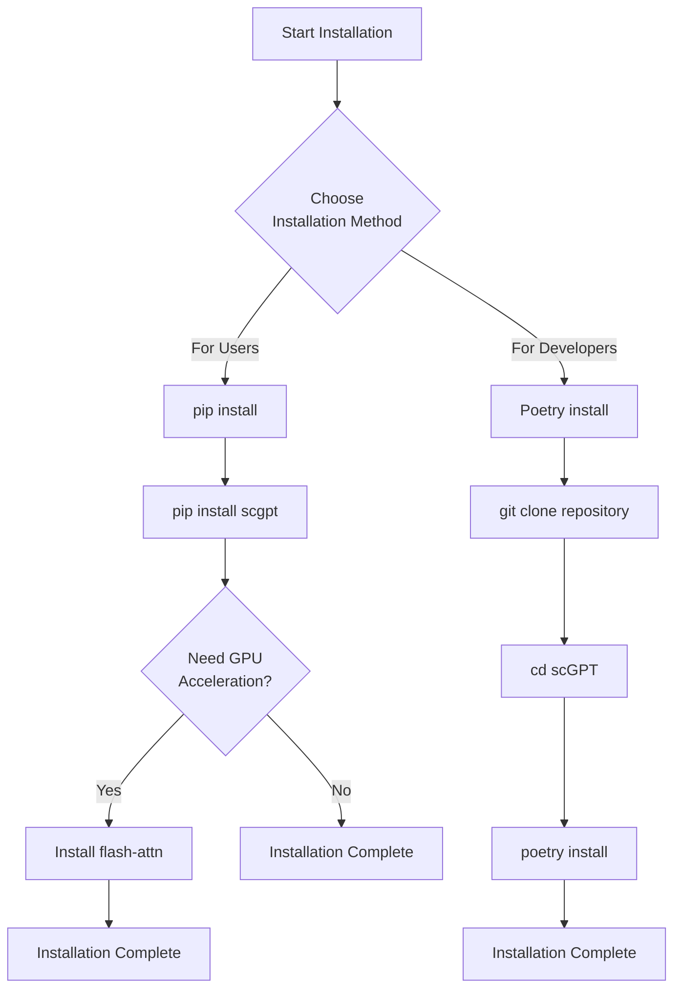
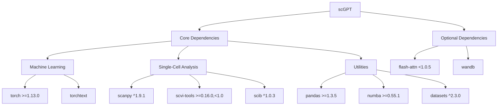
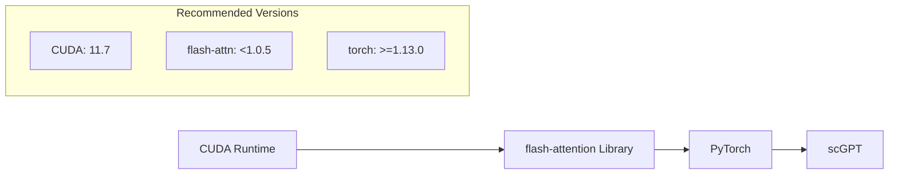

# Installation Guide

<details>
<summary>Relevant source files</summary>

The following files were used as context for generating this wiki page:

- [README.md](README.md)
- [poetry.lock](poetry.lock)
- [pyproject.toml](pyproject.toml)
- [scgpt/data_collator.py](scgpt/data_collator.py)
- [scgpt/tokenizer/gene_tokenizer.py](scgpt/tokenizer/gene_tokenizer.py)

</details>


This guide provides detailed instructions for installing and configuring scGPT, a foundation model for single-cell multi-omics data analysis. For information about the overall system architecture and components, see [Core Components](#2).

## Prerequisites

Before installing scGPT, ensure your system meets the following requirements:

- **Python**: Version ≥ 3.7.13
- **R**: Version ≥ 3.6.1 (for certain functionalities)
- **Hardware**: 
  - For CPU-only installation: Modern multi-core CPU with at least 16GB RAM
  - For GPU installation (recommended): CUDA-compatible GPU with at least 12GB VRAM

Sources: [README.md:29-30]()

## Installation Options

There are two primary methods to install scGPT: via pip (for users) or via Poetry (for developers).



Sources: [README.md:28-52]()

## Basic Installation (pip)

The simplest method to install scGPT is via pip:

```bash
pip install scgpt
```

For optimal performance with GPU acceleration, install with flash-attention:

```bash
pip install scgpt "flash-attn<1.0.5"
```

**Note on compatibility:** If you encounter issues with the Google orbax package, use:

```bash
pip install scgpt "flash-attn<1.0.5" "orbax<0.1.8"
```

Optional: For logging and visualization capabilities, install wandb:

```bash
pip install wandb
```

Sources: [README.md:32-44]()

## Developer Installation (Poetry)

For developers contributing to scGPT, we recommend using Poetry for package management:

1. First, install Poetry following the instructions at [python-poetry.org](https://python-poetry.org/docs/#installation)

2. Clone the repository and install dependencies:

```bash
git clone https://github.com/bowang-lab/scGPT
cd scGPT
poetry install
```

This will create a virtual environment with all dependencies specified in `pyproject.toml`.

Sources: [README.md:46-52](), [pyproject.toml:1-40]()

## Dependency Structure

scGPT relies on several key packages to function properly:



Sources: [pyproject.toml:11-26](), [README.md:32-44]()

## GPU and CUDA Configuration

### CUDA Version Compatibility

For optimal performance, we recommend using:
- CUDA version 11.7
- flash-attn < 1.0.5

This combination has been tested and known to work well with scGPT.



### Flash Attention Installation

The `flash-attn` package provides significant speed improvements for transformer-based operations but requires specific GPU and CUDA versions. If you encounter issues installing flash-attention, please refer to the [flash-attention GitHub repository](https://github.com/HazyResearch/flash-attention/tree/main) for detailed installation instructions specific to your hardware.

Sources: [README.md:54-56]()

## Troubleshooting Common Issues

### Flash Attention Installation Failures

If you encounter errors installing flash-attention:

1. Verify your CUDA version matches the recommended version
2. Try installing an older version of flash-attention:
   ```bash
   pip install "flash-attn==1.0.4"
   ```
3. If still unsuccessful, you can use scGPT without flash-attention (with reduced performance)

### Orbax Package Conflicts

If you see dependency conflicts with the orbax package:

```bash
pip install "orbax<0.1.8"
```

### Package Compatibility

scGPT's dependencies have specific version requirements. The table below shows key packages and their required versions:

| Package | Version Requirement |
|---------|---------------------|
| Python | >=3.7.12, <4 |
| pandas | >=1.3.5 |
| scvi-tools | >=0.16.0, <1.0 |
| scanpy | ^1.9.1 |
| torch | >=1.13.0 |
| numba | >=0.55.1 |
| datasets | ^2.3.0 |

Sources: [pyproject.toml:11-26](), [README.md:36-38]()

## Backend Support

As of version 0.2.4, scGPT's pretrained weights can be loaded on multiple backends:

- PyTorch CPU
- PyTorch GPU
- flash-attention

This flexibility allows users to use the model with or without specialized hardware acceleration.

The pretrained weights can be loaded using the `load_pretrained` function:

```python
from scgpt.utils.util import load_pretrained
import torch

# Load model
target_model = YourModel()  # Your initialized model
load_pretrained(target_model, torch.load("path_to_checkpoint.pt"))
```

Sources: [README.md:18]()

## Verifying Your Installation

After installation, you can verify that scGPT is correctly installed by running:

```python
import scgpt
print(scgpt.__version__)  # Should print the installed version
```

For further verification, try loading one of the models:

```python
from scgpt.utils.util import load_pretrained
from scgpt.models.model import TransformerModel
import torch

# Initialize a small model just to test
model = TransformerModel(
    ntoken=100,  # placeholder
    d_model=128,
    nhead=4,
    d_hid=512,
    nlayers=2,
)

# This should run without errors if installation is correct
device = torch.device("cuda" if torch.cuda.is_available() else "cpu")
model = model.to(device)
```

## Next Steps

Once you have successfully installed scGPT, you may want to:

- Learn about the [Core Components](#2) of the system
- Explore the [Tasks and Applications](#3) supported by scGPT
- Download [Pretrained Models](#4) for your analyses

Sources: [README.md:57-70]()

---