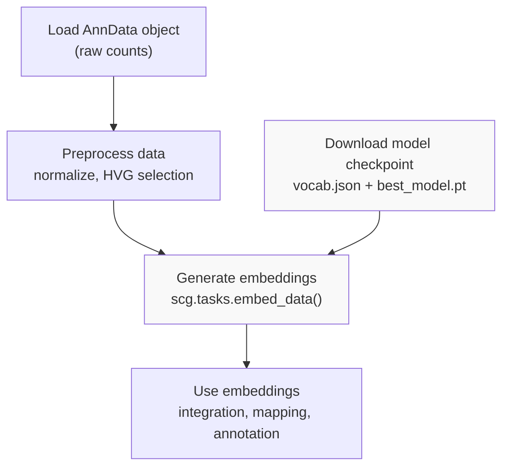
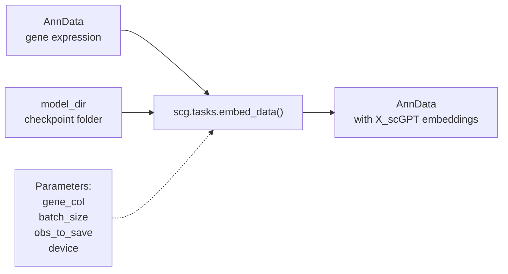
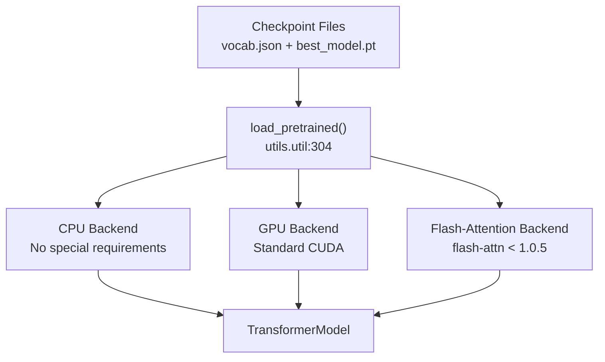
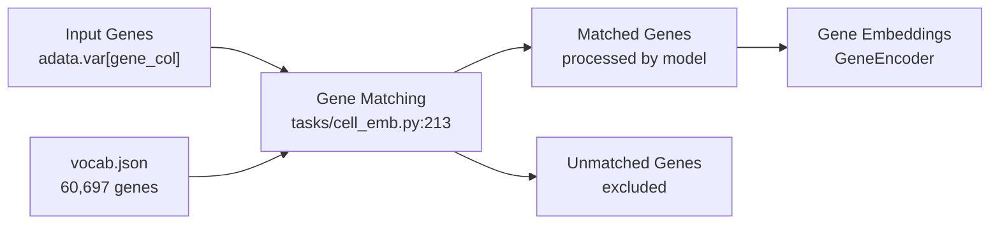
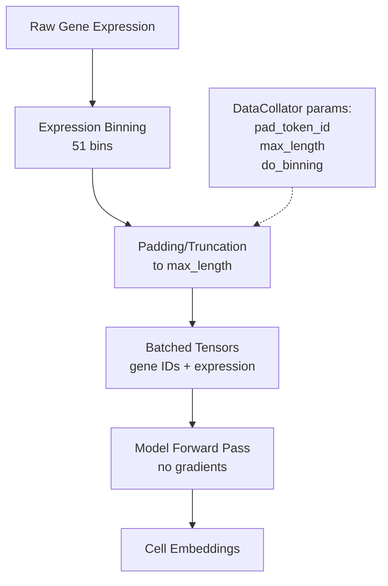

# Quick Start with Pretrained Models

<details>
<summary>Relevant source files</summary>

The following files were used as context for generating this wiki page:

- [README.md](README.md)
- [scgpt/data_collator.py](scgpt/data_collator.py)
- [tutorials/zero-shot/Tutorial_ZeroShot_Integration.ipynb](tutorials/zero-shot/Tutorial_ZeroShot_Integration.ipynb)
- [tutorials/zero-shot/Tutorial_ZeroShot_Integration_Continual_Pretraining.ipynb](tutorials/zero-shot/Tutorial_ZeroShot_Integration_Continual_Pretraining.ipynb)
- [tutorials/zero-shot/Tutorial_ZeroShot_Reference_Mapping.ipynb](tutorials/zero-shot/Tutorial_ZeroShot_Reference_Mapping.ipynb)

</details>


## Purpose and Scope

This guide shows how to quickly load and use scGPT's pretrained models for common single-cell analysis tasks without any fine-tuning or training. These models provide out-of-the-box cell embeddings that can be used for tasks like reference mapping, data integration, and cell annotation.

For information about fine-tuning pretrained models for specific downstream tasks, see [Fine-tuning Applications](#6). For details on the model architecture itself, see [Model Architecture](#3.1).

## Available Pretrained Models

scGPT provides several pretrained checkpoints optimized for different biological contexts:

| Model Name | Description | Training Data | Primary Use Cases | Download Link |
|------------|-------------|---------------|-------------------|---------------|
| `whole-human` (recommended) | General-purpose human model | 33M normal human cells | Default choice for most applications | [Google Drive](https://drive.google.com/drive/folders/1oWh_-ZRdhtoGQ2Fw24HP41FgLoomVo-y?usp=sharing) |
| `continual pretrained` (scGPT_CP) | Enhanced for zero-shot tasks | Tabula Sapiens with cell type supervision | Cell embedding tasks with batch effects | [Google Drive](https://drive.google.com/drive/folders/1_GROJTzXiAV8HB4imruOTk6PEGuNOcgB?usp=sharing) |
| `brain` | Brain tissue specialist | 13.2M brain cells | Brain-specific analyses | [Google Drive](https://drive.google.com/drive/folders/1vf1ijfQSk7rGdDGpBntR5bi5g6gNt-Gx?usp=sharing) |
| `blood` | Blood/bone marrow specialist | 10.3M blood and bone marrow cells | Hematological analyses | [Google Drive](https://drive.google.com/drive/folders/1kkug5C7NjvXIwQGGaGoqXTk_Lb_pDrBU?usp=sharing) |
| `heart` | Heart tissue specialist | 1.8M heart cells | Cardiac analyses | [Google Drive](https://drive.google.com/drive/folders/1GcgXrd7apn6y4Ze_iSCncskX3UsWPY2r?usp=sharing) |
| `lung` | Lung tissue specialist | 2.1M lung cells | Pulmonary analyses | [Google Drive](https://drive.google.com/drive/folders/16A1DJ30PT6bodt4bWLa4hpS7gbWZQFBG?usp=sharing) |
| `kidney` | Kidney tissue specialist | 814K kidney cells | Renal analyses | [Google Drive](https://drive.google.com/drive/folders/1S-1AR65DF120kNFpEbWCvRHPhpkGK3kK?usp=sharing) |
| `pan-cancer` | Cancer specialist | 5.7M cancer cells | Cancer/tumor analyses | [Google Drive](https://drive.google.com/drive/folders/13QzLHilYUd0v3HTwa_9n4G4yEF-hdkqa?usp=sharing) |

The `whole-human` model is recommended as the default starting point. The `scGPT_CP` (continual pretrained) model offers improved performance on datasets with observable technical batch effects, especially for zero-shot integration and reference mapping tasks.

**Sources:** [README.md:56-69]()

## Model Checkpoint Structure

Each pretrained model checkpoint folder contains two essential files:

```
model_directory/
├── vocab.json          # Gene vocabulary mapping gene names to token IDs
└── best_model.pt       # Model weights and configuration
```

The `vocab.json` file maps gene names (or ENSEMBL IDs) to integer token IDs used by the model. The vocabulary size for the whole-human model is 60,697 genes. The `best_model.pt` file contains the trained TransformerModel weights and can be loaded on CPU, GPU, or flash-attention backends.

**Sources:** [README.md:58](), [tutorials/zero-shot/Tutorial_ZeroShot_Reference_Mapping.ipynb:20]()

## Basic Usage Workflow

The typical workflow for using a pretrained model consists of four steps:



**Workflow Diagram: Pretrained Model Usage Pipeline**

The core function for using pretrained models is `scg.tasks.embed_data()`, which takes your preprocessed data and a model directory, then returns cell embeddings stored in `adata.obsm['X_scGPT']`.

**Sources:** [tutorials/zero-shot/Tutorial_ZeroShot_Reference_Mapping.ipynb:23-29](), [tutorials/zero-shot/Tutorial_ZeroShot_Integration.ipynb:28-32]()

## Using embed_data Function

### Function Overview



**Diagram: embed_data Function Interface**

The `embed_data` function is the primary interface for generating cell embeddings from pretrained models. It performs a forward pass through the model without computing gradients.

### Function Signature

```python
scg.tasks.embed_data(
    adata: AnnData,
    model_dir: Path,
    gene_col: str = "gene_name",
    batch_size: int = 64,
    obs_to_save: List[str] = None,
    device: str = "cuda",
    use_fast_transformer: bool = True,
    return_new_adata: bool = False
) -> AnnData
```

### Input Requirements

| Parameter | Type | Description | Example |
|-----------|------|-------------|---------|
| `adata` | `AnnData` | Preprocessed single-cell data with gene expression matrix | `sc.read_h5ad('data.h5ad')` |
| `model_dir` | `Path` | Directory containing `vocab.json` and `best_model.pt` | `Path("save/scGPT_human")` |
| `gene_col` | `str` | Column in `adata.var` containing gene names/symbols | `"gene_name"` or `"gene_symbols"` |
| `batch_size` | `int` | Number of cells to process per batch | `64` |
| `device` | `str` | Computation device | `"cuda"` or `"cpu"` |

The input `adata` should contain:
- **X matrix**: Gene expression values (normalized or log-normalized)
- **var**: Gene metadata with column specified by `gene_col`
- **obs**: Cell metadata (optional, preserved in output)

### Data Preprocessing Requirements

Before calling `embed_data`, your data should be preprocessed:

```python
import scanpy as sc

# Load data
adata = sc.read_h5ad('your_data.h5ad')

# Basic preprocessing
sc.pp.normalize_total(adata, target_sum=1e4)
sc.pp.log1p(adata)

# Select highly variable genes (recommended)
sc.pp.highly_variable_genes(adata, n_top_genes=3000, flavor='seurat_v3')
adata = adata[:, adata.var['highly_variable']]

# Ensure gene names are in var
adata.var['gene_name'] = adata.var.index.values
```

The model will match genes in your data against its vocabulary. Unmatched genes are excluded from processing.

**Sources:** [tutorials/zero-shot/Tutorial_ZeroShot_Integration.ipynb:212-218](), [tutorials/zero-shot/Tutorial_ZeroShot_Reference_Mapping.ipynb:155-160]()

### Output Format

The function returns an `AnnData` object with embeddings stored in `adata.obsm['X_scGPT']`:

```python
# Generate embeddings
embed_adata = scg.tasks.embed_data(
    adata,
    model_dir=Path("save/scGPT_human"),
    gene_col="gene_name",
    batch_size=64,
)

# Access embeddings
embeddings = embed_adata.obsm['X_scGPT']  # Shape: (n_cells, embedding_dim)
```

The embedding dimension is typically 512 for the standard model. The output preserves all original cell metadata from `adata.obs`.

**Sources:** [tutorials/zero-shot/Tutorial_ZeroShot_Reference_Mapping.ipynb:191-196](), [tutorials/zero-shot/Tutorial_ZeroShot_Integration.ipynb:324-329]()

## Complete Example

### Reference Mapping Example

```python
from pathlib import Path
import scanpy as sc
import scgpt as scg

# 1. Specify model directory
model_dir = Path("save/scGPT_human")

# 2. Load and preprocess reference data
adata = sc.read_h5ad('data/reference.h5ad')
sc.pp.highly_variable_genes(adata, n_top_genes=3000, flavor='seurat_v3')
adata = adata[:, adata.var['highly_variable']]

# Set gene column name
gene_col = "gene_name"
adata.var[gene_col] = adata.var.index.values

# 3. Generate embeddings
ref_embed_adata = scg.tasks.embed_data(
    adata,
    model_dir,
    gene_col=gene_col,
    batch_size=64,
)

# 4. Load and embed query data
test_adata = sc.read_h5ad('data/query.h5ad')
test_adata = test_adata[:, test_adata.var[gene_col].isin(adata.var[gene_col])]

test_embed_adata = scg.tasks.embed_data(
    test_adata,
    model_dir,
    gene_col=gene_col,
    batch_size=64,
)

# 5. Use embeddings for downstream analysis
# Embeddings are in: ref_embed_adata.obsm['X_scGPT']
#                    test_embed_adata.obsm['X_scGPT']
```

**Sources:** [tutorials/zero-shot/Tutorial_ZeroShot_Reference_Mapping.ipynb:155-233]()

### Integration Example

```python
from pathlib import Path
import scanpy as sc
import scgpt as scg

# 1. Specify model directory (using continual pretrained model)
model_dir = Path("save/scGPT_CP")

# 2. Load and preprocess data with multiple batches
adata = sc.read_h5ad('data/integration_data.h5ad')

# Preprocess
sc.pp.normalize_total(adata, target_sum=1e4)
sc.pp.log1p(adata)
sc.pp.highly_variable_genes(adata, n_top_genes=1800, flavor='seurat_v3')
adata = adata[:, adata.var['highly_variable']]

# Set gene column
gene_col = "gene_name"
batch_key = "batch"
cell_type_key = "celltype"

# 3. Generate embeddings
embed_adata = scg.tasks.embed_data(
    adata,
    model_dir,
    gene_col=gene_col,
    batch_size=64,
)

# 4. Use embeddings for integration analysis
# The X_scGPT embeddings naturally integrate across batches
sc.pp.neighbors(embed_adata, use_rep='X_scGPT')
sc.tl.umap(embed_adata)
sc.pl.umap(embed_adata, color=[batch_key, cell_type_key])
```

**Sources:** [tutorials/zero-shot/Tutorial_ZeroShot_Integration_Continual_Pretraining.ipynb:239-329]()

## Model Loading Details

### Backend Compatibility

The pretrained models can be loaded on different computational backends:



**Diagram: Model Loading Backend Options**

The `load_pretrained` function handles loading model weights onto the appropriate backend. Flash-attention is optional but recommended for improved performance on compatible GPUs.

```python
import torch
from scgpt.model import TransformerModel
from scgpt.utils import load_pretrained

# Load model
model = TransformerModel(...)
load_pretrained(model, torch.load("path/to/best_model.pt"))
```

**Sources:** [README.md:18](), [scgpt/utils/util.py:304]()

### Vocabulary Matching

When generating embeddings, the model matches genes in your data against its vocabulary:



**Diagram: Gene Vocabulary Matching Process**

The system reports how many genes were successfully matched. For example:
```
scGPT - INFO - match 2978/3000 genes in vocabulary of size 60697.
```

Only matched genes are used for generating cell embeddings. Genes not in the vocabulary are silently excluded.

**Sources:** [tutorials/zero-shot/Tutorial_ZeroShot_Integration.ipynb:332-336](), [scgpt/data_collator.py:1-203]()

## Data Collation Process

Internally, `embed_data` uses a `DataCollator` to prepare batches:



**Diagram: Data Collation Pipeline**

Key data collation features:
- **Expression binning**: Continuous expression values are discretized into 51 bins
- **Padding**: Sequences are padded to consistent length with `pad_token_id`
- **Sampling**: For sequences exceeding `max_length`, genes are randomly sampled
- **No masking**: Unlike training, no MLM masking is applied during inference

**Sources:** [scgpt/data_collator.py:11-203]()

## Tips and Best Practices

### Model Selection Guidelines

| Your Data Characteristics | Recommended Model |
|---------------------------|-------------------|
| General human single-cell data | `whole-human` |
| Multiple batches with technical effects | `scGPT_CP` (continual pretrained) |
| Brain-specific tissue | `brain` (if context matches training data) |
| Blood/immune cells | `blood` (if context matches training data) |
| Other specific organs | Corresponding organ model if available |
| Cancer/tumor samples | `pan-cancer` |

### Gene Selection

- Select 1,800-3,000 highly variable genes for optimal performance
- More genes provide more information but increase computation time
- Use `flavor='seurat_v3'` for HVG selection for consistency with training

### Batch Size

- Larger batch sizes (64-128) are faster but require more memory
- Reduce batch size if encountering out-of-memory errors
- Batch size does not affect embedding quality

### Preprocessing Consistency

- Normalize and log-transform consistently with training data
- Target sum of 1e4 (10,000) is standard
- HVG selection should use raw counts when `flavor='seurat_v3'`

**Sources:** [tutorials/zero-shot/Tutorial_ZeroShot_Integration.ipynb:135-303](), [README.md:56-72]()

## Next Steps

After generating embeddings with pretrained models:

- **For zero-shot reference mapping**: See [Reference Mapping](#4.1)
- **For zero-shot data integration**: See [Data Integration](#4.2)  
- **For fine-tuning on specific tasks**: See [Cell Type Annotation](#6.1), [Perturbation Prediction](#6.2), or other fine-tuning guides
- **For understanding the embedding space**: See [Cell Embedding System](#5)

**Sources:** [README.md:1-114]()

---