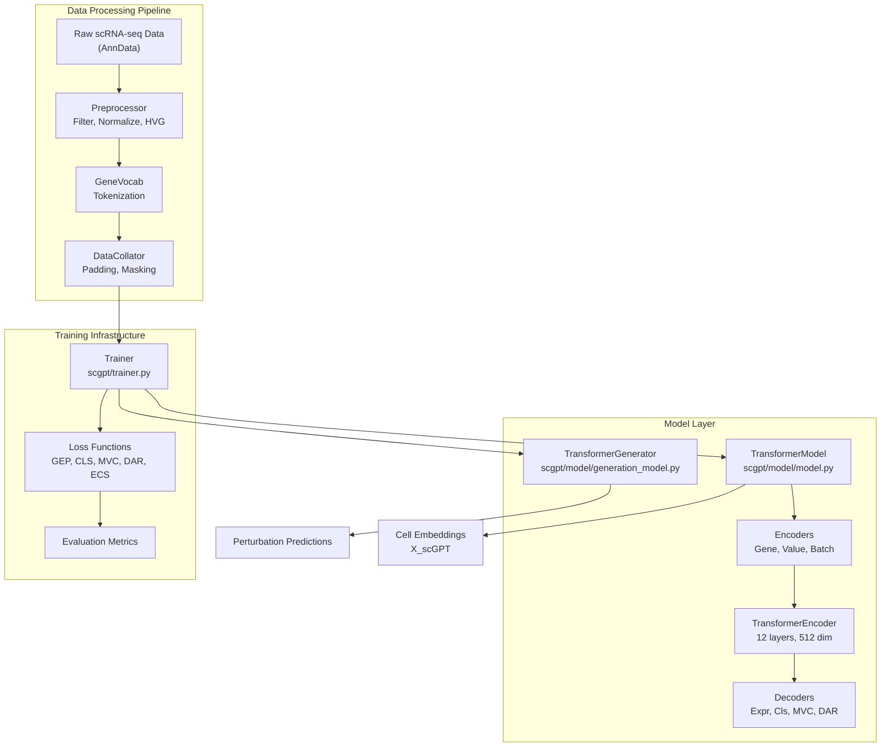
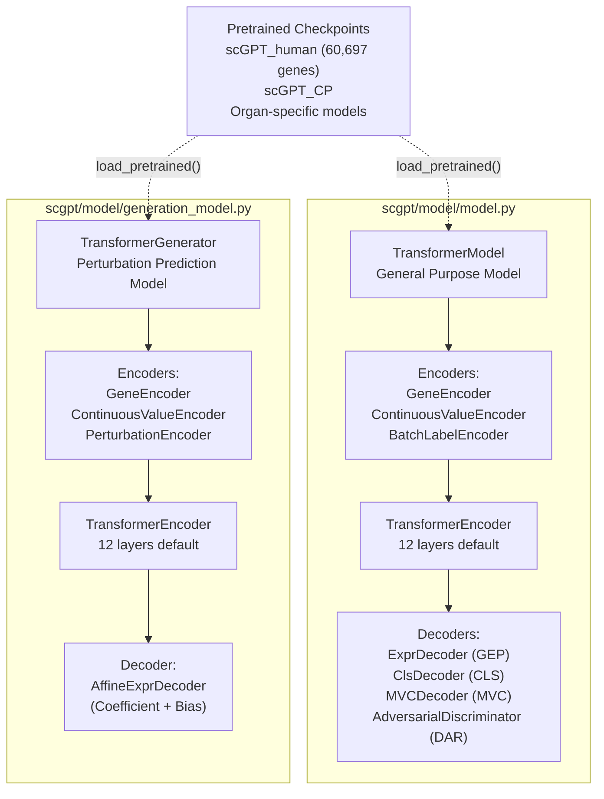
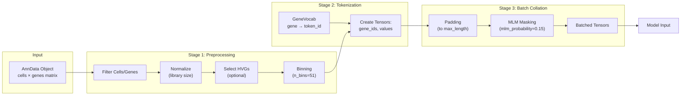
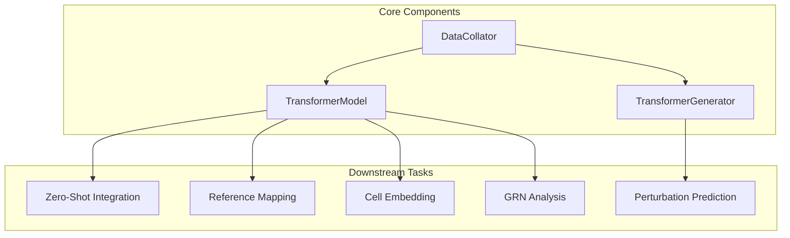

# Core Architecture

<details>
<summary>Relevant source files</summary>

The following files were used as context for generating this wiki page:

- [README.md](README.md)
- [scgpt/data_collator.py](scgpt/data_collator.py)
- [scgpt/model/generation_model.py](scgpt/model/generation_model.py)
- [scgpt/model/model.py](scgpt/model/model.py)
- [scgpt/utils/util.py](scgpt/utils/util.py)

</details>


This page provides an architectural overview of the scGPT system, explaining the fundamental components and subsystems that enable scGPT's functionality as a foundation model for single-cell genomics. The architecture is organized into three primary subsystems: the model layer, the data processing pipeline, and the training infrastructure.

For detailed information about specific subsystems, refer to the following subpages:
- **[Model Architecture (3.1)](#3.1)** - Detailed explanation of TransformerModel and TransformerGenerator architectures, including encoders, decoders, and attention mechanisms
- **[Tokenization and Vocabulary (3.2)](#3.2)** - GeneVocab system, tokenization process, and special token handling
- **[Data Processing Pipeline (3.3)](#3.3)** - Preprocessor, DataCollator, and data preparation workflow from raw data to model input
- **[Training Infrastructure (3.4)](#3.4)** - Training loop, loss functions, evaluation metrics, and optimizer configuration

## Architectural Overview

scGPT is organized around three primary subsystems that work together to enable single-cell genomics modeling:

1. **Model Layer** - Transformer-based neural network architectures (`TransformerModel`, `TransformerGenerator`)
2. **Data Processing Pipeline** - Tokenization, preprocessing, and batch collation (`GeneVocab`, `Preprocessor`, `DataCollator`)
3. **Training Infrastructure** - Training loop, loss functions, and evaluation (`Trainer`, multi-objective losses)

**High-Level Architecture Diagram**



Sources: [scgpt/__init__.py:18-29](), [scgpt/model/model.py:28-168](), [scgpt/model/generation_model.py:25-125](), [scgpt/data_collator.py:10-66]()

## Model Layer

The model layer contains the core neural network architectures that perform single-cell genomics modeling. scGPT provides two transformer-based models, each designed for different use cases. For detailed architecture information, see **[Model Architecture (3.1)](#3.1)**.

**Model Hierarchy**



| Model | File | Primary Use Cases | Key Features |
|-------|------|-------------------|--------------|
| `TransformerModel` | [scgpt/model/model.py:28-442]() | Cell embedding, integration, annotation | Multi-objective training (GEP, CLS, MVC, DAR, ECS) |
| `TransformerGenerator` | [scgpt/model/generation_model.py:25-350]() | Perturbation prediction | Affine expression decoder, perturbation encoding |

**Key Architecture Features:**
- **Flash Attention Support**: Optional use of `FlashMHA` for memory-efficient attention ([scgpt/model/model.py:115-129]())
- **Domain-Specific Batch Normalization**: Handles batch effects during training ([scgpt/model/model.py:105-113]())
- **Flexible Cell Embedding Extraction**: Supports `cls`, `avg-pool`, and `w-pool` strategies ([scgpt/model/model.py:199-223]())
- **Explicit Zero-Inflation Modeling**: Models dropout events in single-cell data ([scgpt/model/model.py:364-370]())

Sources: [scgpt/model/model.py:28-442](), [scgpt/model/generation_model.py:25-350](), [scgpt/utils/util.py:308-365]()

## Data Processing Pipeline

The data processing pipeline transforms raw single-cell RNA-seq data into model-ready tensors. This pipeline consists of three stages: preprocessing, tokenization, and batch collation. For detailed information, see **[Data Processing Pipeline (3.3)](#3.3)** and **[Tokenization and Vocabulary (3.2)](#3.2)**.

**Data Flow Through Pipeline**



| Component | File | Responsibility |
|-----------|------|----------------|
| `Preprocessor` | [scgpt/preprocess.py]() | Filter, normalize, HVG selection, binning |
| `GeneVocab` | [scgpt/tokenizer/gene_tokenizer.py]() | Maintain gene vocabulary, handle special tokens |
| `DataCollator` | [scgpt/data_collator.py:10-203]() | Pad sequences, apply masking, create batches |

**Key Data Structures:**

The pipeline produces the following data structures for model input:

```python
# Example batch structure from DataCollator
{
    "gene": torch.Tensor,      # shape: (batch_size, max_length), gene token IDs
    "expr": torch.Tensor,      # shape: (batch_size, max_length), expression values
    "masked_expr": torch.Tensor # shape: (batch_size, max_length), masked expression values
}
```

**Special Tokens:**

The vocabulary includes special tokens for model operations:
- `<pad>`: Padding token for variable-length sequences
- `<cls>`: Classification token prepended to sequences
- `<eoc>`: End-of-cell token (optional)

Sources: [scgpt/data_collator.py:10-203](), [scgpt/__init__.py:19-20]()

## Training Infrastructure

The training infrastructure orchestrates the training loop, manages multi-objective losses, and evaluates model performance. For detailed information, see **[Training Infrastructure (3.4)](#3.4)**.

**Training Loop Architecture**

```mermaid
sequenceDiagram
    participant DATA as "DataLoader"
    participant TRAINER as "Trainer<br/>scgpt/trainer.py"
    participant MODEL as "TransformerModel"
    participant LOSS as "Loss Computation"
    participant OPT as "Optimizer<br/>AdamW"
    participant SCHED as "Scheduler"
    
    loop Each Epoch
        loop Each Batch
            DATA->>TRAINER: Batch data
            TRAINER->>MODEL: Forward pass
            MODEL->>LOSS: Model outputs
            Note over LOSS: Multi-objective:<br/>GEP + CLS + MVC + DAR + ECS
            LOSS->>TRAINER: Combined loss
            TRAINER->>OPT: Backward pass
            OPT->>MODEL: Update weights
            TRAINER->>SCHED: Step scheduler
        end
        TRAINER->>TRAINER: Evaluate on validation
        TRAINER->>TRAINER: Save checkpoint
    end
```

**Multi-Objective Training:**

scGPT supports multiple training objectives that can be combined:

| Objective | Name | Purpose | Loss Function |
|-----------|------|---------|---------------|
| GEP | Gene Expression Prediction | Masked language modeling for expression values | MSE Loss |
| CLS | Cell Type Classification | Supervised cell type prediction | Cross-Entropy Loss |
| MVC | Masked Value Prediction for Cell Embedding | Contrastive learning for cell representations | MSE Loss |
| DAR | Domain Adaptation via Reverse Gradient | Remove batch effects | Cross-Entropy Loss with gradient reversal |
| ECS | Elastic Cell Similarity | Regularize cell embeddings | Custom similarity loss |

**Forward Pass with Multiple Objectives:**

```python
# Example from TransformerModel.forward()
output = model(
    src=gene_ids,                # Gene token IDs
    values=gene_values,          # Expression values
    src_key_padding_mask=mask,   # Attention mask
    batch_labels=batch_ids,      # Batch information
    CLS=True,                    # Enable classification objective
    MVC=True,                    # Enable MVC objective
    ECS=True                     # Enable ECS objective
)
# Returns: {"mlm_output", "cell_emb", "cls_output", "mvc_output", "loss_ecs"}
```

Sources: [scgpt/model/model.py:314-440](), [scgpt/model/generation_model.py:175-262]()

## Configuration and Key Parameters

The scGPT architecture is highly configurable. Below are the most important configuration parameters for each subsystem:

**Model Architecture Parameters:**

| Parameter | Default | Description |
|-----------|---------|-------------|
| `ntoken` | - | Vocabulary size (number of genes) |
| `d_model` | 512 | Embedding dimension |
| `nhead` | 8 | Number of attention heads |
| `d_hid` | 512 | Hidden layer dimension in feedforward network |
| `nlayers` | 12 | Number of transformer encoder layers |
| `dropout` | 0.0 | Dropout probability |
| `use_fast_transformer` | True | Enable FlashAttention or linear attention |
| `cell_emb_style` | "cls" | Cell embedding extraction method: "cls", "avg-pool", or "w-pool" |
| `explicit_zero_prob` | False | Model zero-inflation with explicit probability |

**Data Processing Parameters:**

| Parameter | Default | Description |
|-----------|---------|-------------|
| `n_input_bins` | 51 | Number of bins for discretizing expression values |
| `mlm_probability` | 0.15 | Probability of masking gene tokens for MLM objective |
| `mask_value` | -1 | Value to fill masked positions |
| `max_length` | 1200-3000 | Maximum sequence length (varies by task) |
| `pad_token_id` | - | Token ID for padding |

**Training Parameters:**

| Parameter | Typical Value | Description |
|-----------|---------------|-------------|
| `learning_rate` | 1e-4 | Base learning rate |
| `batch_size` | 32-64 | Number of cells per batch |
| `epochs` | 10-30 | Number of training epochs |
| `warmup_ratio` | 0.1 | Fraction of training for learning rate warmup |

Sources: [scgpt/model/model.py:28-167](), [scgpt/model/generation_model.py:25-64](), [scgpt/data_collator.py:36-46]()

## Integration with the Broader System

The core components described here integrate with the broader scGPT system to enable various downstream tasks:



Sources: [scgpt/__init__.py:18-29]()

## Key Implementation Details

The scGPT models include several specialized implementation features:

1. **Flash Attention Support**: Optional use of flash attention for improved memory usage and speed
2. **Domain-Specific Batch Normalization**: Support for batch-aware normalization to handle domain shifts
3. **Multiple Cell Embedding Styles**: Options for how cell representations are derived from gene-level features
4. **Zero-Inflation Modeling**: Specialized components to model dropout events in single-cell data

Sources: [scgpt/model/model.py:64-84](), [scgpt/model/model.py:595-720]()

---