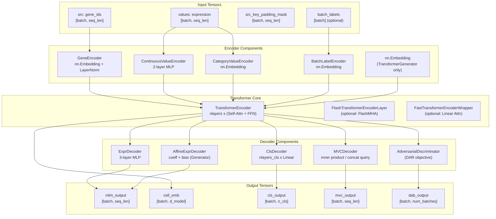
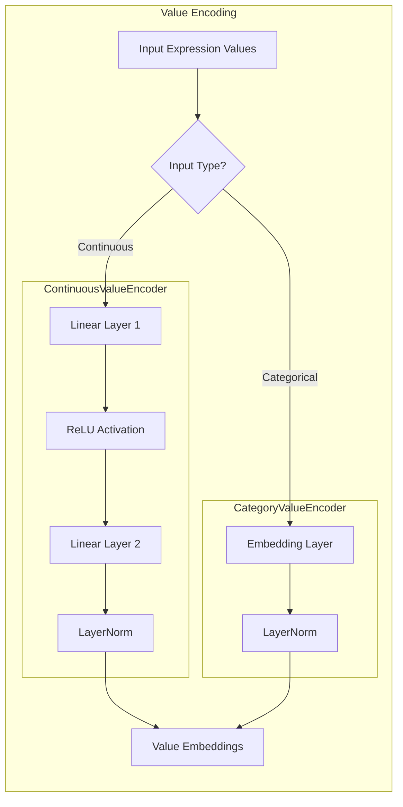
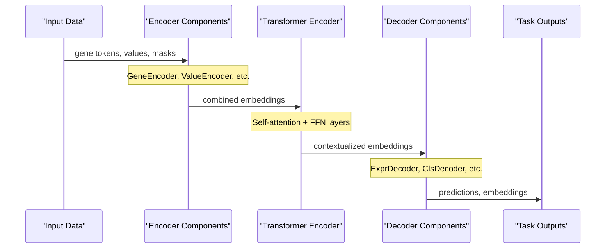

# Model Architecture

<details>
<summary>Relevant source files</summary>

The following files were used as context for generating this wiki page:

- [scgpt/model/generation_model.py](scgpt/model/generation_model.py)
- [scgpt/model/model.py](scgpt/model/model.py)
- [scgpt/utils/util.py](scgpt/utils/util.py)

</details>


This page documents the core model architecture components of scGPT, focusing on `TransformerModel` and `TransformerGenerator` classes located in [scgpt/model/model.py]() and [scgpt/model/generation_model.py](). These transformer-based architectures provide the foundation for gene expression prediction, cell type classification, and perturbation prediction.

Related pages: See page 3.2 for tokenization via `GeneVocab`, page 3.3 for `Preprocessor` and `DataCollator`, page 3.4 for the training loop, and page 5 for `embed_data` function usage.

## Overview

scGPT implements two primary model classes in [scgpt/model/]():

1. **`TransformerModel`** [scgpt/model/model.py:28-500](): General-purpose foundation model for gene expression prediction, masked language modeling (MLM), cell type classification (CLS), masked value prediction for cell embedding (MVC), and domain adversarial regularization (DAR).

2. **`TransformerGenerator`** [scgpt/model/generation_model.py:25-350](): Specialized model for perturbation prediction tasks, using `AffineExprDecoder` to predict expression changes.

Both inherit from `nn.Module` and share similar encoder-transformer-decoder architectures but differ in their decoder components and training objectives.

**Architecture Diagram: Core Components and Data Flow**



Sources: [scgpt/model/model.py:28-440](), [scgpt/model/generation_model.py:25-296]()

## Primary Model Classes

### TransformerModel

The `TransformerModel` class is the core architecture of scGPT, designed for modeling gene expression data and generating cell embeddings.

Key components and features:

- **Input**: Takes gene tokens, expression values, and optional batch labels
- **Encoding**: Combines gene embeddings with value embeddings
- **Transformer**: Processes the embeddings through multi-head attention layers
- **Cell Embedding**: Extracts cell-level representations from the transformer output
- **Decoding**: Multiple decoders for expression prediction, classification, and contrastive learning
- **Attention Options**: Supports both standard PyTorch transformers and optimized Flash Attention

```mermaid
classDiagram
    class TransformerModel {
        +__init__(ntoken, d_model, nhead, etc)
        +forward(src, values, src_key_padding_mask, etc)
        +generate(cell_emb, src, values, etc)
        +encode_batch(src, values, src_key_padding_mask, etc)
        -_encode(src, values, src_key_padding_mask, batch_labels)
        -_get_cell_emb_from_layer(layer_output, weights)
    }
    
    class GeneEncoder {
        +embedding
        +enc_norm
        +forward(x)
    }
    
    class ContinuousValueEncoder {
        +linear1
        +linear2
        +activation
        +forward(x)
    }
    
    class ExprDecoder {
        +fc
        +zero_logit
        +forward(x)
    }
    
    class ClsDecoder {
        +_decoder
        +out_layer
        +forward(x)
    }
    
    TransformerModel --> GeneEncoder
    TransformerModel --> ContinuousValueEncoder
    TransformerModel --> ExprDecoder
    TransformerModel --> ClsDecoder
    TransformerModel --> "TransformerEncoder"
```

Sources: [scgpt/model/model.py:28-440]()

### TransformerGenerator

The `TransformerGenerator` is a specialized model architecture for perturbation prediction tasks, extending the base architecture with perturbation-specific components.

Key components and features:

- **Input**: Takes gene tokens, expression values, and perturbation flags
- **Encoding**: Combines gene embeddings, value embeddings, and perturbation embeddings
- **Transformer**: Processes the combined embeddings
- **Decoding**: Uses a specialized `AffineExprDecoder` for predicting perturbation effects
- **Prediction**: Supports specialized inference for perturbation prediction via `pred_perturb` method

```mermaid
classDiagram
    class TransformerGenerator {
        +__init__(ntoken, d_model, nhead, etc)
        +forward(src, values, input_pert_flags, etc)
        +pred_perturb(batch_data, include_zero_gene, etc)
        -_encode(src, values, input_pert_flags, src_key_padding_mask)
        -_get_cell_emb_from_layer(layer_output, weights)
    }
    
    class GeneEncoder {
        +embedding
        +enc_norm
        +forward(x)
    }
    
    class ContinuousValueEncoder {
        +linear1
        +linear2
        +activation
        +forward(x)
    }
    
    class PertEncoder {
        +embedding
        +forward(x)
    }
    
    class AffineExprDecoder {
        +coeff_decoder
        +bias_decoder
        +forward(x, values)
    }
    
    TransformerGenerator --> GeneEncoder
    TransformerGenerator --> ContinuousValueEncoder
    TransformerGenerator --> PertEncoder
    TransformerGenerator --> AffineExprDecoder
    TransformerGenerator --> "TransformerEncoder"
```

Sources: [scgpt/model/generation_model.py:25-296]()

## Encoder Components

The encoder components transform gene tokens, expression values, batch labels, and perturbation flags into embeddings for the transformer layers.

### GeneEncoder

The `GeneEncoder` embeds gene tokens into continuous vector representations:

- Takes token IDs as input
- Uses an embedding layer followed by layer normalization
- Provides gene-specific embeddings for the transformer

```python
# GeneEncoder implementation
class GeneEncoder(nn.Module):
    def __init__(self, num_embeddings, embedding_dim, padding_idx=None):
        super().__init__()
        self.embedding = nn.Embedding(num_embeddings, embedding_dim, padding_idx=padding_idx)
        self.enc_norm = nn.LayerNorm(embedding_dim)

    def forward(self, x):
        x = self.embedding(x)  # (batch, seq_len, embsize)
        x = self.enc_norm(x)
        return x
```

Sources: [scgpt/model/model.py:723-739](), [scgpt/model/generation_model.py:357-373]()

### Value Encoders

scGPT supports multiple types of value encoders to handle different types of expression data:

1. **ContinuousValueEncoder**: For continuous gene expression values
   - Projects scalar values to embedding space via neural network layers
   - Applies value clipping, ReLU activation, and layer normalization

2. **CategoryValueEncoder**: For categorical (binned) gene expression values
   - Embeds categorical values similar to the GeneEncoder
   - Useful when expression values are discretized



Sources: [scgpt/model/model.py:765-812]()

### PertEncoder

The `PertEncoder` in the `TransformerGenerator` model embeds perturbation flags:

- Takes perturbation flags (0 for control, 1 for perturbed, 2 for padding)
- Embeds them into continuous vector representations
- Helps the model understand which genes are perturbed in perturbation prediction tasks

Sources: [scgpt/model/generation_model.py:25-296]()

## Transformer Core

The transformer core consists of the multi-head attention layers that process the concatenated embeddings. scGPT provides multiple implementations:

### Standard Transformer

Uses PyTorch `TransformerEncoder` [scgpt/model/model.py:131-134]() with `TransformerEncoderLayer` [scgpt/model/model.py:131-132]().

### Flash Attention Transformer

Implemented via `FlashTransformerEncoderLayer` [scgpt/model/model.py:595-720](), using the `FlashMHA` class from `flash_attn.flash_attention` [scgpt/model/model.py:15-22]():

- Faster computation for long sequences
- Lower memory footprint
- Supports `pre_norm` and `post_norm` schemes [scgpt/model/model.py:633-661]()

### Linear Attention Transformer

Implemented via `FastTransformerEncoderWrapper` [scgpt/model/model.py:507-593](), using the `fast_transformers` library:

- Linear complexity attention mechanism
- Builds encoder via `TransformerEncoderBuilder` [scgpt/model/model.py:522-544]()
- Converts `src_key_padding_mask` to `LengthMask` [scgpt/model/model.py:547-563]()

**Transformer Core Configuration**

| Parameter | Description | Default |
|-----------|-------------|---------|
| `use_fast_transformer` | Enable Flash or Linear attention | `False` |
| `fast_transformer_backend` | `"flash"` or `"linear"` | `"flash"` |
| `pre_norm` | Pre-normalization vs. post-normalization | `False` |
| `nhead` | Number of attention heads | - |
| `nlayers` | Number of transformer layers | - |
| `d_model` | Embedding dimension | - |
| `d_hid` | Feedforward hidden dimension | - |

Sources: [scgpt/model/model.py:115-134](), [scgpt/model/model.py:507-720](), [scgpt/model/generation_model.py:88-107]()

## Decoder Components

The decoder components transform the transformer outputs into task-specific predictions.

### ExprDecoder

The `ExprDecoder` predicts gene expression values:

- Takes transformer outputs as input
- Applies multiple fully-connected layers with activations
- Optionally predicts zero probabilities for explicit zero modeling
- Returns predicted expression values

```python
# ExprDecoder simplified implementation
class ExprDecoder(nn.Module):
    def __init__(self, d_model, explicit_zero_prob=False, use_batch_labels=False):
        super().__init__()
        d_in = d_model * 2 if use_batch_labels else d_model
        self.fc = nn.Sequential(
            nn.Linear(d_in, d_model),
            nn.LeakyReLU(),
            nn.Linear(d_model, d_model),
            nn.LeakyReLU(),
            nn.Linear(d_model, 1),
        )
        self.explicit_zero_prob = explicit_zero_prob
        if explicit_zero_prob:
            self.zero_logit = nn.Sequential(
                # Similar layers for zero probability prediction
            )
```

Sources: [scgpt/model/model.py:848-888]()

### ClsDecoder

The `ClsDecoder` is used for cell type classification:

- Takes cell embeddings as input
- Applies multiple fully-connected layers with activations and layer normalization
- Returns class logits for cell type prediction

Sources: [scgpt/model/model.py:890-918](), [scgpt/model/generation_model.py:521-549]()

### MVCDecoder

The `MVCDecoder` (Masked Value Prediction for Cell Embedding) predicts masked gene expression values from cell embeddings:

- Takes cell embeddings and gene embeddings as inputs
- Supports multiple architectural styles (inner product, concat query, sum query)
- Returns predicted expression values

Sources: [scgpt/model/model.py:920-1011]()

### AffineExprDecoder

The `AffineExprDecoder` is a specialized decoder for perturbation prediction:

- Predicts gene expression changes in an affine form (Ax + b)
- Uses two separate decoders for coefficient (A) and bias (b) prediction
- Supports optional activation functions and adaptive bias
- Used in the `TransformerGenerator` model

```python
# AffineExprDecoder simplified implementation
class AffineExprDecoder(nn.Module):
    def __init__(self, d_model, explicit_zero_prob=False, activation=None, 
                 tanh_coeff=False, adaptive_bias=False):
        super().__init__()
        self.explicit_zero_prob = explicit_zero_prob
        self.tanh_coeff = tanh_coeff
        self.adaptive_bias = adaptive_bias
        self.coeff_decoder = ExprDecoder(d_model, explicit_zero_prob=explicit_zero_prob)
        self.bias_decoder = ExprDecoder(d_model, explicit_zero_prob=explicit_zero_prob)
        
        self.activation = activation
        if activation is not None:
            self.activation = getattr(nn, activation)()
```

Sources: [scgpt/model/generation_model.py:376-442]()

## Model Forward Pass and Tasks

The model architecture supports several tasks through different forward pass operations:

### Main Forward Pass

The main forward pass in both `TransformerModel` and `TransformerGenerator` follows these steps:

1. Encode gene tokens, expression values, and optional batch labels/perturbation flags
2. Process the embeddings through the transformer encoder
3. Extract cell embeddings from the transformer output
4. Decode the transformer output for various tasks



Sources: [scgpt/model/model.py:314-440](), [scgpt/model/generation_model.py:175-262]()

### Supported Tasks

The architecture supports various tasks through different components:

1. **Gene Expression Prediction**: Using the `ExprDecoder` or `AffineExprDecoder`
2. **Cell Type Classification**: Using the `ClsDecoder`
3. **Contrastive Cell Embedding (CCE)**: Uses cosine similarity between cell embeddings
4. **Masked Value Prediction (MVC)**: Using the `MVCDecoder`
5. **Elastic Cell Similarity (ECS)**: Optimizes cell embeddings to maintain similarity structure
6. **Perturbation Prediction**: Specialized in `TransformerGenerator` via `pred_perturb`

## Generation and Inference

The model architecture includes specialized methods for generation and inference:

### TransformerModel.generate

The `generate` method [scgpt/model/model.py:234-312]() generates gene expression values conditioned on a cell embedding:

**Signature:**
```python
def generate(
    self,
    cell_emb: Tensor,  # (batch, embsize)
    src: Tensor,       # (batch, seq_len)
    values: Optional[Tensor] = None,
    src_key_padding_mask: Optional[Tensor] = None,
    gen_iters: int = 1,
    batch_labels: Optional[Tensor] = None,
) -> Tensor
```

**Steps:**
1. Encode gene tokens and values via `self.encoder` and `self.value_encoder` [scgpt/model/model.py:266-276]()
2. Replace first token embedding with `cell_emb` [scgpt/model/model.py:286]()
3. Apply domain-specific batch normalization if enabled [scgpt/model/model.py:278-284]()
4. Run `self.transformer_encoder` forward pass [scgpt/model/model.py:292-294]()
5. Decode via `self.decoder` to get predicted expression [scgpt/model/model.py:298-310]()

### TransformerGenerator.pred_perturb

The `pred_perturb` method [scgpt/model/generation_model.py:295-349]() predicts perturbed gene expression:

**Signature:**
```python
def pred_perturb(
    self,
    batch_data,
    include_zero_gene="batch-wise",  # "all" or "batch-wise"
    gene_ids=None,
    amp=True,
) -> Tensor
```

**Steps:**
1. Extract `ori_gene_values` and `pert_flags` from `batch_data.x` [scgpt/model/generation_model.py:313-315]()
2. Select input gene IDs based on `include_zero_gene` strategy [scgpt/model/generation_model.py:318-324]()
3. Map raw IDs to vocab IDs via `map_raw_id_to_vocab_id` [scgpt/model/generation_model.py:328-329]()
4. Forward pass with `input_pert_flags` [scgpt/model/generation_model.py:335-345]()
5. Return predicted expression values [scgpt/model/generation_model.py:346-348]()

### encode_batch

Both models provide `encode_batch` [scgpt/model/model.py:442-499](), [scgpt/model/generation_model.py:264-293]() for batch processing:

**Key Parameters:**
- `batch_size`: Sub-batch size for memory management
- `output_to_cpu`: Move outputs to CPU to save GPU memory
- `time_step`: Extract specific time step (e.g., CLS token at position 0)
- `return_np`: Return numpy array instead of torch tensor

**Usage:**
```python
# Process large dataset in manageable batches
outputs = model.encode_batch(
    src=src_tensor,
    values=values_tensor,
    src_key_padding_mask=mask_tensor,
    batch_size=64,
    batch_labels=batch_labels,
    output_to_cpu=True,
    time_step=0,  # Extract CLS token only
)
```

Sources: [scgpt/model/model.py:234-313](), [scgpt/model/model.py:442-499](), [scgpt/model/generation_model.py:264-349]()

## Integration with Data Processing

The model architecture integrates with the data processing pipeline (see page 3.3):

**Input Preparation:**
- Gene names tokenized via `GeneVocab` [scgpt/tokenizer/gene_tokenizer.py]() → `src` tensor (page 3.2)
- Expression values preprocessed by `Preprocessor` → `values` tensor (page 3.3)
- `DataCollator` creates `src_key_padding_mask` for variable-length sequences (page 3.3)
- Batch labels encoded as integers for domain-specific batch normalization

**Pipeline Flow:**
```
AnnData → Preprocessor → GeneVocab → DataCollator → TransformerModel → embed_data
```

**Key Configuration Parameters:**

| Parameter | Purpose | Options |
|-----------|---------|---------|
| `input_emb_style` | How to combine gene + value embeddings | `"continuous"`, `"category"`, `"scaling"` |
| `n_input_bins` | Number of bins for categorical encoding | Integer (e.g., 51) |
| `cell_emb_style` | How to extract cell embedding from sequence | `"cls"`, `"avg-pool"`, `"w-pool"` |
| `use_batch_labels` | Enable batch-aware encoding | Boolean |
| `domain_spec_batchnorm` | Domain-specific batch normalization | `False`, `True`, `"dsbn"`, `"batchnorm"` |

For tokenization details, see page 3.2. For data collation, see page 3.3. For training objectives, see page 3.4.

Sources: [scgpt/model/model.py:29-56](), [scgpt/model/model.py:64-74]()

## Summary

The scGPT model architecture consists of two main transformer-based models:

1. `TransformerModel`: The core architecture for general single-cell data tasks
2. `TransformerGenerator`: A specialized architecture for perturbation prediction

Both models combine gene embeddings with expression value embeddings (and optionally batch or perturbation embeddings), process them through transformer layers, and decode the outputs for various tasks including expression prediction, cell type classification, and perturbation prediction.

The architecture is modular with specialized encoders and decoders for different input types and tasks, making it adaptable to various single-cell genomics applications.

---