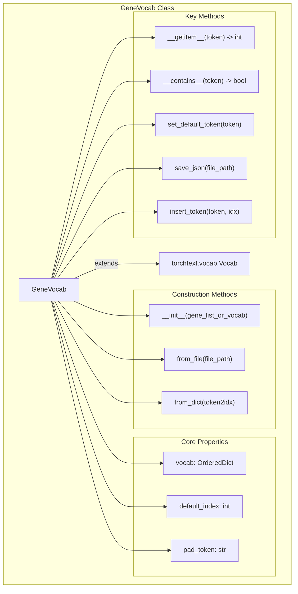
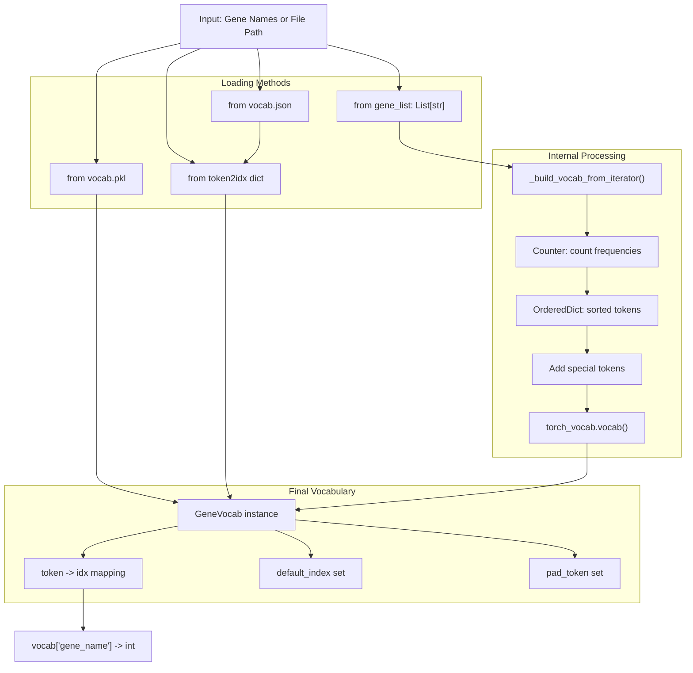
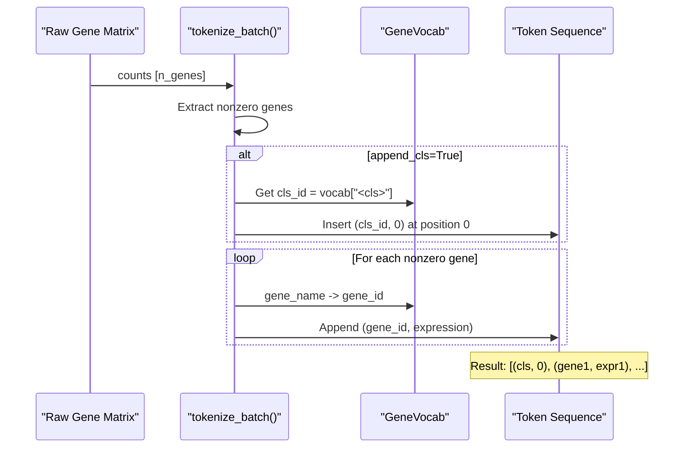
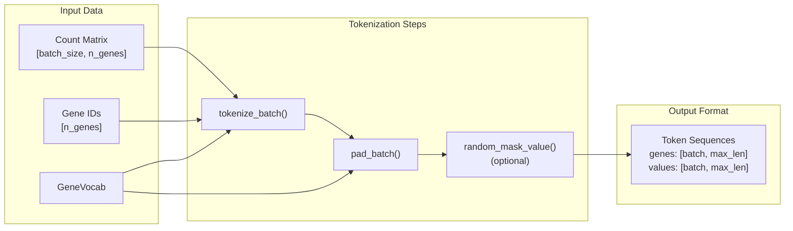
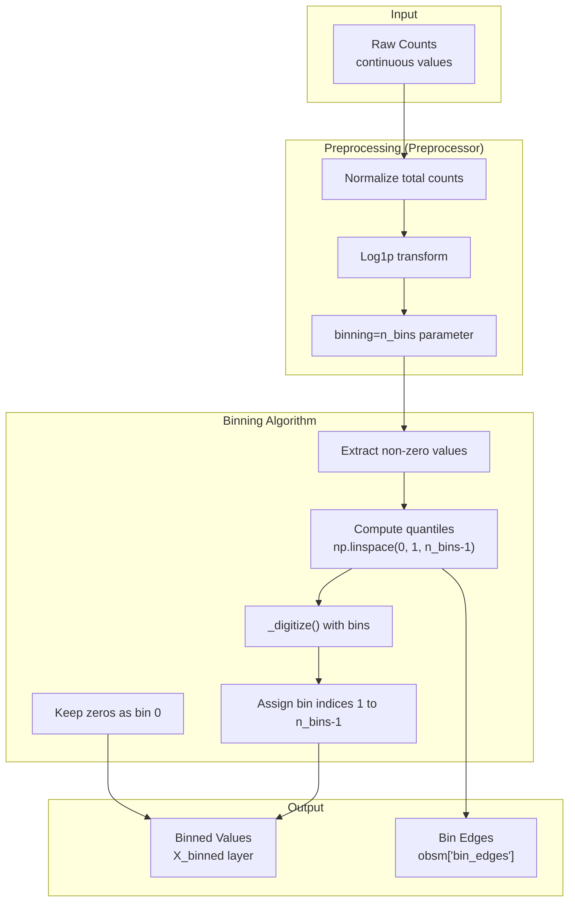
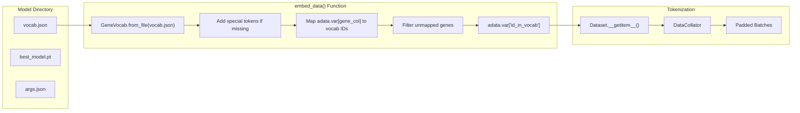

# Tokenization and Vocabulary

<details>
<summary>Relevant source files</summary>

The following files were used as context for generating this wiki page:

- [poetry.lock](poetry.lock)
- [scgpt/preprocess.py](scgpt/preprocess.py)
- [scgpt/tasks/cell_emb.py](scgpt/tasks/cell_emb.py)
- [scgpt/tokenizer/gene_tokenizer.py](scgpt/tokenizer/gene_tokenizer.py)

</details>


## Purpose and Scope

This page documents the tokenization and vocabulary management systems in scGPT. These components handle the conversion of gene expression data into tokenized sequences suitable for transformer model input. For information about data preprocessing before tokenization, see [Data Processing Pipeline](#3.3). For model-level embedding after tokenization, see [Cell Embedding System](#5).

---

## Overview

scGPT's tokenization system converts single-cell gene expression matrices into sequences of gene tokens paired with expression values. The vocabulary maps gene names (symbols or IDs) to integer indices that the transformer can process. Unlike traditional NLP tokenization, scGPT's tokenizer operates on gene-level granularity where each gene is a discrete token.

**Sources:** [scgpt/tokenizer/gene_tokenizer.py:1-474]()

---

## GeneVocab Class

### Class Structure

The `GeneVocab` class extends `torchtext.vocab.Vocab` to provide gene-specific vocabulary management with support for special tokens and default values.



**Sources:** [scgpt/tokenizer/gene_tokenizer.py:20-197]()

### Initialization and Loading

The `GeneVocab` can be created in three ways:

| Method | Input | Use Case |
|--------|-------|----------|
| `__init__` | List of gene names or existing Vocab | Creating new vocabulary from scratch |
| `from_file` | Path to .pkl or .json file | Loading pretrained vocabularies |
| `from_dict` | Dictionary mapping tokens to indices | Converting from external formats |

**Key Parameters:**
- `specials`: List of special tokens (e.g., `["<pad>", "<cls>", "<eoc>"]`)
- `special_first`: Whether to place special tokens at beginning of vocabulary
- `default_token`: Token to return for out-of-vocabulary queries (typically `"<pad>"`)

**Sources:** [scgpt/tokenizer/gene_tokenizer.py:25-109]()

### Vocabulary Construction Flow



**Sources:** [scgpt/tokenizer/gene_tokenizer.py:66-155]()

---

## Special Tokens

scGPT uses three primary special tokens for sequence structuring:

| Token | Purpose | Position | Model Configs Key |
|-------|---------|----------|------------------|
| `<pad>` | Padding sequences to uniform length | Throughout sequence | `pad_token` |
| `<cls>` | Classification/cell representation | Beginning of sequence | Used in `append_cls` |
| `<eoc>` | End of cell marker | End of sequence | Listed in specials |

### Special Token Usage Pattern



The `<cls>` token's embedding at position 0 is extracted as the cell-level representation during inference, similar to BERT's approach.

**Sources:** [scgpt/tasks/cell_emb.py:78-90](), [scgpt/tasks/cell_emb.py:136-137](), [scgpt/tokenizer/gene_tokenizer.py:205-211]()

---

## Tokenization Process

### Core Tokenization Functions

The tokenization pipeline transforms dense count matrices into sparse token sequences:



**Sources:** [scgpt/tokenizer/gene_tokenizer.py:249-474]()

### tokenize_batch Function

Converts raw expression data to token pairs `(gene_id, expression_value)`:

**Function Signature:**
```python
tokenize_batch(
    data: np.ndarray,              # [batch_size, n_genes]
    gene_ids: np.ndarray,          # [n_genes]
    return_pt: bool = True,
    append_cls: bool = True,
    include_zero_gene: bool = False,
    cls_id: int = "<cls>",
    mod_type: np.ndarray = None,   # For multi-omics
) -> List[Tuple[torch.Tensor, torch.Tensor, torch.Tensor]]
```

**Algorithm:**
1. For each cell (row) in the batch:
   - Extract non-zero gene indices (unless `include_zero_gene=True`)
   - Retrieve corresponding gene IDs and expression values
   - If `append_cls=True`: Insert `(cls_id, 0)` at position 0
   - Convert to PyTorch tensors if `return_pt=True`

**Output:** List of tuples `(genes, values, mod_types)` per cell

**Sources:** [scgpt/tokenizer/gene_tokenizer.py:249-309]()

### pad_batch Function

Ensures uniform sequence length across batch via padding or sampling:

**Function Signature:**
```python
pad_batch(
    batch: List[Tuple],
    max_len: int,
    vocab: Vocab,
    pad_token: str = "<pad>",
    pad_value: int = 0,
    cls_appended: bool = True,
    vocab_mod: Vocab = None,
) -> Dict[str, torch.Tensor]
```

**Padding Strategy:**

| Scenario | Action |
|----------|--------|
| `len(genes) > max_len` | Random sample `max_len` genes (preserving `<cls>` if present) |
| `len(genes) < max_len` | Append `pad_token` IDs and `pad_value` expressions |
| `len(genes) == max_len` | No modification |

**Output:**
```python
{
    "genes": torch.Tensor,      # [batch_size, max_len]
    "values": torch.Tensor,     # [batch_size, max_len]
    "mod_types": torch.Tensor,  # [batch_size, max_len] (optional)
}
```

**Sources:** [scgpt/tokenizer/gene_tokenizer.py:312-396]()

### Combined Pipeline Function

The `tokenize_and_pad_batch()` function provides a single-call interface:

```python
tokenize_and_pad_batch(
    data: np.ndarray,
    gene_ids: np.ndarray,
    max_len: int,
    vocab: Vocab,
    pad_token: str,
    pad_value: int,
    append_cls: bool = True,
    include_zero_gene: bool = False,
    cls_token: str = "<cls>",
) -> Dict[str, torch.Tensor]
```

This is the standard entry point used by the DataCollator for batch preparation.

**Sources:** [scgpt/tokenizer/gene_tokenizer.py:399-439]()

---

## Expression Value Binning

While tokenization handles gene identity, expression values can be discretized into bins before being fed to the model. This binning occurs in the preprocessing stage.

### Binning Process



**Key Implementation Details:**

- **Bin 0 reserved for zeros:** Ensures zero values are explicitly represented
- **Per-cell quantiles:** Each cell's non-zero values determine bin boundaries independently
- **Uniform distribution:** `np.quantile()` with `np.linspace(0, 1, n_bins-1)` creates equal-probability bins
- **Randomized assignment:** `_digitize()` with `side="both"` spreads values uniformly when bin edges overlap

**Configuration:** Default `n_bins=51` in most tutorials (50 expression bins + 1 zero bin)

**Sources:** [scgpt/preprocess.py:172-211](), [scgpt/preprocess.py:239-271](), [scgpt/preprocess.py:274-303]()

---

## Integration with Data Pipeline

### Vocabulary in embed_data Workflow

The following diagram shows how `GeneVocab` integrates with the inference pipeline:



**Matching Process:**
1. Load vocabulary from model directory
2. For each gene in `adata.var[gene_col]`:
   - Check if `gene in vocab`
   - Assign `vocab[gene]` to `adata.var["id_in_vocab"]`
   - Assign `-1` if gene not in vocabulary
3. Filter to genes with `id_in_vocab >= 0`
4. Log matching statistics

**Sources:** [scgpt/tasks/cell_emb.py:207-220]()

### DataCollator Usage

The `DataCollator` class (documented in [Data Processing Pipeline](#3.3)) calls tokenization functions to prepare batches:

```python
# Inside DataCollator.__call__()
batch = tokenize_and_pad_batch(
    data=data,
    gene_ids=gene_ids,
    max_len=self.max_length,
    vocab=self.vocab,
    pad_token=self.pad_token_id,
    pad_value=self.pad_value,
)
```

The collator also handles:
- Masked language modeling (MLM) token masking
- Binning of expression values
- Sampling sequences that exceed `max_length`

**Sources:** [scgpt/tasks/cell_emb.py:96-114]()

---

## Masking for Training

### random_mask_value Function

During training, a subset of expression values can be masked to train masked language models:

```python
random_mask_value(
    values: torch.Tensor,
    mask_ratio: float = 0.15,
    mask_value: int = -1,
    pad_value: int = 0,
) -> torch.Tensor
```

**Masking Strategy:**
1. Identify non-padding positions (`value != pad_value`)
2. Randomly select `mask_ratio` × `n_non_padding` positions
3. Replace selected values with `mask_value` (typically `-1`)
4. Keep gene IDs unchanged (only mask expression values)

This differs from BERT-style masking where the token IDs themselves are masked. In scGPT, gene identities remain visible while their expression levels are hidden.

**Sources:** [scgpt/tokenizer/gene_tokenizer.py:442-473]()

---

## Practical Usage Examples

### Creating a Vocabulary from Gene List

```python
from scgpt.tokenizer import GeneVocab

# Define gene list and special tokens
gene_names = ["CD3D", "CD4", "CD8A", "CD19", "MS4A1"]
specials = ["<pad>", "<cls>", "<eoc>"]

# Create vocabulary
vocab = GeneVocab(
    gene_list_or_vocab=gene_names,
    specials=specials,
    special_first=True,
    default_token="<pad>",
)

# Token lookup
gene_id = vocab["CD3D"]  # Returns: 3 (after 3 special tokens)
vocab.set_default_index(vocab["<pad>"])  # Out-of-vocab queries return pad_id
```

### Loading Pretrained Vocabulary

```python
from pathlib import Path
from scgpt.tokenizer import GeneVocab

model_dir = Path("/path/to/model")
vocab = GeneVocab.from_file(model_dir / "vocab.json")

# Check vocabulary size
print(f"Vocabulary size: {len(vocab)}")

# Verify special tokens
assert "<pad>" in vocab
assert "<cls>" in vocab
```

### Tokenizing a Single Cell

```python
import numpy as np
import torch
from scgpt.tokenizer import tokenize_batch

# Raw data
counts = np.array([[0, 5.2, 0, 3.1, 0, 8.7]])  # 1 cell, 6 genes
gene_ids = np.array([0, 1, 2, 3, 4, 5])  # vocab indices
cls_id = vocab["<cls>"]

# Tokenize
tokenized = tokenize_batch(
    data=counts,
    gene_ids=gene_ids,
    append_cls=True,
    cls_id=cls_id,
    include_zero_gene=False,  # Only keep expressed genes
)

# Result: [(genes, values, None)]
genes, values, _ = tokenized[0]
# genes:  tensor([cls_id, 1, 3, 5])
# values: tensor([0., 5.2, 3.1, 8.7])
```

### End-to-End Batch Preparation

```python
from scgpt.tokenizer import tokenize_and_pad_batch

# Prepare batch
batch_dict = tokenize_and_pad_batch(
    data=counts,
    gene_ids=gene_ids,
    max_len=1200,
    vocab=vocab,
    pad_token="<pad>",
    pad_value=0,
    append_cls=True,
    cls_token="<cls>",
)

# Output structure
# batch_dict["genes"]:  [batch_size, max_len]  (gene token IDs)
# batch_dict["values"]: [batch_size, max_len]  (expression values)
```

**Sources:** [scgpt/tokenizer/gene_tokenizer.py:20-474]()

---

## Summary Table

| Component | Location | Purpose |
|-----------|----------|---------|
| `GeneVocab` | [scgpt/tokenizer/gene_tokenizer.py:20-197]() | Core vocabulary class, maps gene names to indices |
| `tokenize_batch` | [scgpt/tokenizer/gene_tokenizer.py:249-309]() | Converts count matrices to token sequences |
| `pad_batch` | [scgpt/tokenizer/gene_tokenizer.py:312-396]() | Pads/samples sequences to uniform length |
| `tokenize_and_pad_batch` | [scgpt/tokenizer/gene_tokenizer.py:399-439]() | Combined tokenization and padding |
| `random_mask_value` | [scgpt/tokenizer/gene_tokenizer.py:442-473]() | Masks expression values for MLM training |
| `_digitize` | [scgpt/preprocess.py:239-271]() | Converts continuous values to discrete bins |
| Binning logic | [scgpt/preprocess.py:172-211]() | Per-cell quantile-based value discretization |

The tokenization system provides the critical bridge between raw single-cell count matrices and the transformer model's input requirements, handling gene vocabulary management, sequence formatting, and expression value discretization.

---