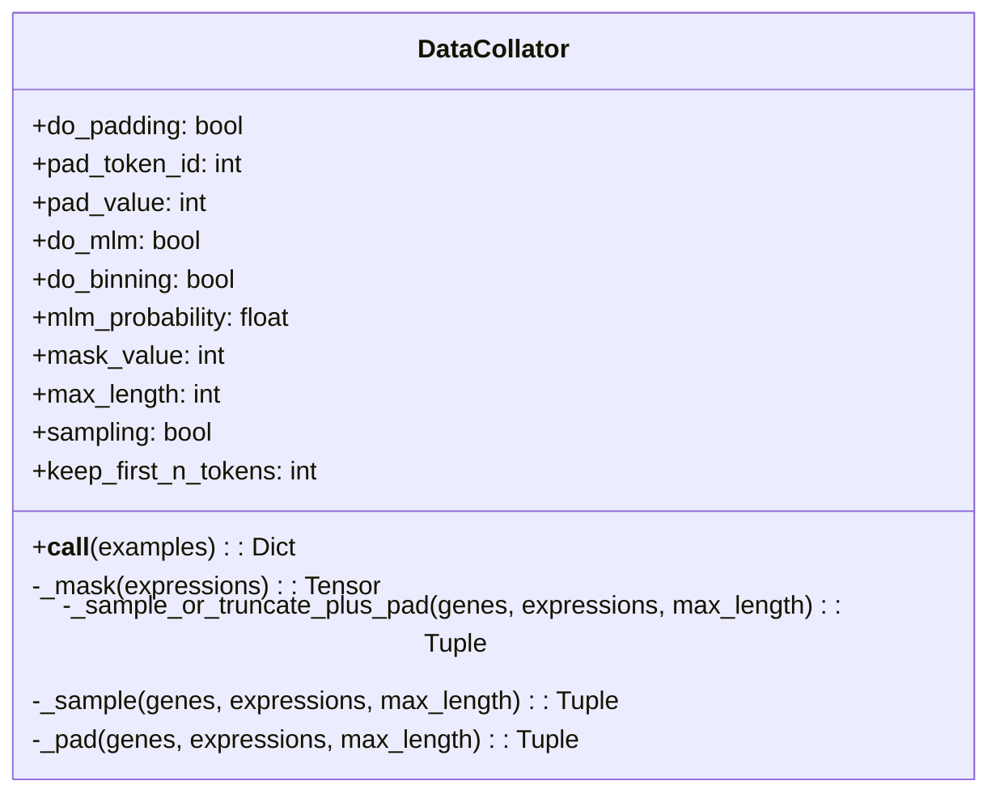
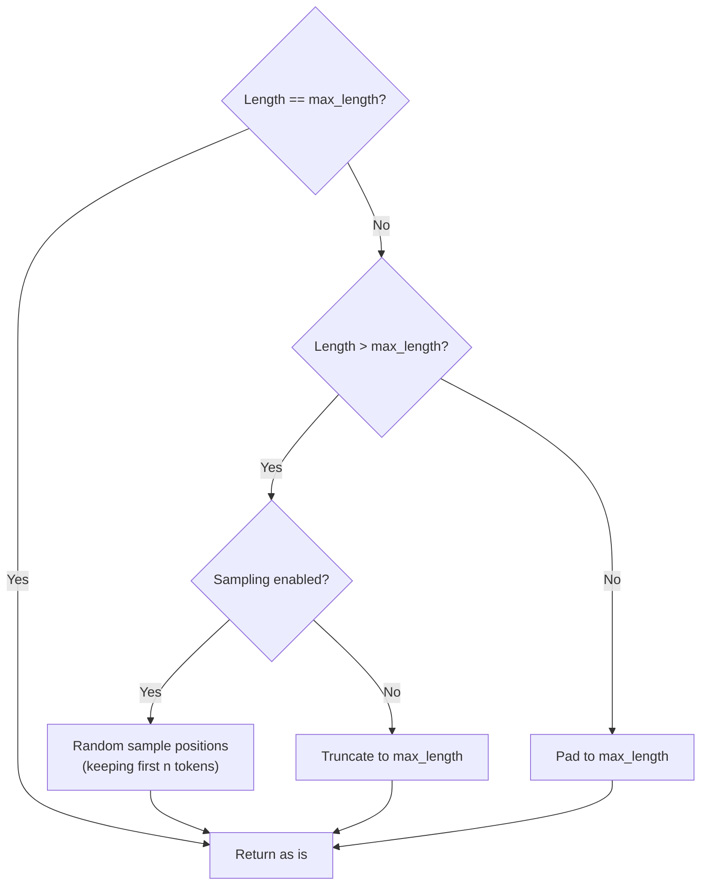
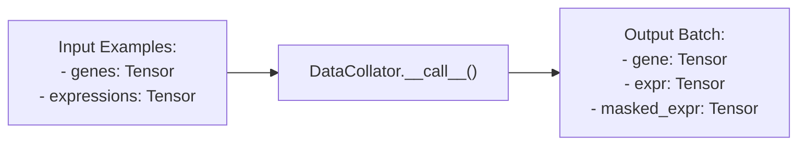
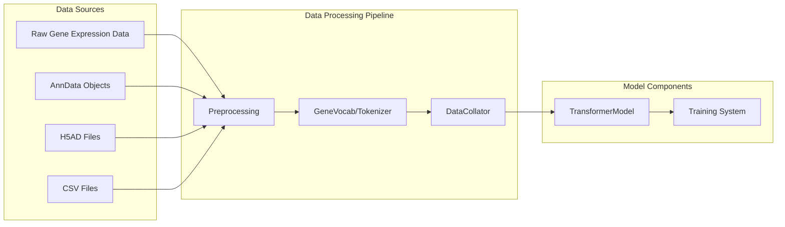

# Data Processing

<details>
<summary>Relevant source files</summary>

The following files were used as context for generating this wiki page:

- [README.md](README.md)
- [poetry.lock](poetry.lock)
- [scgpt/data_collator.py](scgpt/data_collator.py)
- [scgpt/preprocess.py](scgpt/preprocess.py)
- [scgpt/tasks/cell_emb.py](scgpt/tasks/cell_emb.py)
- [scgpt/tokenizer/gene_tokenizer.py](scgpt/tokenizer/gene_tokenizer.py)

</details>


This document explains the data processing pipeline in scGPT, covering how single-cell RNA-seq data is preprocessed, tokenized, and collated before being fed to the model. For information about the model architecture itself, see [Model Architecture](#2.1), and for details on the training process, see [Training System](#2.3).

## Overview

Data processing in scGPT transforms raw gene expression matrices into a format suitable for transformer-based model training. The pipeline consists of several key steps that prepare single-cell data for the model.

```mermaid
flowchart LR
    Raw["Raw Gene Expression Data"] --> Preprocessing["Preprocessing Steps"]
    Preprocessing --> Tokenization["Gene Tokenization"]
    Tokenization --> Collation["Data Collation"]
    Collation --> ModelInput["Model-Ready Data"]
    
    subgraph "Preprocessing Pipeline"
        P1["Filter Genes"]
        P2["Normalize Counts"]
        P3["Log Transform"]
        P4["Select HVGs"]
        P5["Bin Expression Values"]
        
        P1 --> P2 --> P3 --> P4 --> P5
    end
    
    Preprocessing -.-> "Preprocessing Pipeline"
```

**Data Processing Pipeline Overview**

Sources: [scgpt/data_collator.py]()

## Preprocessing Steps

Before feeding data into the scGPT model, several preprocessing steps are applied to the raw gene expression data:

1. **Filtering**: Removing low-quality cells and genes with low expression
2. **Normalization**: Scaling gene counts to account for sequencing depth differences
3. **Log Transformation**: Applying log(1+x) transformation to compress the dynamic range
4. **HVG Selection**: Selecting highly variable genes to focus on the most informative features
5. **Binning**: Discretizing continuous expression values into bins

The binning step is particularly important as it transforms continuous expression values into a discrete set of "tokens" that can be processed by the transformer model.

```mermaid
flowchart TD
    ExprValues["Continuous Expression Values"] --> Binning["Binning Function"]
    Binning --> DiscValues["Discretized Values (0-50)"]
    
    subgraph "Expression Value Binning"
        BinFunc["binning(row, n_bins=51)"]
    end
    
    Binning -.-> "Expression Value Binning"
```

**Expression Value Binning Process**

Sources: [scgpt/data_collator.py:87-91]()

## Data Collation with DataCollator

The `DataCollator` class is responsible for preparing batches of data for model training. It handles tokenization, padding, and masking operations.



**DataCollator Class Structure**

Sources: [scgpt/data_collator.py:10-202]()

### Key Features of DataCollator

1. **Padding**: Ensures all sequences in a batch have the same length by padding shorter sequences
2. **Masking**: Implements Masked Language Modeling (MLM) strategy by randomly masking expression values
3. **Sampling/Truncation**: Handles sequences longer than the maximum length by either sampling or truncation
4. **Binning**: Converts continuous expression values to discrete bins

```mermaid
flowchart TD
    Input["Input Batch"] --> MaxLength["Determine Max Length"]
    MaxLength --> Binning["Apply Binning (Optional)"]
    Binning --> SampleTruncPad["Sample/Truncate and Pad"]
    SampleTruncPad --> Stack["Stack Tensors"]
    Stack --> Masking["Apply Masking (Optional)"]
    Masking --> Output["Output Batch Dictionary"]
    
    subgraph "DataCollator.__call__ Flow"
        Process["Process each example:\n- Bin expressions\n- Sample/truncate if too long\n- Pad if too short"]
    end
    
    Binning -.-> "DataCollator.__call__ Flow"
```

**DataCollator Processing Flow**

Sources: [scgpt/data_collator.py:64-113]()

## Masking for Masked Value Learning

The masking process is a critical part of scGPT's training strategy, enabling the model to learn from partially obscured data:

1. A probability matrix determines which positions to mask
2. Padding positions and special token positions (first n tokens) are excluded from masking
3. Random positions are masked according to the specified probability
4. Masked positions are filled with a special mask value (-1 by default)

```mermaid
flowchart LR
    Expr["Expression Values"] --> ProbMatrix["Create Probability Matrix"]
    ProbMatrix --> Exclude["Exclude Padding & Special Tokens"]
    Exclude --> SampleMask["Sample Mask Positions"]
    SampleMask --> Replace["Replace with Mask Value"]
    Replace --> MaskedExpr["Masked Expressions"]
    
    subgraph "Masking Process"
        M1["probability_matrix = full(shape, mlm_probability)"]
        M2["Set 0 probability for pad positions"]
        M3["Set 0 probability for first n tokens"]
        M4["mask = bernoulli(probability_matrix)"]
        M5["masked_expressions = expressions.masked_fill(mask, mask_value)"]
        
        M1 --> M2 --> M3 --> M4 --> M5
    end
    
    SampleMask -.-> "Masking Process"
```

**Expression Masking Process**

Sources: [scgpt/data_collator.py:115-132]()

## Handling Variable-Length Sequences

The `DataCollator` handles sequences of variable length through three main strategies:

1. **Padding**: For sequences shorter than the maximum length
2. **Truncation**: Simply cutting off sequences that are too long
3. **Sampling**: Randomly selecting a subset of positions from sequences that are too long (default behavior)

When sampling, the first `keep_first_n_tokens` positions are preserved, which is useful for keeping special tokens like CLS or batch labels.



**Sequence Length Handling Logic**

Sources: [scgpt/data_collator.py:134-202]()

## Input and Output Data Format

The `DataCollator` expects input examples in a specific format and produces a standardized output format for the model:

### Input Format
Each example is a dictionary containing:
- `genes`: A tensor of gene IDs
- `expressions`: A tensor of expression values

### Output Format
The collated batch is a dictionary containing:
- `gene`: Padded gene ID tensors
- `expr`: Padded expression value tensors
- `masked_expr`: Expression values with some positions masked



**Data Format Transformation**

Sources: [scgpt/data_collator.py:64-113]()

## Integration with the Overall System

The data processing pipeline is a crucial bridge between raw single-cell data and the scGPT transformer model. It prepares data in a format that allows the model to learn meaningful representations of gene expression patterns.



**Data Processing in System Context**

Sources: [README.md:12-70](), [scgpt/data_collator.py:10-202]()

## Summary

The data processing pipeline in scGPT transforms raw gene expression data into a format suitable for transformer-based modeling through:

1. Preprocessing of gene expression data (filtering, normalization, log transformation, HVG selection)
2. Binning of continuous expression values
3. Tokenization of genes
4. Collation of data with padding, masking, and length standardization

This pipeline enables scGPT to effectively learn from single-cell RNA-seq data and perform various downstream tasks such as cell type annotation, dataset integration, perturbation prediction, and reference mapping.

---