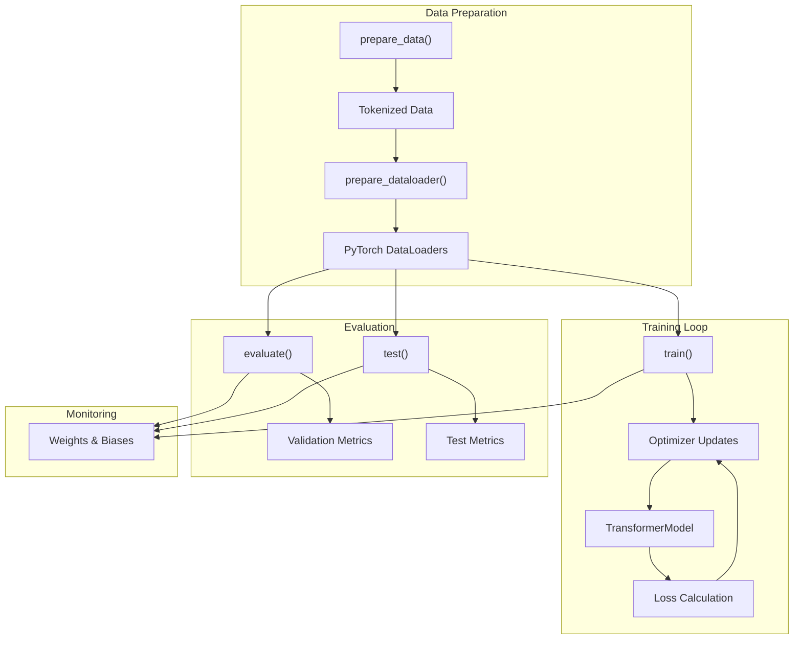
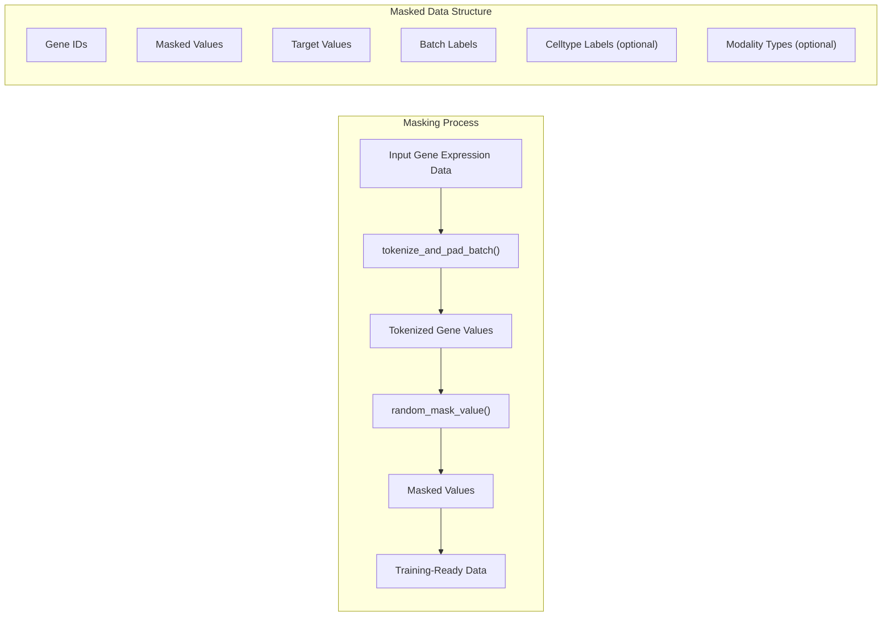
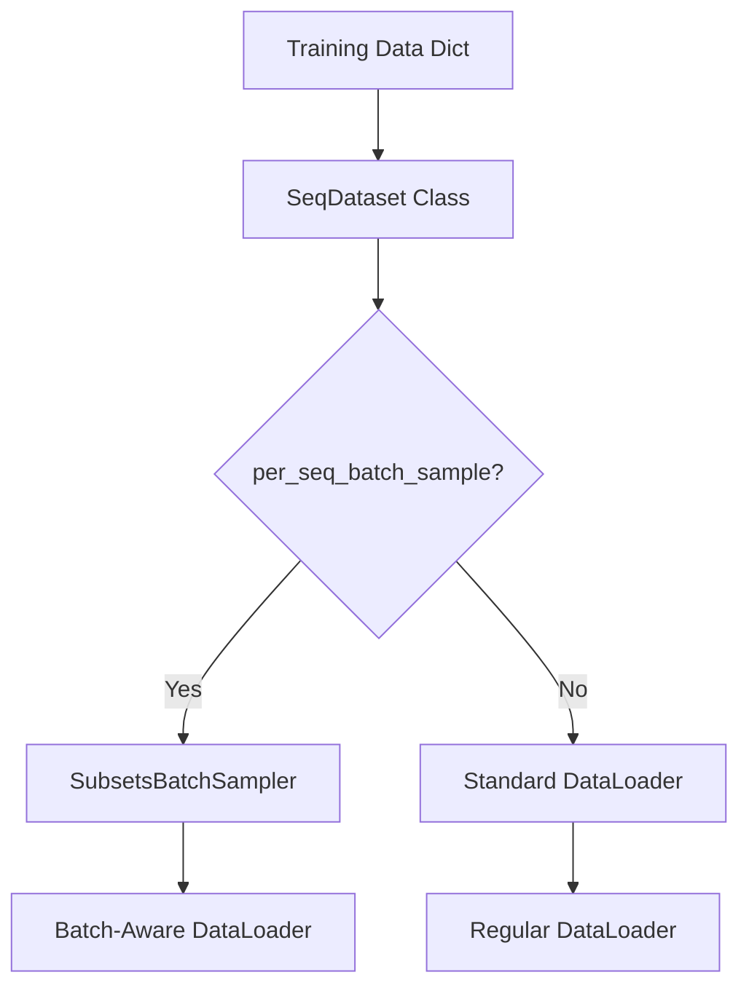
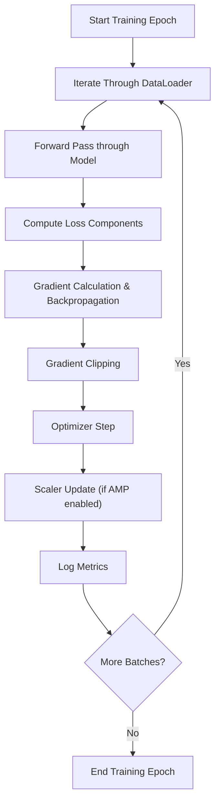
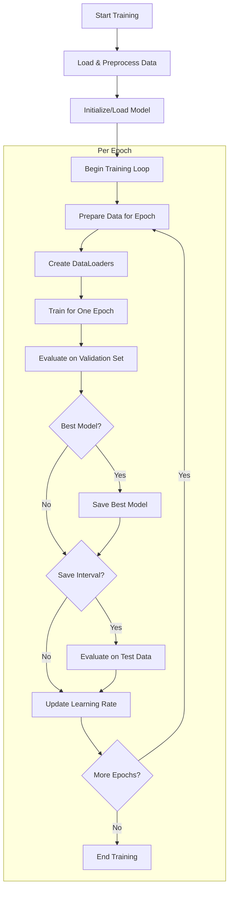
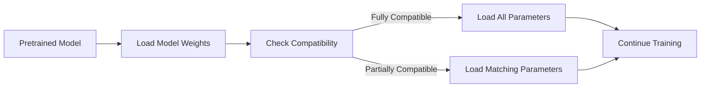

# Training System

<details>
<summary>Relevant source files</summary>

The following files were used as context for generating this wiki page:

- [scgpt/trainer.py](scgpt/trainer.py)

</details>


This document provides a technical overview of the training infrastructure in scGPT, explaining the core components responsible for training, evaluation, and testing workflows. For information about model architecture, see [Model Architecture](#2.1), and for data processing before training, see [Data Processing](#2.2).

## Overview

The scGPT training system consists of several core components designed to facilitate model training across different tasks including cell type annotation, dataset integration, perturbation prediction, and multi-omics analysis. The system handles the entire workflow from data preparation through training loops, evaluation, and performance reporting.



Sources: [scgpt/trainer.py:1-686]()

## Data Preparation for Training

Before training, data must be prepared with proper tokenization, masking, and batching. This preparation flow is crucial for the model to effectively learn from the data.

### Masked Value Preparation

A key part of scGPT's training approach is random masking of gene expression values, which allows the model to learn to predict these values:



Sources: [scgpt/trainer.py:24-115]()

### Data Loaders

The `prepare_dataloader` function creates PyTorch DataLoaders with support for batch-aware sampling, which is important for tasks involving multiple batches or domains:



Sources: [scgpt/trainer.py:118-170]()

## Training Process

The training process orchestrates the model training cycle, including forward passes, loss calculation, gradient computation and optimization steps.

### Training Loop

The `train` function in [scgpt/trainer.py:173-371]() handles the training loop for a single epoch:



Sources: [scgpt/trainer.py:173-371]()

### Loss Components

The training system supports multiple loss components depending on the configured training objectives:

| Loss Component | Description | Configuration Flag |
|----------------|-------------|-------------------|
| GEP (Gene Expression Prediction) | MSE loss for masked gene values prediction | `config.GEP` |
| GEPC/MVC (Masked Value Prediction) | Secondary prediction task for cell embedding | `config.GEPC` |
| CLS (Classification) | Cell type classification loss | `config.CLS` |
| ECS (Elastic Cell Similarity) | Cell similarity constraint | `config.ESC` |
| DAB/DAR (Domain Adversarial) | Batch/domain adversarial loss | `config.DAR` |
| Zero-log probability | Bernoulli loss for explicit zero modeling | `config.explicit_zero_prob` |

Sources: [scgpt/trainer.py:235-289](), [examples/finetune_integration.py:466-497]()

### Optimization and Scaling

The training system uses:
- Adam optimizer with configurable learning rate
- Learning rate scheduling
- Gradient clipping for stability
- Automatic Mixed Precision (AMP) for faster training with lower memory usage

Sources: [scgpt/trainer.py:295-309](), [examples/finetune_integration.py:431-435]()

## Evaluation and Testing

The evaluation system provides mechanisms to assess model performance on validation and test data.

### Validation Process

The `evaluate` function computes validation metrics without updating model parameters:


Sources: [scgpt/trainer.py:379-461]()

### Test Process and Metrics

For final evaluation on test data, the system provides:

1. The `test` function for classification tasks, calculating:
   - Accuracy, Precision, Recall
   - Macro and Micro F1 scores

2. The `eval_testdata` function for integration tasks, calculating:
   - scIB metrics for batch integration quality
   - UMAP visualizations of embeddings

Sources: [scgpt/trainer.py:507-686]()

## Configuration and Training Tasks

The scGPT training system is highly configurable to support different training tasks:

| Task | Description | Configuration |
|------|-------------|--------------|
| Annotation | Cell type annotation/classification | `config.task = "annotation"` |
| Integration | Dataset integration across batches | `config.task = "integration"` |
| Perturbation | Cellular perturbation prediction | `config.task = "perturb"` |
| Multi-omics | Integration of multiple omics data types | `config.task = "multiomic"` |

Each task utilizes different combinations of the loss functions and training objectives.

Sources: [scgpt/trainer.py:35](), [examples/finetune_integration.py:49-73]()

## Training Workflow

The complete training workflow combines these components into a coordinated process:



Sources: [examples/finetune_integration.py:708-780]()

## Fine-tuning Existing Models

The system supports fine-tuning pretrained models for specific tasks:



Sources: [examples/finetune_integration.py:406-422]()

## Monitoring and Visualization

The training system integrates with Weights & Biases (wandb) for experiment tracking:

1. Defining metrics for tracking:
   ```python
   wandb.define_metric("valid/loss", summary="min", step_metric="epoch")
   wandb.define_metric("test/avg_bio", summary="max")
   ```

2. Logging training metrics per batch:
   ```python
   wandb.log(metrics_to_log)  # Log loss components
   ```

3. Visualization outputs:
   - UMAP plots for batch effect assessment
   - UMAP plots for cell type visualization
   - Training and validation curves

Sources: [scgpt/trainer.py:372-378](), [examples/finetune_integration.py:550-556](), [examples/finetune_integration.py:767-778]()

## Usage Example

A typical training workflow follows these steps:

1. Configure training settings (batch size, learning rate, etc.)
2. Prepare and tokenize data
3. Initialize the model or load a pretrained model
4. Create optimizer and scheduler
5. Run the training loop for specified epochs
6. Evaluate and save the best performing model
7. Generate and visualize results

For a complete example, see the `finetune_integration.py` script in the examples directory.

Sources: [examples/finetune_integration.py:1-797]()

---