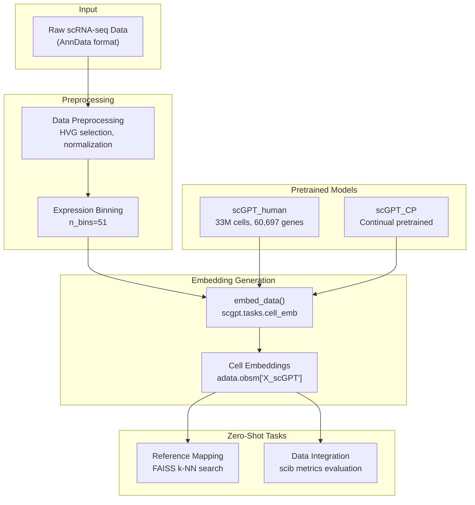
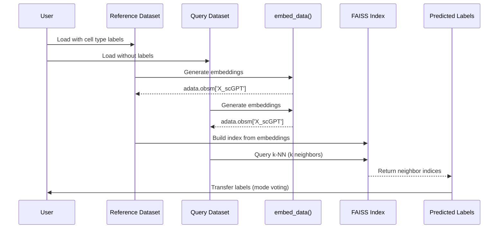
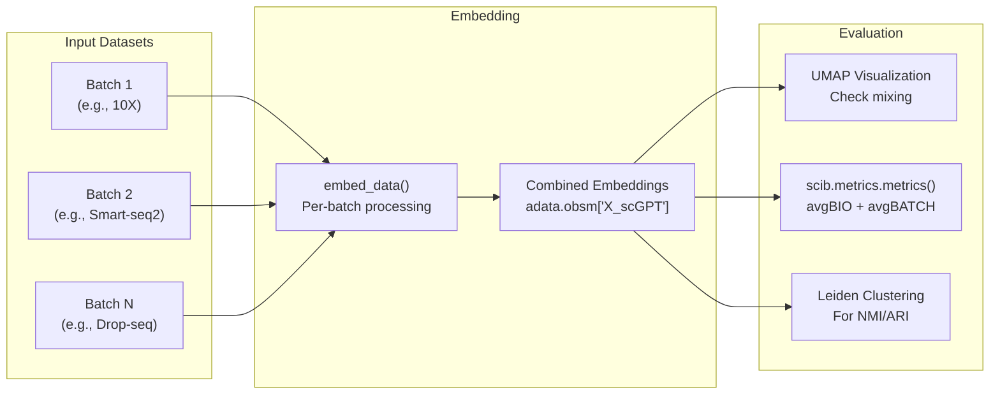
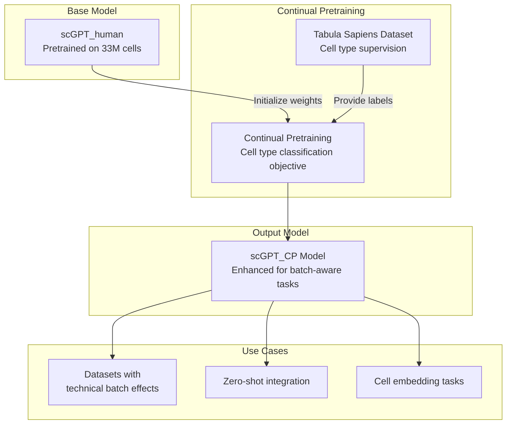
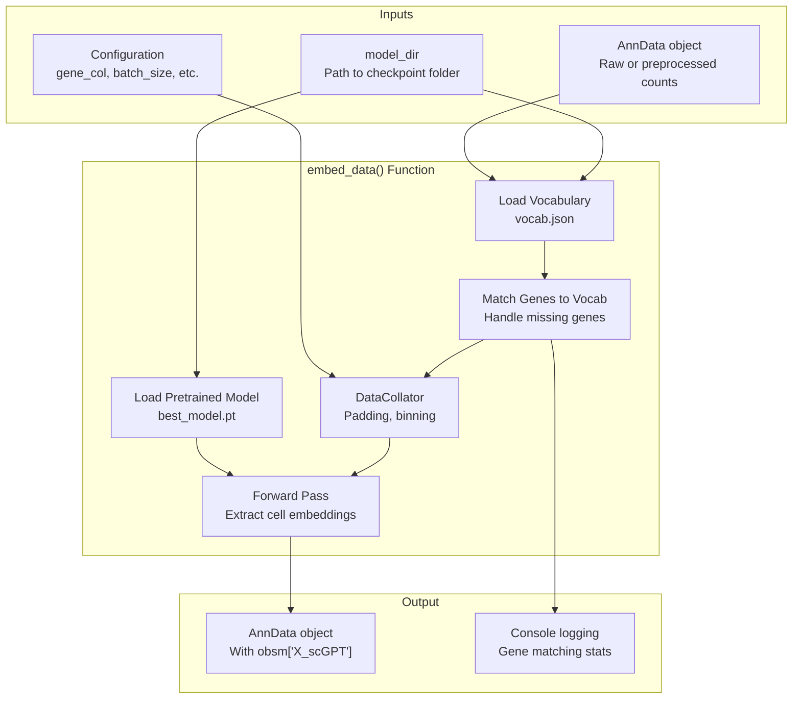
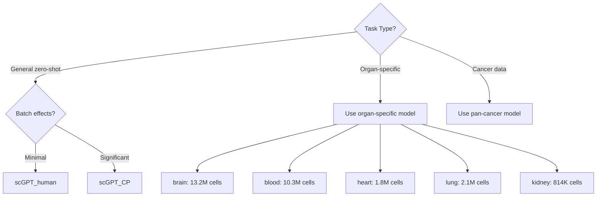
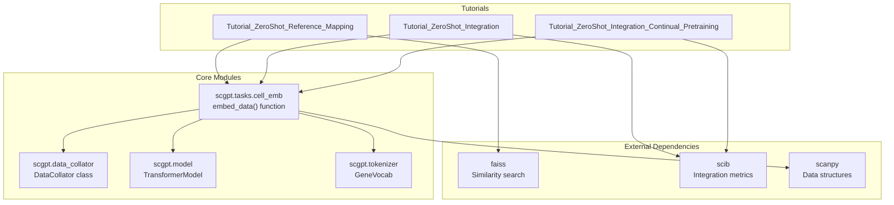

# Zero-Shot Applications

<details>
<summary>Relevant source files</summary>

The following files were used as context for generating this wiki page:

- [README.md](README.md)
- [scgpt/data_collator.py](scgpt/data_collator.py)
- [tutorials/zero-shot/Tutorial_ZeroShot_Integration.ipynb](tutorials/zero-shot/Tutorial_ZeroShot_Integration.ipynb)
- [tutorials/zero-shot/Tutorial_ZeroShot_Integration_Continual_Pretraining.ipynb](tutorials/zero-shot/Tutorial_ZeroShot_Integration_Continual_Pretraining.ipynb)
- [tutorials/zero-shot/Tutorial_ZeroShot_Reference_Mapping.ipynb](tutorials/zero-shot/Tutorial_ZeroShot_Reference_Mapping.ipynb)

</details>


## Purpose and Scope

This page documents scGPT's zero-shot inference capabilities, which enable direct application of pretrained models to new single-cell RNA-seq datasets without any fine-tuning. Zero-shot applications represent scGPT's highest-impact feature cluster (importance: 34.40) and are designed for rapid deployment on novel datasets.

The two primary zero-shot tasks are:
- **Reference Mapping**: Transferring cell type annotations from reference to query datasets
- **Data Integration**: Batch correction and harmonization across multiple datasets

For information about fine-tuning scGPT for specific downstream tasks, see [Fine-tuning Applications](#6).

**Sources**: [README.md:16-20](), [High-Level Architecture Diagrams]()

## Overview

Zero-shot applications leverage scGPT's learned representations to perform downstream tasks without additional training. The core principle is that pretrained models encode biologically meaningful cell embeddings that can be directly used for similarity-based analysis, integration, and annotation transfer.



**Diagram**: Zero-Shot Application Workflow

The workflow consists of three stages:
1. **Data Preparation**: Preprocessing raw counts, selecting highly variable genes (HVGs), and binning expression values
2. **Embedding Generation**: Forward pass through pretrained model to extract cell-level representations
3. **Task Execution**: Using embeddings for similarity search (reference mapping) or batch correction (integration)

**Sources**: [tutorials/zero-shot/Tutorial_ZeroShot_Reference_Mapping.ipynb:23-36](), [tutorials/zero-shot/Tutorial_ZeroShot_Integration.ipynb:28-32]()

## Reference Mapping

Reference mapping transfers cell type annotations from a labeled reference dataset to an unlabeled query dataset by computing similarity in the embedding space. This enables rapid cell type identification without training a classifier.

### Workflow



**Diagram**: Reference Mapping Sequence

### Implementation Details

The reference mapping process involves:

1. **Embedding Generation**: Both reference and query datasets are processed through `embed_data()` to generate cell embeddings
2. **FAISS Indexing**: The reference embeddings are indexed using FAISS for efficient similarity search
3. **k-NN Search**: Query embeddings are compared against the index to find the k nearest reference cells
4. **Label Transfer**: Cell type labels are transferred using majority voting among the k neighbors

**Key Parameters**:
- `k`: Number of nearest neighbors (typically 5-15)
- `batch_size`: Embedding batch size (default: 64)
- `gene_col`: Column name for gene identifiers in AnnData.var

**Performance**: With FAISS GPU acceleration, similarity search takes <1 second for 10,000 query cells against 33+ million reference cells with <1GB memory footprint.

**Sources**: [tutorials/zero-shot/Tutorial_ZeroShot_Reference_Mapping.ipynb:14-34](), [README.md:20]()

### Example Usage

The typical reference mapping workflow (from tutorial):

```python
# Load datasets
ref_adata = sc.read_h5ad('reference.h5ad')  # Has cell type labels
query_adata = sc.read_h5ad('query.h5ad')   # Missing labels

# Generate embeddings
ref_embed = scg.tasks.embed_data(
    ref_adata,
    model_dir,
    gene_col="gene_name",
    batch_size=64
)

query_embed = scg.tasks.embed_data(
    query_adata,
    model_dir,
    gene_col="gene_name",
    batch_size=64
)

# Build FAISS index and search
# (FAISS operations shown in tutorial)
```

The embeddings are stored in `adata.obsm['X_scGPT']` and can be used with any similarity search library.

**Sources**: [tutorials/zero-shot/Tutorial_ZeroShot_Reference_Mapping.ipynb:191-233]()

## Data Integration

Data integration uses scGPT embeddings to harmonize multiple batches or datasets by removing technical variation while preserving biological signal. The embeddings naturally account for batch effects learned during pretraining.

### Evaluation Metrics

Integration quality is assessed using the scib (single-cell integration benchmarking) framework, which computes:

- **avgBIO**: Average of biological conservation metrics
  - NMI (Normalized Mutual Information) cluster/label
  - ARI (Adjusted Rand Index) cluster/label  
  - ASW (Average Silhouette Width) label
  
- **avgBATCH**: Average of batch mixing metrics
  - Graph connectivity
  - ASW label/batch



**Diagram**: Data Integration Evaluation Pipeline

### Implementation

The integration workflow:

1. **Preprocessing**: Each batch is preprocessed independently with HVG selection
2. **Embedding**: `embed_data()` generates embeddings preserving batch identities in metadata
3. **Concatenation**: Batch embeddings are combined into single AnnData object
4. **Evaluation**: scib metrics computed on combined embeddings

**Key Configuration**:
- `batch_key`: AnnData.obs column identifying batches
- `cell_type_key`: AnnData.obs column with cell type labels (for avgBIO)
- `embed_key`: Key in AnnData.obsm for embeddings (default: "X_scGPT")

**Sources**: [tutorials/zero-shot/Tutorial_ZeroShot_Integration.ipynb:141-189](), [tutorials/zero-shot/Tutorial_ZeroShot_Integration.ipynb:323-351]()

### Evaluation Function

The scib evaluation function from the tutorials:

```python
def scib_eval(adata, batch_key, cell_type_key, embed_key):
    results = scib.metrics.metrics(
        adata,
        adata_int=adata,
        batch_key=batch_key,
        label_key=cell_type_key,
        embed=embed_key,
        isolated_labels_asw_=False,
        silhouette_=True,
        hvg_score_=False,
        graph_conn_=True,
        pcr_=True,
        nmi_=True,
        ari_=True,
        # ... other metrics
    )
    
    result_dict["avg_bio"] = np.mean([
        result_dict["NMI_cluster/label"],
        result_dict["ARI_cluster/label"],
        result_dict["ASW_label"],
    ])
    
    result_dict["avg_batch"] = np.mean([
        result_dict["graph_conn"],
        result_dict["ASW_label/batch"],
    ])
    
    return result_dict
```

Higher avgBIO indicates better biological signal preservation, while higher avgBATCH indicates better batch mixing.

**Sources**: [tutorials/zero-shot/Tutorial_ZeroShot_Integration.ipynb:141-189]()

## Continual Pre-training Model (scGPT_CP)

The `scGPT_CP` model is a specialized variant designed for improved zero-shot performance on datasets with observable batch effects. It builds upon the whole-human pretrained model with additional supervised training.

### Architecture and Training



**Diagram**: scGPT_CP Model Development

### Key Differences

| Aspect | scGPT_human | scGPT_CP |
|--------|-------------|----------|
| **Training objective** | Masked gene prediction only | Masked prediction + cell type classification |
| **Supervision** | Self-supervised only | Self-supervised + supervised |
| **Training data** | 33M normal human cells | scGPT_human + Tabula Sapiens |
| **Vocabulary size** | 60,697 genes | 60,697 genes (same) |
| **Best for** | General-purpose tasks | Batch correction, integration |
| **Zero-shot performance** | Excellent baseline | Superior on datasets with batch effects |

### When to Use scGPT_CP

Use `scGPT_CP` for:
- **Data integration** tasks where batch effects are prominent
- **Reference mapping** when reference and query have different technical protocols
- **Cell embedding** tasks where batch-invariant representations are critical

Use `scGPT_human` for:
- General-purpose applications without severe batch effects
- Tasks requiring maximum generalization
- Applications where cell type supervision might introduce bias

**Sources**: [tutorials/zero-shot/Tutorial_ZeroShot_Integration_Continual_Pretraining.ipynb:14-20](), [README.md:63]()

### Model Selection Example

From the Pancreas dataset tutorial using scGPT_CP:

```python
# For dataset with multiple technical batches
model_dir = Path("../../save/scGPT_CP")

# Generate embeddings with continual pretrained model
embed_adata = scg.tasks.embed_data(
    adata,
    model_dir,  # Uses scGPT_CP
    gene_col="Gene Symbol",
    batch_size=64,
)
```

The tutorial demonstrates that scGPT_CP achieves better avgBIO and avgBATCH scores on the Pancreas dataset which contains multiple technical batches (10X, Smart-seq2, etc.).

**Sources**: [tutorials/zero-shot/Tutorial_ZeroShot_Integration_Continual_Pretraining.ipynb:115-351]()

## Cell Embedding Generation

The `embed_data()` function is the core interface for zero-shot applications. It performs a forward pass through the pretrained model to extract cell-level representations.

### Function Interface



**Diagram**: embed_data() Function Workflow

### Key Parameters

| Parameter | Type | Description | Default |
|-----------|------|-------------|---------|
| `adata` | AnnData | Input single-cell dataset | Required |
| `model_dir` | Path/str | Directory containing model checkpoint and vocab | Required |
| `gene_col` | str | Column name in adata.var for gene names | "gene_name" |
| `batch_size` | int | Number of cells per forward pass batch | 64 |
| `return_new_adata` | bool | Return new AnnData vs modify in-place | True |
| `obs_to_save` | List[str] | Metadata columns to preserve | None |

### Gene Vocabulary Matching

The function automatically handles gene vocabulary matching:

1. **Load vocabulary**: Reads `vocab.json` from model checkpoint directory
2. **Match genes**: Maps genes in `adata.var[gene_col]` to vocabulary indices
3. **Handle mismatches**: Genes not in vocabulary are assigned index -1 and ignored
4. **Log statistics**: Reports matching success rate (e.g., "match 2978/3000 genes in vocabulary of size 60697")

**Sources**: [tutorials/zero-shot/Tutorial_ZeroShot_Reference_Mapping.ipynb:191-196](), [tutorials/zero-shot/Tutorial_ZeroShot_Integration.ipynb:323-330]()

### Data Processing Pipeline

Before embedding generation, data undergoes preprocessing:


**Diagram**: Data Preprocessing for Embedding Generation

The `DataCollator` class handles binning, padding, and truncation:
- **Binning**: Converts continuous expression values to discrete bins (n_bins=51)
- **Padding**: Pads sequences to max_length with pad_token_id
- **Truncation/Sampling**: Handles sequences exceeding max_length

**Sources**: [scgpt/data_collator.py:11-202](), [tutorials/zero-shot/Tutorial_ZeroShot_Integration.ipynb:276-300]()

### Output Format

The function returns an AnnData object with:
- **Original data**: Preserved from input (unless return_new_adata=False)
- **Embeddings**: Added to `adata.obsm['X_scGPT']` as numpy array of shape (n_cells, embedding_dim)
- **Metadata**: Selected obs columns preserved if specified

Example embedding extraction:

```python
# After running embed_data()
embeddings = embed_adata.obsm['X_scGPT']  # Shape: (n_cells, 512)

# Embeddings can be used for downstream tasks:
# - FAISS indexing for similarity search
# - UMAP/t-SNE visualization
# - Clustering (Leiden, Louvain)
# - Input to classifiers
```

**Sources**: [tutorials/zero-shot/Tutorial_ZeroShot_Integration.ipynb:323-351]()

## Pretrained Model Zoo

scGPT provides multiple pretrained models optimized for different use cases:

| Model Name | Description | Training Data | Use Cases | Download |
|------------|-------------|---------------|-----------|----------|
| **scGPT_human (whole-human)** | General-purpose model | 33M normal human cells | Default choice for most tasks | [Google Drive](https://drive.google.com/drive/folders/1oWh_-ZRdhtoGQ2Fw24HP41FgLoomVo-y) |
| **scGPT_CP (continual pretrained)** | Batch-aware model | scGPT_human + Tabula Sapiens | Zero-shot integration, batch correction | [Google Drive](https://drive.google.com/drive/folders/1_GROJTzXiAV8HB4imruOTk6PEGuNOcgB) |
| **brain** | Brain-specific | 13.2M brain cells | Brain tissue applications | [Google Drive](https://drive.google.com/drive/folders/1vf1ijfQSk7rGdDGpBntR5bi5g6gNt-Gx) |
| **blood** | Blood-specific | 10.3M blood/bone marrow cells | Hematology applications | [Google Drive](https://drive.google.com/drive/folders/1kkug5C7NjvXIwQGGaGoqXTk_Lb_pDrBU) |
| **heart** | Heart-specific | 1.8M heart cells | Cardiac applications | [Google Drive](https://drive.google.com/drive/folders/1GcgXrd7apn6y4Ze_iSCncskX3UsWPY2r) |
| **lung** | Lung-specific | 2.1M lung cells | Respiratory applications | [Google Drive](https://drive.google.com/drive/folders/16A1DJ30PT6bodt4bWLa4hpS7gbWZQFBG) |
| **kidney** | Kidney-specific | 814K kidney cells | Renal applications | [Google Drive](https://drive.google.com/drive/folders/1S-1AR65DF120kNFpEbWCvRHPhpkGK3kK) |
| **pan-cancer** | Cancer model | 5.7M cancer cells | Oncology applications | [Google Drive](https://drive.google.com/drive/folders/13QzLHilYUd0v3HTwa_9n4G4yEF-hdkqa) |

### Model Selection Guidelines



**Diagram**: Model Selection Decision Tree

**Recommendation**: Use `scGPT_human` as the default starting point. Switch to `scGPT_CP` if batch effects are a concern or if initial integration results show poor batch mixing. Organ-specific models may provide competitive or superior performance if your dataset closely matches their training data context.

**Sources**: [README.md:56-69]()

## Implementation Details

### Module Organization



**Diagram**: Zero-Shot Implementation Module Dependencies

### Key Code Paths

**Embedding Generation**:
- Entry point: `scgpt.tasks.embed_data()` (exact location in scgpt/tasks/cell_emb.py)
- Data collation: [scgpt/data_collator.py:11-202]()
- Preprocessing: Uses scanpy functions (`sc.pp.normalize_total`, `sc.pp.log1p`, `sc.pp.highly_variable_genes`)

**Data Collation Pipeline**:
```python
# From DataCollator class
DataCollator(
    do_padding=True,
    pad_token_id=vocab["<pad>"],
    pad_value=0,
    do_mlm=False,  # No masking for inference
    do_binning=True,  # Expression binning
    max_length=model_config.max_seq_len,
    sampling=True,
    keep_first_n_tokens=1
)
```

The collator performs:
1. **Expression binning**: [scgpt/data_collator.py:88-91]() - Discretizes values into 51 bins
2. **Padding**: [scgpt/data_collator.py:173-202]() - Pads to max_length
3. **Truncation/Sampling**: [scgpt/data_collator.py:134-171]() - Handles long sequences

**Sources**: [scgpt/data_collator.py:11-202]()

### Configuration Requirements

Each model checkpoint directory must contain:
- `best_model.pt`: PyTorch model weights
- `vocab.json`: Gene vocabulary mapping gene names to indices
- `args.json` (optional): Model configuration parameters

The vocabulary file structure:
```json
{
    "gene_name_1": 0,
    "gene_name_2": 1,
    ...,
    "<pad>": 60696
}
```

### Performance Considerations

**Memory Usage**:
- Model size: ~1GB for scGPT_human and scGPT_CP
- FAISS index: <1GB for 33M cells (with GPU acceleration)
- Embedding storage: ~2-4 KB per cell (512-dim float32)

**Computational Requirements**:
- GPU recommended for `embed_data()` (can run on CPU but slower)
- FAISS GPU acceleration provides 100-1000x speedup for similarity search
- Batch size of 64 provides good throughput/memory trade-off

**Throughput**:
- Embedding generation: ~30-40 cells/sec (GPU, batch_size=64)
- FAISS search: <1 second for 10K queries against 33M references (GPU)

**Sources**: [README.md:20](), [tutorials/zero-shot/Tutorial_ZeroShot_Reference_Mapping.ipynb:179-223]()

### Preprocessing Best Practices

For optimal zero-shot performance:

1. **HVG Selection**: Use 1800-3000 highly variable genes
2. **Normalization**: Apply standard scanpy normalization (target_sum=1e4, log1p)
3. **Gene Naming**: Ensure gene names match vocabulary (typically gene symbols)
4. **Quality Control**: Remove low-quality cells before embedding (standard QC metrics)
5. **Batch Information**: Preserve batch labels in adata.obs for integration tasks

Example preprocessing pipeline:
```python
# Standard preprocessing for zero-shot
sc.pp.filter_cells(adata, min_genes=200)
sc.pp.filter_genes(adata, min_cells=3)
sc.pp.normalize_total(adata, target_sum=1e4)
sc.pp.log1p(adata)
sc.pp.highly_variable_genes(adata, n_top_genes=3000, flavor='seurat_v3')
adata = adata[:, adata.var['highly_variable']]
```

**Sources**: [tutorials/zero-shot/Tutorial_ZeroShot_Integration.ipynb:276-300](), [tutorials/zero-shot/Tutorial_ZeroShot_Integration_Continual_Pretraining.ipynb:282-300]()

---