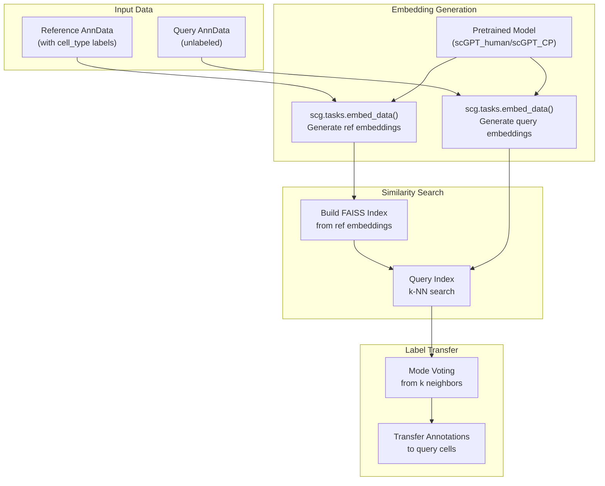
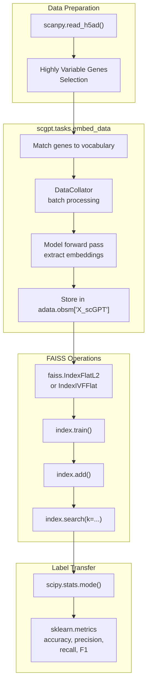
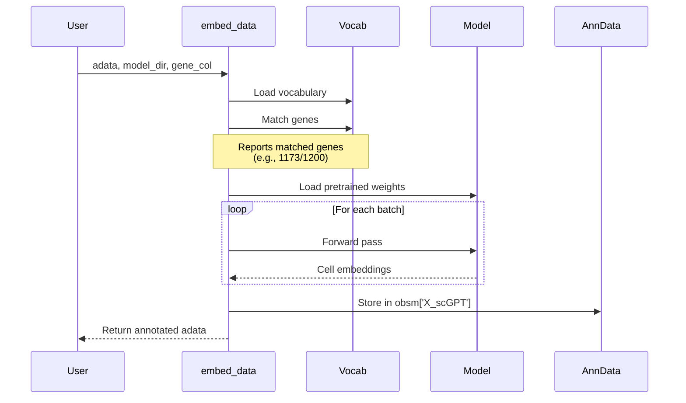
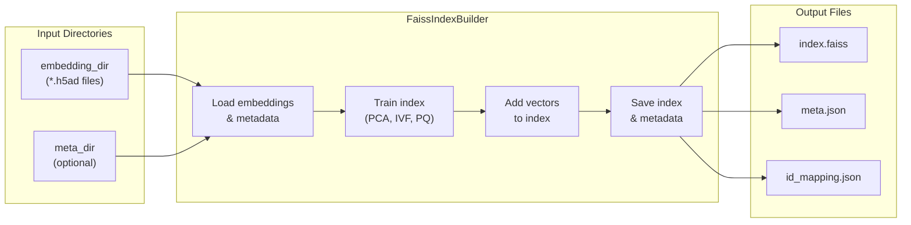
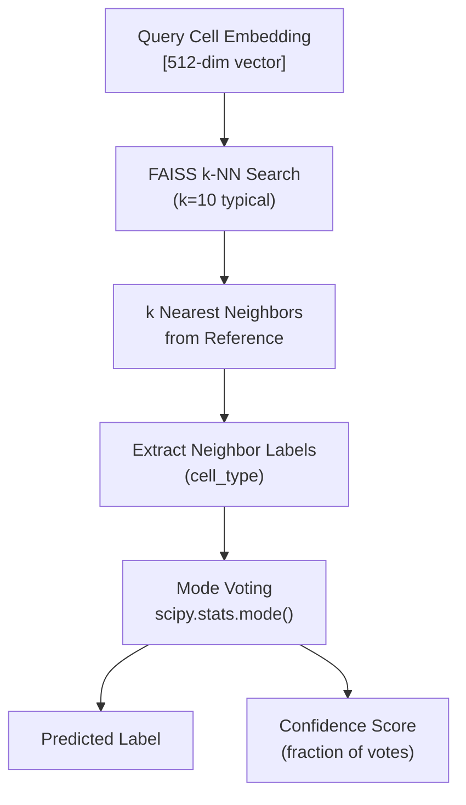

# Reference Mapping

<details>
<summary>Relevant source files</summary>

The following files were used as context for generating this wiki page:

- [tutorials/Tutorial_Reference_Mapping.ipynb](tutorials/Tutorial_Reference_Mapping.ipynb)
- [tutorials/build_atlas_index_faiss.py](tutorials/build_atlas_index_faiss.py)
- [tutorials/zero-shot/Tutorial_ZeroShot_Integration.ipynb](tutorials/zero-shot/Tutorial_ZeroShot_Integration.ipynb)
- [tutorials/zero-shot/Tutorial_ZeroShot_Integration_Continual_Pretraining.ipynb](tutorials/zero-shot/Tutorial_ZeroShot_Integration_Continual_Pretraining.ipynb)
- [tutorials/zero-shot/Tutorial_ZeroShot_Reference_Mapping.ipynb](tutorials/zero-shot/Tutorial_ZeroShot_Reference_Mapping.ipynb)

</details>


## Purpose and Scope

Reference mapping is a zero-shot application that enables cell type annotation by mapping query cells to a labeled reference dataset using scGPT-generated embeddings. This approach requires no model fine-tuning, making it fast and accessible for users with limited computational resources.

For information about generating the underlying cell embeddings, see [Cell Embedding System](#5). For fine-tuning approaches to cell annotation, see [Cell Type Annotation](#6.1). For other zero-shot applications, see [Data Integration](#4.2) and [Continual Pre-training Model](#4.3).

## Overview

Reference mapping transfers annotations (e.g., cell types, disease conditions) from a labeled reference dataset to unlabeled query cells by finding similar cells in embedding space. The workflow operates in zero-shot mode, requiring only:

1. A pretrained scGPT model (typically `scGPT_human` or `scGPT_CP`)
2. A reference dataset with annotations
3. A query dataset requiring annotation

The system supports two operational modes:

**Custom Reference Mode**: Users provide their own annotated reference dataset to map similar samples. This suits scenarios where domain-specific annotations already exist.

**Atlas Reference Mode**: Maps query cells against a pre-built atlas of over 33 million cells from CellXGene, providing a generic first-pass annotation for newly collected samples.

Sources: [tutorials/zero-shot/Tutorial_ZeroShot_Reference_Mapping.ipynb:1-37](), [tutorials/Tutorial_Reference_Mapping.ipynb:1-22]()

## Core Workflow



**Reference Mapping Workflow Architecture**

The workflow consists of four main stages:

1. **Embedding Generation**: Both reference and query datasets are processed through `scg.tasks.embed_data()` using a pretrained model, producing cell embeddings stored in `adata.obsm['X_scGPT']`

2. **Index Construction**: Reference embeddings are organized into a FAISS index for efficient similarity search

3. **Similarity Search**: Query embeddings are searched against the index using k-nearest neighbors (k-NN)

4. **Label Transfer**: Cell type labels from k nearest neighbors are aggregated via mode voting

Sources: [tutorials/zero-shot/Tutorial_ZeroShot_Reference_Mapping.ipynb:23-37](), [tutorials/zero-shot/Tutorial_ZeroShot_Reference_Mapping.ipynb:167-233]()

## Implementation Components



**Reference Mapping Code Components**

### Key Functions and Classes

| Component | Location | Purpose |
|-----------|----------|---------|
| `embed_data()` | `scgpt/tasks/cell_emb.py` | Generates cell embeddings from pretrained model |
| `faiss.IndexFlatL2` | External library | Exact L2 distance search |
| `faiss.IndexIVFFlat` | External library | Inverted file index for large datasets |
| `scipy.stats.mode` | External library | Voting mechanism for label transfer |
| `FaissIndexBuilder` | `tutorials/build_atlas_index_faiss.py` | Builds indices from embedding directories |

### Embedding Generation

The `embed_data()` function operates as follows:



**Embedding Generation Sequence**

The function reports gene matching statistics (e.g., "match 1173/1200 genes in vocabulary of size 60697") and processes cells in batches with a progress bar. The default batch size is 64 cells.

Sources: [tutorials/zero-shot/Tutorial_ZeroShot_Reference_Mapping.ipynb:190-197](), [tutorials/zero-shot/Tutorial_ZeroShot_Reference_Mapping.ipynb:227-233]()

### FAISS Index Operations

For custom reference mapping, the index is built directly from reference embeddings:

```python
# Build index from reference embeddings
ref_embeddings = ref_embed_adata.obsm['X_scGPT']
dimension = ref_embeddings.shape[1]
index = faiss.IndexFlatL2(dimension)  # or IndexIVFFlat for large data
index.add(ref_embeddings)

# Query with test embeddings
test_embeddings = test_embed_adata.obsm['X_scGPT']
distances, indices = index.search(test_embeddings, k=10)

# Transfer labels using mode voting
from scipy.stats import mode
predicted_labels = mode(ref_labels[indices], axis=1)[0]
```

The system supports different FAISS index types:
- **IndexFlatL2**: Exact search, suitable for smaller references (<1M cells)
- **IndexIVFFlat**: Approximate search with inverted file, faster for large references
- **HNSW variants**: Graph-based indices for memory-efficient search

Sources: [tutorials/zero-shot/Tutorial_ZeroShot_Reference_Mapping.ipynb:256-268](), [tutorials/Tutorial_Reference_Mapping.ipynb:95-110]()

## Building Atlas Indices

The `FaissIndexBuilder` class facilitates building indices from directories of embedding files for the atlas reference mode.



**FAISS Index Building Pipeline**

### FaissIndexBuilder Parameters

| Parameter | Default | Description |
|-----------|---------|-------------|
| `embedding_dir` | Required | Directory containing embedding files (*.h5ad) |
| `meta_dir` | None | Directory with metadata files (if separate) |
| `embedding_key` | None | Key for embeddings in h5ad files (None uses X) |
| `meta_key` | "cell_type" | Key for metadata labels |
| `index_desc` | "PCA64,IVF16384_HNSW32,PQ16" | FAISS index factory string |
| `gpu` | False | Use GPU for index building |
| `num_workers` | None | Parallel workers for loading |

### Index Factory Strings

The `index_desc` parameter uses FAISS factory syntax:

- **"PCA64"**: Reduce to 64 dimensions via PCA
- **"IVF16384_HNSW32"**: 16384 inverted file lists with HNSW graph
- **"PQ16"**: Product quantization with 16 bytes per vector
- **"Flat"**: Exact search (no compression)

For large atlases (>10M cells), the default configuration balances memory usage, search speed, and accuracy.

Sources: [tutorials/build_atlas_index_faiss.py:1-46](), [tutorials/build_atlas_index_faiss.py:59-148]()

### Usage Example

```python
from build_atlas_index_faiss import FaissIndexBuilder

builder = FaissIndexBuilder(
    embedding_dir="path/to/embeddings",
    output_dir="path/to/index",
    meta_key="cell_type",
    index_desc="PCA64,IVF16384_HNSW32,PQ16",
    gpu=True,
    num_workers=4
)

builder.build()  # Creates index.faiss and meta.json
```

The builder supports recursive directory traversal and can handle embeddings split across multiple files. It preserves metadata associations and generates an ID mapping for tracing predictions back to source cells.

Sources: [tutorials/build_atlas_index_faiss.py:149-210]()

## Label Transfer Mechanism



**Label Transfer via k-NN Voting**

The label transfer process:

1. For each query cell, find k nearest reference cells in embedding space
2. Extract the labels (e.g., cell types) of these k neighbors
3. Apply mode voting to select the most frequent label
4. Optionally compute confidence as the fraction of votes for the winning label

Typical k values range from 5 to 50. Smaller k emphasizes local structure, while larger k provides smoother boundaries. The optimal k depends on reference density and biological heterogeneity.

Sources: [tutorials/zero-shot/Tutorial_ZeroShot_Reference_Mapping.ipynb:256-268](), [tutorials/Tutorial_Reference_Mapping.ipynb:112-150]()

## Evaluation Metrics

Reference mapping quality is assessed using standard classification metrics:

| Metric | Function | Interpretation |
|--------|----------|----------------|
| Accuracy | `sklearn.metrics.accuracy_score` | Overall fraction of correct predictions |
| Precision | `sklearn.metrics.precision_score` | Fraction of positive predictions that are correct |
| Recall | `sklearn.metrics.recall_score` | Fraction of actual positives identified |
| F1 Score | `sklearn.metrics.f1_score` | Harmonic mean of precision and recall |

### Confusion Matrix

The confusion matrix provides detailed per-cell-type performance:

```python
from sklearn.metrics import confusion_matrix
import seaborn as sns

cm = confusion_matrix(true_labels, predicted_labels)
sns.heatmap(cm, annot=True, fmt='d')
```

This reveals which cell types are confused with each other, guiding decisions about whether to merge similar types or collect more reference data.

Sources: [tutorials/zero-shot/Tutorial_ZeroShot_Reference_Mapping.ipynb:117-119]()

## Practical Considerations

### Gene Vocabulary Matching

The embedding generation reports gene matching statistics:
```
scGPT - INFO - match 1173/1200 genes in vocabulary of size 60697.
```

This indicates that 1173 of the 1200 highly variable genes in the dataset match the model's vocabulary. Genes not in the vocabulary are excluded from the analysis. For best results:

- Use gene symbols that match the model's training data (typically HGNC symbols)
- Expect 95-99% match rates for human data
- Lower match rates may indicate gene naming inconsistencies

Sources: [tutorials/zero-shot/Tutorial_ZeroShot_Reference_Mapping.ipynb:179-180](), [tutorials/zero-shot/Tutorial_ZeroShot_Reference_Mapping.ipynb:216-217]()

### Preprocessing Requirements

Both reference and query datasets should undergo consistent preprocessing:

1. **Gene Selection**: Identify highly variable genes (HVGs)
2. **Normalization**: Not required (model handles raw counts)
3. **Gene Name Column**: Specify via `gene_col` parameter

The tutorial examples use pre-normalized data, but the model accepts raw counts. The key requirement is consistent gene selection between reference and query.

Sources: [tutorials/zero-shot/Tutorial_ZeroShot_Reference_Mapping.ipynb:145-161]()

### Model Selection

Two primary pretrained models are available:

- **scGPT_human**: Trained on 33M cells, general-purpose
- **scGPT_CP**: Continually pretrained with cell type supervision, better for batch integration

The choice depends on the biological context and presence of batch effects. For reference mapping, `scGPT_human` typically suffices unless strong technical variation exists between reference and query.

Sources: [tutorials/zero-shot/Tutorial_ZeroShot_Reference_Mapping.ipynb:20-20]()

## Performance Characteristics

Reference mapping completes in minutes to hours depending on dataset size:

- **Embedding generation**: ~20-40 cells/second on CPU, ~100-200 cells/second on GPU
- **FAISS index building**: Linear in reference size, ~1M cells/minute
- **Query search**: Sub-millisecond per query for IVF indices

The zero-shot approach is 10-100x faster than fine-tuning while achieving competitive accuracy for well-represented cell types. Performance degrades for rare cell types or significant domain shifts between reference and query.

Sources: [tutorials/zero-shot/Tutorial_ZeroShot_Reference_Mapping.ipynb:185-187](), [tutorials/zero-shot/Tutorial_ZeroShot_Reference_Mapping.ipynb:222-224]()

---