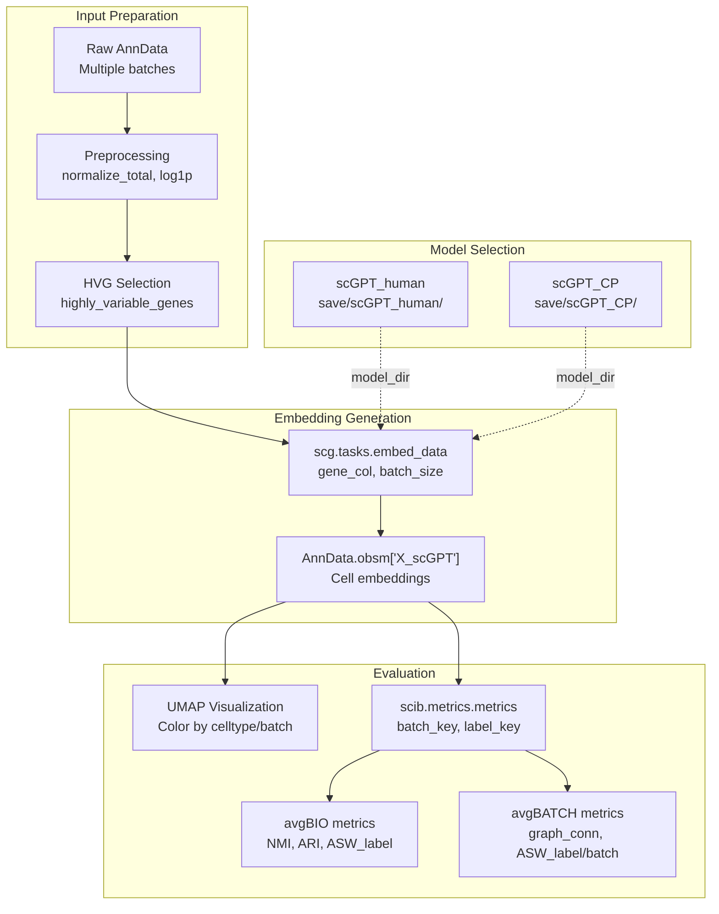
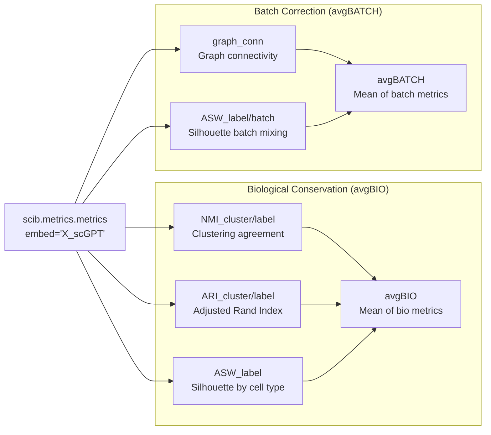
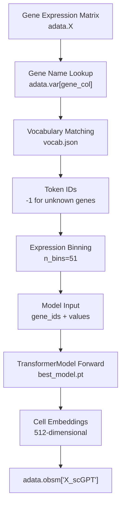

# Data Integration

<details>
<summary>Relevant source files</summary>

The following files were used as context for generating this wiki page:

- [tutorials/Tutorial_Integration.ipynb](tutorials/Tutorial_Integration.ipynb)
- [tutorials/zero-shot/Tutorial_ZeroShot_Integration.ipynb](tutorials/zero-shot/Tutorial_ZeroShot_Integration.ipynb)
- [tutorials/zero-shot/Tutorial_ZeroShot_Integration_Continual_Pretraining.ipynb](tutorials/zero-shot/Tutorial_ZeroShot_Integration_Continual_Pretraining.ipynb)
- [tutorials/zero-shot/Tutorial_ZeroShot_Reference_Mapping.ipynb](tutorials/zero-shot/Tutorial_ZeroShot_Reference_Mapping.ipynb)

</details>


## Purpose and Scope

This page documents scGPT's zero-shot data integration capabilities, which enable batch correction and dataset harmonization without fine-tuning. Data integration in scGPT refers to combining multiple scRNA-seq datasets (batches) into a unified latent space where biological variation is preserved while technical batch effects are minimized.

For zero-shot cell type annotation through reference mapping, see [Reference Mapping](#4.1). For fine-tuned integration approaches, see [Integration Fine-tune](#6.5).

**Sources:** [tutorials/zero-shot/Tutorial_ZeroShot_Integration.ipynb:14-32]()

## Overview

scGPT performs batch integration by generating consistent cell embeddings across different datasets. The integration workflow requires no training or fine-tuning—it directly uses pretrained model weights to produce embeddings that are then evaluated using standard integration metrics from the scib benchmarking framework.

Two pretrained models are available for integration tasks:

- **scGPT_human**: The base whole-human model trained on 33M cells
- **scGPT_CP**: Continual pre-trained model with additional supervision from Tabula Sapiens cell type labels, showing improved performance on datasets with observable technical batch effects

**Sources:** [tutorials/zero-shot/Tutorial_ZeroShot_Integration.ipynb:14-32](), [tutorials/zero-shot/Tutorial_ZeroShot_Integration_Continual_Pretraining.ipynb:14-21]()

## Integration Workflow



**Sources:** [tutorials/zero-shot/Tutorial_ZeroShot_Integration.ipynb:28-32, 196-330](), [tutorials/zero-shot/Tutorial_ZeroShot_Integration_Continual_Pretraining.ipynb:28-351]()

## Data Preprocessing

### Loading and Basic Processing

Data integration begins with loading AnnData objects and specifying key metadata columns:

```python
adata = sc.read_h5ad(sample_data_path)
gene_col = "gene_name"          # or "Gene Symbol" 
cell_type_key = "cell_type"     # for evaluation
batch_key = "sample"            # batch identifier
N_HVG = 3000                    # number of HVGs
```

### Highly Variable Gene Selection

Integration typically uses a subset of highly variable genes (HVGs) to focus on biologically informative features:

```python
sc.pp.highly_variable_genes(adata, n_top_genes=N_HVG, flavor='seurat_v3')
adata = adata[:, adata.var['highly_variable']]
```

Common HVG counts across tutorials:
- Lung-Kim: 3000 HVGs
- Pancreas: 1800 HVGs
- COVID-19: Variable based on dataset

**Sources:** [tutorials/zero-shot/Tutorial_ZeroShot_Integration.ipynb:196-279](), [tutorials/zero-shot/Tutorial_ZeroShot_Integration_Continual_Pretraining.ipynb:190-301]()

## Embedding Generation

### The `embed_data` Function

Cell embeddings are generated using `scg.tasks.embed_data()`, which loads a pretrained model and produces fixed-dimensional representations:

```python
embed_adata = scg.tasks.embed_data(
    adata,
    model_dir,           # Path to model checkpoint
    gene_col=gene_col,   # Column name for gene identifiers
    batch_size=64,       # Batch size for inference
)
```

This function:
1. Loads the vocabulary from `model_dir/vocab.json`
2. Matches genes in the dataset to the model vocabulary
3. Loads the pretrained model weights from `model_dir/best_model.pt`
4. Performs forward passes to generate embeddings
5. Stores results in `adata.obsm['X_scGPT']`

### Gene Vocabulary Matching

The model reports how many genes from the dataset are found in its vocabulary:

```
scGPT - INFO - match 2978/3000 genes in vocabulary of size 60697.
```

Genes not in the vocabulary are typically set to index -1 and handled appropriately by the model.

**Sources:** [tutorials/zero-shot/Tutorial_ZeroShot_Integration.ipynb:285-332](), [scgpt/tasks/cell_emb.py:213]()

## Evaluation Metrics

### scib Metrics Framework

Integration quality is assessed using the scib package, which computes both biological conservation (avgBIO) and batch correction (avgBATCH) metrics:



### Evaluation Function

```python
def scib_eval(adata, batch_key, cell_type_key, embed_key):
    results = scib.metrics.metrics(
        adata,
        adata_int=adata,
        batch_key=batch_key,
        label_key=cell_type_key,
        embed=embed_key,
        isolated_labels_asw_=False,
        silhouette_=True,
        hvg_score_=False,
        graph_conn_=True,
        pcr_=True,
        isolated_labels_f1_=False,
        trajectory_=False,
        nmi_=True,
        ari_=True,
        cell_cycle_=False,
        kBET_=False,
        ilisi_=False,
        clisi_=False,
    )
    
    result_dict = results[0].to_dict()
    result_dict["avg_bio"] = np.mean([
        result_dict["NMI_cluster/label"],
        result_dict["ARI_cluster/label"],
        result_dict["ASW_label"],
    ])
    result_dict["avg_batch"] = np.mean([
        result_dict["graph_conn"],
        result_dict["ASW_label/batch"],
    ])
    return result_dict
```

**Key Metrics:**
- **avgBIO**: Higher is better (0-1), measures preservation of biological structure
- **avgBATCH**: Higher is better (0-1), measures batch effect removal
- Goal: Maximize both metrics simultaneously

**Sources:** [tutorials/zero-shot/Tutorial_ZeroShot_Integration.ipynb:128-189](), [tutorials/zero-shot/Tutorial_ZeroShot_Integration_Continual_Pretraining.ipynb:122-183]()

## Pretrained Models Comparison

### scGPT_human vs scGPT_CP

| Model | Training Data | Special Features | Best Use Cases |
|-------|---------------|------------------|----------------|
| `scGPT_human` | 33M cells, whole-human | Base pretrained model | General-purpose integration |
| `scGPT_CP` | scGPT_human + Tabula Sapiens | Additional cell type supervision during continual pre-training | Datasets with strong batch effects |

The `scGPT_CP` model inherits weights from `scGPT_human` and receives additional training with cell type classification objectives on Tabula Sapiens data. This continual pre-training helps the model learn more robust cell type representations that are less affected by technical variation.

**Sources:** [tutorials/zero-shot/Tutorial_ZeroShot_Integration_Continual_Pretraining.ipynb:14-21]()

## Example Datasets

### Supported Integration Tasks

| Dataset | Cells | Batches | Description | Tutorial |
|---------|-------|---------|-------------|----------|
| Lung-Kim | 32,493 | 14 samples | Human lung adenocarcinoma | Tutorial_ZeroShot_Integration.ipynb |
| COVID-19 | Variable | 18 batches | Lung tissue samples | Appendix section |
| MS (Multiple Sclerosis) | Variable | Multiple | MS patient samples | Appendix section |
| Pancreas (scIB) | Variable | Multiple batches | Complex batch structure | Tutorial_ZeroShot_Integration_Continual_Pretraining.ipynb |

### Data Format Requirements

Input data should be:
- AnnData format (`.h5ad`)
- Gene names in `var` (specified by `gene_col`)
- Batch labels in `obs` (specified by `batch_key`)
- Cell type labels in `obs` (specified by `cell_type_key`, optional for evaluation)

**Sources:** [tutorials/zero-shot/Tutorial_ZeroShot_Integration.ipynb:23-32, 36-40](), [tutorials/zero-shot/Tutorial_ZeroShot_Integration_Continual_Pretraining.ipynb:23-37]()

## Visualization

### UMAP Analysis

After embedding generation, UMAP projections visualize the integrated latent space:

```python
# UMAP colored by cell type
sc.pp.neighbors(embed_adata, use_rep='X_scGPT')
sc.tl.umap(embed_adata)
sc.pl.umap(embed_adata, color=cell_type_key)

# UMAP colored by batch
sc.pl.umap(embed_adata, color=batch_key)
```

Successful integration shows:
- **Cell type coloring**: Cells of same type cluster together regardless of batch
- **Batch coloring**: Batches are well-mixed rather than separated

**Sources:** [tutorials/zero-shot/Tutorial_ZeroShot_Integration.ipynb:337-352]()

## Technical Details

### Model Input Processing



### Batch Processing

The `embed_data` function processes cells in batches:
- Default `batch_size=64`
- Progress tracked with tqdm: `Embedding cells: 100%|██████████| 477/477`
- Gradient computation disabled for inference efficiency

**Sources:** [tutorials/zero-shot/Tutorial_ZeroShot_Integration.ipynb:296-330](), [scgpt/tasks/cell_emb.py:213]()

## Comparison with Reference Mapping

| Aspect | Data Integration (4.2) | Reference Mapping (4.1) |
|--------|------------------------|-------------------------|
| **Goal** | Batch correction, harmonization | Cell type annotation transfer |
| **Input** | Multiple batches to integrate | Reference + query datasets |
| **Output** | Unified embedding space | Predicted labels for query cells |
| **Evaluation** | scib metrics (avgBIO/avgBATCH) | Classification accuracy, F1 |
| **Method** | Direct embedding + UMAP | Embedding + FAISS k-NN search |
| **Use Case** | Merging studies, removing batch effects | Annotating new datasets |

Both tasks use the same `embed_data()` function but differ in downstream analysis. Integration focuses on embedding quality across batches, while reference mapping uses embeddings for label transfer via similarity search.

**Sources:** [tutorials/zero-shot/Tutorial_ZeroShot_Integration.ipynb:14-32](), [tutorials/zero-shot/Tutorial_ZeroShot_Reference_Mapping.ipynb:14-36]()

## Implementation Code Paths

Key functions and files involved in zero-shot integration:

- **Embedding generation**: `scgpt/tasks/cell_emb.py` - `embed_data()` function
- **Model loading**: `scgpt/__init__.py` - Model and vocabulary loading
- **Preprocessing**: Standard scanpy functions (`sc.pp.*`)
- **Evaluation**: `scib` package metrics
- **Tutorials**: 
  - `tutorials/zero-shot/Tutorial_ZeroShot_Integration.ipynb`
  - `tutorials/zero-shot/Tutorial_ZeroShot_Integration_Continual_Pretraining.ipynb`

**Sources:** [tutorials/zero-shot/Tutorial_ZeroShot_Integration.ipynb:95-122](), [scgpt/tasks/cell_emb.py:213]()

---