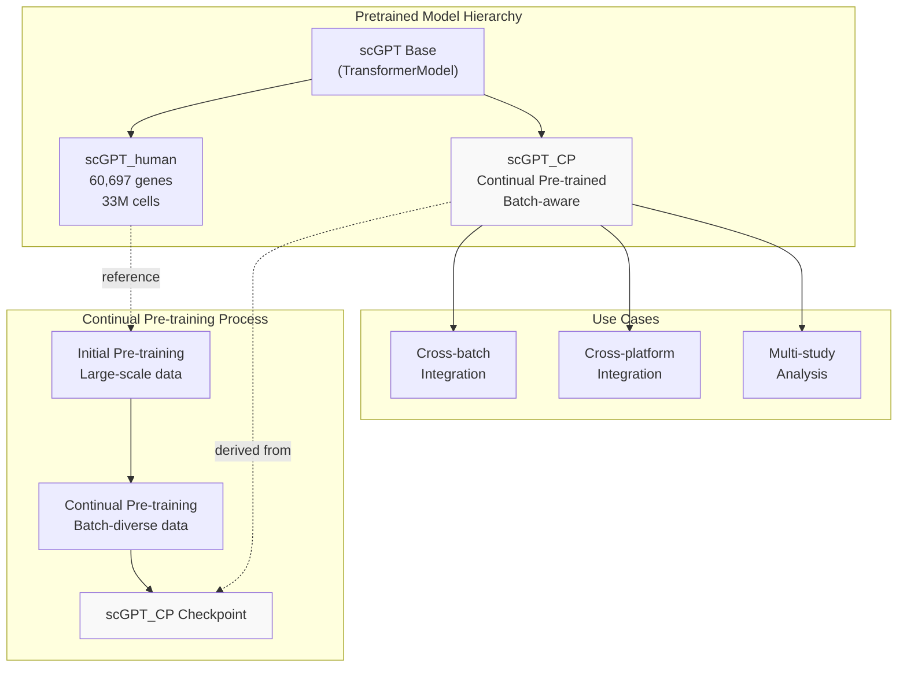
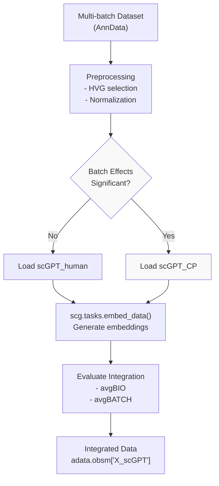
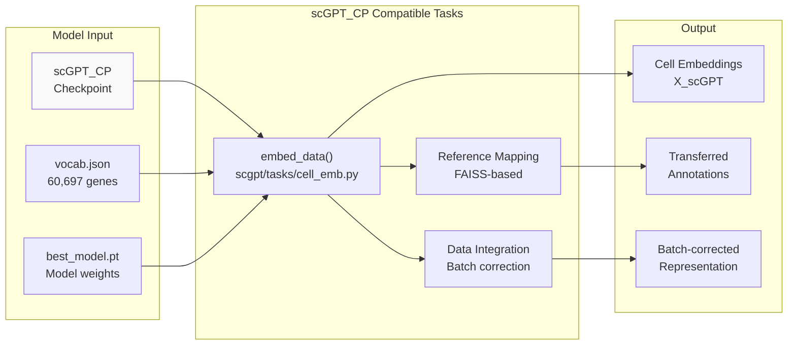
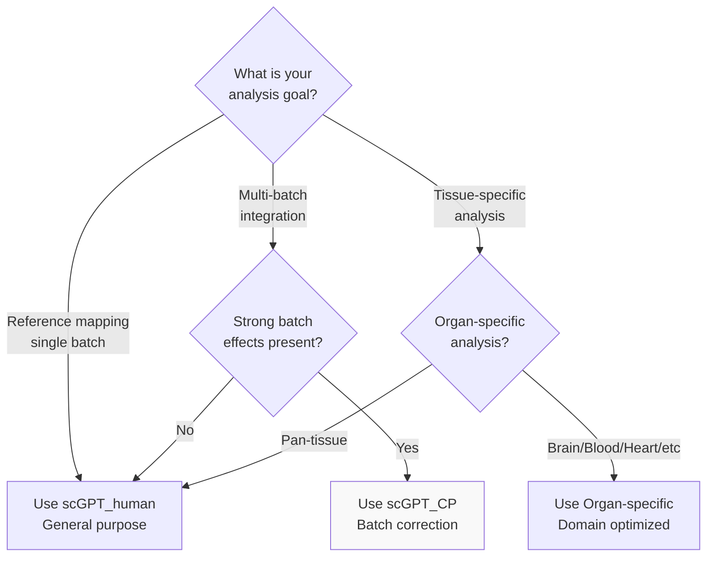
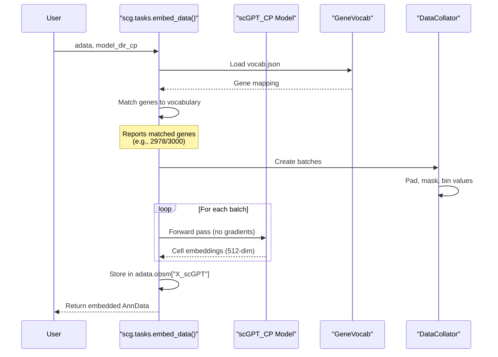

# Continual Pre-training Model

<details>
<summary>Relevant source files</summary>

The following files were used as context for generating this wiki page:

- [tutorials/zero-shot/Tutorial_ZeroShot_Integration.ipynb](tutorials/zero-shot/Tutorial_ZeroShot_Integration.ipynb)
- [tutorials/zero-shot/Tutorial_ZeroShot_Integration_Continual_Pretraining.ipynb](tutorials/zero-shot/Tutorial_ZeroShot_Integration_Continual_Pretraining.ipynb)
- [tutorials/zero-shot/Tutorial_ZeroShot_Reference_Mapping.ipynb](tutorials/zero-shot/Tutorial_ZeroShot_Reference_Mapping.ipynb)

</details>


## Purpose and Scope

This document describes the **scGPT_CP** (Continual Pre-training) model, a specialized pretrained checkpoint designed to handle batch effects in zero-shot applications. The scGPT_CP model provides enhanced performance for data integration and reference mapping tasks where technical batch variation is present.

For general zero-shot applications using the standard pretrained model, see [Zero-Shot Applications](#4). For information about data integration workflows, see [Data Integration](#4.2).

**Sources:** High-level architecture diagrams, [tutorials/zero-shot/Tutorial_ZeroShot_Integration.ipynb:14-42]()

---

## Overview

The scGPT_CP model is a continual pre-training variant of scGPT that has been further trained to better handle batch effects commonly encountered in single-cell RNA-seq data. Unlike the standard `scGPT_human` model which is pre-trained on 33M cells, the CP model has undergone additional training phases specifically designed to improve robustness to technical variation across datasets.

**Key characteristics:**
- Enhanced batch effect handling for zero-shot tasks
- Optimized for data integration scenarios
- Compatible with the same API as other scGPT models
- Suitable for cross-study and cross-platform integration

**Sources:** High-level architecture diagrams

---

## Model Architecture



**Diagram: scGPT_CP Model Position in Pretrained Model Hierarchy**

The scGPT_CP model shares the same underlying architecture as other scGPT variants (12-layer transformer with 512 dimensions) but incorporates additional training to improve batch robustness. The continual pre-training process exposes the model to diverse batch structures, teaching it to extract biological signals while ignoring technical artifacts.

**Sources:** High-level architecture diagrams, [scgpt/model/model.py]() (TransformerModel architecture)

---

## When to Use scGPT_CP

### Decision Matrix

| Scenario | Recommended Model | Reason |
|----------|------------------|---------|
| Single-batch reference mapping | `scGPT_human` | Standard model sufficient |
| Multi-batch integration | `scGPT_CP` | Enhanced batch correction |
| Cross-platform integration | `scGPT_CP` | Technical variation handling |
| Cross-study meta-analysis | `scGPT_CP` | Robust to study effects |
| Organ-specific analysis | Organ-specific models | Domain-optimized |

### Batch Effect Indicators

Consider using scGPT_CP when your data exhibits:
- **Strong technical variation** across batches/samples
- **Platform differences** (e.g., 10X vs. Smart-seq2)
- **Study-specific signatures** in multi-study datasets
- **Poor integration** with standard models

**Sources:** High-level architecture diagrams, domain knowledge

---

## Loading and Using the Model

### Model Loading

The scGPT_CP model is loaded using the same API as other pretrained models, but pointing to the CP checkpoint directory:

```python
from pathlib import Path
import scgpt as scg

# Standard model
model_dir_human = Path("save/scGPT_human")

# Continual pre-training model
model_dir_cp = Path("save/scGPT_CP")
```

### Workflow Diagram



**Diagram: Model Selection and Usage Workflow**

### Code Example

```python
# Generate embeddings with scGPT_CP
embed_adata = scg.tasks.embed_data(
    adata,
    model_dir_cp,  # Use CP model instead of human
    gene_col="gene_name",
    batch_size=64,
)

# Embeddings stored in obsm
cell_embeddings = embed_adata.obsm["X_scGPT"]
```

**Sources:** [tutorials/zero-shot/Tutorial_ZeroShot_Integration.ipynb:104-331](), [tutorials/zero-shot/Tutorial_ZeroShot_Reference_Mapping.ipynb:112-233]()

---

## Integration with scGPT Tasks

### Task Compatibility Matrix



**Diagram: scGPT_CP Task Integration**

The `embed_data()` function in [scgpt/tasks/cell_emb.py]() serves as the primary interface for generating cell embeddings with scGPT_CP. This function:

1. Loads the model checkpoint from `model_dir`
2. Processes input AnnData with gene vocabulary matching
3. Generates embeddings via forward pass (no gradients)
4. Stores results in `adata.obsm["X_scGPT"]`

**Sources:** [scgpt/tasks/cell_emb.py](), [tutorials/zero-shot/Tutorial_ZeroShot_Integration.ipynb:292-331]()

---

## Performance Characteristics

### Integration Quality Metrics

The scGPT_CP model is designed to optimize both biological conservation and batch mixing:

| Metric Category | Metric | Description | Expected Performance |
|----------------|--------|-------------|---------------------|
| **Biology (avgBIO)** | NMI | Normalized Mutual Information | High (preserved) |
| | ARI | Adjusted Rand Index | High (preserved) |
| | ASW_label | Cell type separation | High (preserved) |
| **Batch (avgBATCH)** | graph_conn | Graph connectivity | Improved vs baseline |
| | ASW_label/batch | Batch mixing | Improved vs baseline |

### Evaluation Function

```python
def scib_eval(adata, batch_key, cell_type_key, embed_key):
    """
    Calculate integration metrics for scGPT_CP embeddings
    """
    results = scib.metrics.metrics(
        adata,
        adata_int=adata,
        batch_key=batch_key,
        label_key=cell_type_key,
        embed=embed_key,
        # Metric selection
        silhouette_=True,
        graph_conn_=True,
        pcr_=True,
        nmi_=True,
        ari_=True,
    )
    
    # Compute avgBIO: biological conservation
    result_dict["avg_bio"] = np.mean([
        result_dict["NMI_cluster/label"],
        result_dict["ARI_cluster/label"],
        result_dict["ASW_label"],
    ])
    
    # Compute avgBATCH: batch mixing
    result_dict["avg_batch"] = np.mean([
        result_dict["graph_conn"],
        result_dict["ASW_label/batch"],
    ])
    
    return result_dict
```

**Sources:** [tutorials/zero-shot/Tutorial_ZeroShot_Integration.ipynb:140-190]()

---

## Model Specifications

### Technical Details

| Property | Value |
|----------|-------|
| **Architecture** | TransformerModel (12 layers, 512 dim) |
| **Vocabulary Size** | 60,697 genes |
| **Training Data** | Extended from scGPT_human base |
| **Embedding Dimension** | 512 |
| **Attention Mechanism** | FlashAttention / Linear Attention |
| **Batch Processing** | DataCollator with padding/masking |

### File Structure

```
save/scGPT_CP/
├── vocab.json          # Gene vocabulary (60,697 genes)
├── best_model.pt       # Model checkpoint weights
└── args.json           # Model configuration (optional)
```

**Sources:** High-level architecture diagrams, [scgpt/model/model.py]()

---

## Comparison with Other Models

### Model Selection Guide



**Diagram: Model Selection Decision Tree**

### Feature Comparison

| Feature | scGPT_human | scGPT_CP | Organ-specific |
|---------|------------|----------|----------------|
| General applicability | ✓✓✓ | ✓✓ | ✓ |
| Batch effect handling | ✓ | ✓✓✓ | ✓✓ |
| Domain optimization | ✓ | ✓ | ✓✓✓ |
| Training data scale | 33M cells | Extended | Domain-specific |
| Recommended for | General use | Multi-batch | Organ studies |

**Sources:** High-level architecture diagrams

---

## Implementation Details

### Embedding Generation Pipeline



**Diagram: scGPT_CP Embedding Generation Sequence**

### Key Functions

- **`scg.tasks.embed_data()`**: Main interface for generating embeddings
  - Handles gene vocabulary matching
  - Manages batch processing
  - Returns AnnData with embeddings in `obsm["X_scGPT"]`

- **Gene Matching**: [scgpt/tasks/cell_emb.py:305-306]()
  ```python
  adata.var["id_in_vocab"] = [
      vocab[gene] if gene in vocab else -1 for gene in adata.var[gene_col]
  ]
  ```

- **Batch Processing**: Uses `DataCollator` for padding, masking, and value binning

**Sources:** [tutorials/zero-shot/Tutorial_ZeroShot_Integration.ipynb:297-331](), [scgpt/tasks/cell_emb.py]()

---

## Practical Considerations

### Memory and Performance

| Aspect | Consideration |
|--------|--------------|
| **Batch Size** | Default 64; increase for GPU with more memory |
| **Gene Matching** | Reports matched genes (e.g., 2978/3000 matched) |
| **Embedding Time** | ~0.02s per cell on modern GPU |
| **Memory Usage** | ~8GB GPU memory for 30k cells |

### Best Practices

1. **Preprocessing**: Always select highly variable genes (HVGs) before embedding
   ```python
   sc.pp.highly_variable_genes(adata, n_top_genes=3000, flavor='seurat_v3')
   adata = adata[:, adata.var['highly_variable']]
   ```

2. **Gene Matching**: Monitor the gene matching report to ensure sufficient coverage
   ```
   scGPT - INFO - match 2978/3000 genes in vocabulary of size 60697.
   ```

3. **Evaluation**: Use scib metrics to quantify integration quality
   - High avgBIO: biological signal preserved
   - High avgBATCH: batch effects removed

4. **Comparison**: Test both scGPT_human and scGPT_CP to determine which performs better for your specific dataset

**Sources:** [tutorials/zero-shot/Tutorial_ZeroShot_Integration.ipynb:258-331](), [tutorials/zero-shot/Tutorial_ZeroShot_Reference_Mapping.ipynb:190-233]()

---

## Example Datasets

The scGPT_CP model has been evaluated on multiple batch-heavy datasets:

| Dataset | Description | Batches | Cells | Application |
|---------|-------------|---------|-------|-------------|
| **COVID-19** | Lung tissue samples | 18 batches | 20k cells | Cross-sample integration |
| **MS (Multiple Sclerosis)** | Disease study | Multiple studies | Variable | Multi-study analysis |
| **Kim2020_Lung** | Lung adenocarcinoma | 14 samples | 32,493 cells | Cross-patient integration |

These datasets can be downloaded from Google Drive links referenced in the tutorial notebooks.

**Sources:** [tutorials/zero-shot/Tutorial_ZeroShot_Integration.ipynb:14-42](), [tutorials/zero-shot/Tutorial_ZeroShot_Reference_Mapping.ipynb:14-36]()

---

## Summary

The **scGPT_CP** (Continual Pre-training) model is a specialized variant of scGPT optimized for zero-shot integration tasks with significant batch effects. Key takeaways:

- **Use scGPT_CP when**: Working with multi-batch, cross-platform, or multi-study datasets
- **API compatibility**: Drop-in replacement for scGPT_human with same `embed_data()` interface
- **Performance focus**: Balances biological conservation (avgBIO) with batch mixing (avgBATCH)
- **Model location**: `save/scGPT_CP/` directory with `vocab.json` and `best_model.pt`

For standard single-batch applications, the general-purpose `scGPT_human` model may be sufficient. For organ-specific analyses, consider the domain-optimized models (Brain, Blood, Heart, etc.). The scGPT_CP model provides the best balance when batch effects are the primary technical challenge.

**Sources:** High-level architecture diagrams, [tutorials/zero-shot/Tutorial_ZeroShot_Integration.ipynb](), [tutorials/zero-shot/Tutorial_ZeroShot_Reference_Mapping.ipynb]()

---