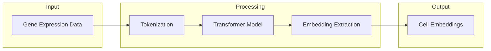
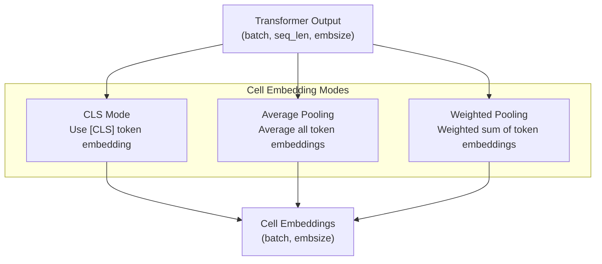
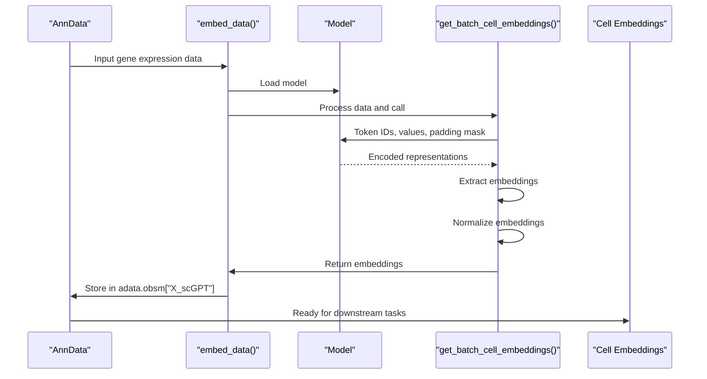
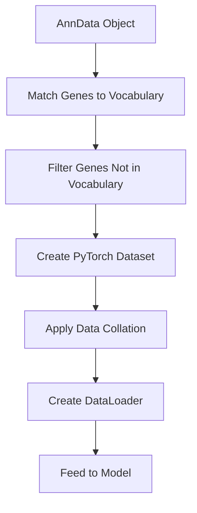
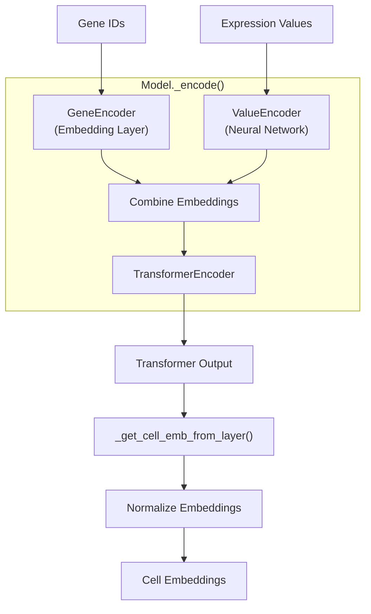
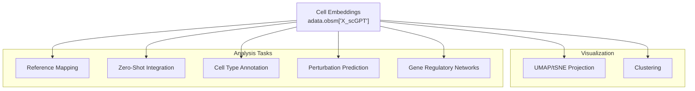
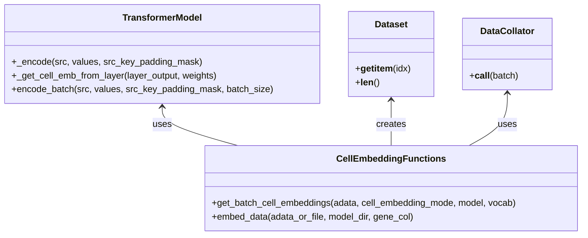

# Cell Embedding

<details>
<summary>Relevant source files</summary>

The following files were used as context for generating this wiki page:

- [scgpt/preprocess.py](scgpt/preprocess.py)
- [scgpt/tasks/__init__.py](scgpt/tasks/__init__.py)
- [scgpt/tasks/cell_emb.py](scgpt/tasks/cell_emb.py)
- [scgpt/tasks/grn.py](scgpt/tasks/grn.py)

</details>


Cell embedding is a core feature of scGPT that transforms single-cell gene expression data into fixed-length vector representations (embeddings) that capture meaningful biological information. These embeddings serve as the foundation for various downstream tasks such as cell type annotation, reference mapping, and data integration. For information about specific applications using these embeddings, see [Reference Mapping](#3.2) and [Zero-Shot Integration](#3.1).

## Overview

Cell embeddings in scGPT are dense numerical representations of cells that capture complex gene expression patterns in a lower-dimensional space. The process involves:

1. Tokenizing gene expression data
2. Processing through the transformer model
3. Extracting fixed-length vectors that represent each cell



Sources: [scgpt/tasks/cell_emb.py:22-145](), [scgpt/model/model.py:171-223]()

## Cell Embedding Modes

scGPT supports several methods for generating cell embeddings from the transformer's output:



Sources: [scgpt/model/model.py:171-223]()

### CLS Mode

The CLS mode uses the embedding of the special `<cls>` token (positioned at the beginning of the sequence) as the cell representation. This is the default mode in scGPT.

```python
cell_emb = layer_output[:, 0, :]  # (batch, embsize)
```

### Average Pooling

Average pooling takes the mean of all token embeddings in the sequence:

```python
cell_emb = torch.mean(layer_output, dim=1)
```

### Weighted Pooling

Weighted pooling computes a weighted sum of token embeddings based on provided weights and then normalizes the result:

```python
cell_emb = torch.sum(layer_output * weights.unsqueeze(2), dim=1)
cell_emb = F.normalize(cell_emb, p=2, dim=1)  # (batch, embsize)
```

Sources: [scgpt/model/model.py:199-223]()

## Generating Cell Embeddings

scGPT provides two main functions for generating cell embeddings:

1. `get_batch_cell_embeddings()`: Lower-level function for obtaining embeddings for a batch of cells
2. `embed_data()`: Higher-level function that handles preprocessing and embedding of an AnnData object

### Internal Embedding Process



Sources: [scgpt/tasks/cell_emb.py:22-145](), [scgpt/tasks/cell_emb.py:148-280]()

## Using the `embed_data()` Function

The `embed_data()` function is the primary interface for generating cell embeddings from an AnnData object. It handles:

1. Loading and preprocessing the data
2. Matching genes to the model vocabulary
3. Running the data through the model
4. Extracting and normalizing embeddings
5. Storing the results in the AnnData object

### Function Parameters

| Parameter | Type | Description |
|-----------|------|-------------|
| `adata_or_file` | `Union[AnnData, PathLike]` | The AnnData object or path to an AnnData file |
| `model_dir` | `PathLike` | Path to the directory containing the model files |
| `gene_col` | `str` | Column in `adata.var` containing gene names |
| `max_length` | `int` | Maximum sequence length for input |
| `batch_size` | `int` | Batch size for inference |
| `obs_to_save` | `Optional[list]` | List of observation columns to save in output |
| `device` | `Union[str, torch.device]` | Device to use for computation |
| `use_fast_transformer` | `bool` | Whether to use flash attention |
| `return_new_adata` | `bool` | Whether to return a new AnnData or modify the input |

Sources: [scgpt/tasks/cell_emb.py:148-280]()

### Example Usage

To generate embeddings for an AnnData object:

```python
# Load an AnnData object
import scanpy as sc
adata = sc.read_h5ad("your_data.h5ad")

# Generate embeddings
from scgpt.tasks.cell_emb import embed_data
embed_data(
    adata, 
    model_dir="path/to/scGPT/model", 
    gene_col="feature_name",
    batch_size=128
)

# The embeddings are stored in adata.obsm["X_scGPT"]
cell_embeddings = adata.obsm["X_scGPT"]
```

## Technical Implementation Details

### Data Preparation

Before generating embeddings, the input data is processed to:

1. Match genes to the model vocabulary
2. Filter out genes not in the vocabulary
3. Create a dataset with appropriate format for the model



Sources: [scgpt/tasks/cell_emb.py:50-113]()

### Encoding Process

The encoding process involves:

1. Converting gene indices to embeddings
2. Processing expression values through a value encoder
3. Combining gene embeddings and value encodings
4. Passing through the transformer encoder
5. Extracting the cell embedding (usually from the `<cls>` token)
6. Normalizing the resulting embedding vectors



Sources: [scgpt/model/model.py:137-197](), [scgpt/model/model.py:199-223](), [scgpt/tasks/cell_emb.py:120-142]()

## Using Cell Embeddings for Downstream Tasks

Cell embeddings serve as input for various downstream analyses in the scGPT ecosystem:



Sources: [scgpt/tasks/cell_emb.py:1-17]()

### Important Properties of Cell Embeddings

1. **Dimensionality**: Cell embeddings typically have the same dimension as the model's embedding size (e.g., 512 or 768).
2. **Normalization**: Embeddings are L2-normalized by default to facilitate similarity computations.
3. **Biological information**: The embeddings capture gene expression patterns that correlate with cell types and states.
4. **Batch-invariance**: When trained properly, embeddings can be invariant to technical batch effects.

## Implementation Components

The cell embedding functionality is implemented through the following key components:



Sources: [scgpt/tasks/cell_emb.py:22-145](), [scgpt/tasks/cell_emb.py:148-280](), [scgpt/model/model.py:199-223](), [scgpt/model/model.py:442-498]()

---