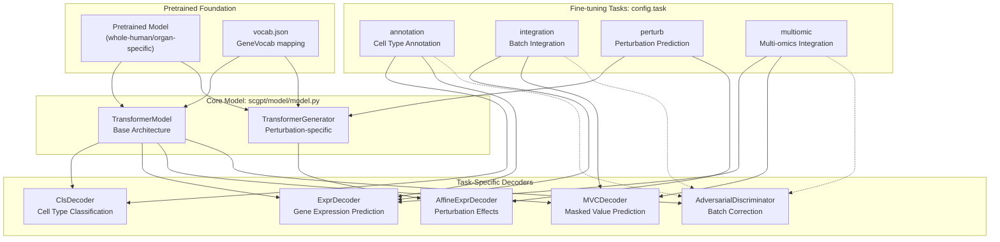
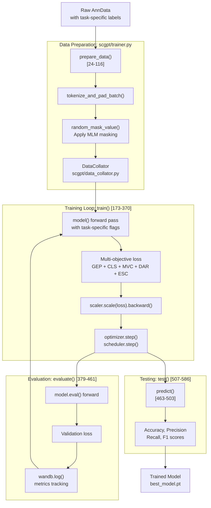
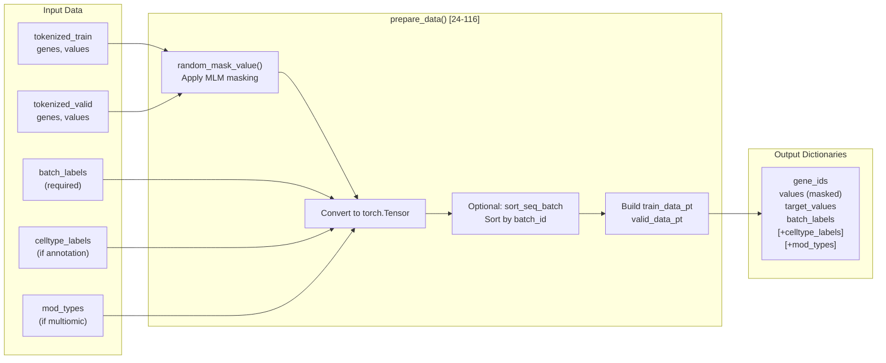
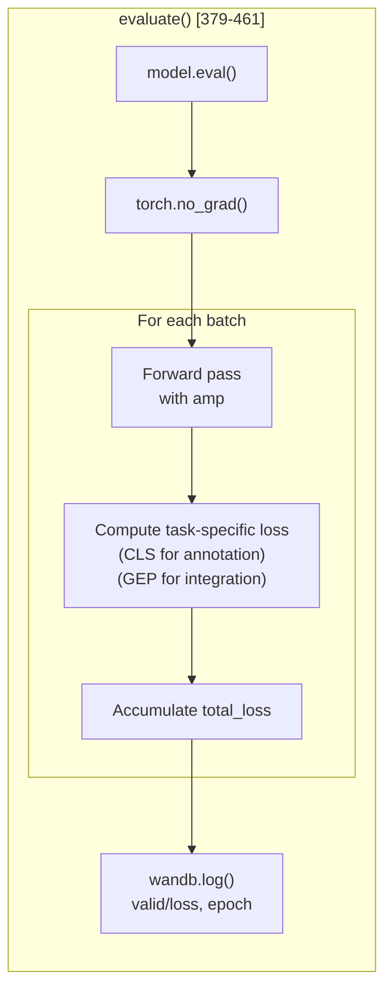
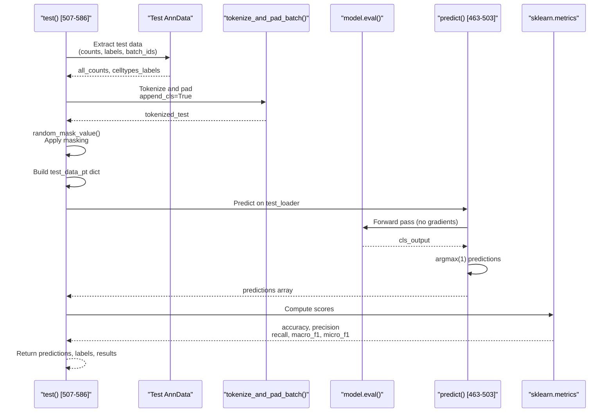
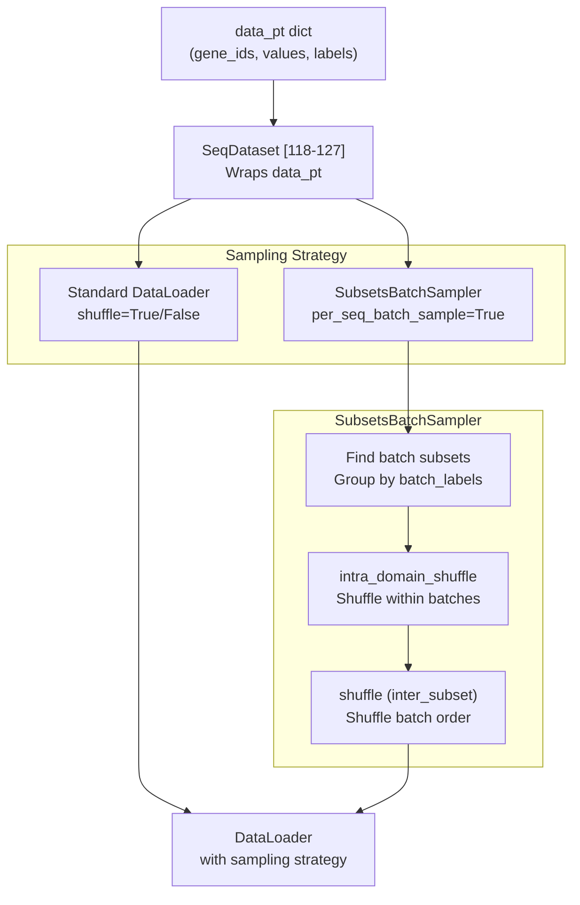
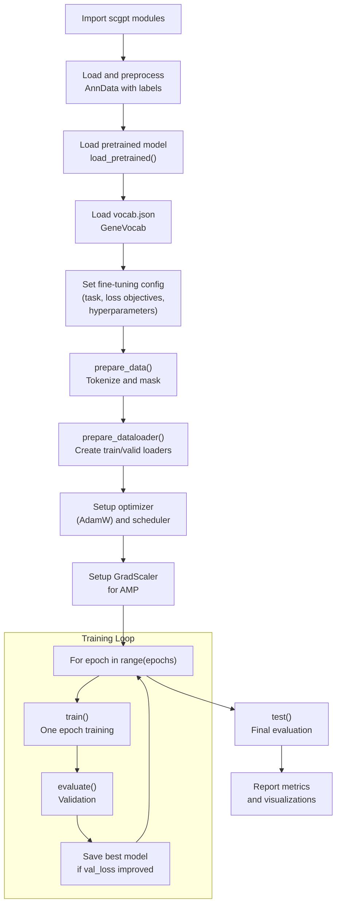

# Fine-tuning Applications

<details>
<summary>Relevant source files</summary>

The following files were used as context for generating this wiki page:

- [README.md](README.md)
- [scgpt/data_collator.py](scgpt/data_collator.py)
- [scgpt/trainer.py](scgpt/trainer.py)

</details>


## Purpose and Scope

This document covers the fine-tuning workflow for adapting pretrained scGPT models to specific downstream tasks. Fine-tuning involves training the model on task-specific labeled data with appropriate loss objectives, in contrast to zero-shot applications which use pretrained embeddings directly without additional training. 

For zero-shot inference without fine-tuning, see [Zero-Shot Applications](#4). For details about the cell embedding generation process used in both workflows, see [Cell Embedding System](#5). For information about available pretrained checkpoints to start fine-tuning from, see [Pretrained Models](#7).

The four primary fine-tuning tasks supported by scGPT are:
- **Cell Type Annotation** - supervised cell type classification (see [6.1](#6.1))
- **Perturbation Prediction** - predicting gene perturbation effects (see [6.2](#6.2))
- **Multi-omics Integration** - integrating RNA and protein modalities (see [6.3](#6.3))
- **Gene Regulatory Network Analysis** - inferring gene-gene relationships (see [6.4](#6.4))

**Sources:** [README.md:71-86](), [scgpt/trainer.py:24-35]()

---

## Fine-tuning Task Architecture

The following diagram shows how the four fine-tuning tasks relate to the core model architecture and specialized decoders:



**Task Configuration Mapping:**

| Task (`config.task`) | Primary Model | Key Loss Objectives | Input Requirements |
|---------------------|---------------|-------------------|-------------------|
| `"annotation"` | TransformerModel | CLS, GEP | `celltype_labels` |
| `"integration"` | TransformerModel | GEP, GEPC, DAR | `batch_labels` |
| `"perturb"` | TransformerGenerator | GEP, custom MSE | `perturbation_flags` |
| `"multiomic"` | TransformerModel | GEP, GEPC | `mod_types` (modality) |

**Sources:** [scgpt/trainer.py:24-35](), [README.md:60-69]()

---

## Fine-tuning Training Pipeline

The complete training pipeline from data to deployed model:

### Training Workflow Diagram



**Sources:** [scgpt/trainer.py:24-586]()

---

## Data Preparation for Fine-tuning

The `prepare_data()` function handles task-specific data preparation:

### prepare_data() Function Structure



**Key Configuration Parameters:**
- `config.mask_ratio`: Proportion of values to mask (e.g., 0.15)
- `config.mask_value`: Value to use for masked positions (e.g., -1)
- `config.pad_value`: Value for padding (e.g., 0)
- `sort_seq_batch`: Whether to sort samples by batch_id for domain-specific batching

**Sources:** [scgpt/trainer.py:24-116]()

---

## Multi-Objective Training Framework

scGPT supports training with multiple loss objectives simultaneously. The `train()` function implements a flexible multi-objective framework:

### Loss Objectives Overview

| Loss Abbreviation | Full Name | Purpose | When Active | Decoder Used |
|-------------------|-----------|---------|-------------|--------------|
| GEP | Gene Expression Prediction | Masked language modeling on expression values | `config.GEP=True` | ExprDecoder |
| CLS | Classification | Cell type prediction | `config.CLS=True` | ClsDecoder |
| GEPC (MVC) | Gene Expression Prediction with Contrastive | Masked value prediction with contrastive learning | `config.GEPC=True` | MVCDecoder |
| DAR | Domain Adversarial Regularization | Batch effect removal | `config.DAR=True` | AdversarialDiscriminator |
| ESC | Elastic Similarity Constraint | Cell similarity constraint | `config.ESC=True` | Built into model |

### Multi-Objective Loss Computation

```mermaid
flowchart TD
    INPUT["Model Forward Pass<br/>output_dict"]
    
    subgraph "Loss Computation: train() [238-290]"
        INIT["loss = 0.0"]
        
        CHECK_GEP{"config.GEP?"}
        CALC_GEP["loss_gep = criterion_gep_gepc()<br/>masked_positions"]
        ADD_GEP["loss += loss_gep"]
        
        CHECK_CLS{"config.CLS?"}
        CALC_CLS["loss_cls = criterion_cls()<br/>celltype_labels"]
        ADD_CLS["loss += loss_cls"]
        
        CHECK_GEPC{"config.GEPC?"}
        CALC_GEPC["loss_gepc = criterion_gep_gepc()<br/>mvc_output"]
        ADD_GEPC["loss += loss_gepc"]
        
        CHECK_ESC{"config.ESC?"}
        CALC_ESC["loss_ecs = 10 * loss_ecs"]
        ADD_ESC["loss += loss_ecs"]
        
        CHECK_DAR{"config.DAR?"}
        CALC_DAR["loss_dab = criterion_dab()<br/>batch_labels"]
        ADD_DAR["loss += dab_weight * loss_dab"]
    end
    
    OUTPUT["Total Loss<br/>for backprop"]
    
    INPUT --> INIT
    INIT --> CHECK_GEP
    CHECK_GEP -->|Yes| CALC_GEP
    CALC_GEP --> ADD_GEP
    CHECK_GEP -->|No| CHECK_CLS
    ADD_GEP --> CHECK_CLS
    
    CHECK_CLS -->|Yes| CALC_CLS
    CALC_CLS --> ADD_CLS
    CHECK_CLS -->|No| CHECK_GEPC
    ADD_CLS --> CHECK_GEPC
    
    CHECK_GEPC -->|Yes| CALC_GEPC
    CALC_GEPC --> ADD_GEPC
    CHECK_GEPC -->|No| CHECK_ESC
    ADD_GEPC --> CHECK_ESC
    
    CHECK_ESC -->|Yes| CALC_ESC
    CALC_ESC --> ADD_ESC
    CHECK_ESC -->|No| CHECK_DAR
    ADD_ESC --> CHECK_DAR
    
    CHECK_DAR -->|Yes| CALC_DAR
    CALC_DAR --> ADD_DAR
    CHECK_DAR -->|No| OUTPUT
    ADD_DAR --> OUTPUT
```



**Loss Function Implementations:**
- `criterion_gep_gepc`: Typically `masked_relative_error()` from [scgpt/loss.py]()
- `criterion_cls`: CrossEntropyLoss for classification
- `criterion_dab`: Adversarial loss for batch correction
- `criterion_neg_log_bernoulli`: For explicit zero probability modeling

**Sources:** [scgpt/trainer.py:238-290]()

---

## Training Loop Implementation

The `train()` function implements a single epoch of training with automatic mixed precision (AMP) support:

### Training Iteration Details

```mermaid
sequenceDiagram
    participant DL as "DataLoader<br/>(batch iterator)"
    participant MODEL as "TransformerModel<br/>or Generator"
    participant LOSS as "Loss Functions"
    participant OPT as "Optimizer<br/>+ Scheduler"
    participant WANDB as "wandb<br/>logging"
    
    loop For each batch
        DL->>MODEL: input_gene_ids, input_values<br/>batch_labels, celltype_labels
        MODEL->>MODEL: Forward pass with AMP<br/>torch.cuda.amp.autocast()
        MODEL-->>LOSS: output_dict<br/>(mlm_output, cls_output, etc)
        
        LOSS->>LOSS: Compute multi-objective loss<br/>GEP + CLS + GEPC + DAR + ESC
        LOSS-->>MODEL: Total loss
        
        MODEL->>MODEL: scaler.scale(loss).backward()<br/>Gradient computation
        MODEL->>MODEL: clip_grad_norm_(max_norm=1.0)
        
        MODEL->>OPT: scaler.step(optimizer)<br/>scaler.update()
        OPT->>OPT: scheduler.step()
        
        MODEL->>WANDB: Log metrics<br/>(train/gep, train/cls, etc)
        
        alt Every log_interval batches
            MODEL->>MODEL: Print progress<br/>(loss, lr, ms/batch)
        end
    end
```

**Key Training Features:**

1. **Automatic Mixed Precision (AMP):** [scgpt/trainer.py:220]()
   ```python
   with torch.cuda.amp.autocast(enabled=config.amp):
       output_dict = model(...)
   ```

2. **Gradient Clipping:** [scgpt/trainer.py:298-301]()
   ```python
   torch.nn.utils.clip_grad_norm_(
       model.parameters(), 1.0,
       error_if_nonfinite=False if scaler.is_enabled() else True
   )
   ```

3. **Gradient Scaling:** [scgpt/trainer.py:293-310]()
   - Uses `torch.cuda.amp.GradScaler` for numerical stability
   - Prevents underflow with mixed precision training

4. **Logging Interval:** [scgpt/trainer.py:330-369]()
   - Prints progress every `config.log_interval` batches
   - Logs learning rate, loss components, and throughput

**Sources:** [scgpt/trainer.py:173-370]()

---

## Task-Specific Configuration

Different fine-tuning tasks require different configurations and data inputs:

### Annotation Task Configuration

**Objective:** Supervised cell type classification

**Required Inputs:**
- `tokenized_train["genes"]`, `tokenized_train["values"]`
- `train_celltype_labels`: Integer labels for cell types
- `train_batch_labels`: Batch identifiers

**Active Loss Functions:**
- `CLS=True`: Cell type classification loss
- `GEP=True`: Masked expression prediction (optional, for regularization)
- `DAR=True`: Adversarial batch correction (optional)

**Model Forward Configuration:** [scgpt/trainer.py:221-234]()
```python
output_dict = model(
    input_gene_ids,
    input_values,
    src_key_padding_mask=src_key_padding_mask,
    batch_labels=batch_labels if config.use_batch_labels or config.DSBN else None,
    CLS=config.CLS,  # Enable classification head
    MVC=config.GEPC,
    ECS=config.ESC,
)
```

**Evaluation Metric:** [scgpt/trainer.py:566-576]()
- Accuracy, Precision, Recall
- Macro F1, Micro F1

**Sources:** [scgpt/trainer.py:67-69](), [scgpt/trainer.py:213-214](), [scgpt/trainer.py:270-279]()

---

### Integration Task Configuration

**Objective:** Batch integration while preserving biological variation

**Required Inputs:**
- `tokenized_train["genes"]`, `tokenized_train["values"]`
- `train_batch_labels`: Batch identifiers
- No cell type labels required (unsupervised)

**Active Loss Functions:**
- `GEP=True`: Masked expression prediction
- `GEPC=True`: Masked value prediction with contrastive learning
- `DAR=True`: Domain adversarial regularization for batch effect removal
- `dab_weight`: Weight for adversarial loss (e.g., 0.5)

**Model Forward Configuration:**
```python
output_dict = model(
    input_gene_ids,
    input_values,
    src_key_padding_mask=src_key_padding_mask,
    batch_labels=batch_labels,  # Required for integration
    CLS=False,  # No classification for integration
    MVC=True,   # Enable contrastive learning
    ECS=False,
)
```

**Evaluation Metrics:** [scgpt/trainer.py:589-686]()
- scib metrics via `eval_scib_metrics()` [scgpt/utils.py]()
- avg_bio: Average biological conservation score
- avg_batch: Average batch correction score
- UMAP visualizations

**Sources:** [scgpt/trainer.py:432-437](), [README.md:71-73]()

---

### Multi-omics Task Configuration

**Objective:** Integrate RNA and protein modalities

**Required Inputs:**
- `tokenized_train["genes"]`, `tokenized_train["values"]`
- `tokenized_train["mod_types"]`: Modality type indicators
  - 0 for RNA genes
  - 1 for protein features
- `train_batch_labels`: Batch identifiers

**Active Loss Functions:**
- `GEP=True`: Masked expression prediction
- `GEPC=True`: Masked value prediction
- `use_mod=True`: Enable modality-aware encoding

**Model Forward Configuration:** [scgpt/trainer.py:231]()
```python
output_dict = model(
    input_gene_ids,
    input_values,
    src_key_padding_mask=src_key_padding_mask,
    batch_labels=batch_labels,
    CLS=False,
    MVC=True,
    ECS=False,
    mod_types=mod_types,  # Modality information
)
```

**Data Preparation:** [scgpt/trainer.py:71-75]()
```python
if config.task == "multiomic":
    tensor_mod_types_train, tensor_mod_types_valid = (
        tokenized_train["mod_types"].long(),
        tokenized_valid["mod_types"].long(),
    )
```

**Sources:** [scgpt/trainer.py:71-75](), [scgpt/trainer.py:112-114]()

---

### Perturbation Task Configuration

**Objective:** Predict gene perturbation effects (uses TransformerGenerator)

**Required Model:** `TransformerGenerator` (not standard TransformerModel)

**Required Inputs:**
- Gene expression data
- Perturbation flags indicating which genes are perturbed
- Control (unperturbed) expression data

**Specialized Components:**
- `PerturbationEncoder`: Encodes perturbation status
- `AffineExprDecoder`: Predicts expression changes as coefficients + bias

**Loss Function:**
- Typically MSE between predicted and observed perturbed expression
- Custom implementation in perturbation-specific training scripts

**Note:** This task uses different model architecture and training loop than other tasks. See [Perturbation Prediction](#6.2) for detailed documentation.

**Sources:** [README.md:80]()

---

## Evaluation and Testing

### Validation During Training

The `evaluate()` function runs validation after each training epoch:



**Validation Logic by Task:** [scgpt/trainer.py:428-437]()

```python
if config.task == "annotation":
    output_values = output_dict["cls_output"]
    loss = criterion_cls(output_values, celltype_labels)

elif config.task in ["integration", "multiomic"]:
    output_values = output_dict["mlm_output"]
    masked_positions = input_values.eq(config.mask_value)
    loss = criterion_gep_gepc(output_values, target_values, masked_positions)
```

**Sources:** [scgpt/trainer.py:379-461]()

---

### Final Testing and Metrics

The `test()` function evaluates the trained model on held-out test data:

### Test Pipeline



**Metrics Computed:** [scgpt/trainer.py:566-576]()

| Metric | Description | Function |
|--------|-------------|----------|
| Accuracy | Overall classification accuracy | `accuracy_score()` |
| Precision | Macro-averaged precision | `precision_score(average="macro")` |
| Recall | Macro-averaged recall | `recall_score(average="macro")` |
| Macro F1 | F1 score averaged across classes | `f1_score(average="macro")` |
| Micro F1 | F1 score averaged across samples | `f1_score(average="micro")` |

**Integration Evaluation:** [scgpt/trainer.py:589-686]()

For integration tasks, `eval_testdata()` computes:
- Cell embeddings via `model.encode_batch()`
- scib metrics via `eval_scib_metrics(adata_t)`
- UMAP visualizations colored by batch and cell type

**Sources:** [scgpt/trainer.py:463-586](), [scgpt/trainer.py:589-686]()

---

## DataLoader and Batch Sampling

scGPT supports specialized batch sampling strategies for fine-tuning:

### prepare_dataloader() Configuration



**Key Parameters:** [scgpt/trainer.py:130-170]()

- `per_seq_batch_sample=True`: Sample batches such that each batch comes from a single biological batch
  - Useful for domain-specific training
  - Uses `SubsetsBatchSampler` [scgpt/__init__.py]()
- `intra_domain_shuffle=True`: Shuffle samples within each biological batch
- `shuffle=True`: Shuffle order of biological batches

**Example Usage:**
```python
train_loader = prepare_dataloader(
    train_data_pt,
    batch_size=64,
    shuffle=True,
    intra_domain_shuffle=True,
    per_seq_batch_sample=True,  # Domain-specific batching
)
```

**Sources:** [scgpt/trainer.py:130-170]()

---

## Example Fine-tuning Script Structure

A typical fine-tuning script follows this pattern:



**Example Script Location:** [examples/finetune_integration.py]() (referenced in README)

**Core Functions Used:**
1. `load_pretrained()` - Load pretrained checkpoint [scgpt/utils/util.py:304]()
2. `prepare_data()` - Prepare task-specific data [scgpt/trainer.py:24-116]()
3. `prepare_dataloader()` - Create DataLoader [scgpt/trainer.py:130-170]()
4. `train()` - Training loop [scgpt/trainer.py:173-370]()
5. `evaluate()` - Validation loop [scgpt/trainer.py:379-461]()
6. `test()` - Final testing [scgpt/trainer.py:507-586]()

**Sources:** [README.md:71-73](), [scgpt/trainer.py:1-686]()

---

## Common Configuration Parameters

The following configuration parameters control fine-tuning behavior:

### Training Configuration

| Parameter | Type | Description | Default/Example |
|-----------|------|-------------|-----------------|
| `task` | str | Task type: "annotation", "integration", "perturb", "multiomic" | Required |
| `mask_ratio` | float | Proportion of values to mask | 0.15 |
| `mask_value` | int | Value for masked positions | -1 |
| `pad_value` | int | Value for padding | 0 |
| `pad_token` | str | Padding token name | "<pad>" |
| `batch_size` | int | Training batch size | 64 |
| `max_seq_len` | int | Maximum sequence length | 3001 |
| `epochs` | int | Number of training epochs | 10-50 |
| `learning_rate` | float | Initial learning rate | 1e-4 |
| `amp` | bool | Enable automatic mixed precision | True |

### Loss Objective Flags

| Parameter | Type | Description | Tasks Using It |
|-----------|------|-------------|----------------|
| `GEP` | bool | Gene Expression Prediction (MLM) | All |
| `CLS` | bool | Classification head | annotation |
| `GEPC` (or `MVC`) | bool | Masked Value with Contrastive | integration, multiomic |
| `DAR` | bool | Domain Adversarial Regularization | integration |
| `ESC` | bool | Elastic Similarity Constraint | integration |
| `dab_weight` | float | Weight for adversarial loss | 0.5 (if DAR) |
| `explicit_zero_prob` | bool | Model zero expression probability | False |

### Model Architecture Flags

| Parameter | Type | Description | Default |
|-----------|------|-------------|---------|
| `use_batch_labels` | bool | Provide batch labels to model | Varies by task |
| `DSBN` | bool | Domain-Specific Batch Normalization | False |
| `use_mod` | bool | Enable modality encoding | multiomic only |
| `include_zero_gene` | bool | Include genes with zero expression | True |
| `append_cls` | bool | Append CLS token at beginning | True |

### Logging Configuration

| Parameter | Type | Description | Default |
|-----------|------|-------------|---------|
| `log_interval` | int | Batches between progress logs | 100 |
| `wandb` | - | Weights & Biases integration | Optional |

**Sources:** [scgpt/trainer.py:24-370]()

---

## Summary

Fine-tuning scGPT involves:

1. **Loading a pretrained model** from the model zoo (see [Pretrained Models](#7))
2. **Selecting a task type** (`annotation`, `integration`, `perturb`, or `multiomic`)
3. **Preparing task-specific data** with appropriate labels using `prepare_data()`
4. **Configuring loss objectives** (GEP, CLS, GEPC, DAR, ESC) via config flags
5. **Running the training loop** with `train()` and `evaluate()` functions
6. **Testing the fine-tuned model** using `test()` or `eval_testdata()`

The modular design allows mixing and matching loss objectives for different biological tasks while leveraging the same underlying transformer architecture. The training infrastructure in `scgpt/trainer.py` handles the complexity of multi-objective optimization, gradient scaling, and task-specific evaluation.

For detailed guidance on specific tasks, see:
- [Cell Type Annotation](#6.1) - Supervised classification
- [Perturbation Prediction](#6.2) - Predicting perturbation effects
- [Multi-omics Integration](#6.3) - RNA + protein integration
- [Gene Regulatory Network Analysis](#6.4) - GRN inference

**Sources:** [scgpt/trainer.py:1-686](), [README.md:71-86](), [scgpt/data_collator.py:1-203]()

---