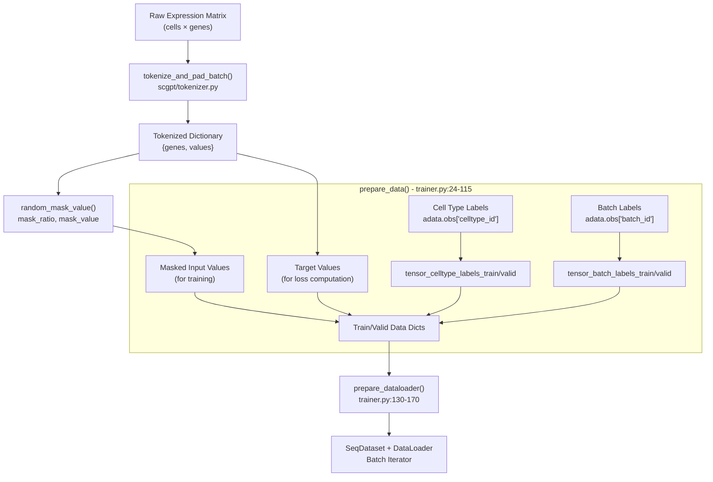
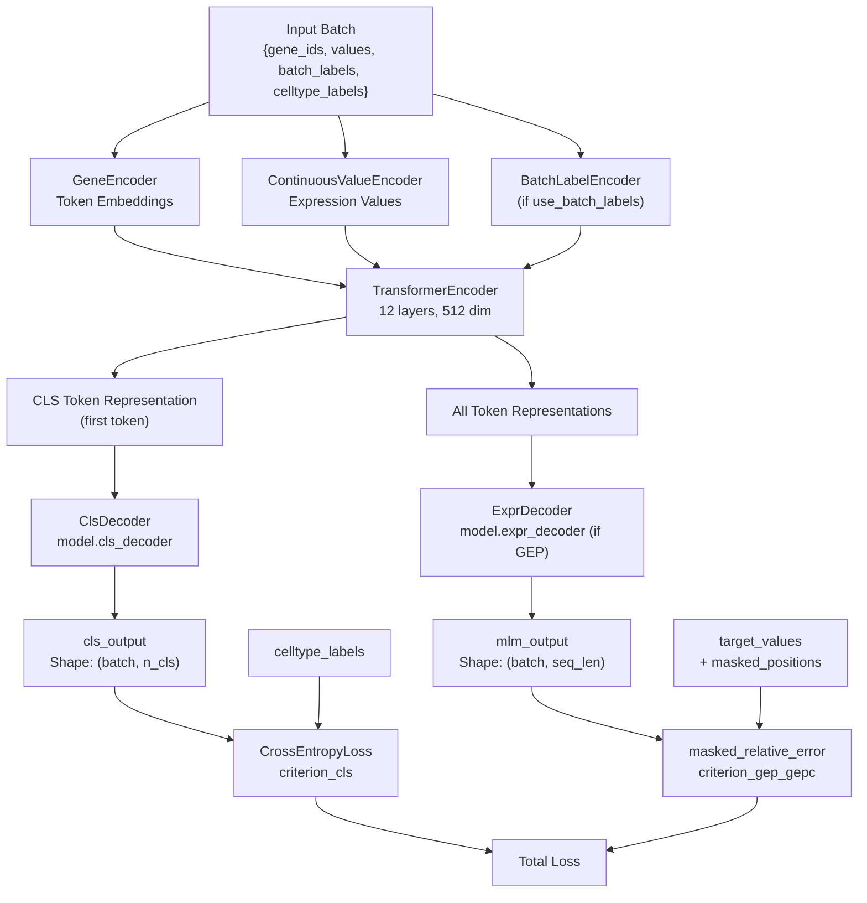
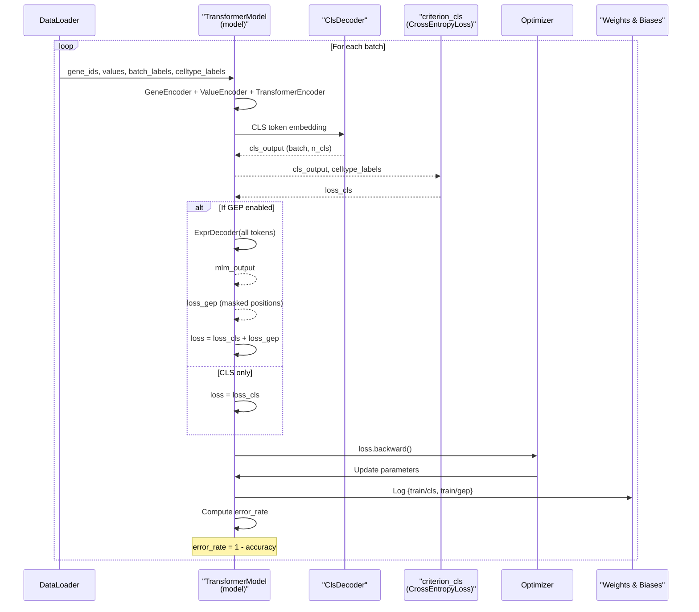
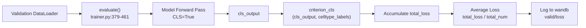
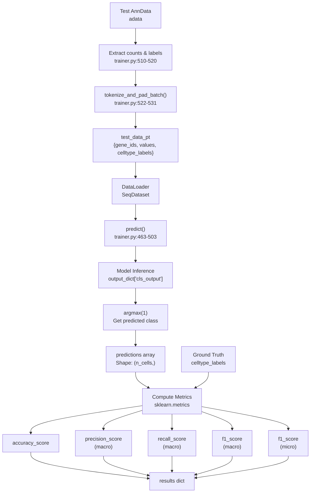
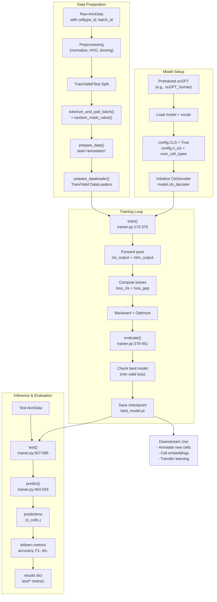

# Cell Type Annotation

<details>
<summary>Relevant source files</summary>

The following files were used as context for generating this wiki page:

- [scgpt/trainer.py](scgpt/trainer.py)
- [tutorials/Tutorial_Annotation.ipynb](tutorials/Tutorial_Annotation.ipynb)

</details>


## Purpose and Scope

This page documents the **cell type annotation** task in scGPT, which involves fine-tuning a pretrained scGPT model to classify cells into discrete cell type categories. This is a supervised learning task where the model learns to predict cell type labels from gene expression profiles.

For zero-shot cell type prediction without fine-tuning, see [Reference Mapping](#4.1). For generating cell embeddings that can be used with downstream classifiers, see [Cell Embedding System](#5). For the underlying model architecture, see [Model Architecture](#3.1).

## Overview

Cell type annotation in scGPT is implemented as a **multi-objective fine-tuning task** that combines:
- **Gene Expression Prediction (GEP)**: Masked language modeling on gene expression values
- **Cell Type Classification (CLS)**: Supervised classification using cell type labels
- Optional objectives: GEPC (masked value prediction), DAR (domain adversarial regularization), ECS (elastic cell similarity)

The annotation task uses the `ClsDecoder` head of the `TransformerModel` to predict cell type labels while simultaneously maintaining the model's ability to reconstruct masked gene expression values. This multi-task approach helps prevent overfitting and preserves the pretrained knowledge.

**Key Characteristics:**
- Task identifier: `config.task = "annotation"`
- Primary loss: Cross-entropy classification loss (`criterion_cls`)
- Evaluation metrics: Accuracy, Precision, Recall, Macro F1, Micro F1
- Data requirements: Cell type labels (`celltype_id` or `celltype_labels`)

Sources: [scgpt/trainer.py:35](), [scgpt/trainer.py:67-69](), [scgpt/trainer.py:270-273]()

## Data Preparation Pipeline

### Input Data Requirements

The annotation task requires `AnnData` objects with the following structure:

| Field | Location | Description | Format |
|-------|----------|-------------|--------|
| Expression matrix | `adata.layers[input_layer_key]` | Raw or normalized counts | Dense or sparse matrix |
| Cell type labels | `adata.obs["celltype_id"]` | Numeric cell type IDs | Integer, starting from 0 |
| Batch labels | `adata.obs["batch_id"]` | Batch/domain identifiers | Integer |
| Gene names | `adata.var_names` or `adata.var["gene_name"]` | Gene identifiers | String |

### Tokenization and Masking



**Data Preparation Flow for Annotation Task**

Sources: [scgpt/trainer.py:24-115](), [scgpt/trainer.py:130-170]()

### Key Functions

**`prepare_data()`** [scgpt/trainer.py:24-115]()

This function prepares tokenized data for the annotation task:

```python
# Annotation-specific logic
if config.task == "annotation":
    tensor_celltype_labels_train = torch.from_numpy(train_celltype_labels).long()
    tensor_celltype_labels_valid = torch.from_numpy(valid_celltype_labels).long()
    
    train_data_pt["celltype_labels"] = tensor_celltype_labels_train
    valid_data_pt["celltype_labels"] = tensor_celltype_labels_valid
```

The function returns two dictionaries containing:
- `gene_ids`: Tokenized gene IDs
- `values`: Masked expression values (input)
- `target_values`: Original expression values (targets)
- `batch_labels`: Batch identifiers
- `celltype_labels`: Cell type labels (annotation-specific)

**`prepare_dataloader()`** [scgpt/trainer.py:130-170]()

Creates `DataLoader` instances with optional per-batch sampling strategies. For annotation tasks with batch effects, `per_seq_batch_sample=True` ensures balanced sampling across batches using `SubsetsBatchSampler`.

Sources: [scgpt/trainer.py:67-69](), [scgpt/trainer.py:109-111](), [scgpt/trainer.py:141-159]()

## Model Configuration

### Required Configuration Parameters

For cell type annotation, the following configuration parameters are essential:

| Parameter | Purpose | Typical Value |
|-----------|---------|---------------|
| `config.task` | Task identifier | `"annotation"` |
| `config.CLS` | Enable classification head | `True` |
| `config.GEP` | Enable gene expression prediction | `True` (recommended) |
| `config.n_cls` | Number of cell type classes | Number of unique cell types |
| `config.mask_ratio` | Masking ratio for MLM | `0.15` - `0.4` |
| `config.use_batch_labels` | Include batch information | `True` if batch effects exist |
| `config.DSBN` | Domain-specific batch normalization | `True` for cross-batch generalization |

### Model Architecture for Annotation



**Model Forward Pass for Annotation Task**

The model processes inputs through the transformer encoder and outputs predictions from both the classification decoder and (optionally) the expression decoder. The `CLS` token embedding is used for cell type classification.

Sources: [scgpt/trainer.py:221-234](), [scgpt/trainer.py:270-273]()

## Training Process

### Training Loop



**Training Sequence for Annotation Task**

Sources: [scgpt/trainer.py:173-370]()

### Key Training Code

The training function [scgpt/trainer.py:173-370]() implements the annotation training loop:

**Forward Pass and Loss Computation:**
```python
# Lines 221-234: Model forward pass
output_dict = model(
    input_gene_ids,
    input_values,
    src_key_padding_mask=src_key_padding_mask,
    batch_labels=batch_labels if config.use_batch_labels or config.DSBN else None,
    CLS=config.CLS,  # Enable classification head
    MVC=config.GEPC,
    ECS=config.ESC,
)

# Lines 270-273: Classification loss
if config.CLS:
    loss_cls = criterion_cls(output_dict["cls_output"], celltype_labels)
    loss = loss + loss_cls
    metrics_to_log.update({"train/cls": loss_cls.item()})
```

**Error Rate Computation:**
```python
# Lines 275-279: Compute error rate for monitoring
error_rate = 1 - (
    (output_dict["cls_output"].argmax(1) == celltype_labels)
    .sum()
    .item()
) / celltype_labels.size(0)
```

Sources: [scgpt/trainer.py:221-234](), [scgpt/trainer.py:270-279]()

### Multi-Objective Loss

The total loss for annotation tasks typically combines:

1. **Classification Loss (CLS)**: Primary objective for cell type prediction
   - Function: `criterion_cls` (CrossEntropyLoss)
   - Applied to: `cls_output` vs `celltype_labels`

2. **Gene Expression Prediction (GEP)**: Auxiliary objective to maintain generalization
   - Function: `criterion_gep_gepc` (masked relative error)
   - Applied to: `mlm_output` vs `target_values` at masked positions

3. **Optional Objectives**:
   - **GEPC (MVC)**: Masked value prediction with different decoder
   - **DAR**: Domain adversarial regularization for batch invariance
   - **ECS**: Elastic cell similarity

Sources: [scgpt/trainer.py:241-290]()

## Evaluation and Prediction

### Validation Evaluation

The `evaluate()` function [scgpt/trainer.py:379-461]() computes validation loss during training:



**Validation Evaluation Flow**

For annotation tasks, the evaluation uses only the classification loss:
```python
# Lines 428-430
if config.task == "annotation":
    output_values = output_dict["cls_output"]
    loss = criterion_cls(output_values, celltype_labels)
```

Sources: [scgpt/trainer.py:379-461](), [scgpt/trainer.py:428-430]()

### Test Prediction and Metrics

The `test()` function [scgpt/trainer.py:507-586]() performs final evaluation on test data:

**Prediction Process:**

1. **Tokenize test data** using `tokenize_and_pad_batch()` [scgpt/trainer.py:522-531]()
2. **Generate predictions** using `predict()` [scgpt/trainer.py:463-503]()
3. **Compute metrics** using scikit-learn [scgpt/trainer.py:567-571]()



**Test Prediction and Metrics Computation**

**Metrics Computed:**

| Metric | Function | Averaging | Description |
|--------|----------|-----------|-------------|
| Accuracy | `accuracy_score()` | Overall | Fraction of correct predictions |
| Precision | `precision_score()` | `macro` | Average precision across classes |
| Recall | `recall_score()` | `macro` | Average recall across classes |
| Macro F1 | `f1_score()` | `macro` | Unweighted mean F1 across classes |
| Micro F1 | `f1_score()` | `micro` | Global F1 treating all cells equally |

Sources: [scgpt/trainer.py:507-586](), [scgpt/trainer.py:567-571]()

### Prediction Function

The `predict()` function [scgpt/trainer.py:463-503]() generates cell type predictions:

```python
# Lines 499-501: Extract predictions from classification output
output_values = output_dict["cls_output"]
preds = output_values.argmax(1).cpu().numpy()
predictions.append(preds)

# Line 503: Concatenate all batch predictions
return np.concatenate(predictions, axis=0)
```

This returns an array of predicted cell type IDs that can be compared with ground truth labels.

Sources: [scgpt/trainer.py:463-503](), [scgpt/trainer.py:499-503]()

## Complete Workflow

### End-to-End Pipeline



**Complete Cell Type Annotation Workflow**

Sources: [scgpt/trainer.py:24-586]()

### Typical Usage Pattern

A typical annotation workflow follows these steps:

1. **Data Preparation**:
   - Load reference dataset with cell type annotations
   - Split into train/validation/test sets
   - Ensure `celltype_id` is numeric starting from 0
   - Tokenize using `tokenize_and_pad_batch()` with pretrained vocab

2. **Model Configuration**:
   - Load pretrained model (e.g., `scGPT_human`)
   - Set `config.task = "annotation"`
   - Set `config.CLS = True` and `config.n_cls` to number of cell types
   - Optionally enable `config.DSBN` for batch effect handling

3. **Training**:
   - Call `train()` for each epoch
   - Monitor classification loss (`train/cls`) and error rate
   - Validate using `evaluate()` on validation set
   - Save best model based on validation loss

4. **Evaluation**:
   - Load best checkpoint
   - Run `test()` on held-out test set
   - Report accuracy, precision, recall, F1 scores
   - Optionally visualize confusion matrix

5. **Deployment**:
   - Use trained model to annotate new cells
   - Generate cell embeddings for downstream analysis
   - Fine-tune on domain-specific datasets

### Comparison with Zero-Shot Reference Mapping

| Aspect | Fine-tuned Annotation (This Page) | Zero-Shot Reference Mapping ([#4.1](#4.1)) |
|--------|-----------------------------------|---------------------------------------------|
| Training | Requires fine-tuning with cell type labels | No training required |
| Data needs | Labeled training set + validation set | Reference dataset only |
| Model modification | Updates model weights | Uses frozen pretrained model |
| Prediction method | `ClsDecoder` classification head | FAISS k-NN search on embeddings |
| Use case | Task-specific, high accuracy | General-purpose, quick deployment |
| Computational cost | High (training required) | Low (inference only) |

Sources: [scgpt/trainer.py:173-586]()

---

**Summary**: Cell type annotation in scGPT is a supervised fine-tuning task that leverages the `ClsDecoder` head to classify cells while optionally maintaining gene expression prediction capability. The workflow is implemented primarily in [scgpt/trainer.py](), with key functions including `prepare_data()`, `train()`, `evaluate()`, `predict()`, and `test()`. The multi-objective training approach combines classification loss with masked language modeling to achieve robust cell type predictions while preserving pretrained knowledge.

---