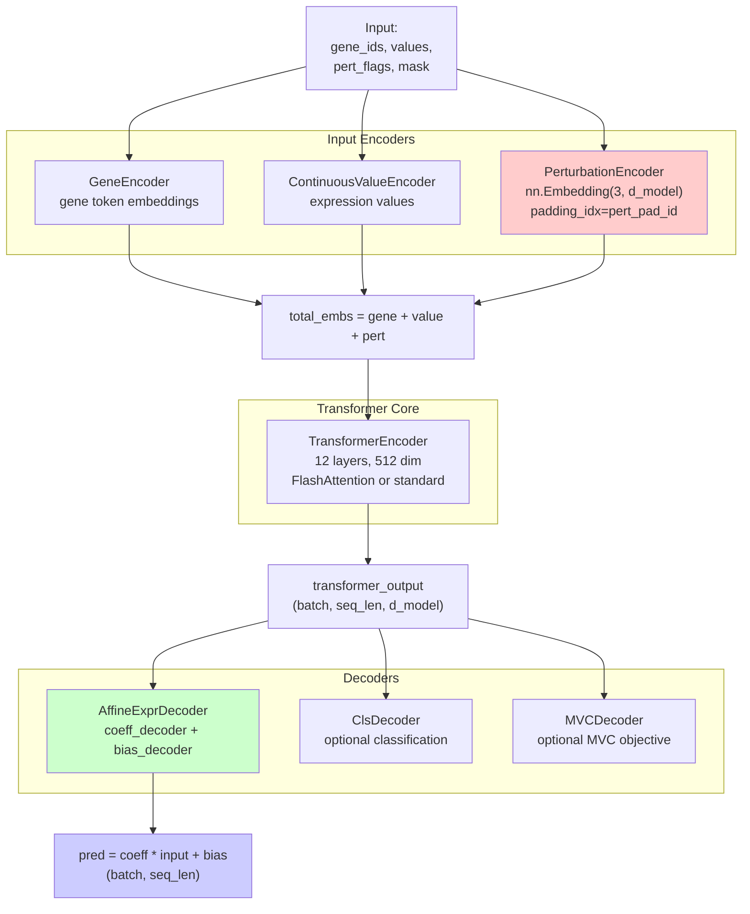
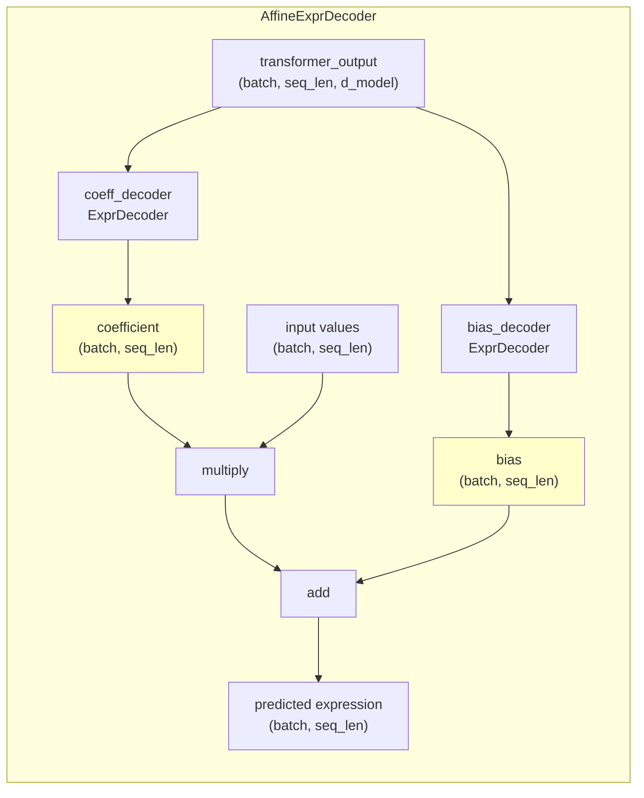
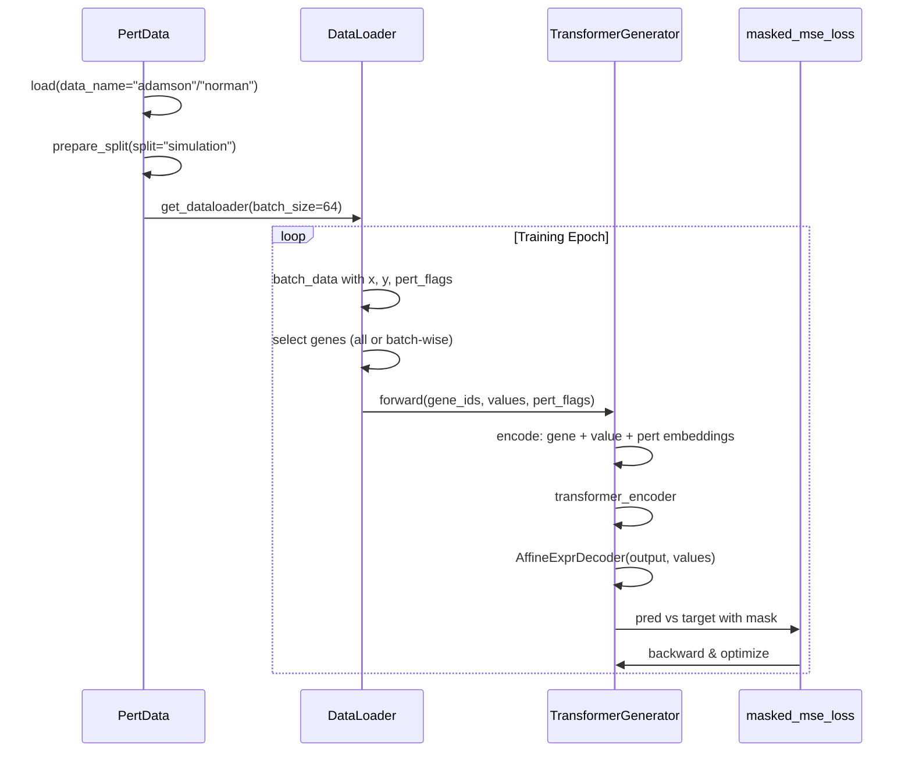
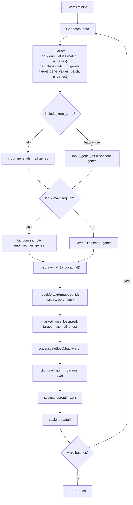
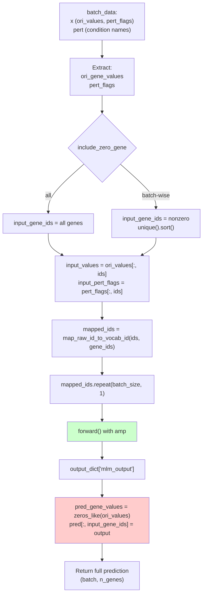
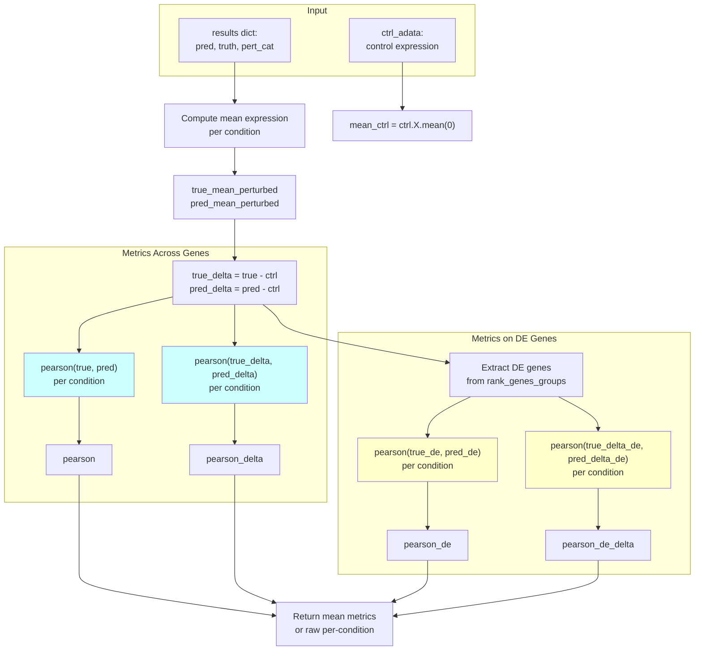

# Perturbation Prediction

<details>
<summary>Relevant source files</summary>

The following files were used as context for generating this wiki page:

- [docs/tutorial_reference_mapping.nblink](docs/tutorial_reference_mapping.nblink)
- [scgpt/model/generation_model.py](scgpt/model/generation_model.py)
- [scgpt/model/model.py](scgpt/model/model.py)
- [scgpt/utils/util.py](scgpt/utils/util.py)
- [tutorials/Tutorial_Perturbation.ipynb](tutorials/Tutorial_Perturbation.ipynb)

</details>


This page documents how to fine-tune scGPT for predicting the effects of genetic perturbations on cell state. Given a control cell's gene expression profile and a perturbation specification (e.g., gene knockout, overexpression), the model predicts the resulting gene expression profile after the perturbation is applied.

**Scope**: This page covers the `TransformerGenerator` model architecture, the affine expression decoder, perturbation encoding, training procedures, and evaluation metrics specific to perturbation prediction tasks. For general cell type classification, see [Cell Type Annotation](#6.1). For analyzing gene regulatory relationships, see [Gene Regulatory Network Analysis](#6.4).

## Overview

Perturbation prediction is a supervised fine-tuning task where scGPT learns to predict how genetic interventions alter cellular gene expression. This capability is critical for understanding gene function, designing therapeutic interventions, and modeling cellular responses to perturbations.

The key innovation is the `TransformerGenerator` class, which extends the base transformer architecture with:
- **Perturbation encoding**: Explicit flags indicating which genes are perturbed
- **Affine decoder**: Predicts expression as `coefficient * input_value + bias`
- **Specialized inference method**: `pred_perturb()` for generating predictions

Sources: [scgpt/model/generation_model.py:25-350](), [tutorials/Tutorial_Perturbation.ipynb:1-100]()

## TransformerGenerator Architecture

### Component Diagram



**TransformerGenerator vs TransformerModel**

The `TransformerGenerator` class differs from the base `TransformerModel` in three critical ways:

| Component | TransformerModel | TransformerGenerator |
|-----------|------------------|---------------------|
| **Perturbation Input** | None | `pert_encoder: nn.Embedding(3, d_model)` |
| **Decoder** | `ExprDecoder` (direct prediction) | `AffineExprDecoder` (coefficient + bias) |
| **Inference Method** | `generate()` for autoregressive | `pred_perturb()` for one-shot prediction |

Sources: [scgpt/model/generation_model.py:25-124](), [scgpt/model/model.py:28-160]()

### Affine Expression Decoder

The `AffineExprDecoder` predicts perturbed expression as an affine transformation of the input expression:

```
pred_expression = coefficient * input_expression + bias
```

This formulation is biologically motivated: perturbations often scale existing expression (coefficient) and add a shift term (bias).



**Optional Activations**: The decoder supports optional activation functions (e.g., `ReLU`, `Sigmoid`) and adaptive bias scaling based on non-zero expression means.

Sources: [scgpt/model/generation_model.py:376-442]()

## Training Workflow

### Data Preparation

The training pipeline uses the GEARS framework's `PertData` class to manage perturbation datasets. The data includes:
- **Control cells**: Baseline gene expression
- **Perturbed cells**: Expression after genetic intervention
- **Perturbation flags**: Binary indicators (0=control, 1=perturbed, 2=padding)
- **DE genes**: Differentially expressed genes for evaluation



Sources: [tutorials/Tutorial_Perturbation.ipynb:180-245](), [tutorials/Tutorial_Perturbation.ipynb:711-807]()

### Training Configuration

Key hyperparameters from the tutorial:

| Parameter | Value | Purpose |
|-----------|-------|---------|
| `load_model` | `"../save/scGPT_human"` | Pretrained checkpoint |
| `load_param_prefixs` | `["encoder", "value_encoder", "transformer_encoder"]` | Freeze decoder layers initially |
| `lr` | `1e-4` | Learning rate |
| `batch_size` | `64` | Training batch size |
| `epochs` | `15` | Training epochs |
| `max_seq_len` | `1536` | Maximum genes per batch |
| `include_zero_gene` | `"all"` or `"batch-wise"` | Include zero-expression genes |
| `amp` | `True` | Automatic mixed precision |

The `include_zero_gene` setting controls whether to predict all genes or only expressed genes:
- `"all"`: Predict all genes in vocabulary (slower, more comprehensive)
- `"batch-wise"`: Predict only non-zero genes in current batch (faster, focused)

Sources: [tutorials/Tutorial_Perturbation.ipynb:66-121]()

### Training Loop Implementation

The training loop follows a standard supervised learning pattern with perturbation-specific data handling:



**Key Implementation Details**:
1. **Gene ID Mapping**: Raw gene indices are mapped to vocabulary IDs using `map_raw_id_to_vocab_id()` [scgpt/utils/util.py:273-305]()
2. **Masking**: Unlike MLM training, all positions are used for loss computation (`masked_positions = torch.ones_like(input_values)`)
3. **Gradient Scaling**: Uses `torch.cuda.amp.GradScaler` for mixed precision training
4. **Padding Mask**: Created as `torch.zeros_like(input_values, dtype=torch.bool)` since no actual padding exists

Sources: [tutorials/Tutorial_Perturbation.ipynb:711-807]()

## Inference and Prediction

### pred_perturb Method

The `pred_perturb()` method is the primary inference interface for generating predictions:



**Method Signature**:
```python
def pred_perturb(
    self,
    batch_data,
    include_zero_gene="batch-wise",
    gene_ids=None,
    amp=True,
) -> Tensor
```

Sources: [scgpt/model/generation_model.py:295-350]()

### Evaluation Function

The `eval_perturb()` function runs the model on a test set and collects predictions:

**Workflow**:
1. Set model to `eval()` mode
2. Iterate through test data loader
3. For each batch, call `pred_perturb()`
4. Extract predictions for differentially expressed (DE) genes using `batch.de_idx`
5. Stack all predictions and ground truth
6. Return dictionary with `pert_cat`, `pred`, `truth`, `pred_de`, `truth_de`

Sources: [tutorials/Tutorial_Perturbation.ipynb:809-858]()

## Evaluation Metrics

### compute_perturbation_metrics

The primary evaluation function computes Pearson correlations across genes and conditions:



**Metric Definitions**:

| Metric | Description | Biological Meaning |
|--------|-------------|-------------------|
| `pearson` | Correlation between predicted and true expression across genes | Overall prediction accuracy |
| `pearson_de` | Correlation on differentially expressed genes only | Accuracy on most affected genes |
| `pearson_delta` | Correlation of expression changes (perturbed - control) | Ability to predict perturbation effects |
| `pearson_de_delta` | Correlation of changes on DE genes | Accuracy of predicted differential effects |

**Optional Parameters**:
- `non_zero_genes=True`: Only consider non-zero genes in ground truth
- `return_raw=True`: Return per-condition correlations instead of means

Sources: [scgpt/utils/util.py:429-596]()

### Example Results

From the tutorial, typical metrics after fine-tuning on the Adamson dataset:

```
Epoch 7 validation metrics:
- pearson: 0.9904
- pearson_de: 0.9573
- pearson_delta: 0.6970
- pearson_de_delta: 0.8659
```

The high `pearson` and `pearson_de` indicate excellent prediction of absolute expression levels. The lower `pearson_delta` reflects the inherent difficulty of predicting expression changes, which is a more challenging task.

Sources: [tutorials/Tutorial_Perturbation.ipynb:949]()

## Key Implementation Details

### Perturbation Flags

Perturbation flags are encoded as integers:
- `0`: Padding token (default for `pert_encoder`)
- `1`: Gene is perturbed (knockout/overexpression)
- `2`: Gene is not perturbed (control)

The flags are embedded using `nn.Embedding(3, d_model, padding_idx=0)` and added to gene and value embeddings.

Sources: [scgpt/model/generation_model.py:83](), [tutorials/Tutorial_Perturbation.ipynb:75]()

### Model Initialization

When fine-tuning from a pretrained checkpoint, typically only the encoder components are loaded:

```python
load_param_prefixs = [
    "encoder",              # GeneEncoder
    "value_encoder",        # ContinuousValueEncoder
    "transformer_encoder",  # TransformerEncoder layers
]
```

This allows the `pert_encoder` and `AffineExprDecoder` to be trained from scratch, adapting to the perturbation task while leveraging pretrained gene and expression representations.

Sources: [tutorials/Tutorial_Perturbation.ipynb:87-91](), [tutorials/Tutorial_Perturbation.ipynb:663-693]()

### Loss Function

The training uses `masked_mse_loss` with all positions unmasked:

```python
masked_positions = torch.ones_like(input_values, dtype=torch.bool)
loss = masked_mse_loss(output_values, target_values, masked_positions)
```

This is equivalent to standard MSE loss but uses the same interface as other scGPT training objectives.

Sources: [tutorials/Tutorial_Perturbation.ipynb:765-768]()

## Dataset Support

The tutorial demonstrates integration with the GEARS framework's perturbation datasets:

**Supported Datasets**:
- `"adamson"`: K562 cells with single and combinatorial CRISPR perturbations
- `"norman"`: Chronic myelogenous leukemia cells with perturbations
- Other datasets compatible with GEARS `PertData` interface

**Split Types**:
- `"simulation"`: Simulated train/val/test splits
- `"simulation_single"`: Single perturbations only
- Custom splits via GEARS

Sources: [tutorials/Tutorial_Perturbation.ipynb:114-184]()

## Summary

The perturbation prediction task uses the specialized `TransformerGenerator` architecture with three key innovations:

1. **Perturbation Encoding**: Explicit flags indicate which genes are perturbed
2. **Affine Decoder**: Models expression as `coefficient * input + bias`
3. **Specialized Inference**: `pred_perturb()` method for efficient prediction

The training workflow follows standard supervised learning with perturbation-specific data handling, and evaluation focuses on Pearson correlations for both absolute expression and expression changes. Fine-tuning from pretrained scGPT checkpoints typically achieves >0.99 correlation on absolute expression and >0.85 on expression changes.

Sources: [scgpt/model/generation_model.py:25-350](), [tutorials/Tutorial_Perturbation.ipynb:1-1200](), [scgpt/utils/util.py:429-596]()

---