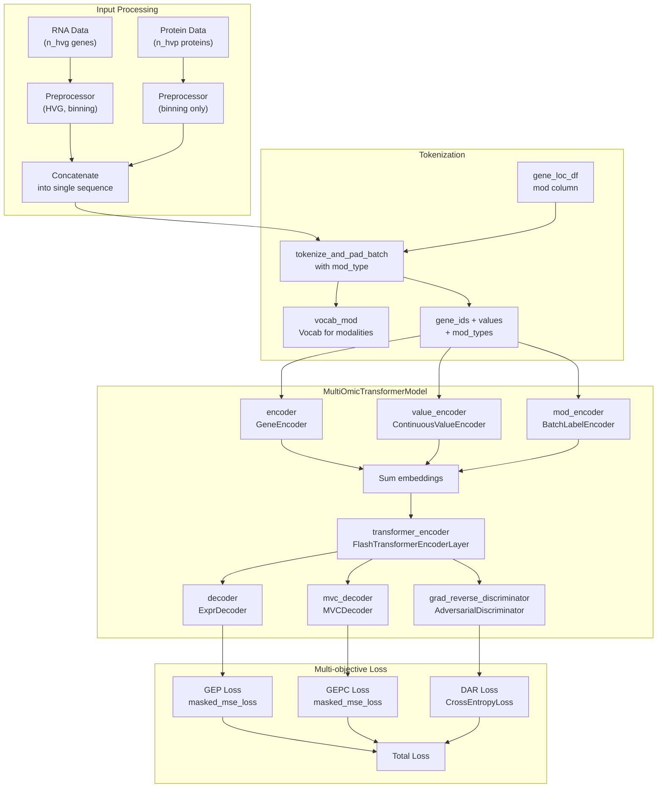
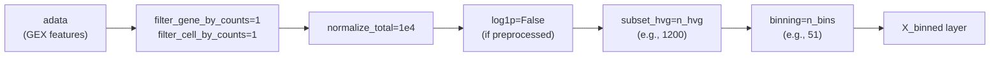
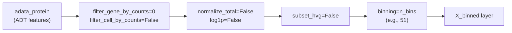
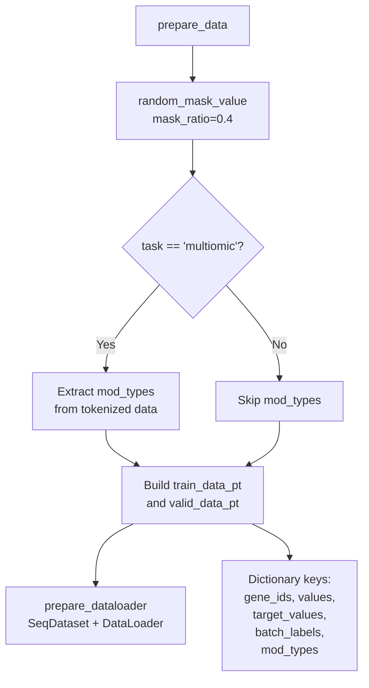
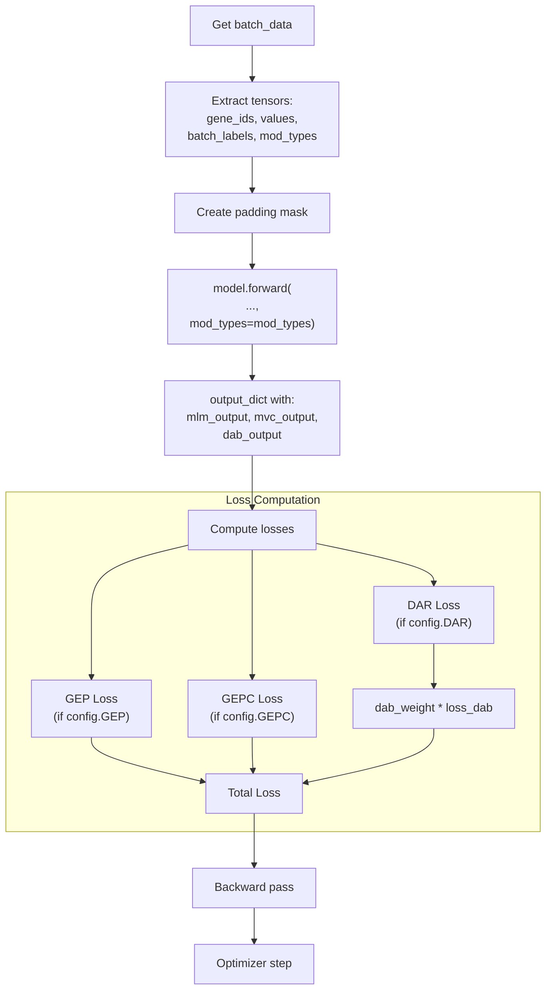
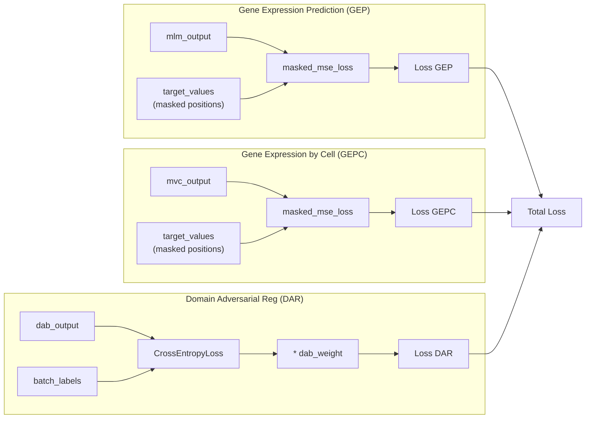
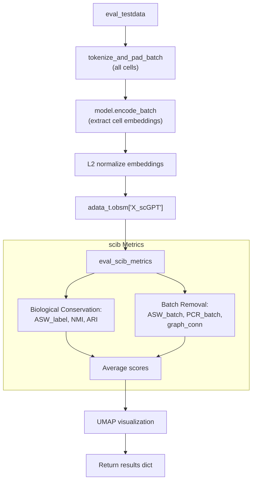
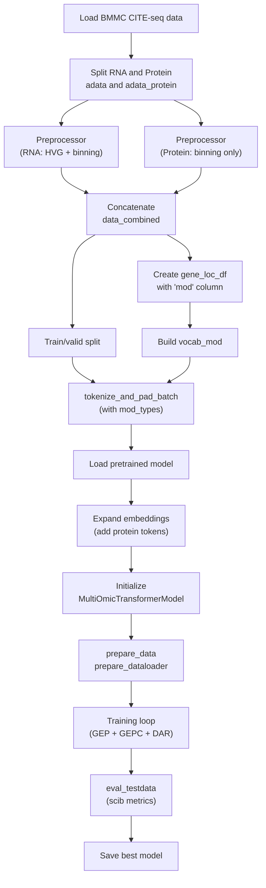

# Multi-omics Integration

<details>
<summary>Relevant source files</summary>

The following files were used as context for generating this wiki page:

- [scgpt/trainer.py](scgpt/trainer.py)
- [tutorials/Tutorial_Attention_GRN.ipynb](tutorials/Tutorial_Attention_GRN.ipynb)
- [tutorials/Tutorial_Multiomics.ipynb](tutorials/Tutorial_Multiomics.ipynb)

</details>


## Purpose and Scope

This document explains how to fine-tune scGPT for multi-omics integration tasks, specifically for integrating paired RNA and protein measurements from technologies like CITE-seq. This tutorial demonstrates modality-aware training where the model learns to distinguish and integrate different data types (e.g., RNA transcripts and surface proteins) while correcting for batch effects.

For zero-shot integration of single-modality data, see [Data Integration](#4.2). For general fine-tuning guidance, see [Fine-tuning Applications](#6).

**Sources:** [tutorials/Tutorial_Multiomics.ipynb:1-22]()

---

## Multi-omics Integration Overview

Multi-omics integration in scGPT refers to training on datasets where each cell contains measurements from multiple molecular modalities (e.g., RNA + protein). The key distinction from single-modality integration is:

1. **Modality-aware embeddings**: Each token is tagged with its modality type (RNA, Protein, etc.)
2. **Per-modality preprocessing**: Each modality is preprocessed independently before concatenation
3. **Joint sequence representation**: Different modalities are combined into a single sequence with modality tokens
4. **Batch correction objectives**: DAR (Domain Adversarial Regularization) helps integrate across batches

The primary use case is **paired multi-omics data** where the same cells have been measured with multiple technologies.

**Sources:** [tutorials/Tutorial_Multiomics.ipynb:8-21]()

---

## System Architecture

### Multi-omics Model Components



**Sources:** [tutorials/Tutorial_Multiomics.ipynb:870-907](), [scgpt/model/model.py]()

---

## Data Preprocessing Pipeline

### Modality-Specific Preprocessing

Different modalities require different preprocessing strategies. RNA data undergoes standard scRNA-seq preprocessing, while protein data has minimal preprocessing.

#### RNA Preprocessing



#### Protein Preprocessing



The protein preprocessing is minimal because:
- Protein measurements are already normalized in CITE-seq protocols
- All proteins should be retained (no HVG selection)
- Only binning is needed to match the token representation

**Sources:** [tutorials/Tutorial_Multiomics.ipynb:428-481]()

---

### Combining Modalities

After independent preprocessing, modalities are concatenated:

```python
# Example from Tutorial_Multiomics.ipynb:499-507
data_combined = np.concatenate([
    adata.layers["X_binned"], 
    adata_protein.layers["X_binned"]
], axis=1)

adata = AnnData(
    X=data_combined,
    obs=adata.obs,
    var=pd.DataFrame(index=adata.var_names.tolist() + adata_protein.var_names.tolist()),
    layers={"X_binned": data_combined}
)
```

A modality dataframe tracks which tokens belong to which modality:

```python
# Example from Tutorial_Multiomics.ipynb:333-338
gene_rna_df = pd.DataFrame(index=adata.var.index.tolist())
gene_rna_df['mod'] = 'RNA'

gene_protein_df = pd.DataFrame(index=adata_protein.var.index.tolist())
gene_protein_df['mod'] = 'Protein'

gene_loc_df = pd.concat([gene_rna_df, gene_protein_df])
```

**Sources:** [tutorials/Tutorial_Multiomics.ipynb:492-507](), [tutorials/Tutorial_Multiomics.ipynb:332-339]()

---

## Tokenization with Modality Types

### Modality Vocabulary

A separate vocabulary is created for modality types:

```python
# Example from Tutorial_Multiomics.ipynb:583-589
mod_type = np.array([gene_loc_df.loc[g, 'mod'] for g in genes])
vocab_mod = Vocab(
    VocabPybind(
        np.unique(gene_loc_df['mod']).tolist() + special_tokens, 
        None
    )
)
vocab_mod.set_default_index(vocab_mod["<pad>"])
mod_type = np.array(vocab_mod(list(mod_type)), dtype=int)
```

### Tokenization with Mod Types

The `tokenize_and_pad_batch` function is called with modality information:

```python
# Example from Tutorial_Multiomics.ipynb:691-714
tokenized_train = tokenize_and_pad_batch(
    train_data,
    gene_ids,
    max_len=config.max_seq_len,
    vocab=vocab,
    pad_token=config.pad_token,
    pad_value=config.pad_value,
    append_cls=True,
    include_zero_gene=config.include_zero_gene,
    mod_type=mod_type if config.use_mod else None,
    vocab_mod=vocab_mod if config.use_mod else None,
)
```

This produces tokenized data with an additional `mod_types` tensor containing modality IDs for each token.

**Sources:** [tutorials/Tutorial_Multiomics.ipynb:583-589](), [tutorials/Tutorial_Multiomics.ipynb:691-714]()

---

## Model Architecture

### MultiOmicTransformerModel

The `MultiOmicTransformerModel` extends the base transformer with modality-aware embeddings. Key components:

| Component | Type | Purpose |
|-----------|------|---------|
| `encoder` | `GeneEncoder` | Embeds gene/protein IDs |
| `value_encoder` | `ContinuousValueEncoder` | Embeds expression values |
| `mod_encoder` | `BatchLabelEncoder` | Embeds modality types (RNA/Protein) |
| `batch_encoder` | `BatchLabelEncoder` | Embeds batch labels |
| `transformer_encoder` | `TransformerEncoder` | Processes combined embeddings |
| `decoder` | `ExprDecoder` | Predicts masked expression values (GEP) |
| `mvc_decoder` | `MVCDecoder` | Predicts cell-level representations (GEPC) |
| `grad_reverse_discriminator` | `AdversarialDiscriminator` | Removes batch effects (DAR) |

### Model Initialization

```python
# Example from Tutorial_Multiomics.ipynb:874-897
model = MultiOmicTransformerModel(
    ntokens,
    embsize,
    nhead,
    d_hid, 
    nlayers,
    vocab=vocab,
    dropout=config.dropout,
    pad_token=config.pad_token,
    pad_value=config.pad_value,
    do_mvc=config.GEPC,
    do_dab=config.DAR,
    use_batch_labels=config.use_batch_labels,
    num_batch_labels=num_batch_types,
    domain_spec_batchnorm=config.DSBN,
    n_input_bins=config.n_bins,
    ecs_threshold=config.ecs_thres,
    explicit_zero_prob=config.explicit_zero_prob,
    use_fast_transformer=config.fast_transformer,
    pre_norm=config.pre_norm,
    use_mod=config.use_mod,
    ntokens_mod=ntokens_mod if config.use_mod else None,
    vocab_mod=vocab_mod if config.use_mod else None,
)
```

The `use_mod=True` flag activates the modality encoder, which adds learned embeddings based on whether each token is RNA or Protein.

**Sources:** [tutorials/Tutorial_Multiomics.ipynb:870-907]()

---

## Training Configuration

### Hyperparameter Recommendations

The multi-omics task uses specific hyperparameters to handle multiple modalities and batch effects:

| Parameter | Value | Purpose |
|-----------|-------|---------|
| `task` | `"multiomic"` | Enables modality-aware logic |
| `use_mod` | `True` | Activates modality encoder |
| `GEP` | `True` | Gene expression prediction |
| `GEPC` | `True` | Gene expression by cell (MVC) |
| `DAR` | `True` | Domain adversarial regularization for batch correction |
| `dab_weight` | `1.0` | Weight for DAR loss |
| `mask_ratio` | `0.4` | Proportion of values to mask |
| `n_hvg` | `1200` | Number of highly variable genes (RNA) |
| `n_hvp` | `4000` | Number of proteins (typically all) |
| `max_seq_len` | `4001` | Maximum sequence length (hvg + hvp + 1) |
| `epochs` | `25` | Training epochs |
| `lr` | `1e-3` | Learning rate |
| `batch_size` | `16` | Batch size |

**Sources:** [tutorials/Tutorial_Multiomics.ipynb:109-151]()

---

## Training Process

### Data Preparation Flow



The `prepare_data` function handles multi-omics data by checking `config.task == "multiomic"` and extracting `mod_types` tensors:

**Sources:** [scgpt/trainer.py:24-115]()

---

### Training Loop

The training loop forwards modality types when `config.use_mod` is enabled:



Key training code in [scgpt/trainer.py:173-370]():

```python
# Line 221: Forward pass with mod_types
output_dict = model(
    input_gene_ids,
    input_values,
    src_key_padding_mask=src_key_padding_mask,
    batch_labels=batch_labels if config.use_batch_labels or config.DSBN else None,
    CLS=config.CLS,
    MVC=config.GEPC,
    ECS=config.ESC,
    mod_types=mod_types if config.use_mod else None,
)

# Line 242: GEP loss for masked position prediction
if config.GEP:
    loss_gep = criterion_gep_gepc(
        output_dict["mlm_output"], target_values, masked_positions
    )
    loss = loss + loss_gep

# Line 254: GEPC (MVC) loss for cell-level prediction
if config.GEPC:
    loss_gepc = criterion_gep_gepc(
        output_dict["mvc_output"], target_values, masked_positions
    )
    loss = loss + loss_gepc

# Line 286: DAR loss for batch correction
if config.DAR:
    loss_dab = criterion_dab(output_dict["dab_output"], batch_labels)
    loss = loss + config.dab_weight * loss_dab
```

**Sources:** [scgpt/trainer.py:173-370]()

---

## Loss Functions

### Multi-objective Training

Multi-omics integration uses three primary objectives:



**GEP (Gene Expression Prediction)**: Standard masked language modeling for individual genes/proteins.

**GEPC (Gene Expression by Cell)**: Cell-level representation learning using masked cell contrastive learning (MVC decoder).

**DAR (Domain Adversarial Regularization)**: Adversarial training to remove batch-specific signals, crucial for multi-batch integration.

**Sources:** [scgpt/trainer.py:241-290]()

---

## Evaluation

### Evaluation Process

Multi-omics models are evaluated using the `eval_testdata` function with integration metrics:



### Key Metrics

| Metric Category | Metrics | Purpose |
|----------------|---------|---------|
| **Biological Conservation** | `ASW_label`, `NMI_cluster/label`, `ARI_cluster/label` | Measure preservation of cell type structure |
| **Batch Effect Removal** | `ASW_label/batch`, `PCR_batch`, `graph_conn` | Measure batch mixing |

The evaluation generates UMAP plots colored by batch and cell type to visualize integration quality.

**Sources:** [scgpt/trainer.py:589-686](), [tutorials/Tutorial_Multiomics.ipynb:1007-1041]()

---

## Transfer Learning Strategy

### Pretrained Model Adaptation

When fine-tuning from a pretrained model, only gene embeddings are transferred:

```python
# Example from Tutorial_Multiomics.ipynb:899-903
with torch.no_grad():
    pretrained_emb_weights = model_dict['encoder.embedding.weight'][gene_ids_pretrained, :]
    model.encoder.embedding.weight.data[:len(pretrained_genes), :] = pretrained_emb_weights
    model.encoder.enc_norm.weight.data = model_dict['encoder.enc_norm.weight']
```

**Why limited transfer?**
1. Pretrained models don't include protein tokens
2. Modality encoder (`mod_encoder`) is new and trained from scratch
3. Rest of the model learns to handle multi-modal sequences

This approach:
- Initializes gene embeddings from the whole-body pretrained model
- Randomly initializes protein token embeddings
- Trains all parameters to adapt to multi-omics data

**Sources:** [tutorials/Tutorial_Multiomics.ipynb:899-903](), [tutorials/Tutorial_Multiomics.ipynb:730-732]()

---

## Complete Training Pipeline

### End-to-End Workflow



**Sources:** [tutorials/Tutorial_Multiomics.ipynb:1-1300]()

---

## Example Results

### Integration Quality

The tutorial demonstrates integration of 12,578 cells from 3 donors across 17 cell types. After 15 epochs of fine-tuning:

| Metric | Value | Interpretation |
|--------|-------|----------------|
| `NMI_cluster/label` | 0.772 | Strong cell type clustering |
| `ARI_cluster/label` | 0.920 | Excellent cluster-label agreement |
| `ASW_label` | 0.637 | Good cell type separation |
| `ASW_label/batch` | 0.849 | Strong batch mixing |
| `PCR_batch` | 0.385 | Moderate batch correction |
| `graph_conn` | 0.924 | Excellent connectivity across batches |

These metrics indicate successful integration where:
- Cell types remain distinct (high biological conservation)
- Batch effects are reduced (high batch mixing)
- The embedding space maintains good structure

**Sources:** [tutorials/Tutorial_Multiomics.ipynb:1219-1238]()

---

## Implementation Notes

### Key Configuration Flags

When implementing multi-omics integration:

1. **Required flags:**
   - `config.task = "multiomic"`
   - `config.use_mod = True`
   - `config.DAR = True` (for batch correction)

2. **Data requirements:**
   - Create `gene_loc_df` with `'mod'` column mapping features to modalities
   - Build separate `vocab_mod` for modality types
   - Pass `mod_type` and `vocab_mod` to `tokenize_and_pad_batch`

3. **Model initialization:**
   - Use `MultiOmicTransformerModel` class
   - Set `ntokens_mod` to vocabulary size of modalities
   - Expand embeddings if loading pretrained weights

4. **Training:**
   - Pass `mod_types` to model forward pass when `config.use_mod=True`
   - Use multi-objective loss (GEP + GEPC + DAR)
   - Monitor both biological and batch correction metrics

**Sources:** [tutorials/Tutorial_Multiomics.ipynb:109-151](), [scgpt/trainer.py:71-76](), [scgpt/trainer.py:231]()

---