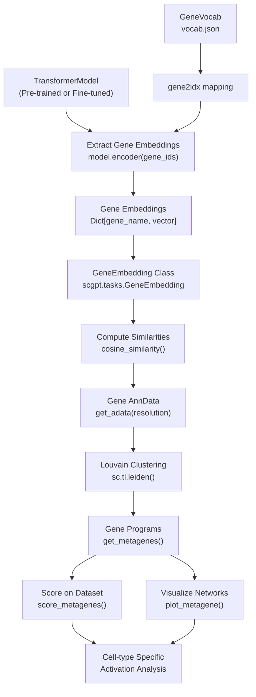
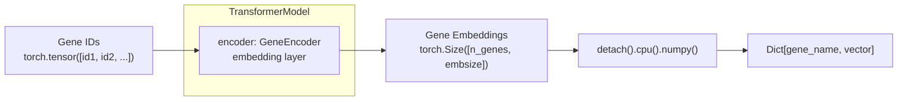
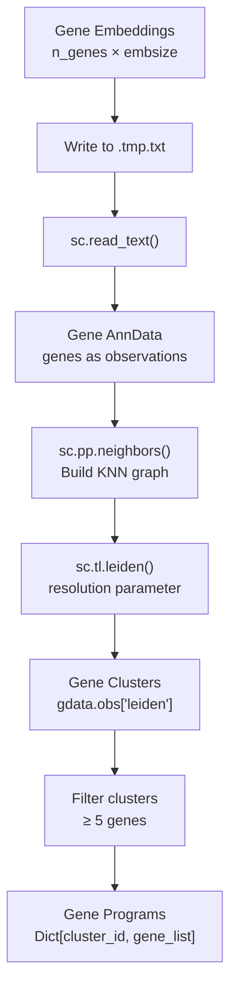
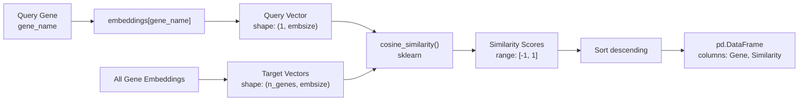
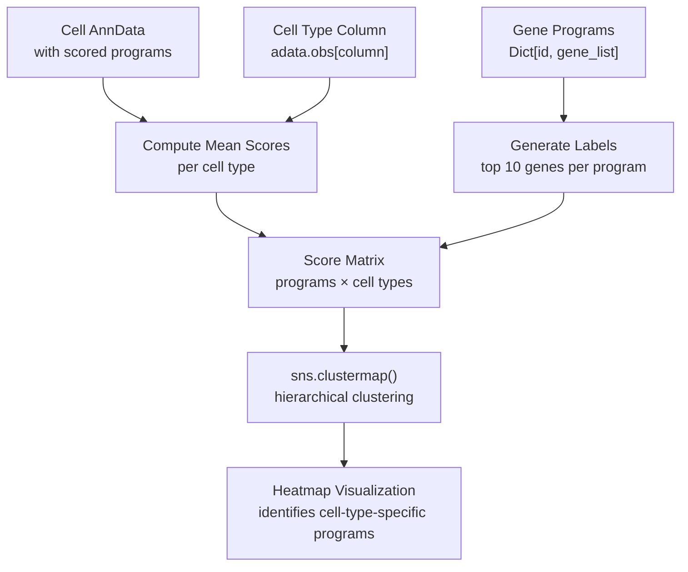
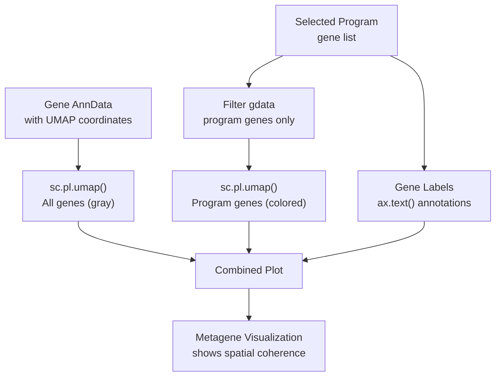
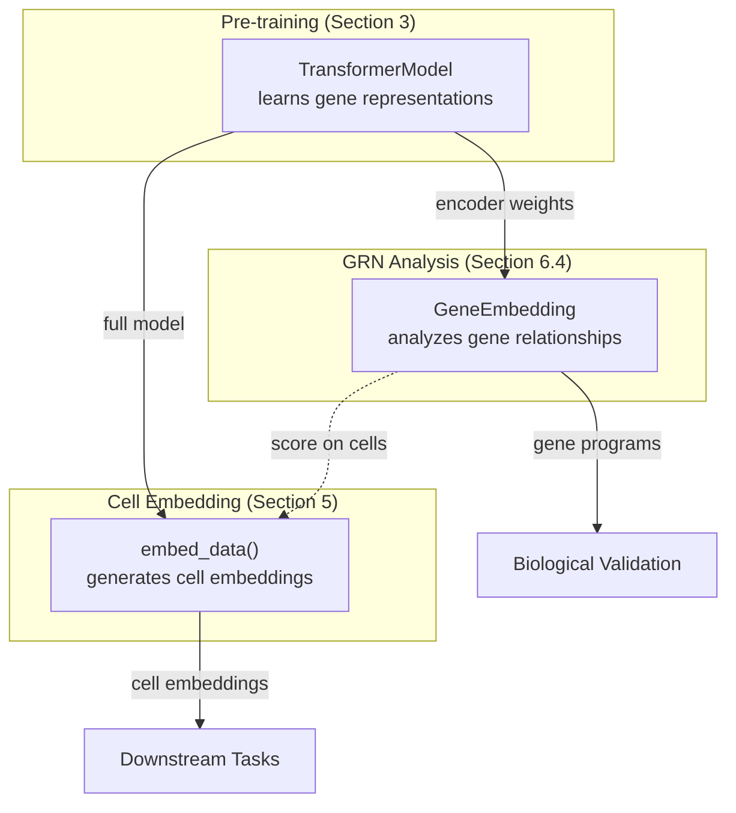

# Gene Regulatory Network Analysis

<details>
<summary>Relevant source files</summary>

The following files were used as context for generating this wiki page:

- [scgpt/tasks/__init__.py](scgpt/tasks/__init__.py)
- [scgpt/tasks/grn.py](scgpt/tasks/grn.py)
- [tutorials/Tutorial_GRN.ipynb](tutorials/Tutorial_GRN.ipynb)

</details>


## Purpose and Scope

This document explains how to perform Gene Regulatory Network (GRN) inference using scGPT's learned gene embeddings. The approach extracts gene programs by clustering genes based on their embedding similarity and can identify cell-type-specific regulatory modules. This analysis can be performed on both pre-trained and fine-tuned models.

For generating embeddings from cells, see [Cell Embedding System](#5). For fine-tuning models on specific tasks, see other sections under [Fine-tuning Applications](#6).

---

## Overview

scGPT's GRN inference operates on the principle that genes with similar regulatory functions learn similar representations during pre-training. The system extracts data-independent gene embeddings from the model's `GeneEncoder`, computes pairwise gene similarities, and applies community detection algorithms to identify gene programs (metagenes).

**Key Features:**
- **Data-independent**: Gene embeddings are extracted directly from model weights
- **Unsupervised**: No labels required for gene program extraction
- **Transferable**: Works on pre-trained and fine-tuned models
- **Interpretable**: Gene programs can be visualized and scored on downstream datasets

Sources: [tutorials/Tutorial_GRN.ipynb:9-25]()

---

## GRN Analysis Workflow



**Workflow Components:**

| Step | Component | Purpose |
|------|-----------|---------|
| 1. Model Loading | `TransformerModel` | Load optimized scGPT checkpoint |
| 2. Embedding Extraction | `model.encoder()` | Retrieve learned gene representations |
| 3. Network Construction | `GeneEmbedding` | Build gene similarity graph |
| 4. Program Extraction | Louvain clustering | Identify gene modules |
| 5. Validation | Program scoring | Assess biological relevance |

Sources: [tutorials/Tutorial_GRN.ipynb:14-25](), [scgpt/tasks/grn.py:18-26]()

---

## The GeneEmbedding Class

The `GeneEmbedding` class in [scgpt/tasks/grn.py:18-298]() is the primary interface for GRN analysis. It wraps gene embedding dictionaries and provides methods for similarity computation, clustering, and visualization.

### Initialization

```python
from scgpt.tasks import GeneEmbedding

# gene_embeddings: Dict[str, np.ndarray]
# Keys are gene names, values are embedding vectors
embed = GeneEmbedding(gene_embeddings)
```

The constructor iterates through the embedding dictionary and stores genes and their vectors in aligned lists [scgpt/tasks/grn.py:19-26]().

### Core Methods

| Method | Purpose | Key Parameters |
|--------|---------|----------------|
| `get_adata(resolution)` | Create gene AnnData with clustering | `resolution`: Controls granularity |
| `get_metagenes(gdata)` | Extract gene programs from clusters | `gdata`: Clustered gene AnnData |
| `compute_similarities(gene)` | Find similar genes | `gene`: Query gene name |
| `generate_network(threshold)` | Build gene-gene network | `threshold`: Similarity cutoff |
| `score_metagenes(adata, metagenes)` | Score programs on cells | `adata`: Cell AnnData, `metagenes`: Programs |

Sources: [scgpt/tasks/grn.py:37-282]()

---

## Extracting Gene Embeddings from Models

Gene embeddings are extracted directly from the `GeneEncoder` layer of the `TransformerModel`. These embeddings represent the model's learned understanding of gene function and regulation.



### Implementation Details

The extraction process involves:

1. **Retrieve gene-to-index mapping** from `GeneVocab.get_stoi()` [tutorials/Tutorial_GRN.ipynb:155]()
2. **Create tensor of gene IDs** for all genes in vocabulary
3. **Forward pass through encoder** to get embeddings [tutorials/Tutorial_GRN.ipynb:626]()
4. **Filter to dataset genes** to focus on relevant gene set [tutorials/Tutorial_GRN.ipynb:646]()

**Example from tutorial:**
```python
# Extract embeddings for all genes in vocab
gene_ids = np.array([id for id in gene2idx.values()])
gene_embeddings = model.encoder(torch.tensor(gene_ids, dtype=torch.long).to(device))
gene_embeddings = gene_embeddings.detach().cpu().numpy()

# Filter to highly variable genes (HVGs) in dataset
gene_embeddings = {
    gene: gene_embeddings[i] 
    for i, gene in enumerate(gene2idx.keys()) 
    if gene in adata.var.index.tolist()
}
```

**Note:** Gene embeddings are data-independent—they depend only on model weights, not on input data. The tutorial notes: "technically scGPT's gene embeddings are data independent" [tutorials/Tutorial_GRN.ipynb:612-614]().

Sources: [tutorials/Tutorial_GRN.ipynb:625-647](), [scgpt/model/model.py - GeneEncoder]

---

## Gene Program Extraction via Clustering

Gene programs (metagenes) are identified by clustering genes in embedding space using the Louvain algorithm. The process constructs a k-nearest neighbor graph and applies community detection.



### Clustering Parameters

The `get_adata()` method [scgpt/tasks/grn.py:37-46]() performs clustering with a single critical parameter:

- **`resolution`**: Controls cluster granularity (higher = more clusters)
  - Tutorial example uses `resolution=40` [tutorials/Tutorial_GRN.ipynb:695]()
  - Typical range: 10-100 depending on gene set size

### Filtering and Post-processing

After clustering, the tutorial filters programs to retain only those with ≥5 genes [tutorials/Tutorial_GRN.ipynb:716-720]():

```python
# Obtain the set of gene programs from clusters with #genes >= 5
mgs = dict()
for mg, genes in metagenes.items():
    if len(genes) > 4:
        mgs[mg] = genes
```

This ensures gene programs are substantial enough for meaningful biological interpretation.

Sources: [scgpt/tasks/grn.py:37-46](), [scgpt/tasks/grn.py:143-147](), [tutorials/Tutorial_GRN.ipynb:684-720]()

---

## Gene Similarity and Network Construction

The `GeneEmbedding` class provides two approaches to analyze gene-gene relationships: pairwise similarity computation and global network construction.

### Pairwise Similarity Computation

The `compute_similarities()` method [scgpt/tasks/grn.py:149-179]() computes cosine similarity between a query gene and all other genes:



The method supports optional filtering by gene subset [scgpt/tasks/grn.py:159-162]().

### Global Network Construction

The `generate_network()` method [scgpt/tasks/grn.py:269-281]() builds a `networkx.Graph` representing gene-gene relationships:

**Algorithm:**
1. Compute pairwise cosine similarity for all gene pairs
2. Threshold similarities (edges with similarity < threshold are removed)
3. Construct undirected graph with genes as nodes

**Parameters:**
- `threshold` (float): Minimum similarity to create edge (default: 0.5)
  - Higher values = sparser network
  - Typical range: 0.3-0.7

The resulting graph can be used for network analysis, motif detection, or visualization.

Sources: [scgpt/tasks/grn.py:149-179](), [scgpt/tasks/grn.py:269-281]()

---

## Gene Program Scoring and Validation

Once gene programs are extracted, they can be scored on cell datasets to assess biological relevance and identify cell-type-specific activation patterns.

### Scoring Mechanism

The `score_metagenes()` method [scgpt/tasks/grn.py:131-141]() computes gene program scores for each cell:

1. **Scanpy scoring**: Uses `sc.tl.score_genes()` to compute aggregate expression
2. **MinMax normalization**: Scales scores to [0, 1] range for comparability
3. **Storage**: Adds scores as `{program_id}_SCORE` columns in `adata.obs`

```python
# Example usage
metagenes = embed.get_metagenes(gdata)  # Extract programs
embed.score_metagenes(adata, metagenes)  # Score on cell dataset

# Access scores
cell_scores = adata.obs['0_SCORE']  # Scores for program '0'
```

### Cell-type Activation Heatmap

The `plot_metagenes_scores()` method [scgpt/tasks/grn.py:95-129]() visualizes program activation across cell types:



The visualization includes:
- **Rows**: Gene programs (labeled with top genes)
- **Columns**: Cell types
- **Values**: Mean program scores (standardized)
- **Clustering**: Both programs and cell types are hierarchically clustered

This enables identification of cell-type-specific regulatory modules.

Sources: [scgpt/tasks/grn.py:95-141](), [tutorials/Tutorial_GRN.ipynb:872-898]()

---

## Visualization Methods

The `GeneEmbedding` class provides several visualization methods for exploring gene programs and their relationships.

### Individual Gene Program Visualization

The `plot_metagene()` method [scgpt/tasks/grn.py:56-93]() highlights a specific gene program in UMAP space:

**Components:**
- UMAP embedding of all genes
- Highlighted genes belonging to selected program
- Gene labels for program members
- Useful for understanding gene program coherence

### Gene Similarity Bar Plot

The `plot_similarities()` method [scgpt/tasks/grn.py:48-54]() visualizes top similar genes:

```python
embed.plot_similarities(gene='CD8A', n_genes=10, save='cd8a_similarities.pdf')
```

Creates a horizontal bar plot showing the top `n_genes` most similar to the query gene.

### Visualization Architecture



**Note:** The `get_adata()` method [scgpt/tasks/grn.py:37-46]() automatically computes UMAP coordinates (`sc.tl.umap()`) as part of the clustering workflow.

Sources: [scgpt/tasks/grn.py:48-93](), [tutorials/Tutorial_GRN.ipynb - visualization cells]

---

## Complete GRN Analysis Pipeline

### Step-by-Step Implementation

The tutorial [tutorials/Tutorial_GRN.ipynb]() demonstrates the complete pipeline:

**Step 1: Load Model and Data**
```python
# Load pre-trained model
model = TransformerModel(ntokens, embsize, nhead, d_hid, nlayers, vocab=vocab)
model.load_state_dict(torch.load(model_file))

# Load and preprocess dataset
adata = sc.read("Immune_ALL_human.h5ad")
preprocessor = Preprocessor(filter_gene_by_counts=3, subset_hvg=n_hvg, binning=n_bins)
preprocessor(adata, batch_key="batch")
```

**Step 2: Extract Gene Embeddings**
```python
gene_ids = np.array([id for id in gene2idx.values()])
gene_embeddings = model.encoder(torch.tensor(gene_ids).to(device))
gene_embeddings = {gene: gene_embeddings[i].detach().cpu().numpy() 
                   for i, gene in enumerate(gene2idx.keys()) 
                   if gene in adata.var.index}
```

**Step 3: Construct Gene Embedding Network**
```python
embed = GeneEmbedding(gene_embeddings)
```

**Step 4: Extract Gene Programs**
```python
gdata = embed.get_adata(resolution=40)
metagenes = embed.get_metagenes(gdata)

# Filter to programs with ≥5 genes
mgs = {mg: genes for mg, genes in metagenes.items() if len(genes) > 4}
```

**Step 5: Score and Visualize**
```python
# Score programs on cell dataset
embed.score_metagenes(adata, mgs)

# Visualize activation across cell types
embed.plot_metagenes_scores(adata, mgs, column='celltype')

# Visualize individual program
embed.plot_metagene(gdata, mg='0', title='Gene Program 0')
```

### Key Configuration Parameters

| Parameter | Location | Typical Value | Purpose |
|-----------|----------|---------------|---------|
| `n_hvg` | Preprocessing | 1200 | Number of highly variable genes |
| `resolution` | Clustering | 20-100 | Controls program granularity |
| `threshold` | Network | 0.3-0.7 | Similarity cutoff for edges |
| `min_genes` | Filtering | 5 | Minimum genes per program |

Sources: [tutorials/Tutorial_GRN.ipynb:103-898]()

---

## Implementation Details and Best Practices

### Gene Embedding Properties

1. **Dimensionality**: Matches model `embsize` parameter (typically 512) [tutorials/Tutorial_GRN.ipynb:149]()
2. **Data Independence**: Embeddings depend only on model weights, not input data
3. **Vocabulary Coverage**: Pre-trained models contain 30,000+ genes; analysis typically focuses on HVG subset [tutorials/Tutorial_GRN.ipynb:612-614]()

### Clustering Considerations

The Louvain algorithm via `sc.tl.leiden()` [scgpt/tasks/grn.py:44]() provides:
- **Advantages**: Scalable, deterministic, interpretable
- **Limitation**: Requires resolution tuning for optimal granularity
- **Alternative**: Users can implement custom clustering on `embed.vector`

### Performance and Scalability

The `GeneEmbedding` initialization uses `tqdm` progress bars [scgpt/tasks/grn.py:24]() for tracking large gene sets. Network construction with `generate_network()` uses `tqdm` for edge generation [scgpt/tasks/grn.py:277]().

**Scalability notes:**
- Similarity computation: O(n²) for n genes
- Suitable for 100-10,000 genes (typical HVG range)
- For genome-wide analysis (20,000+ genes), consider subsampling or GPU acceleration

### Temporary File Management

The `get_adata()` method creates temporary files [scgpt/tasks/grn.py:39-41]():
```python
np.savetxt(".tmp.txt", mat)
gdata = sc.read_text(".tmp.txt")
os.remove(".tmp.txt")
```

This is a workaround for creating scanpy AnnData objects from embedding matrices. The file is automatically cleaned up.

Sources: [scgpt/tasks/grn.py:18-298](), [tutorials/Tutorial_GRN.ipynb:612-666]()

---

## Integration with scGPT Ecosystem

### Relationship to Other Components



### Exported API

The `GeneEmbedding` class is exported in [scgpt/tasks/__init__.py:1]():
```python
from .grn import GeneEmbedding
```

Users can import directly:
```python
from scgpt.tasks import GeneEmbedding
```

### Model Compatibility

GRN analysis works with:
- **Pre-trained models**: Extract general gene programs (e.g., cell cycle, immune response)
- **Fine-tuned models**: Extract task-specific programs
- **Organ-specific models**: Extract tissue-relevant programs

The tutorial demonstrates using the pre-trained blood model [tutorials/Tutorial_GRN.ipynb:112-113](), but the approach generalizes to any scGPT checkpoint.

Sources: [scgpt/tasks/__init__.py:1-3](), [tutorials/Tutorial_GRN.ipynb:9-12]()

---

## Summary

Gene Regulatory Network analysis in scGPT leverages learned gene embeddings to identify co-regulated gene modules without requiring labeled data. The `GeneEmbedding` class provides a complete toolkit for:

1. **Extracting** data-independent gene representations from model weights
2. **Clustering** genes into functionally coherent programs
3. **Scoring** gene programs on cell datasets for validation
4. **Visualizing** gene relationships and cell-type-specific activation

This unsupervised approach enables discovery of regulatory modules that can be validated against known biological pathways and used to interpret model predictions.

Sources: [tutorials/Tutorial_GRN.ipynb:9-25](), [scgpt/tasks/grn.py:18-298]()

---