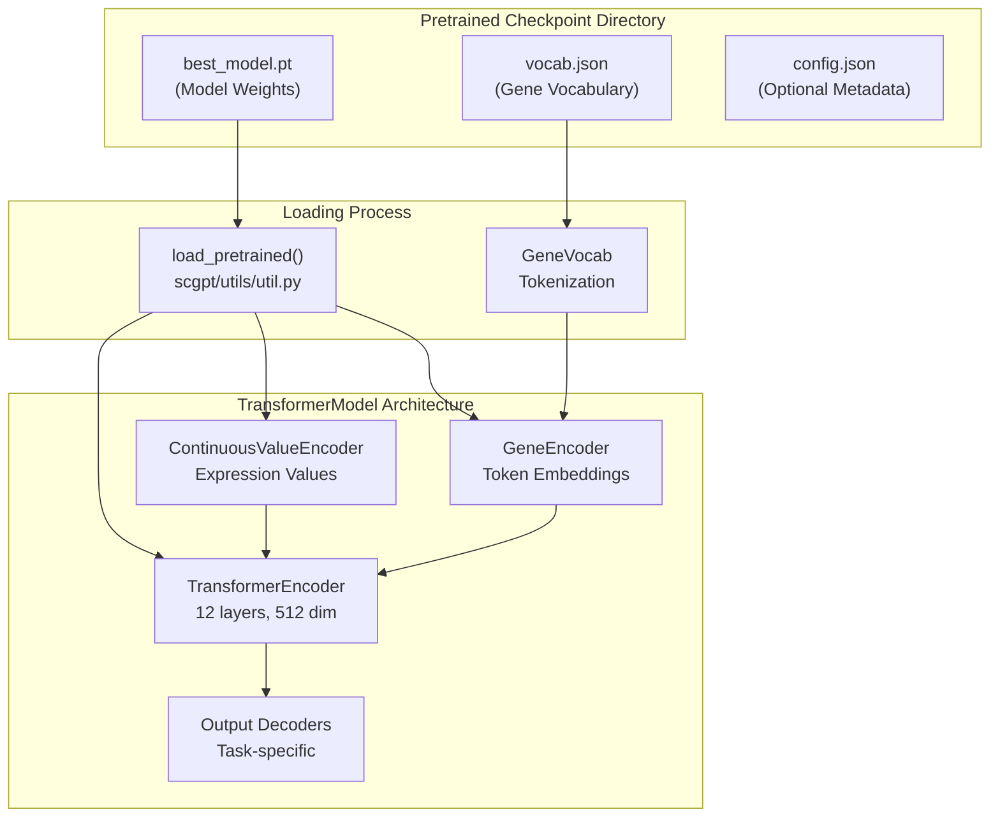
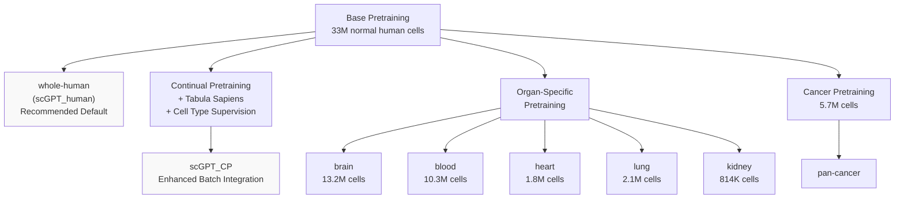
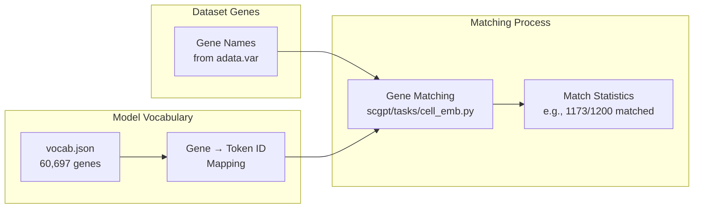
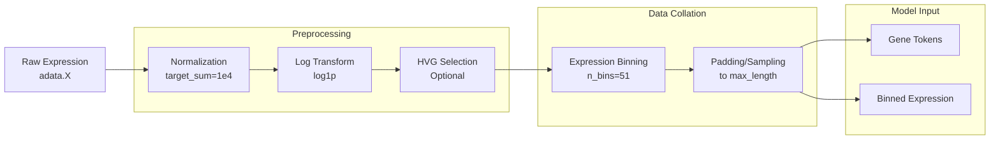

# Pretrained Models

<details>
<summary>Relevant source files</summary>

The following files were used as context for generating this wiki page:

- [README.md](README.md)
- [scgpt/data_collator.py](scgpt/data_collator.py)
- [tutorials/zero-shot/Tutorial_ZeroShot_Integration.ipynb](tutorials/zero-shot/Tutorial_ZeroShot_Integration.ipynb)
- [tutorials/zero-shot/Tutorial_ZeroShot_Integration_Continual_Pretraining.ipynb](tutorials/zero-shot/Tutorial_ZeroShot_Integration_Continual_Pretraining.ipynb)
- [tutorials/zero-shot/Tutorial_ZeroShot_Reference_Mapping.ipynb](tutorials/zero-shot/Tutorial_ZeroShot_Reference_Mapping.ipynb)

</details>


This document describes the pretrained scGPT model checkpoints available for use. These models have been pre-trained on large-scale single-cell RNA-seq datasets and can be used for zero-shot inference or as starting points for fine-tuning on downstream tasks. For information about fine-tuning these models, see [Fine-tuning Applications](#6). For zero-shot inference workflows, see [Zero-Shot Applications](#4).

## Model Zoo Overview

The scGPT model zoo provides multiple pretrained checkpoints optimized for different biological contexts and use cases. All models are trained using the TransformerModel architecture and share the same checkpoint format, making them interchangeable depending on the application requirements.

Each pretrained model checkpoint includes:
- Model weights (`best_model.pt`)
- Gene vocabulary mapping (`vocab.json`)
- Training configuration metadata

**Sources:** [README.md:56-69]()

## Available Pretrained Models

| Model Name | Description | Training Data | Recommended Use | Download Link |
|------------|-------------|---------------|-----------------|---------------|
| `whole-human` | **Recommended default model** | 33 million normal human cells | General-purpose applications across tissues | [Google Drive](https://drive.google.com/drive/folders/1oWh_-ZRdhtoGQ2Fw24HP41FgLoomVo-y?usp=sharing) |
| `scGPT_CP` (continual pretrained) | Enhanced for batch integration | Whole-human + Tabula Sapiens with cell type supervision | Zero-shot cell embedding tasks with batch effects | [Google Drive](https://drive.google.com/drive/folders/1_GROJTzXiAV8HB4imruOTk6PEGuNOcgB?usp=sharing) |
| `brain` | Brain tissue specialist | 13.2 million brain cells | Brain-specific analyses | [Google Drive](https://drive.google.com/drive/folders/1vf1ijfQSk7rGdDGpBntR5bi5g6gNt-Gx?usp=sharing) |
| `blood` | Blood/marrow specialist | 10.3 million blood and bone marrow cells | Hematopoietic system analyses | [Google Drive](https://drive.google.com/drive/folders/1kkug5C7NjvXIwQGGaGoqXTk_Lb_pDrBU?usp=sharing) |
| `heart` | Cardiac specialist | 1.8 million heart cells | Cardiac tissue analyses | [Google Drive](https://drive.google.com/drive/folders/1GcgXrd7apn6y4Ze_iSCncskX3UsWPY2r?usp=sharing) |
| `lung` | Lung specialist | 2.1 million lung cells | Respiratory tissue analyses | [Google Drive](https://drive.google.com/drive/folders/16A1DJ30PT6bodt4bWLa4hpS7gbWZQFBG?usp=sharing) |
| `kidney` | Kidney specialist | 814 thousand kidney cells | Renal tissue analyses | [Google Drive](https://drive.google.com/drive/folders/1S-1AR65DF120kNFpEbWCvRHPhpkGK3kK?usp=sharing) |
| `pan-cancer` | Cancer specialist | 5.7 million cells across cancer types | Cancer/tumor analyses | [Google Drive](https://drive.google.com/drive/folders/13QzLHilYUd0v3HTwa_9n4G4yEF-hdkqa?usp=sharing) |

**Sources:** [README.md:56-69]()

## Model Architecture and Loading

### Pretrained Model Components



The `load_pretrained()` function handles loading pretrained weights and is backend-agnostic, supporting CPU, GPU, and flash-attention configurations without requiring separate checkpoint files.

**Sources:** [README.md:18](), [scgpt/tasks/cell_emb.py:258]()

### Loading Pretrained Models in Code

Models are loaded using the `embed_data()` function for zero-shot inference or by directly loading weights for fine-tuning:

```python
# Zero-shot inference using embed_data()
import scgpt as scg
from pathlib import Path

model_dir = Path("save/scGPT_human")  # or scGPT_CP, brain, etc.
embed_adata = scg.tasks.embed_data(
    adata,
    model_dir,
    gene_col="gene_name",
    batch_size=64,
)
# Embeddings stored in adata.obsm['X_scGPT']
```

The `embed_data()` function automatically:
1. Loads the vocabulary from `vocab.json`
2. Loads model weights from `best_model.pt`
3. Matches genes between the dataset and model vocabulary
4. Generates cell embeddings without gradients

**Sources:** [tutorials/zero-shot/Tutorial_ZeroShot_Reference_Mapping.ipynb:191-196](), [tutorials/zero-shot/Tutorial_ZeroShot_Integration.ipynb:324-329]()

## Model Lineage and Relationships



The `scGPT_CP` model inherits from the `whole-human` checkpoint and receives additional supervised training with cell type labels from the Tabula Sapiens dataset. This continual pretraining improves zero-shot performance on cell embedding tasks, particularly for datasets with technical batch effects.

**Sources:** [tutorials/zero-shot/Tutorial_ZeroShot_Integration_Continual_Pretraining.ipynb:18](), [README.md:63]()

## Model Selection Guidelines

### When to Use `whole-human` (Default)

Use the `whole-human` model for:
- General-purpose applications
- Diverse tissue types
- Reference mapping tasks
- Fine-tuning starting point
- When tissue context is unknown or mixed

This is the **recommended default** for most applications.

**Sources:** [README.md:58]()

### When to Use `scGPT_CP` (Continual Pretrained)

Use the `scGPT_CP` model for:
- Zero-shot cell embedding tasks
- Datasets with observable batch effects
- Cross-dataset integration
- When batch correction is critical

The continual pretraining with cell type supervision provides better batch mixing while preserving biological signal.

**Example Use Case:**
```python
# For batch integration with technical effects
model_dir = Path("save/scGPT_CP")
embed_adata = scg.tasks.embed_data(
    adata,  # Dataset with multiple technical batches
    model_dir,
    gene_col="gene_name",
    batch_size=64,
)
```

**Sources:** [tutorials/zero-shot/Tutorial_ZeroShot_Integration_Continual_Pretraining.ipynb:16-19](), [README.md:63]()

### When to Use Organ-Specific Models

Use organ-specific models (`brain`, `blood`, `heart`, `lung`, `kidney`) when:
- Your dataset shares similar cell type context with the pretraining data
- Fine-tuning for tissue-specific tasks
- Specialized biological applications in the target organ

Organ-specific models can demonstrate competitive performance compared to `whole-human` when the biological context matches.

**Sources:** [README.md:58]()

### When to Use `pan-cancer`

Use the `pan-cancer` model for:
- Tumor tissue analyses
- Cancer cell type identification
- Oncology-focused applications
- Malignant vs. normal cell classification

**Sources:** [README.md:69]()

## Gene Vocabulary System

### Vocabulary Files

Each pretrained model includes a `vocab.json` file that maps gene names to integer token IDs. The vocabulary defines which genes the model recognizes.



When loading data for inference, scGPT reports how many genes from your dataset match the model vocabulary:

```
scGPT - INFO - match 1173/1200 genes in vocabulary of size 60697.
```

Genes not in the vocabulary are excluded from the embedding process.

**Sources:** [tutorials/zero-shot/Tutorial_ZeroShot_Reference_Mapping.ipynb:179](), [tutorials/zero-shot/Tutorial_ZeroShot_Integration.ipynb:312]()

### Gene Identifier Conversion

The vocabulary files use gene symbols by default. For ENSEMBL ID conversions, a mapping file is available:

- **File:** `gene_info.csv`
- **Purpose:** Convert between gene symbols and ENSEMBL IDs
- **Location:** Provided as supplementary file

**Sources:** [README.md:58]()

## Model Characteristics

### Vocabulary Size

All models share a vocabulary of **60,697 genes**, representing the comprehensive gene space learned during pretraining.

**Sources:** [tutorials/zero-shot/Tutorial_ZeroShot_Reference_Mapping.ipynb:179](), [tutorials/zero-shot/Tutorial_ZeroShot_Integration.ipynb:312]()

### Input Processing

Pretrained models expect preprocessed input following this pipeline:



The `DataCollator` handles:
- **Binning:** Expression values discretized into 51 bins
- **Padding:** Sequences padded to max_length with `pad_token_id`
- **Sampling:** Random sampling if sequence exceeds max_length
- **Masking:** Optional MLM-style masking for training

**Sources:** [scgpt/data_collator.py:1-203](), [tutorials/zero-shot/Tutorial_ZeroShot_Reference_Mapping.ipynb:191-196]()

### Backend Compatibility

All pretrained model checkpoints are compatible with multiple computational backends:

| Backend | Flash Attention | Description |
|---------|----------------|-------------|
| CPU | No | Standard PyTorch on CPU |
| GPU | No | Standard PyTorch on GPU |
| GPU | Yes | Optimized with flash-attn<1.0.5 |

The same checkpoint file (`best_model.pt`) works across all backends using the `load_pretrained()` function without modification.

**Sources:** [README.md:18]()

### Output Embeddings

When using pretrained models for inference via `embed_data()`:
- **Output location:** `adata.obsm['X_scGPT']`
- **Embedding dimension:** 512 (model hidden dimension)
- **Type:** Cell-level embeddings from transformer encoder

These embeddings can be used directly for:
- UMAP visualization
- Clustering
- Reference mapping via FAISS
- Batch integration evaluation
- Downstream classification tasks

**Sources:** [tutorials/zero-shot/Tutorial_ZeroShot_Integration.ipynb:292](), [tutorials/zero-shot/Tutorial_ZeroShot_Reference_Mapping.ipynb:191-233]()

---