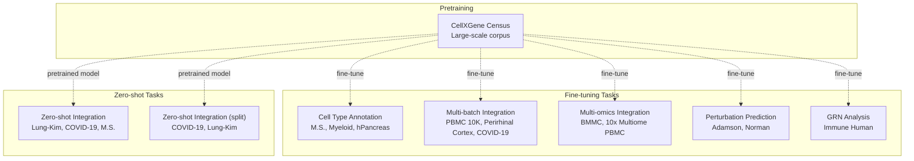
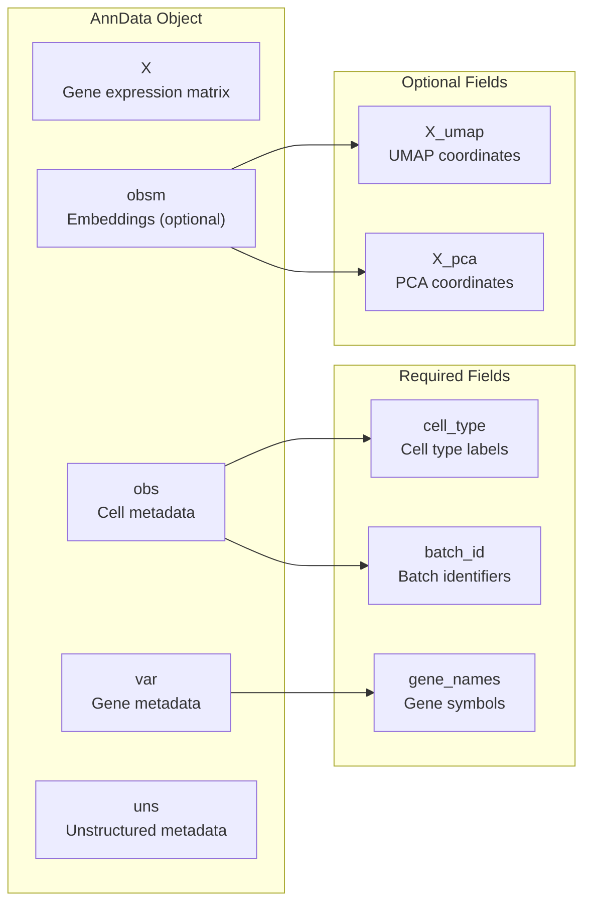
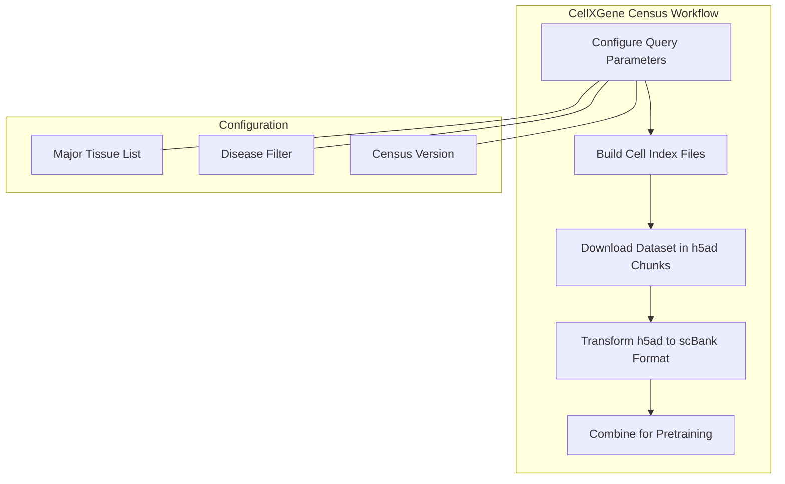
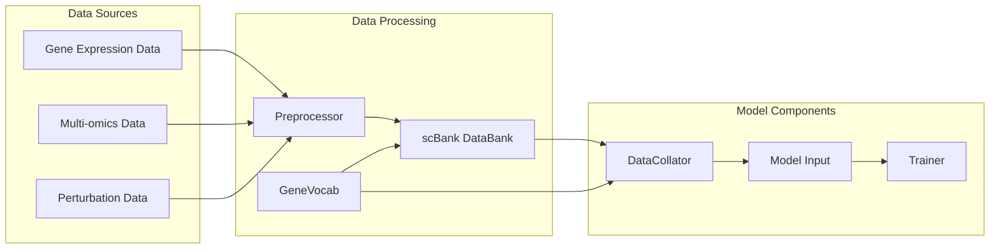

# Datasets

<details>
<summary>Relevant source files</summary>

The following files were used as context for generating this wiki page:

- [data/README.md](data/README.md)

</details>


This page catalogs the available datasets for training and evaluating scGPT on various single-cell genomics tasks. Each dataset is provided in a preprocessed format ready for use with scGPT's model architecture and training infrastructure.

## Dataset Catalog

scGPT provides curated datasets for various single-cell genomics tasks. All datasets are preprocessed and ready for use with scGPT's training and inference pipelines.

### Overview of Available Datasets

The following table lists all publicly available datasets organized by task type:

| Task | Dataset | Description | Format | Access Link |
|------|---------|-------------|--------|-------------|
| **Cell Type Annotation** | | | | |
| | Multiple Sclerosis (M.S.) | Cell type annotation in MS patient samples | AnnData | [Google Drive](https://drive.google.com/drive/folders/1Qd42YNabzyr2pWt9xoY4cVMTAxsNBt4v) |
| | Myeloid (Mye.) | Myeloid cell type annotation | AnnData | [Google Drive](https://drive.google.com/drive/folders/1VbpApQufZq8efFGakW3y8QDDpY9MBoDS) |
| | hPancreas | Human pancreas cell types | AnnData | [Google Drive](https://drive.google.com/drive/folders/1s9XjcSiPC-FYV3VeHrEa7SeZetrthQVV) |
| **Multi-batch Integration** | | | | |
| | PBMC 10K | 10,000 peripheral blood mononuclear cells | AnnData | [scvi-tools API](https://docs.scvi-tools.org/en/stable/api/reference/scvi.data.pbmc_dataset.html) |
| | Perirhinal Cortex | Brain perirhinal cortex tissue | AnnData | [Google Drive](https://drive.google.com/file/d/1rDAxDtvWx1GpJaNhlKBi71f8-psUNppE) |
| | COVID-19 | COVID-19 patient samples | AnnData | [Google Drive](https://drive.google.com/file/d/1eD9LbxNJ35YUde3VtdVcjkwm-f4iyJ6x) |
| **Multi-omics Integration** | | | | |
| | BMMC | Bone marrow mononuclear cells with RNA+protein | AnnData | [Google Drive](https://drive.google.com/drive/folders/1VRsVugg6vgCq8GG0gGajYsyXfrEtP0jK) |
| | 10x Multiome PBMC | PBMC with RNA+ATAC | AnnData | [Google Drive](https://drive.google.com/drive/folders/163J4Qi7R-awuLiHnWCh-eJD7RPMnb_yK) |
| **Perturbation Prediction** | | | | |
| | Adamson | Genetic perturbation screen | AnnData | [Dataverse](https://dataverse.harvard.edu/api/access/datafile/6154417) |
| | Norman | Genetic perturbation screen | AnnData | [Dataverse](https://dataverse.harvard.edu/api/access/datafile/6154020) |
| **GRN Analysis** | | | | |
| | Immune Human | Human immune cells for gene regulatory networks | AnnData | [Figshare](https://figshare.com/ndownloader/files/25717328) |
| **Zero-shot Integration** | | | | |
| | Lung-Kim | Lung tissue for zero-shot integration | AnnData | [Google Drive](https://drive.google.com/file/d/1z_0vWYMhRuRiD1EyhuFtY9ReIR0msWaL) |
| | COVID-19 | COVID-19 samples for zero-shot integration | AnnData | [Google Drive](https://drive.google.com/file/d/1eD9LbxNJ35YUde3VtdVcjkwm-f4iyJ6x) |
| | Multiple Sclerosis (M.S.) | MS samples for zero-shot integration | AnnData | [Google Drive](https://drive.google.com/drive/folders/1Qd42YNabzyr2pWt9xoY4cVMTAxsNBt4v) |
| | COVID-19 (split) | COVID-19 pre-split into train/test | AnnData | [Google Drive](https://drive.google.com/drive/folders/1jSPoPunGQOmd71vDsK0FS7UvmDhGdhQS) |
| | Lung-Kim (split) | Lung-Kim pre-split into train/test | AnnData | [Google Drive](https://drive.google.com/drive/folders/1gbfO7VqxCOkfzgHAih6hO88zFv6pd8wO) |

Sources: [data/README.md:5-55]()

### Dataset Organization by Task



Sources: [data/README.md:5-55]()

## Dataset Formats

All datasets are provided in **AnnData** format (`.h5ad` files), which is the standard format in the single-cell genomics community. AnnData objects can be loaded using the `scanpy` library:

```python
import scanpy as sc
adata = sc.read_h5ad("path/to/dataset.h5ad")
```

### AnnData Structure

The provided datasets follow a standardized AnnData structure:



Sources: [data/README.md:1-55]()

### Loading Datasets in scGPT

To use datasets with scGPT, load them as AnnData objects and pass them to the preprocessing pipeline:

```python
import scanpy as sc
import scgpt as scg

# Load dataset
adata = sc.read_h5ad("ms_dataset.h5ad")

# Load gene vocabulary
vocab = scg.tokenizer.get_default_gene_vocab()

# Datasets are ready for use with scGPT's data processing pipeline
# See page 3.3 (Data Processing Pipeline) for preprocessing details
```

The preprocessing steps (filtering, normalization, tokenization) are covered in detail in **page 3.3 (Data Processing Pipeline)**.

Sources: [data/cellxgene/build_large_scale_data.py:182-183]()

## Building Pretraining Data from CellXGene Census

scGPT uses the CellXGene Census as a source for pretraining data. The process of building the pretraining corpus involves several steps:



### Workflow Steps

1. **Configure Query Parameters**:
   - Define the major tissue list
   - Set the CellXGene Census version
   - Configure disease filters

2. **Build Cell Index Files**:
   - Query cells from CellXGene Census
   - Filter cells according to criteria
   - Generate a cell index file with SOMA IDs

3. **Download Dataset in Chunks**:
   - Download data in chunks (max 200,000 cells per chunk)
   - Store in h5ad format

4. **Transform to scBank Format**:
   - Preprocess the dataset
   - Convert h5ad files to scBank format for efficient I/O
   - Apply gene vocabulary mapping

Sources: [data/cellxgene/README.md:1-57]()

## Integrating Data with scGPT Models

The data system interfaces with the model training and inference components of scGPT:



Data processing interfaces with the model components through:

1. **GeneVocab**: Provides token mappings for genes
2. **DataCollator**: Prepares batches of data for the model, including padding and masking
3. **scBank**: Efficiently stores and retrieves large datasets

Sources: [data/cellxgene/build_large_scale_data.py:1-225](), [data/cellxgene/process_allcounts.py:1-316]()

## Conclusion

The data system in scGPT provides a comprehensive framework for processing, storing, and accessing single-cell genomic data for transformer-based modeling. It includes task-specific datasets, efficient data storage formats, preprocessing pipelines, and vocabulary management tools. Understanding this data infrastructure is essential for working with scGPT and extending it to new applications in single-cell genomics.

---