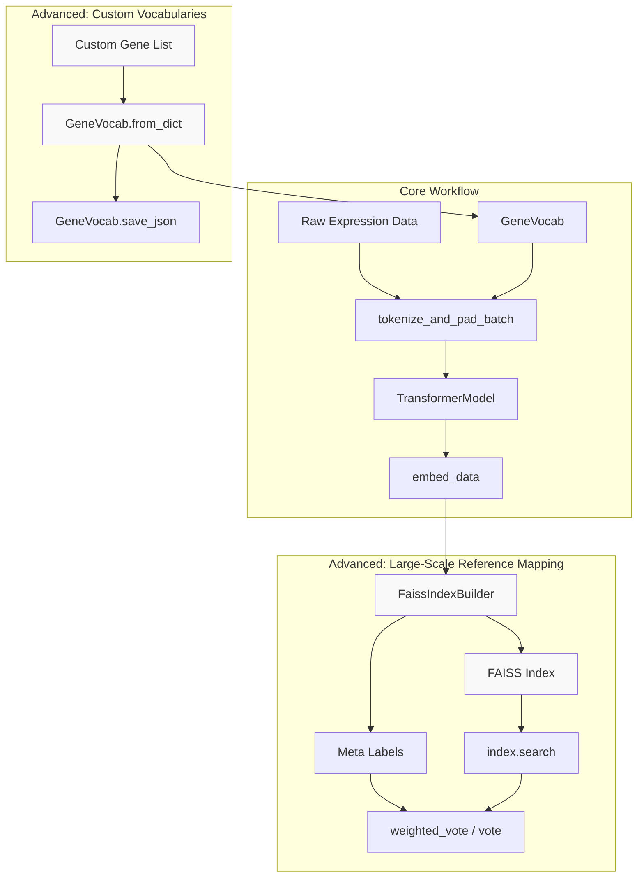
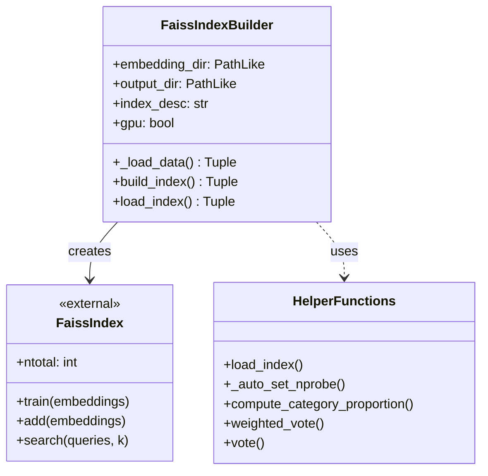
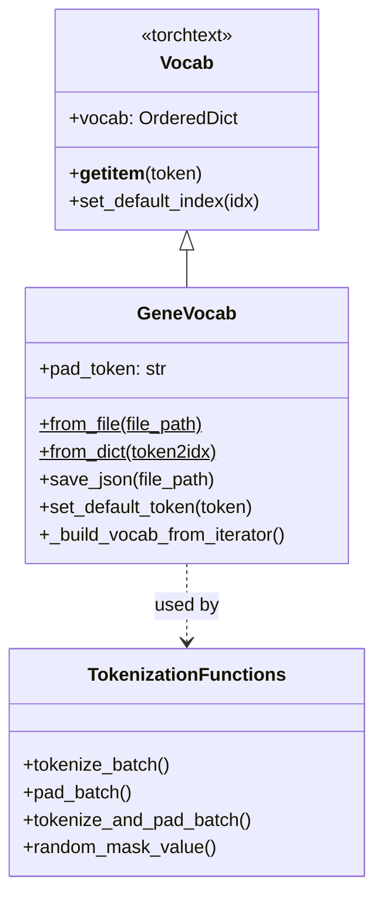
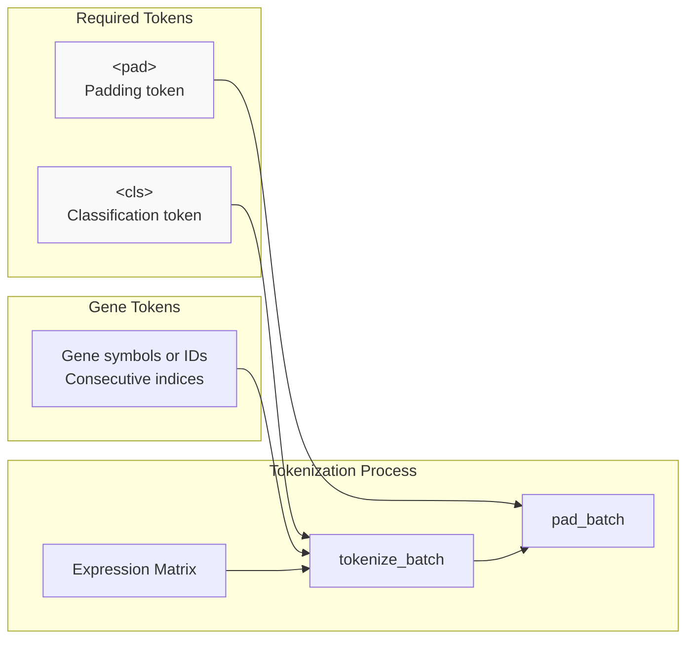
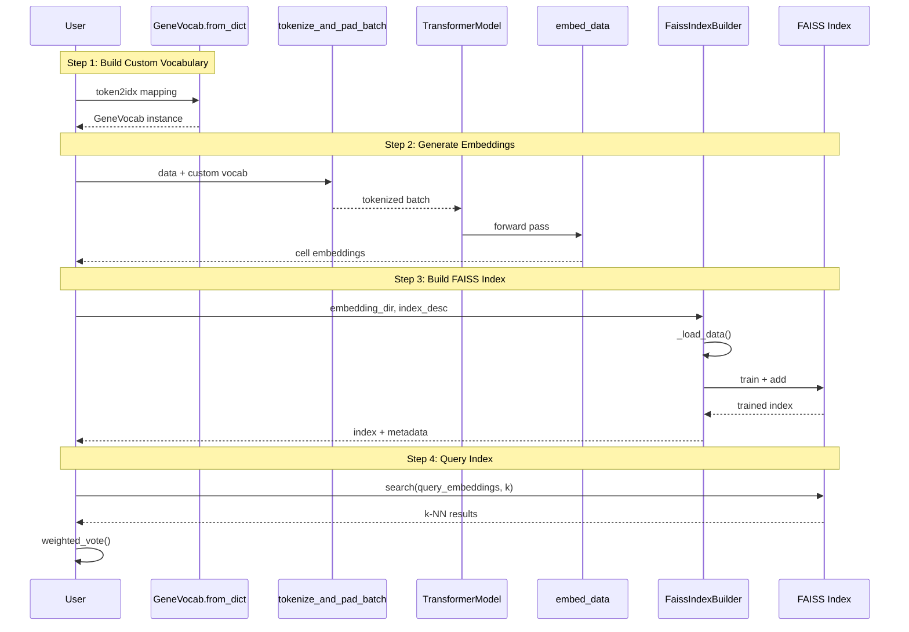
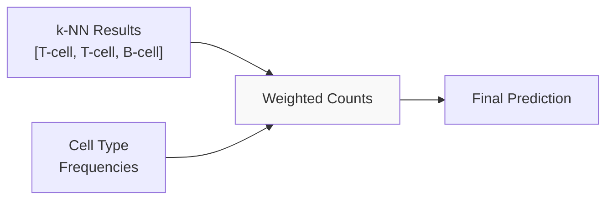

# Advanced Topics

<details>
<summary>Relevant source files</summary>

The following files were used as context for generating this wiki page:

- [poetry.lock](poetry.lock)
- [scgpt/tokenizer/gene_tokenizer.py](scgpt/tokenizer/gene_tokenizer.py)
- [tutorials/build_atlas_index_faiss.py](tutorials/build_atlas_index_faiss.py)

</details>


This page covers advanced usage patterns and utilities for power users working with scGPT. These topics go beyond standard zero-shot inference and fine-tuning workflows, providing tools for scaling to large datasets and customizing the model for specialized domains.

**Scope**: This section documents advanced utilities that enable:
- Large-scale reference mapping using FAISS indices
- Custom gene vocabularies for non-standard organisms or gene sets

For basic zero-shot applications, see [Zero-Shot Applications](#4). For standard fine-tuning workflows, see [Fine-tuning Applications](#6). For information about the standard tokenization system, see [Tokenization and Vocabulary](#3.2).

---

## Overview

The advanced topics covered here address two common scenarios that power users encounter:

1. **Scaling Reference Mapping**: When working with reference atlases containing millions of cells, standard k-NN search becomes computationally prohibitive. FAISS (Facebook AI Similarity Search) indices provide efficient similarity search at scale.

2. **Domain-Specific Vocabularies**: The default gene vocabulary covers human genes from HGNC. Users working with other organisms, custom gene panels, or specialized assays may need to build custom vocabularies.

These utilities integrate with scGPT's core pipeline but require additional configuration and understanding of the underlying data structures.

---

## System Architecture for Advanced Features

The following diagram shows how advanced features integrate with scGPT's core workflow:



**Sources**: [tutorials/build_atlas_index_faiss.py:1-379](), [scgpt/tokenizer/gene_tokenizer.py:1-474]()

---

## When to Use Advanced Features

### FAISS Index Building

Use FAISS indices when:
- Reference atlas contains >1M cells
- Running batch queries on large datasets
- Memory constraints require compressed representations
- Query latency must be minimized

**Key Trade-offs**:
- **Training Time**: Building indices requires upfront computation
- **Accuracy vs Speed**: Different index types (IVF, HNSW, PQ) offer different accuracy/speed trade-offs
- **Memory**: Compressed indices reduce memory but may sacrifice accuracy

### Custom Vocabularies

Build custom vocabularies when:
- Working with non-human organisms
- Using specialized gene panels (e.g., targeted sequencing)
- Requiring gene IDs instead of symbols
- Domain-specific naming conventions

**Key Considerations**:
- Vocabulary must match model's expected token space
- Special tokens (`<pad>`, `<cls>`, etc.) must be handled correctly
- Token indices must be consecutive

---

## Component Overview

### FaissIndexBuilder Class

The `FaissIndexBuilder` class manages the end-to-end process of creating searchable indices:



**Key Methods**:
- `build_index()`: Trains and populates FAISS index from embeddings [tutorials/build_atlas_index_faiss.py:137-204]()
- `load_index()`: Loads pre-built index from disk [tutorials/build_atlas_index_faiss.py:206-213]()
- `_load_data()`: Loads embeddings from h5ad files [tutorials/build_atlas_index_faiss.py:98-135]()

**Sources**: [tutorials/build_atlas_index_faiss.py:28-214]()

---

### GeneVocab Class

The `GeneVocab` class extends `torchtext.vocab.Vocab` with gene-specific functionality:



**Key Methods**:
- `from_file()`: Load vocabulary from JSON or pickle [scgpt/tokenizer/gene_tokenizer.py:66-85]()
- `from_dict()`: Create vocabulary from token-to-index mapping [scgpt/tokenizer/gene_tokenizer.py:87-109]()
- `save_json()`: Persist vocabulary to JSON format [scgpt/tokenizer/gene_tokenizer.py:178-185]()

**Sources**: [scgpt/tokenizer/gene_tokenizer.py:20-246]()

---

## FAISS Index Types and Configuration

Different FAISS index descriptors offer different performance characteristics:

| Index Type | Description | Use Case | Memory | Speed | Accuracy |
|------------|-------------|----------|---------|-------|----------|
| `Flat` | Exact search | <100K cells | High | Slow | 100% |
| `IVF{n}` | Inverted file | 100K-10M cells | Medium | Medium | 95%+ |
| `IVF{n}_HNSW32` | IVF with HNSW | 1M-10M cells | Medium | Fast | 97%+ |
| `PCA{d},IVF{n},PQ{m}` | Dimensionality reduction + quantization | >10M cells | Low | Fast | 90%+ |

**Default Configuration**: `"PCA64,IVF16384_HNSW32,PQ16"` [tutorials/build_atlas_index_faiss.py:45]()

This configuration:
- Reduces embeddings from model dimension to 64D (PCA64)
- Uses 16384 clusters with HNSW graph (IVF16384_HNSW32)
- Applies 16-byte product quantization (PQ16)

**Sources**: [tutorials/build_atlas_index_faiss.py:45-96]()

---

## Vocabulary Token Requirements

Custom vocabularies must include specific special tokens to work correctly with scGPT:



**Token Requirements**:
1. `<pad>`: Used for padding sequences to uniform length [scgpt/tokenizer/gene_tokenizer.py:316-336]()
2. `<cls>`: Prepended to each sequence for classification [scgpt/tokenizer/gene_tokenizer.py:298-302]()
3. Gene tokens: Must have consecutive indices starting after special tokens
4. Default token: Typically set to `<pad>` for out-of-vocabulary handling [scgpt/tokenizer/gene_tokenizer.py:62-63]()

**Sources**: [scgpt/tokenizer/gene_tokenizer.py:20-196]()

---

## Integration with Core Pipeline

The following sequence diagram shows how advanced features integrate with standard workflows:



**Key Integration Points**:
1. Custom vocabulary replaces default in tokenization [scgpt/tokenizer/gene_tokenizer.py:399-439]()
2. Embeddings from any vocabulary can be indexed [tutorials/build_atlas_index_faiss.py:137-155]()
3. Index search results use voting for cell type prediction [tutorials/build_atlas_index_faiss.py:308-357]()

**Sources**: [tutorials/build_atlas_index_faiss.py:28-379](), [scgpt/tokenizer/gene_tokenizer.py:249-474]()

---

## Weighted Voting for Predictions

FAISS returns k nearest neighbors, which must be aggregated into predictions. Two voting strategies are available:

**Simple Majority Voting**:
```python
def vote(predicts_for_query, return_prob=True):
    """Count occurrences and return most frequent"""
```
[tutorials/build_atlas_index_faiss.py:338-357]()

**Weighted Voting** (recommended for imbalanced datasets):
```python
def weighted_vote(predicts_for_query, cell_type_proportion, return_prob=True):
    """Weight by inverse cell type frequency"""
```
[tutorials/build_atlas_index_faiss.py:308-335]()

The weighted approach down-weights over-represented cell types to reduce bias:



**Weighting Formula**: `weighted_count = (count - 0.01 * total) * 1e-3 / cell_type_proportion` [tutorials/build_atlas_index_faiss.py:324-328]()

**Sources**: [tutorials/build_atlas_index_faiss.py:293-357]()

---

## Performance Considerations

### FAISS Index Performance

The `nprobe` parameter controls search accuracy vs speed trade-offs:

| nprobe | Search Time | Recall |
|--------|-------------|--------|
| 16 | 1x | ~90% |
| 32 | 2x | ~95% |
| 64 | 4x | ~97% |
| 128 | 8x | ~99% |

Auto-configuration based on number of clusters: [tutorials/build_atlas_index_faiss.py:259-290]()

```python
nprobe = 16 if nlist <= 1e3 else \
         32 if nlist <= 4e3 else \
         64 if nlist <= 1.6e4 else 128
```

### GPU Acceleration

Both index building and search support GPU acceleration: [tutorials/build_atlas_index_faiss.py:146-148]()

```python
if self.gpu:
    res = faiss.StandardGpuResources()
    index = faiss.index_cpu_to_gpu(res, 0, index)
```

**Sources**: [tutorials/build_atlas_index_faiss.py:137-290]()

---

## File Formats and Persistence

### Index Output Files

`FaissIndexBuilder` creates three files in `output_dir`: [tutorials/build_atlas_index_faiss.py:168-197]()

1. **`index.faiss`**: Binary FAISS index
2. **`meta.h5ad`**: HDF5 file with cell type labels
3. **`index_config.json`**: Configuration metadata including:
   - Index descriptor
   - Number of embeddings/features
   - nprobe setting
   - Build parameters

### Vocabulary File Formats

`GeneVocab` supports two persistence formats:

1. **JSON** (recommended): Human-readable token-to-index mapping [scgpt/tokenizer/gene_tokenizer.py:178-185]()
2. **Pickle**: Binary serialization of Vocab object [scgpt/tokenizer/gene_tokenizer.py:73-76]()

**Example JSON Format**:
```json
{
  "<pad>": 0,
  "<cls>": 1,
  "GENE1": 2,
  "GENE2": 3
}
```

**Sources**: [tutorials/build_atlas_index_faiss.py:168-197](), [scgpt/tokenizer/gene_tokenizer.py:66-185]()

---

## Subsections

This page provides an overview of advanced topics. For detailed guides and examples:

- **[Building FAISS Indices](#9.1)**: Step-by-step guide to building and using FAISS indices for large-scale reference mapping
- **[Custom Gene Vocabularies](#9.2)**: How to create and manage custom gene vocabularies for specialized datasets

---

## Dependencies

Advanced features require additional dependencies:

| Feature | Required Package | Purpose |
|---------|-----------------|---------|
| FAISS Indices | `faiss` or `faiss-gpu` | Similarity search |
| Index Building | `h5py` | HDF5 file handling |
| Index Building | `scanpy` | AnnData file reading |
| Vocabularies | `torchtext` | Base Vocab class |

**Sources**: [poetry.lock:1-100]() (dependency declarations)

---