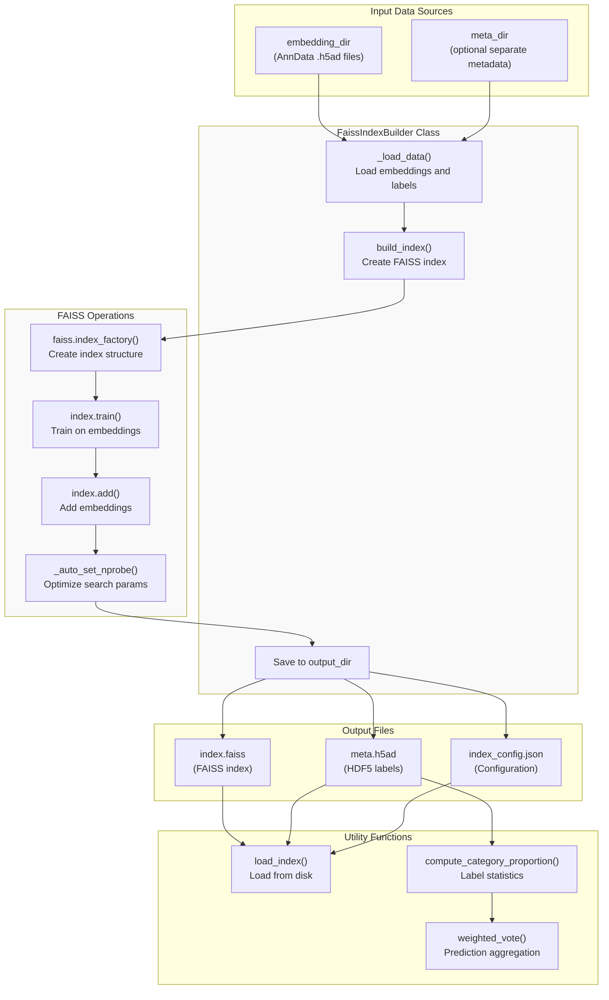
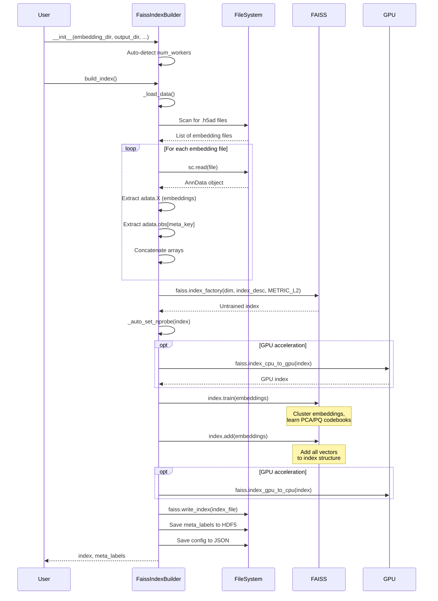
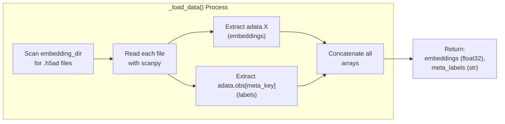
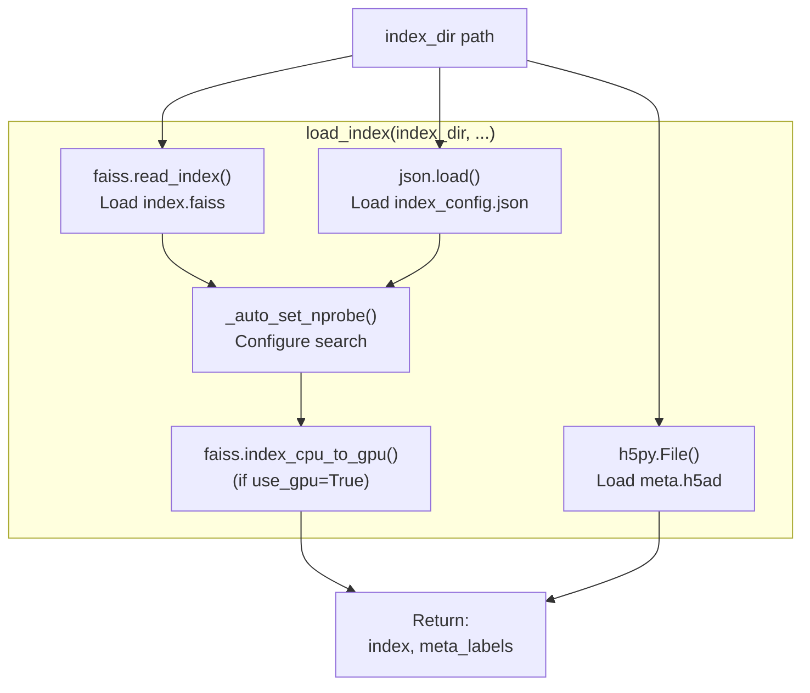
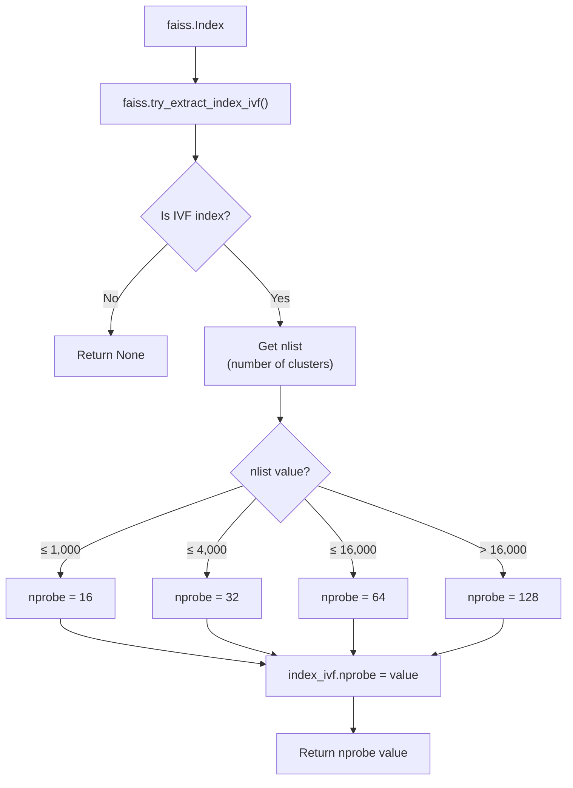
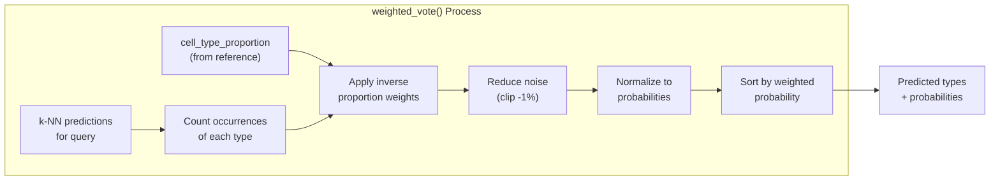

# Building FAISS Indices

<details>
<summary>Relevant source files</summary>

The following files were used as context for generating this wiki page:

- [tutorials/Tutorial_Reference_Mapping.ipynb](tutorials/Tutorial_Reference_Mapping.ipynb)
- [tutorials/build_atlas_index_faiss.py](tutorials/build_atlas_index_faiss.py)

</details>


This document provides a comprehensive guide to building and managing large-scale FAISS indices for efficient similarity search in reference mapping applications. FAISS (Facebook AI Similarity Search) enables fast k-nearest neighbor searches over millions of cell embeddings, which is essential for zero-shot cell type annotation and reference mapping tasks.

For information about using FAISS indices for reference mapping workflows, see [Reference Mapping](#4.1). For generating cell embeddings that feed into these indices, see [Cell Embedding System](#5).

## Overview

The FAISS index building system enables creation of optimized indices from directories of cell embeddings, supporting various index types for different scale and accuracy requirements. The primary implementation is in `FaissIndexBuilder` class, which handles:

- Loading embeddings from multiple files (AnnData format)
- Building optimized FAISS indices with configurable parameters
- Storing metadata labels alongside the index
- GPU acceleration for training and inference
- Automatic parameter tuning (e.g., `nprobe` setting)

**Sources:** [tutorials/build_atlas_index_faiss.py:1-13](), [tutorials/build_atlas_index_faiss.py:28-62]()

## System Architecture

The following diagram shows the major components of the FAISS index building system and their relationships:



**Sources:** [tutorials/build_atlas_index_faiss.py:28-62](), [tutorials/build_atlas_index_faiss.py:137-204](), [tutorials/build_atlas_index_faiss.py:216-256]()

## FaissIndexBuilder Class

The `FaissIndexBuilder` class provides the primary interface for building FAISS indices from embedding directories.

### Initialization Parameters

| Parameter | Type | Default | Description |
|-----------|------|---------|-------------|
| `embedding_dir` | PathLike | Required | Directory containing embedding files |
| `output_dir` | PathLike | Required | Directory to save index files |
| `meta_dir` | PathLike | None | Separate metadata directory (if not in embeddings) |
| `recursive` | bool | True | Search embedding directory recursively |
| `embedding_file_suffix` | str | ".h5ad" | File extension for embedding files |
| `meta_file_suffix` | str | None | File extension for metadata files |
| `embedding_key` | str | None | Key for embeddings in file (None = use AnnData.X) |
| `meta_key` | str | "cell_type" | Key for metadata labels (e.g., cell type) |
| `gpu` | bool | False | Use GPU acceleration |
| `num_workers` | int | None | CPU threads (None = auto-detect) |
| `index_desc` | str | "PCA64,IVF16384_HNSW32,PQ16" | FAISS index factory string |

**Sources:** [tutorials/build_atlas_index_faiss.py:33-62]()

### Index Factory Strings

The `index_desc` parameter uses FAISS's index factory notation to specify the index structure. Common configurations:

| Index Description | Use Case | Scale | Memory | Speed |
|-------------------|----------|-------|--------|-------|
| `"PCA64,IVF16384_HNSW32,PQ16"` | Default, balanced | 10M-100M cells | Low | Fast |
| `"IVF65536_HNSW32"` | High accuracy | 1M-10M cells | High | Medium |
| `"Flat"` | Exact search | <1M cells | Very High | Slow |
| `"IVF4096,PQ64"` | Memory efficient | 10M-100M cells | Very Low | Fast |
| `"HNSW32"` | Fast approximate | 1M-100M cells | Medium | Very Fast |

The default `"PCA64,IVF16384_HNSW32,PQ16"` provides:
- **PCA64**: Dimensionality reduction to 64 dimensions
- **IVF16384**: Inverted file index with 16,384 clusters
- **HNSW32**: Hierarchical Navigable Small World graph with 32 neighbors
- **PQ16**: Product quantization with 16 subquantizers

**Sources:** [tutorials/build_atlas_index_faiss.py:45-61](), [tutorials/build_atlas_index_faiss.py:91-96]()

## Building Process

The following sequence diagram illustrates the complete index building workflow:



**Sources:** [tutorials/build_atlas_index_faiss.py:137-204](), [tutorials/build_atlas_index_faiss.py:98-135]()

### Data Loading

The `_load_data()` method handles loading embeddings and metadata from disk:



Key implementation details:
- Uses `Path.rglob()` for recursive search or `Path.glob()` for flat search [tutorials/build_atlas_index_faiss.py:103-108]()
- Converts embeddings to `np.float32` for FAISS compatibility [tutorials/build_atlas_index_faiss.py:121-123]()
- Handles sparse matrices by converting to dense arrays [tutorials/build_atlas_index_faiss.py:122-123]()
- Validates that embedding and label counts match [tutorials/build_atlas_index_faiss.py:133]()

**Sources:** [tutorials/build_atlas_index_faiss.py:98-135]()

### Index Training and Addition

The core FAISS operations occur in the `build_index()` method:

1. **Index Creation**: Uses `faiss.index_factory()` with L2 distance metric [tutorials/build_atlas_index_faiss.py:142-144]()
2. **Nprobe Tuning**: Automatically sets search parameters with `_auto_set_nprobe()` [tutorials/build_atlas_index_faiss.py:145]()
3. **GPU Transfer** (optional): Moves index to GPU for faster training [tutorials/build_atlas_index_faiss.py:146-148]()
4. **Training**: Learns clustering, PCA, and quantization from embeddings [tutorials/build_atlas_index_faiss.py:153]()
5. **Addition**: Adds all embeddings to the trained index structure [tutorials/build_atlas_index_faiss.py:155]()

**Sources:** [tutorials/build_atlas_index_faiss.py:137-204]()

### Output Files

The builder saves three files to `output_dir`:

1. **index.faiss**: Binary FAISS index file containing the trained index structure
2. **meta.h5ad**: HDF5 file with metadata labels, stored with gzip compression [tutorials/build_atlas_index_faiss.py:175-178]()
3. **index_config.json**: Configuration file containing all build parameters for reproducibility [tutorials/build_atlas_index_faiss.py:179-197]()

The configuration JSON includes:
- All initialization parameters
- Dataset statistics (`num_embeddings`, `num_features`)
- Computed `nprobe` value for optimal search

**Sources:** [tutorials/build_atlas_index_faiss.py:158-203]()

## Loading Indices

The `load_index()` function provides a convenient interface for loading pre-built indices:



### Function Parameters

| Parameter | Type | Default | Description |
|-----------|------|---------|-------------|
| `index_dir` | PathLike | Required | Directory containing index files |
| `use_config_file` | bool | True | Use saved config for gpu/nprobe settings |
| `use_gpu` | bool | False | GPU acceleration (if not using config) |
| `nprobe` | int | None | Manual nprobe setting (if not using config) |

When `use_config_file=True`, the function loads GPU and nprobe settings from `index_config.json`, ensuring consistency with how the index was built.

**Sources:** [tutorials/build_atlas_index_faiss.py:216-256]()

## Nprobe Optimization

The `_auto_set_nprobe()` function automatically configures the search speed/accuracy tradeoff for IVF (Inverted File) indices:



**Nprobe** controls how many clusters to search in an IVF index:
- **Lower values**: Faster search, lower recall
- **Higher values**: Slower search, higher recall
- Automatically scales with index size for balanced performance

**Sources:** [tutorials/build_atlas_index_faiss.py:259-291]()

## Voting Utilities

The module provides utilities for aggregating k-NN predictions into final cell type predictions.

### Simple Majority Voting

The `vote()` function performs standard majority voting:

```python
# Example usage
# predicts_for_query: array(['T cell', 'T cell', 'B cell', 'T cell'])
cell_types, probs = vote(predicts_for_query, return_prob=True)
# Returns: (['T cell', 'B cell'], [0.75, 0.25])
```

**Sources:** [tutorials/build_atlas_index_faiss.py:338-357]()

### Weighted Voting

The `weighted_vote()` function accounts for class imbalance in the reference dataset:



The weighting formula:
```
weighted_counts = clip(counts - 0.01 * total, 0, None) * 1e-3 / cell_type_proportion
```

This prevents over-representation of common cell types in predictions, improving accuracy when the reference has class imbalance.

**Sources:** [tutorials/build_atlas_index_faiss.py:308-335]()

### Category Proportion Computation

The `compute_category_proportion()` function calculates the distribution of cell types in the reference:

```python
# Example
meta_labels = np.array(['T cell', 'T cell', 'B cell', 'T cell', 'NK cell'])
proportions = compute_category_proportion(meta_labels)
# Returns: {'T cell': 0.6, 'B cell': 0.2, 'NK cell': 0.2}
```

This is typically computed once for the reference dataset and used in `weighted_vote()` for all queries.

**Sources:** [tutorials/build_atlas_index_faiss.py:293-305]()

## Usage Example

The following example demonstrates the complete workflow:

```python
# Initialize builder
builder = FaissIndexBuilder(
    embedding_dir="/path/to/embeddings",
    output_dir="/path/to/output",
    embedding_file_suffix=".h5ad",
    meta_key="cell_type",
    gpu=True,
    index_desc="PCA64,IVF16384_HNSW32,PQ16"
)

# Build and save index
index, meta_labels = builder.build_index()

# Later: load the index
index, meta_labels = load_index(
    "/path/to/output",
    use_config_file=True
)

# Compute reference statistics for weighted voting
cell_type_proportion = compute_category_proportion(meta_labels)

# Perform k-NN search on query embeddings
query_embeddings = ...  # shape: (n_queries, embedding_dim)
k = 50
distances, indices = index.search(query_embeddings, k)

# Aggregate predictions with weighted voting
predictions = []
for query_idx in range(len(query_embeddings)):
    neighbor_labels = meta_labels[indices[query_idx]]
    pred_types, probs = weighted_vote(
        neighbor_labels,
        cell_type_proportion,
        return_prob=True
    )
    predictions.append(pred_types[0])  # Top prediction
```

**Sources:** [tutorials/build_atlas_index_faiss.py:360-378]()

## Performance Considerations

### GPU vs CPU

| Aspect | GPU | CPU |
|--------|-----|-----|
| Training speed | 5-10x faster | Baseline |
| Search speed | 2-5x faster | Baseline |
| Memory requirements | Higher (GPU RAM) | Lower |
| Best for | Large datasets (>10M cells) | Small-medium datasets |

GPU acceleration requires `faiss-gpu` package and compatible CUDA-enabled GPU.

### Index Type Selection

| Dataset Size | Recommended Index | Rationale |
|--------------|-------------------|-----------|
| < 100K cells | `"Flat"` | Exact search is fast enough |
| 100K - 1M cells | `"IVF4096,Flat"` | Simple clustering sufficient |
| 1M - 10M cells | `"IVF16384,Flat"` or `"HNSW32"` | Balance speed/accuracy |
| 10M - 100M cells | `"PCA64,IVF16384_HNSW32,PQ16"` | Default (memory efficient) |
| > 100M cells | `"PCA64,IVF65536_HNSW32,PQ32"` | More clusters, compression |

### Memory Footprint

Approximate memory requirements for the default index configuration:
- **Embeddings**: `num_cells * embedding_dim * 4 bytes` (during training)
- **Index**: `num_cells * 16 bytes` (PQ16 compressed)
- **Metadata**: `num_cells * avg_label_length bytes`

For 33M cells with 512-dim embeddings:
- Training: ~67 GB RAM
- Final index: ~528 MB
- Metadata: ~100 MB

**Sources:** [tutorials/build_atlas_index_faiss.py:91-96](), [tutorials/build_atlas_index_faiss.py:142-155]()

## Thread Safety and Parallelization

The current implementation has specific parallelization characteristics:

- **Data loading**: Sequential (`num_workers > 1` raises `NotImplementedError`) [tutorials/build_atlas_index_faiss.py:113-114]()
- **FAISS training**: Automatically uses multiple threads based on `num_workers` parameter [tutorials/build_atlas_index_faiss.py:75-80]()
- **FAISS search**: Thread-safe for parallel queries
- **GPU operations**: Single GPU per index (no multi-GPU support)

For large-scale processing, consider:
1. Pre-computing embeddings in parallel
2. Building index on a single process
3. Using the index for parallel queries

**Sources:** [tutorials/build_atlas_index_faiss.py:44-80](), [tutorials/build_atlas_index_faiss.py:113-127]()

---