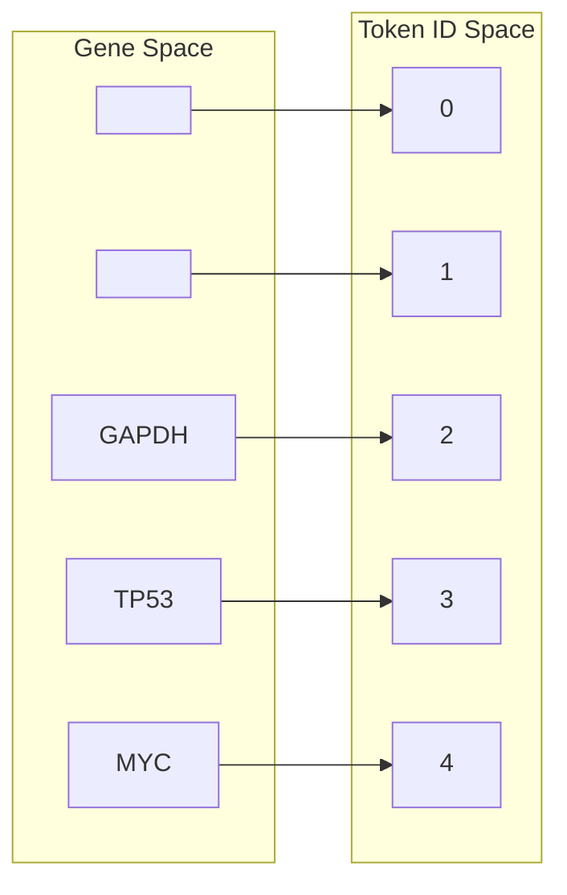
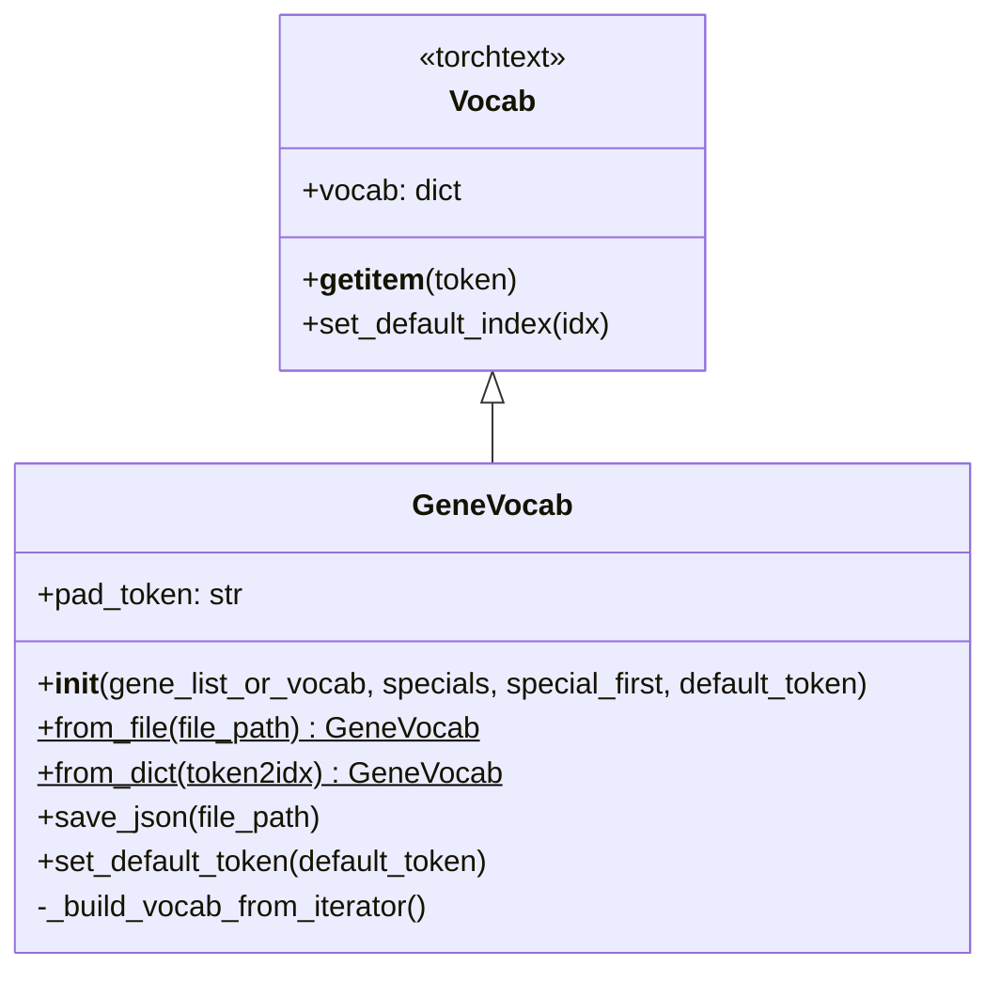
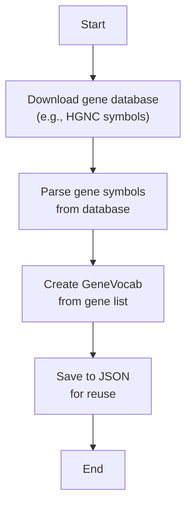
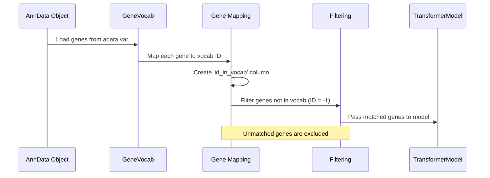
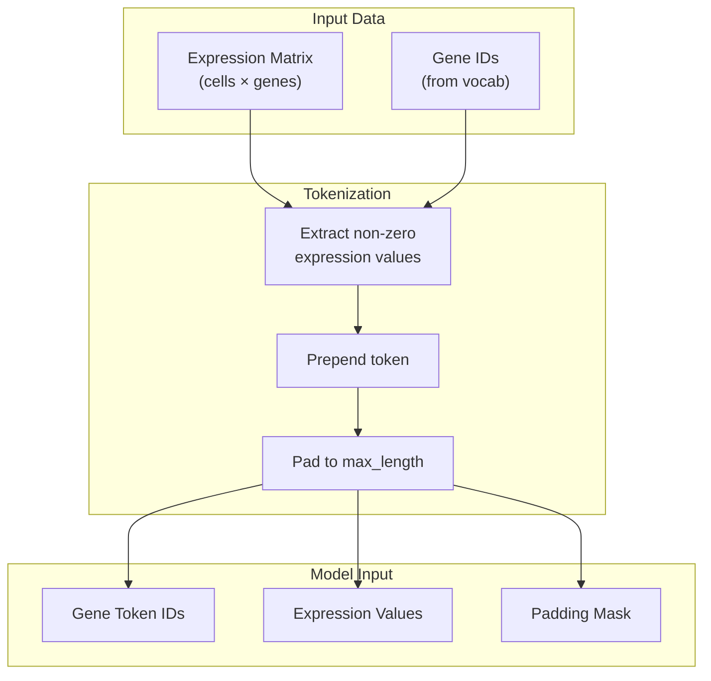
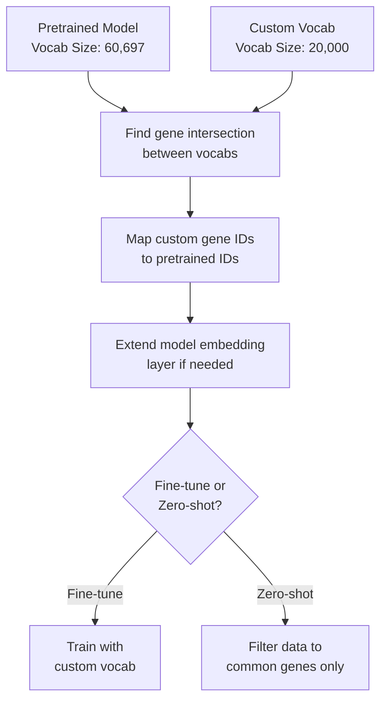
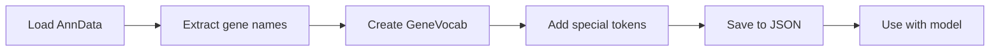

# Custom Gene Vocabularies

<details>
<summary>Relevant source files</summary>

The following files were used as context for generating this wiki page:

- [poetry.lock](poetry.lock)
- [scgpt/preprocess.py](scgpt/preprocess.py)
- [scgpt/tasks/cell_emb.py](scgpt/tasks/cell_emb.py)
- [scgpt/tokenizer/gene_tokenizer.py](scgpt/tokenizer/gene_tokenizer.py)

</details>


## Purpose and Scope

This document explains how to create, manage, and use custom gene vocabularies for specialized datasets in scGPT. Gene vocabularies map gene names (symbols) to integer token IDs that the model uses for processing. While scGPT provides pretrained models with default vocabularies, custom vocabularies are necessary when working with non-standard gene sets, organism-specific genes, or when extending the model to new domains.

For information about the tokenization and data collation process that uses these vocabularies, see [Data Processing Pipeline](#3.3). For details on loading and using pretrained models with their associated vocabularies, see [Quick Start with Pretrained Models](#2.2).

---

## Gene Vocabulary Fundamentals

### What is a Gene Vocabulary?

A gene vocabulary is a bidirectional mapping between gene identifiers (typically gene symbols like "GAPDH" or "TP53") and integer token IDs. This mapping is essential because neural networks operate on numeric tensors, not string names.



**Diagram: Gene Vocabulary Mapping Structure**

Sources: [scgpt/tokenizer/gene_tokenizer.py:20-64]()

### The GeneVocab Class

The `GeneVocab` class extends `torchtext.vocab.Vocab` and provides specialized functionality for gene tokenization:



**Diagram: GeneVocab Class Hierarchy**

| Method | Purpose |
|--------|---------|
| `__init__()` | Initialize from gene list or existing Vocab |
| `from_file()` | Load vocabulary from JSON or pickle file |
| `from_dict()` | Create vocabulary from token-to-index dictionary |
| `save_json()` | Save vocabulary to JSON file |
| `set_default_token()` | Set default token for unknown genes |

Sources: [scgpt/tokenizer/gene_tokenizer.py:20-197]()

### Special Tokens

Special tokens are reserved vocabulary entries with specific purposes:

| Token | Purpose | Typical Position |
|-------|---------|------------------|
| `<pad>` | Padding sequences to uniform length | Usually index 0 |
| `<cls>` | Classification token prepended to sequences | Usually index 1 |
| `<eoc>` | End-of-cell token (less commonly used) | Variable |

Sources: [scgpt/tasks/cell_emb.py:204-205](), [scgpt/tokenizer/gene_tokenizer.py:28-44]()

---

## Creating Custom Vocabularies

### From a Gene List

The most straightforward approach is to create a vocabulary from a list of gene symbols:

```python
from scgpt.tokenizer import GeneVocab

# Define your gene list
gene_list = ["GAPDH", "TP53", "MYC", "BRCA1", "EGFR"]

# Create vocabulary with special tokens
vocab = GeneVocab(
    gene_list,
    specials=["<pad>", "<cls>", "<eoc>"],
    special_first=True,  # Place special tokens at the beginning
    default_token="<pad>"  # Use <pad> for unknown genes
)

# Access token IDs
gene_id = vocab["TP53"]  # Returns integer ID
gene_name = vocab.lookup_token(gene_id)  # Returns "TP53"
```

**Key parameters:**
- `specials`: List of special tokens to add
- `special_first`: If `True`, special tokens get the lowest IDs
- `default_token`: Token to use for genes not in vocabulary

Sources: [scgpt/tokenizer/gene_tokenizer.py:25-64](), [scgpt/tokenizer/gene_tokenizer.py:111-155]()

### From a Dictionary

When you have an existing mapping or need precise control over token IDs:

```python
# Define explicit token-to-index mapping
token2idx = {
    "<pad>": 0,
    "<cls>": 1,
    "GAPDH": 2,
    "TP53": 3,
    "MYC": 4
}

# Create vocabulary from dictionary
vocab = GeneVocab.from_dict(token2idx, default_token="<pad>")
```

**Important:** The `from_dict()` method requires consecutive integer indices. Gaps in the sequence will cause errors.

Sources: [scgpt/tokenizer/gene_tokenizer.py:87-109]()

### From AnnData Gene Names

When working with an AnnData object, extract gene names from the variable annotations:

```python
import scanpy as sc
from scgpt.tokenizer import GeneVocab

# Load your data
adata = sc.read_h5ad("my_data.h5ad")

# Extract gene names (adjust column name as needed)
if "gene_symbols" in adata.var.columns:
    gene_list = adata.var["gene_symbols"].tolist()
elif "feature_name" in adata.var.columns:
    gene_list = adata.var["feature_name"].tolist()
else:
    gene_list = adata.var_names.tolist()

# Create vocabulary
vocab = GeneVocab(
    gene_list,
    specials=["<pad>", "<cls>", "<eoc>"],
    special_first=True,
    default_token="<pad>"
)
```

Sources: [scgpt/tasks/cell_emb.py:188-193](), [scgpt/tasks/cell_emb.py:212-214]()

### Building from External Sources

The default vocabulary builder demonstrates how to construct vocabularies from external databases:



**Diagram: Custom Vocabulary Building Workflow**

The implementation in `_build_default_gene_vocab()` shows this pattern:

1. Download gene data from source (e.g., HGNC)
2. Parse and deduplicate gene symbols
3. Create `GeneVocab` from the list
4. Save to JSON for reuse

Sources: [scgpt/tokenizer/gene_tokenizer.py:213-246]()

---

## Saving and Loading Vocabularies

### JSON Format

JSON is the recommended format for portability and human readability:

```python
# Save vocabulary
vocab.save_json("my_custom_vocab.json")

# Load vocabulary
loaded_vocab = GeneVocab.from_file("my_custom_vocab.json")
```

The JSON file structure is a simple token-to-index mapping:

```json
{
  "<pad>": 0,
  "<cls>": 1,
  "<eoc>": 2,
  "GAPDH": 3,
  "TP53": 4,
  "MYC": 5
}
```

Sources: [scgpt/tokenizer/gene_tokenizer.py:178-185](), [scgpt/tokenizer/gene_tokenizer.py:77-85]()

### Pickle Format

Pickle format preserves the complete Vocab object but is Python-specific:

```python
import pickle

# Save
with open("vocab.pkl", "wb") as f:
    pickle.dump(vocab, f)

# Load
vocab = GeneVocab.from_file("vocab.pkl")
```

**Note:** JSON is preferred for vocabulary files as it's more portable and can be inspected/edited manually.

Sources: [scgpt/tokenizer/gene_tokenizer.py:73-76]()

### File Organization

When working with custom models, organize vocabulary files alongside model checkpoints:

```
my_model_directory/
├── vocab.json          # Gene vocabulary
├── best_model.pt       # Model weights
└── args.json          # Model configuration
```

This structure matches the format expected by `embed_data()` and other utilities.

Sources: [scgpt/tasks/cell_emb.py:200-203]()

---

## Integration with Data Processing

### Gene Matching Pipeline

When embedding data, the vocabulary is used to match genes between your dataset and the model:



**Diagram: Gene Vocabulary Matching in embed_data()**

The matching process:

1. Load gene names from AnnData variable annotations
2. Map each gene to its vocabulary ID (or -1 if not found)
3. Store mapping in `adata.var['id_in_vocab']`
4. Filter out unmatched genes
5. Log matching statistics

Sources: [scgpt/tasks/cell_emb.py:207-220]()

### Handling Gene Mismatches

When genes in your data don't match the vocabulary:

```python
# After loading vocabulary and before embedding
adata.var["id_in_vocab"] = [
    vocab[gene] if gene in vocab else -1 
    for gene in adata.var[gene_col]
]

# Check matching statistics
gene_ids_in_vocab = np.array(adata.var["id_in_vocab"])
n_matched = np.sum(gene_ids_in_vocab >= 0)
n_total = len(gene_ids_in_vocab)

print(f"Matched {n_matched}/{n_total} genes in vocabulary")

# Filter to matched genes only
adata = adata[:, adata.var["id_in_vocab"] >= 0]
```

**Critical:** Genes not in the vocabulary are excluded from analysis. Low match rates (<50%) indicate vocabulary incompatibility.

Sources: [scgpt/tasks/cell_emb.py:212-220]()

### Tokenization Process

Once genes are matched, tokenization converts expression data to model input:



**Diagram: Tokenization Flow Using GeneVocab**

Sources: [scgpt/tokenizer/gene_tokenizer.py:249-310](), [scgpt/tasks/cell_emb.py:78-90]()

---

## Vocabulary Compatibility

### Using Custom Vocabularies with Pretrained Models

When you need to use a pretrained model with a different gene vocabulary:



**Diagram: Vocabulary Compatibility Strategy**

**Option 1: Filter to Common Genes (Zero-shot)**
```python
# Load pretrained vocabulary
pretrained_vocab = GeneVocab.from_file("scGPT_human/vocab.json")

# Find intersection
common_genes = [g for g in custom_gene_list if g in pretrained_vocab]

# Filter your data to common genes
adata = adata[:, adata.var_names.isin(common_genes)]
```

**Option 2: Extend Model (Fine-tuning)**
When fine-tuning with new genes, you can extend the model's embedding layer. This requires modifying the model architecture and is beyond the scope of vocabulary management alone.

Sources: [scgpt/tasks/cell_emb.py:237-244]()

### Special Token Consistency

**Critical Rule:** Special tokens must match between vocabulary and model configuration:

| Component | Special Token Source |
|-----------|---------------------|
| Vocabulary | `GeneVocab` special tokens |
| Model Config | `args.json` → `pad_token`, `pad_value` |
| Data Collator | Must use same token IDs |

Mismatch in special tokens causes:
- Incorrect padding masks
- Wrong classification token positions
- Training instability
- Invalid embeddings

```python
# Ensure consistency
pad_token = "<pad>"
special_tokens = [pad_token, "<cls>", "<eoc>"]

# In vocabulary
vocab = GeneVocab(gene_list, specials=special_tokens)

# In model config (args.json)
model_config = {
    "pad_token": pad_token,
    "pad_value": 0,
    # ... other config
}
```

Sources: [scgpt/tasks/cell_emb.py:204-205](), [scgpt/tasks/cell_emb.py:227-228]()

---

## Best Practices

### Vocabulary Design Guidelines

1. **Gene Identifier Consistency**
   - Use consistent gene naming conventions (e.g., HGNC symbols)
   - Avoid mixing identifier types (symbols vs. Ensembl IDs)
   - Document the gene naming system used

2. **Special Token Placement**
   - Always place special tokens first (`special_first=True`)
   - Use standard token names: `<pad>`, `<cls>`, `<eoc>`
   - Set default token to `<pad>` for unknown gene handling

3. **Vocabulary Size Considerations**
   - Larger vocabularies → higher memory usage
   - Typical range: 15,000-60,000 genes for human
   - Remove unexpressed genes if possible

4. **Version Control**
   - Save vocabularies with descriptive names: `vocab_human_protein_coding.json`
   - Include metadata (date, source, gene count) in filename or companion file
   - Keep vocabulary files with corresponding model checkpoints

Sources: [scgpt/tokenizer/gene_tokenizer.py:25-64](), [scgpt/tokenizer/gene_tokenizer.py:199-246]()

### Creating Organism-Specific Vocabularies

For non-human organisms:

```python
# Example: Mouse gene vocabulary
import pandas as pd

# Download from MGI or similar database
mouse_genes = pd.read_csv("mouse_genes.csv")
gene_list = mouse_genes["symbol"].dropna().unique().tolist()

# Create vocabulary
mouse_vocab = GeneVocab(
    gene_list,
    specials=["<pad>", "<cls>", "<eoc>"],
    special_first=True,
    default_token="<pad>"
)

# Save for reuse
mouse_vocab.save_json("vocab_mouse_mgi.json")
```

### Handling Gene Synonyms

When gene names have multiple synonyms:

```python
# Create mapping including synonyms
gene_mapping = {
    "CD279": "PDCD1",  # Map synonym to primary symbol
    "PD-1": "PDCD1",
    # ... more mappings
}

# Normalize gene names before creating vocabulary
normalized_genes = [gene_mapping.get(g, g) for g in raw_gene_list]
vocab = GeneVocab(normalized_genes, ...)
```

### Default Token Configuration

The default token handles genes not in the vocabulary:

```python
# Set default token
vocab.set_default_token("<pad>")

# Now unknown genes map to <pad>
unknown_gene_id = vocab["UNKNOWN_GENE_XYZ"]  # Returns vocab["<pad>"]
```

**Best practice:** Always set a default token to prevent KeyError exceptions during inference.

Sources: [scgpt/tokenizer/gene_tokenizer.py:187-196](), [scgpt/tokenizer/gene_tokenizer.py:62-63]()

---

## Common Workflows

### Workflow 1: Creating a Vocabulary for New Data



**Diagram: Standard Custom Vocabulary Creation**

```python
import scanpy as sc
from scgpt.tokenizer import GeneVocab

# 1. Load data
adata = sc.read_h5ad("my_dataset.h5ad")

# 2. Extract genes
genes = adata.var_names.tolist()

# 3. Create vocabulary
vocab = GeneVocab(
    genes,
    specials=["<pad>", "<cls>", "<eoc>"],
    special_first=True,
    default_token="<pad>"
)

# 4. Save
vocab.save_json("my_custom_vocab.json")

# 5. Use with embed_data
from scgpt import embed_data
adata_embedded = embed_data(
    adata,
    model_dir="./my_model",  # Contains my_custom_vocab.json
    gene_col="index",
)
```

Sources: [scgpt/tokenizer/gene_tokenizer.py:66-85](), [scgpt/tasks/cell_emb.py:148-280]()

### Workflow 2: Adapting Pretrained Model Vocabulary

```python
# Load pretrained vocabulary
pretrained_vocab = GeneVocab.from_file("scGPT_human/vocab.json")

# Get your gene list
my_genes = adata.var_names.tolist()

# Find genes in both
common_genes = [g for g in my_genes if g in pretrained_vocab]
missing_genes = [g for g in my_genes if g not in pretrained_vocab]

print(f"Common genes: {len(common_genes)}")
print(f"Missing genes: {len(missing_genes)}")

# Option A: Use only common genes (zero-shot)
adata_filtered = adata[:, adata.var_names.isin(common_genes)]

# Option B: Create extended vocabulary (fine-tuning)
all_genes = list(pretrained_vocab.get_stoi().keys()) + missing_genes
extended_vocab = GeneVocab(all_genes, specials=["<pad>", "<cls>", "<eoc>"])
```

Sources: [scgpt/tokenizer/gene_tokenizer.py:66-85](), [scgpt/tasks/cell_emb.py:212-220]()

### Workflow 3: Vocabulary Validation

```python
def validate_vocab(vocab, adata, gene_col="feature_name"):
    """Validate vocabulary against dataset."""
    
    # Check special tokens
    required_tokens = ["<pad>", "<cls>"]
    for token in required_tokens:
        if token not in vocab:
            print(f"WARNING: Missing required token: {token}")
    
    # Check gene coverage
    genes = adata.var[gene_col].tolist()
    matched = [g for g in genes if g in vocab]
    match_rate = len(matched) / len(genes)
    
    print(f"Gene coverage: {match_rate:.1%} ({len(matched)}/{len(genes)})")
    
    if match_rate < 0.5:
        print("WARNING: Low gene coverage. Consider creating custom vocabulary.")
    
    return match_rate

# Use validation
match_rate = validate_vocab(vocab, adata)
```

Sources: [scgpt/tasks/cell_emb.py:212-219]()

---

## Troubleshooting

### Issue: "Gene not in vocabulary" Errors

**Symptom:** KeyError when looking up genes

**Solutions:**
1. Set default token: `vocab.set_default_token("<pad>")`
2. Filter genes before lookup: `if gene in vocab: ...`
3. Normalize gene names to match vocabulary format

Sources: [scgpt/tokenizer/gene_tokenizer.py:187-196]()

### Issue: Low Gene Matching Rate

**Symptom:** Most genes missing from vocabulary (< 50% match)

**Causes:**
- Different gene naming conventions (HGNC vs. Ensembl vs. gene IDs)
- Organism mismatch (human vocab with mouse data)
- Outdated vocabulary version

**Solutions:**
1. Check gene name format in data vs. vocabulary
2. Create custom vocabulary from your data
3. Use organism-specific vocabulary

Sources: [scgpt/tasks/cell_emb.py:216-220]()

### Issue: Special Token Mismatch

**Symptom:** Model errors during embedding or training

**Causes:**
- Vocabulary and model config use different special tokens
- Special tokens not at expected indices

**Solutions:**
1. Ensure consistent special tokens across all components
2. Set `special_first=True` when creating vocabulary
3. Verify model config matches vocabulary special tokens

Sources: [scgpt/tasks/cell_emb.py:204-205](), [scgpt/tokenizer/gene_tokenizer.py:28-44]()

---

## Summary

Custom gene vocabularies are essential when:
- Working with non-standard organisms or gene sets
- Fine-tuning models on specialized datasets  
- Extending pretrained models with new genes
- Building domain-specific applications

**Key takeaways:**
1. Use `GeneVocab` class from `scgpt.tokenizer`
2. Always include special tokens: `<pad>`, `<cls>`, `<eoc>`
3. Save vocabularies as JSON for portability
4. Validate gene matching before training or inference
5. Maintain consistency between vocabulary and model configuration

For the complete tokenization and preprocessing pipeline, see [Data Processing Pipeline](#3.3). For information about using vocabularies with pretrained models, see [Pretrained Models](#7).

---