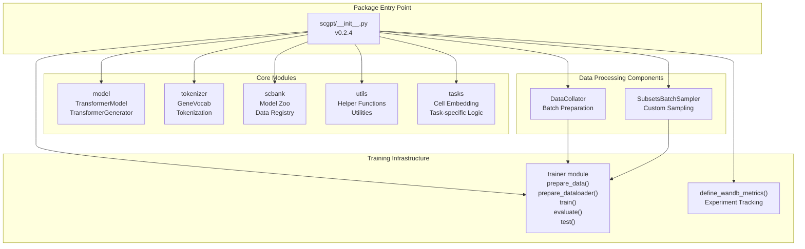
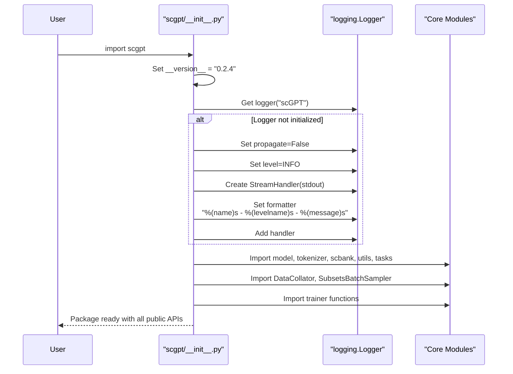
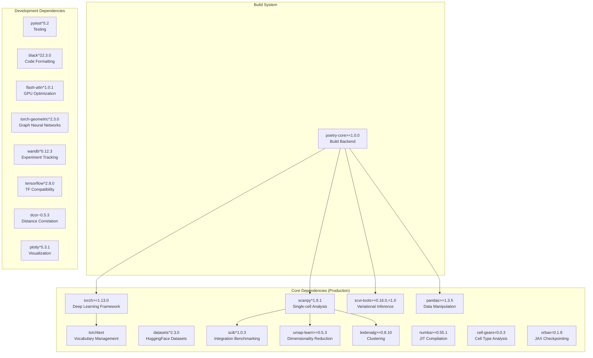
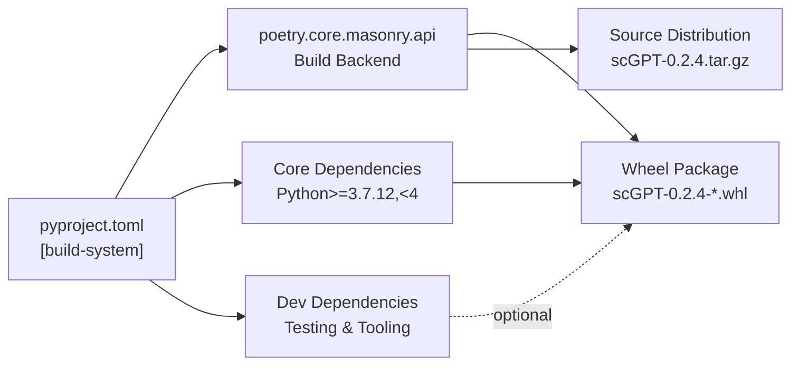
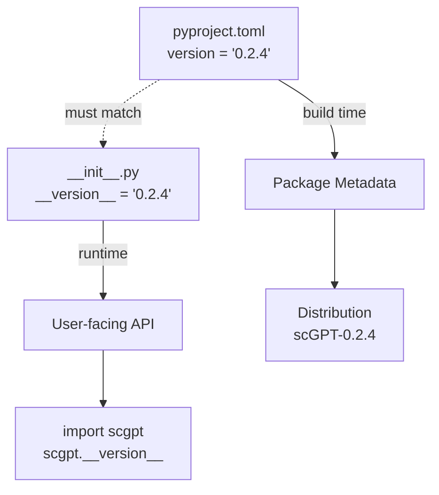

# Development Guide

<details>
<summary>Relevant source files</summary>

The following files were used as context for generating this wiki page:

- [pyproject.toml](pyproject.toml)
- [scgpt/__init__.py](scgpt/__init__.py)

</details>


## Purpose and Scope

This guide provides essential information for developers who want to contribute to the scGPT codebase or build extensions on top of it. It covers the project structure, dependency management, package initialization, and development workflows.

For detailed installation instructions for end users, see [Installation](#2.1). For information about the core architecture and how different components work together, see [Core Architecture](#3).

---

## Package Overview

scGPT is distributed as a Python package managed through Poetry and follows a modular architecture. The package exposes five main modules plus training utilities through its public interface.

### Package Metadata

The package is defined in [pyproject.toml:1-9]() with the following configuration:

| Property | Value |
|----------|-------|
| **Name** | `scGPT` |
| **Version** | `0.2.4` |
| **Description** | Large-scale generative pretrain of single cell using transformer |
| **License** | MIT |
| **Repository** | https://github.com/bowang-lab/scGPT |
| **Python Requirement** | `>=3.7.12,<4` |

The version is also defined in [scgpt/__init__.py:1]() to ensure consistency across the package.

**Sources:** [pyproject.toml:1-9](), [scgpt/__init__.py:1]()

---

## Package Module Structure



**Module Purpose Table**

| Module | Primary Components | Purpose |
|--------|-------------------|---------|
| `model` | `TransformerModel`, `TransformerGenerator` | Core transformer architectures |
| `tokenizer` | `GeneVocab` | Gene tokenization and vocabulary management |
| `scbank` | Model registry, data loaders | Pretrained model and dataset access |
| `utils` | Helper functions | Utility functions for data processing and model operations |
| `tasks` | `cell_emb`, task-specific logic | Task implementations (embedding, annotation, etc.) |
| `DataCollator` | Batch collation | Prepares batches with padding and masking |
| `SubsetsBatchSampler` | Custom sampler | Advanced batch sampling strategies |
| `trainer` | Training functions | Training loop, evaluation, and testing utilities |

**Sources:** [scgpt/__init__.py:18-29]()

---

## Package Initialization Flow

The package follows a structured initialization sequence that sets up logging and imports all public components.



### Logging Configuration

The package configures a custom logger named `"scGPT"` with the following characteristics:

- **Level:** `INFO`
- **Handler:** `StreamHandler` to `stdout`
- **Format:** `"%(name)s - %(levelname)s - %(message)s"`
- **Propagation:** Disabled (`propagate=False`) to prevent duplicate logs
- **Initialization Check:** Uses `hasHandlers()` to avoid re-initialization

This configuration is defined in [scgpt/__init__.py:5-16]().

**Sources:** [scgpt/__init__.py:1-29]()

---

## Dependency Management

scGPT uses **Poetry** for dependency management, which provides deterministic builds and clear separation between production and development dependencies.

### Dependency Architecture



### Core vs Development Dependencies

| Category | Purpose | Key Packages |
|----------|---------|--------------|
| **Core Dependencies** | Required for all scGPT functionality | `torch`, `scanpy`, `scvi-tools`, `torchtext` |
| **Data Processing** | Single-cell data manipulation | `pandas`, `numba`, `scikit-misc` |
| **Integration & Analysis** | Evaluation and benchmarking | `scib`, `umap-learn`, `leidenalg` |
| **Development Dependencies** | Testing, formatting, advanced features | `pytest`, `black`, `flash-attn`, `wandb` |

**Note:** Development dependencies like `flash-attn`, `wandb`, and `torch-geometric` are optional and only needed for specific use cases (GPU optimization, experiment tracking, GRN analysis).

**Sources:** [pyproject.toml:11-40]()

---

## Public API Surface

The package exposes a carefully curated public API through [scgpt/__init__.py:18-29](). This table maps user-facing functionality to internal modules:

| Import Pattern | Components | Source Module |
|----------------|------------|---------------|
| `from scgpt import model` | `TransformerModel`, `TransformerGenerator`, encoders, decoders | `scgpt.model` |
| `from scgpt import tokenizer` | `GeneVocab`, tokenization utilities | `scgpt.tokenizer` |
| `from scgpt import scbank` | Model zoo, data registry | `scgpt.scbank` |
| `from scgpt import utils` | Helper functions, utilities | `scgpt.utils` |
| `from scgpt import tasks` | `cell_emb`, task implementations | `scgpt.tasks` |
| `from scgpt import DataCollator` | Batch collation class | `scgpt.data_collator` |
| `from scgpt import SubsetsBatchSampler` | Custom batch sampler | `scgpt.data_sampler` |
| `from scgpt.trainer import train` | Training functions | `scgpt.trainer` |

**Sources:** [scgpt/__init__.py:18-29]()

---

## Build System Configuration

scGPT uses Poetry's PEP 517-compliant build system:



The build system configuration is defined in [pyproject.toml:38-40]():

```toml
[build-system]
requires = ["poetry-core>=1.0.0"]
build-backend = "poetry.core.masonry.api"
```

This configuration enables:
- **Standard build tools:** `pip install .` or `poetry build`
- **Editable installs:** `pip install -e .` for development
- **Deterministic builds:** `poetry.lock` ensures reproducible environments

**Sources:** [pyproject.toml:38-40]()

---

## Development Workflow

### Setting Up a Development Environment

1. **Clone the repository:**
   ```bash
   git clone https://github.com/bowang-lab/scGPT.git
   cd scGPT
   ```

2. **Install with development dependencies:**
   ```bash
   # Using poetry (recommended)
   poetry install
   
   # Using pip (alternative)
   pip install -e ".[dev]"
   ```

3. **Verify installation:**
   ```python
   import scgpt
   print(scgpt.__version__)  # Should print: 0.2.4
   ```

For comprehensive dependency and environment information, see [Dependencies and Environment](#10.2).

### Code Organization Principles

The scGPT codebase follows these organizational principles:

1. **Separation of Concerns:** Core model logic (`model/`), data processing (`tokenizer/`, collators), training (`trainer.py`), and applications (`tasks/`) are separate
2. **Public API Control:** Only explicitly imported components in `__init__.py` are part of the public API
3. **Version Consistency:** Version is defined in both `pyproject.toml` and `__init__.py`
4. **Logging Standards:** All modules use the centrally configured `scGPT` logger

For detailed project structure information, see [Project Structure](#10.1).

**Sources:** [scgpt/__init__.py:1-29](), [pyproject.toml:1-40]()

---

## Version Management

Version information is maintained in two locations for consistency:



**Version Update Checklist:**
- [ ] Update [pyproject.toml:3]()
- [ ] Update [scgpt/__init__.py:1]()
- [ ] Ensure both values match exactly
- [ ] Update changelog/release notes

**Sources:** [pyproject.toml:3](), [scgpt/__init__.py:1]()

---

## Contributing Guidelines

### Code Style and Testing

scGPT uses the following development tools:

- **Formatter:** `black` [pyproject.toml:30]() for consistent code style
- **Testing:** `pytest` [pyproject.toml:29]() for unit and integration tests
- **Type Hints:** `typing-extensions` [pyproject.toml:23]() for enhanced type annotations

### Module Extension Points

When adding new functionality, consider these extension points:

| Extension Point | Location | Purpose |
|----------------|----------|---------|
| **New Model Architectures** | `scgpt/model/` | Extend `TransformerModel` or create new architectures |
| **Custom Tokenizers** | `scgpt/tokenizer/` | Implement custom vocabulary or tokenization schemes |
| **Task Implementations** | `scgpt/tasks/` | Add new downstream task handlers |
| **Data Processing** | `scgpt/data_*.py` | Create custom collators or samplers |
| **Training Utilities** | `scgpt/trainer.py` | Extend training loop or add evaluation metrics |

### Documentation

For information about contributing to documentation, see [Documentation System](#10.3).

**Sources:** [pyproject.toml:28-36]()

---

## Related Pages

- **[Project Structure](#10.1):** Detailed repository organization and module layout
- **[Dependencies and Environment](#10.2):** Comprehensive dependency documentation and environment setup
- **[Documentation System](#10.3):** Documentation build system and contribution guidelines
- **[Core Architecture](#3):** Understanding the internal systems and how they work
- **[Installation](#2.1):** End-user installation instructions

---